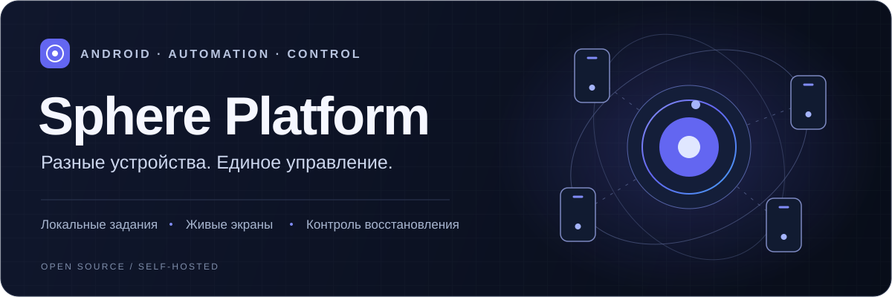
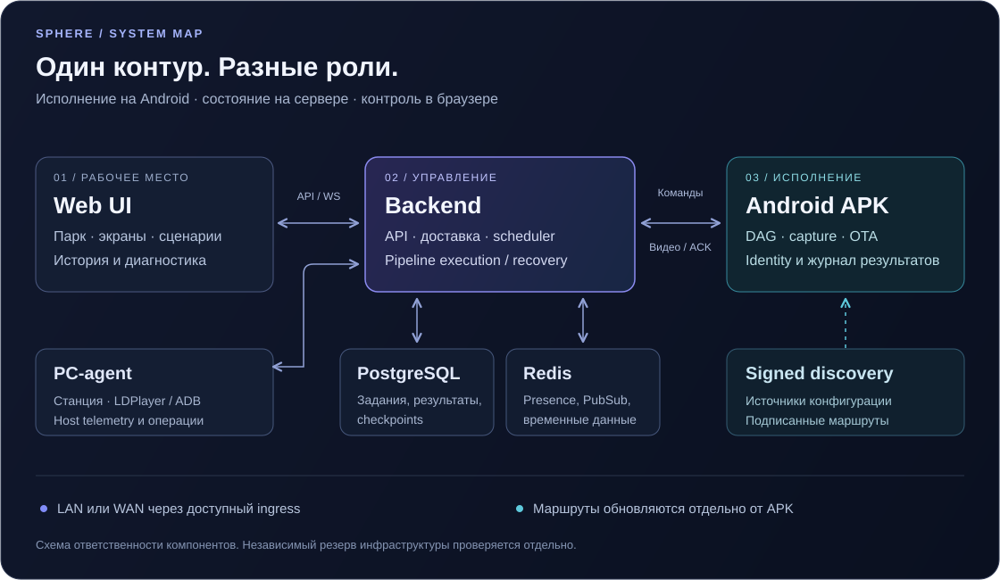
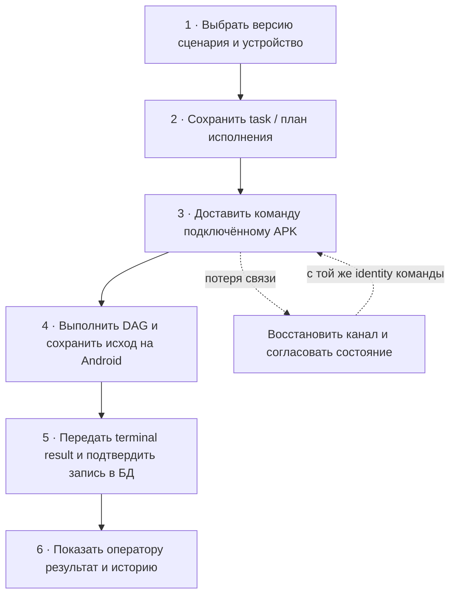

<div align="center">

**Проверенная установка:** UI `ed220169` / API `27f3a61f`.

**16 октября — общий ввод сценария и зрителей.** Веб ed220169 установлен на3015/Tuna; APK80 подтверждён package SHA/OTA на четырёх online устройствах,17 offline не обновлены. На PH011 прошли запуск с двумя клиентами, отмена, удерживаемое касание и третий зритель; direct media peers сохранены, ручной READY вернулся автоматически. 2546 frontend tests; по1231 Android test в dev/enterprise. Полная запись траекторий, rich evidence и общая production-приёмка открыты. API27 сохранён. [Поставка и границы](docs/audits/2026-10-16/AUTOMATION-INPUT80-DELIVERY.md).

**16 октября — запись, handoff и видеостена.** UI f7b6f6c1 установлен на3015/Tuna;2529 локальных frontend tests. На PH011 записаны прямой свайп/клик; после пропуска кривого жеста запись продолжается, задача Home завершена без смены media peer. Кнопки закреплены, пустые слоты/меню миниатюр убраны. Конфликт другого управляющего клиента (`device_input_busy`), первый ICE timeout PH025, полные траектории и лёгкие превью остаются открытыми. API27/APK79 сохранены. [Поставка и границы](docs/audits/2026-10-16/STUDIO-RECORDING-HANDOFF-DELIVERY.md).

**16 октября — восстановление без лишнего viewer reconnect.** UI3a036170 установлен на3015/Tuna; API27/APK79 сохранены. Потеря только idle ACK перед закрытием SCTP теперь допускает первый новый direct peer с собственным native READY; UNKNOWN очистки и неопределённые действия сохраняют строгую блокировку. 2523 локальных frontend tests; контролируемое восстановление на обоих адресах (1.734 с (3015), 2.401 с (Tuna)), два клиента Tuna подтвердили касания и навигацию. PH030 post-OTA delay остаётся отдельной открытой проверкой. [Поставка и границы](docs/audits/2026-10-16/IDLE-PEER-REJOIN-DELIVERY.md).

**Предыдущая поставка APK79 — обход нативного SIGABRT.** 4 completed OTA, 4 проверенных package SHA, 0 частичных package-проверок, 17 offline. Два клиента PH011 прошли direct касания/навигацию на3015/Tuna и пятиминутный Tuna soak; процесс APK сохранился, основной peer не пересоздавался. UI982/API27 сохранены. PH030 вернулся к READY в новом viewer-сеансе после задержки; быстрое автоматическое восстановление ещё не принято. Причина SDK clock regression и общая production-приёмка остаются открытыми. [Поставка и границы](docs/audits/2026-10-16/NATIVE-HEADROOM79-DELIVERY.md).

**Предыдущая поставка веба — согласован запуск управления.** UI `982b2240` установлен на 3015/Tuna; API27/APK78 сохранены. Startup ждёт до8с с keepalive500мс; после READY прежние250мс и строгие сроки команд. Полный локальный frontend CI:2511 tests, Linux image:26 страниц/72 assets, без hosted Actions и Docker archives. Два клиента прошли локально, поздний READY — на обоих адресах. Tuna two-client soak выявил native SIGABRT APK78; APK79 только собирается. Причина холодной задержки root, полный игровой исполнитель и общий production SLA остаются открытыми. [Поставка и границы](docs/audits/2026-10-16/INPUT-STARTUP-WEB-DELIVERY.md).

**Предыдущий срез APK78 — исправлена постоянная блокировка PH030.** APK `1.2.78-dev /10278` установлен на четырёх online устройствах; три package SHA проверены, PH030 — completed OTA/версия и native READY, хеш отдельно не прочитан. PH030: 140 с прямых video/control без новых восстановлений, около 56 FPS, RTT сети 1–10 мс. Два клиента PH011 подтвердили касания и системные кнопки. 17 offline не обновлены. Первоначальная задержка root READY и короткий browser startup timeout остаются в разборе. [Исправление, проверки и границы](docs/audits/2026-10-16/PH030-STARTUP78-RECOVERY.md).

**Предыдущая поставка 16 октября — headless transport.** API27f3a61f установлен на 3015/Tuna; четыре online устройства завершили OTA до APK77. Три installed SHA проверены, PH030 — completed OTA/версия с занятым чтением хеша; 17 offline не обновлены. Два браузерных клиента на каждом адресе и отдельный headless worker прошли конечные проверки. Модель не скачана и не запускалась. [Поставка и границы](docs/audits/2026-10-16/MOTOR-TRANSPORT-DELIVERY.md).

Ниже — датированные предыдущие этапы, не текущий состав установки.

**16 октября — каналы Studio и резервный ввод исправлены.** На 3015 и Tuna установлен UI `19c4272b`: временные режимы сохраняют согласованные каналы, фоновые ICE-попытки не блокируют admission резервного управления. Проверен настоящий native READY и DOWN/UP при задержанном ответе fallback. Локально и в точном frontend CI: 172 набора / 2508 тестов. Сетевые потери PH030, прежние heartbeat-сбои и искажение цвета остаются открытыми; API969/APK76 сохранены. [Результаты и ограничения](docs/audits/2026-10-16/MODE-TRANSPORT-AUTHORIZATION.md).

**15 октября — новый парк и оформление установлены на 3015 и Tuna.** AG Grid Community: resize/reorder/pinning, сохранение вида; телефон — карточки. Шесть палитр, независимые акцент/плотность/шрифт, auto/pin sidebar, optional glass и логотип. Локально 169 suites / 2455 tests; exact-source CI и конечные браузерные проверки прошли. API969/APK76 сохранены, APK77 не устанавливался; heartbeat на паузе. [Поставка и оставшиеся пункты](docs/audits/2026-10-15/UI-REFINEMENT-DELIVERY.md).



**Android-парк. Локальное исполнение. Контроль из браузера.**

Управляйте устройствами в разных сетях, собирайте сценарии в задания<br />
и отслеживайте весь путь — от отправки команды до сохранённого результата.

[](https://github.com/RootOne1337/sphere-platform/actions/workflows/ci-backend.yml) [](https://github.com/RootOne1337/sphere-platform/actions/workflows/ci-frontend.yml) [](https://github.com/RootOne1337/sphere-platform/actions/workflows/ci-android.yml) [](LICENSE)

**[🚀 Запуск](#start) · [📚 Документация](#docs) · [🧩 Архитектура](#architecture) · [🔬 Готовность](#status)**

[Возможности](#capabilities) · [Android и связь](#android) · [Задания](#automation) · [Веб и видео](#workspace) · [План работ](ROADMAP.md) · [Поддержка](SUPPORT.md)

</div>


**15 октября — новый визуальный аудит и проектирование.** Сняты 127 состояний и 2468 видимых кнопок/ссылок; учтены 29 шаблонов страниц и 47 DialogContent. Подтверждены ошибки акцента/плотности, контраста и мобильного toolbar; составлены 20 пунктов доработки, sidebar/theme/glass и контракт Android-файлового менеджера. Условные окна и роли имеют явные пробелы покрытия. Рабочий транспорт не менялся; новые функции не установлены. [Аудит и этапы](docs/audits/2026-10-15/UI-UX-VISUAL-AUDIT.md).

**15 октября — этап зафиксирован, доработка приостановлена по просьбе пользователя.** Удалённая PH025 прошла пользовательскую проверку: видео и управление напрямую, RTT около 20 мс; история подтверждает сеть 22 мс и ACK 25–26 мс. Рабочим остаётся APK 76, подготовка 77 не установлена. Heartbeat `enterprise` приостановлен. [Зафиксированное состояние и следующий этап](docs/audits/2026-10-15/STREAM-CONTROL-FREEZE.md).

**15 октября — установка APK 76 и проверка прямого управления.** Все 15 доступных эмуляторов завершили OTA: 14 подтвердили хеш установленного пакета, PH030 — команду и версию. Шесть выключенных устройств ожидают. На текущем вебе прошли два одновременных клиента, десять клиентов через Tuna, 40 системных нажатий, фактический ввод Unicode в fullscreen и три восстановления RTC. Отдельно проверено восстановление после перезапуска процесса APK. Сетевые отказы прежних прогонов сохранены; непрерывность без signaling и общий production-статус остаются открытыми. [Установка и границы](docs/audits/2026-10-15/DIRECT-KEYBOARD76-DELIVERY.md)

**Предыдущее наблюдение 15 октября — клавиатура76 и незакрытый совместный сеанс.** НаPH011 APK76 подтверждён по файлу и OTA;PH030 сообщает76 с completed OTA,13 доступных машин остаются72,шесть офлайн. Два локальных клиента и фактический Unicode/IME/fullscreen прошли проверку. Текущий прогон десяти клиентов черезTuna потерял готовые peer при открытии остальных; массовая OTA удержана. Исправление transient auth и диагностика signaling подготовлены,ещё не установлены. [Факты и границы](docs/audits/2026-10-14/KEYBOARD76-PARTIAL-DELIVERY.md).

**Предыдущее наблюдение 14 октября — прямые системные кнопки и восстановление ввода.** APK `1.2.72-dev /10272`, UI37543bb2 и APIbe0578d0 установлены; 15 доступных эмуляторов завершили OTA, 14 подтвердили установленный SHA, 1 — только команду и версию; шесть офлайн ожидают. На обоих адресах прошли два клиента с mouse/touch и кнопками; десять клиентов через Tuna подтвердили 40 системных нажатий и совместные жесты. Автовосстановление после трёх принудительных обрывов RTC проверено. Реальное скрытие вкладки, телефон/hotspot, 20+, полноценные клавиатура/IME, звук, автономность без сервера и полный перенос CI остаются открытыми. [Результаты и границы](docs/audits/2026-10-14/DIRECT-SYSTEM-INPUT72-DELIVERY.md).

**Предыдущее наблюдение 14 октября — совместный ввод и fullscreen.** UI `103d8532` / API `3538b650` установлены на 3015 и Tuna. APK `1.2.69-dev /10269`: завершённая OTA и версия подтверждены на 15 доступных эмуляторах; на 14 проверен установленный SHA, у PH030 чтение хеша удержано активным вводом. Шесть офлайн остаются без нового grant. Десять независимых клиентов прошли прямые жесты, takeover и закрытие одного без обрыва девяти; fullscreen и сенсорная геометрия 390×844 /844×390 проверены на обоих адресах с сохранением одного peer. Полноценная клавиатура/IME, прямые системные кнопки, 20+, реальный телефон/hotspot, автономность без сервера и полный перенос CI остаются открытыми. [Установка и границы](docs/audits/2026-10-14/SHARED-INPUT-FULLSCREEN-DELIVERY.md).

**Историческое наблюдение 13 октября — качество и доставка.** UI `a3e61800` / API `69da45cb` установлены на 3015 и Tuna. APK `1.2.68-dev` (10268) подтверждён установленным SHA и завершённой OTA-командой на 14 доступных эмуляторах; семь офлайн, включая PH030, не обновлены. PH010 в обычном Chrome на обоих адресах получил 54–59 FPS при цели 60 и все 13 native подтверждений жеста; после перехода на прямой поток резервное серверное видео не передавалось. Настройки качества применяются вживую; краткая строка показывает маршрут, RTT, размер, фактические FPS и битрейт. Добавлены счётчики вкладок и потоков; скачивание последнего APK проверено побайтово. Совместный ввод, автономный peer без сервера, прямые системные кнопки, реальный телефон, широкая WAN/TURN matrix и полный перенос CI остаются открытыми. [Установка, проверки и границы](docs/audits/2026-10-13/DIRECT-SOURCE-QUALITY-DELIVERY.md).

**Ранее 13 октября — подтверждён прямой маршрут с ноутбука.** UI `954d466c` установлен на 3015 и Tuna. PH025 передаёт видео и ввод напрямую по NAT/UDP: RTT сети 20–22 мс. На PH030 наблюдалось около 30 минут прямого видео и готового ввода без восстановления в счётчиках; следующий viewer учтён отдельно. Исправлен поздний отказ запуска, который мог блокировать ввод при живом видео; проверены реальные жесты и шесть повторных открытий. Диагностика причин завершения адаптирована для телефона. APK `1.2.65-dev` был установлен на момент этой проверки; точный установленный SHA подтверждён на всех 15 доступных эмуляторах, включая PH030; шесть офлайн не обновлялись. [Изменения, границы и результаты](docs/audits/2026-10-13/DIRECT-INPUT-RECOVERY.md) · [Протокол](docs/audits/2026-10-13/DIRECT-INPUT-RECOVERY-OBSERVATION.json).

**Предыдущее наблюдение 13 октября, 06:35 UTC — прямая связь и диагностика.** UI `73419abe` / API `b65b0b54` обслуживают 3015 и Tuna. APK `1.2.65-dev / 10265` подтверждён установленным SHA на 14 доступных эмуляторах. PH030 ранее завершил OTA65, но сейчас офлайн; актуальный SHA и стабильность ноутбучного ввода не приняты. PH010 подтвердил прямое видео и native жест на обоих адресах. Исправлены поздний диагностический echo и гонка повторного допуска до точного RELEASE. Причина завершения нативного ввода теперь сохраняется отдельно от результата cleanup. Общий ввод, Home/Back напрямую, независимость от серверного lease, WAN/TURN и длительная стабильность остаются открытыми. [Изменения и проверки](docs/audits/2026-10-13/DIRECT-SESSION-STABILITY.md) · [Протокол](docs/audits/2026-10-13/DIRECT-SESSION-STABILITY-OBSERVATION.json) · [Локальные тесты и границы переноса CI](docs/audits/2026-10-13/CI-COST-AND-LOCAL-RUNNER.md).

**Предыдущее наблюдение 12 октября, 22:04 UTC — отмена открытия управления.** UI `3d5c2a8f` / API `fc273fa3` обслуживают 3015 и Tuna. Исправлены отменённый OPEN, поздняя ошибка CLOSE, потеря позднего RELEASE и блокировка CLOSE собственной диагностикой; сервер подтверждает только положительно доказанную отмену до доставки в APK. PH010 прошёл конечные проверки прямого видео и нативного жеста на обоих адресах; это не приёмка пользовательского PH030. APK63 подтверждён по установленному SHA на PH010/PH030, массовый rollout удержан. Старый сеанс PH030 с прямым видео без ввода сохранён; новая проверка ноутбука, native authorization/cleanup, общий ввод, WAN и soak остаются открытыми. [Исправление и границы](docs/audits/2026-10-13/INPUT-OPEN-CANCELLATION.md) · [Протокол](docs/audits/2026-10-13/INPUT-OPEN-CANCELLATION-OBSERVATION.json) · [Путь и видеобуфер](docs/audits/2026-10-12/LOCAL-HOST-ROUTE.md) · [Общий ввод: проект](docs/audits/2026-10-12/SHARED-INPUT-CONTRACT.md).

**Предыдущее наблюдение 12 октября, 12:36 UTC — APK и вход.** UI/API `ed9d54d0` обслуживают 3015 и Tuna. В «Обновлениях» можно скачать последний APK выбранного канала с прогрессом и отменой; рядом официальный LDPlayer. Полный APK60 совпал по SHA-256 на обоих адресах (927/8489 мс в конечной проверке). Вход тёмный и адаптивный; сохранённая светлая тема рабочего пространства не сбрасывается. Свежий срез: 14 онлайн сообщают APK10260, семь офлайн; ранее installed SHA подтверждён на 15 устройствах. После установки PH010 подтвердил прямые видео и DOWN/MOVE/UP через оба адреса. 3762 backend tests / 361 subtests и 2260 frontend tests прошли. [Изменения и границы](docs/audits/2026-10-12/APK-DOWNLOAD-AND-LOGIN.md) · [Протокол](docs/audits/2026-10-12/APK-DOWNLOAD-AND-LOGIN-OBSERVATION.json).

**12 октября, 02:29 UTC — предыдущая конечная проверка транспорта.** UI `331bac0a` / API `98370d43` были установлены на 3015 и Tuna. Исправление ввода изменило только фронтенд; код бэкенда в этих ревизиях одинаков. На обоих адресах совпадают 29 JS/CSS, PostgreSQL и Redis готовы, история сеансов требует авторизации и отдаётся с private/no-store. APK `1.2.60-dev / 10260` подтверждён установленным SHA и завершённой OTA на 15 доступных устройствах. Шесть выключенных устройств не подтверждены; обычный канал Android не изменён.

На PH010 обычный Chrome 154 получил прямое видео и подтверждения Android для DOWN/MOVE/UP. На каждом адресе проверены по три обрыва RTC, фактическое резервное видео и автоматический возврат прямого ввода. При прямом просмотре серверная копия не дала новых байтов; отдельный серверный зритель продолжил получать кадры. Смена маршрута ввода больше не ждёт опустошения очереди idle heartbeat.

Полная задержка картинки, ближайший путь во всех сетях, обнаружение при удалённом VPS, физическая смена сети, совместный ввод, звук, клавиатура и 60 FPS остаются открытыми. [Протокол предыдущего испытания](docs/audits/2026-10-12/DIRECT-VIDEO-HANDOVER-OBSERVATION.json), [изменения и границы проверки](docs/audits/2026-10-12/DIRECT-VIDEO-HANDOVER.md). Удалённая PH025 пока получает серверное видео: Android answer пришёл, ICE-ответов нет; [сетевой отказ](docs/audits/2026-10-12/PH025-DIRECT-ROUTE-OBSERVATION.json).

**10 октября, 16:17UTC — автоматическое восстановление допуска управления установлено.** Занятая вкладка и временный отказ сервера повторно согласуются без повтора касаний. [Доставка и пределы проверки](docs/audits/2026-10-10/CONTROL-ADMISSION-RECOVERY-INSTALLED.md).

**Предыдущий этап:** конечный read-only тест PH030 на 10251 получил 223 кадра WebRTC. Этот исторический результат не является текущей версией APK, прямым вводом или доказательством loopback. Текущая установка описана выше.

PH030: пользователь подтвердил конечный прямой echo-канал с ноутбука, 20/20,
p95 25,8 мс NAT/UDP. Видео/управление пока через сервер; это не приёмка localhost.
[Результат и границы](docs/audits/2026-10-10/PH030-LAPTOP-CHANNEL-USER-OBSERVATION.md).

**Предыдущая UI коррекция 10 октября:** автоматическая готовность после reconnect
и навигации;1996frontend tests. Конечный PH011 scope не закрывает latency/direct/fleet.
[Актуальная установка и ограничения](docs/audits/2026-10-10/CONTINUOUS-AUTO-RECOVERY-INSTALLED.md).

**Предыдущая установка10октября — broadcast.** В том срезе на обоих адресах UI/API369;
все4 exact-source CI success:3428 backend tests/252subtests,1966 frontend tests.
Изолированный PostgreSQL/Redis test подтвердил202, commit и admission. На рабочем
стенде ожидаемый404 после чтения presence проверен без запуска массовых действий.
APK, schema/OTA и45соседних контейнеров сохранены при каждой установке.
Idle control и direct transport остаются открытыми; probe выключен.
[Установка, проверки и остаток](docs/audits/2026-10-10/BROADCAST-INSTALLED-ACCEPTANCE.md).
Последующий finite ICE canary:177requests/0responses,0RTT; original APK восстановлен,
probeoff. [Последняя проверка runtime и границы](docs/audits/2026-10-10/DIRECT-PROBE-NETWORK-CANARY.md).

**Действующий статус:** [реестр работ и требований](docs/operations/WORK-STATUS.md)
разделяет **9 принятых /41 открытую работу** и legacy7. Сохранённые сценарии,
версии сохранены; исходный Android APK восстановлен после конечного canary.
Публичный каталог и graph открываются;
unused CSS preload warning не воспроизведён, причина пока UNKNOWN.
Последовательное сравнение ACK:244мс на3015 против487мс через домен;
[границы вывода](docs/audits/2026-10-10/IDLE-LOCAL-PUBLIC-COMPARISON.md).
[Прямой browser↔APK](docs/design/BROWSER-DIRECT-TRANSPORT.md) ещё требует
native connectivity/media/control приёмки. [APK1.3 release gates](docs/design/APK-1.3-COMPATIBILITY-AND-RELEASE.md)
открыты; whole-PC writer также неизвестен. [Runtime](docs/operations/CURRENT-STATE.md) ·
[Документация](docs/DOCUMENTATION.md).

<details>
<summary>История установок до 7 октября; версии ниже не являются текущими</summary>

**6 октября — установлен рабочий Script Studio:** API `c2b91e32`, UI `952b5e2f` на
[3015/scripts/builder](http://127.0.0.1:3015/scripts/builder). Граф ↔ JSON, 32 действия,
bounded drafts/history, import/export, серверная проверка и адресный запуск версии.
Remote PH025 canary завершил 3/3 шага; 631 exact-image backend и 1353 frontend tests
прошли. Recorder/replay и capability schema ещё открыты; общий счёт **9 / 41**.
[Результат и доказательства](docs/audits/2026-10-06/SCRIPT-STUDIO-FOUNDATION.md) ·
[Инструкция](docs/operations/SCRIPT-STUDIO.md) · [Текущее состояние](docs/operations/CURRENT-STATE.md).

**Историческая установка 6 октября, 01:37 UTC+5 — ограничен приём загружаемых APK-журналов:**
Установленный API `76596c39`, UI `5405d465` на [3015/logs](http://127.0.0.1:3015/logs).
Body больше 512 KiB отвергается до полного buffering; total ASGI intake deadline 60 s.
Четыре uploads на worker включают приём и filesystem writer; весь FS lifecycle
в отдельном executor. 8 MiB fixture: declared oversize 0 receive, unknown length
9 вместо 128 chunks; Python traced peak около 8 MiB → 0,506 MiB для unknown case.
Это не общий RSS limit или установленная причина расхода Windows C:.
В packaged image прошли 537 device/status/WS/VPN cases, включая 35 новых upload,
и 35 resource cases: **572 passed**; mypy/scoped Ruff/OpenAPI check прошли.
Сохранены 14 original-byte prefixes / 3614902 bytes и 45 соседних контейнеров.
В 01:42 UTC+5 после переключения подтверждены новые uploads в пяти файлах;
живые declared/chunked oversize POST вернули 413, PH025 GET — 1000 строк.
В браузере проверены непустой журнал, поиск, refresh и границы данных.
Online 14 / offline 5 из 19 — конечный срез, не SLA; UI/APK/OTA/туннели сохранены.
Source CI пока не принят целиком; последующий docs head проверяется отдельно.
**9 принято / 41 открыто**, EP-033 OPEN: общие квоты, независимая очистка,
rotation/delete concurrency, backup/restore и leak/load gates остаются.
[Контракт и результат](docs/audits/2026-10-06/DEVICE-LOG-UPLOAD-BUDGET.md) · [Pinned evidence](docs/audits/2026-10-06/DEVICE-LOG-UPLOAD-EVIDENCE.json) · [Приоритеты](docs/audits/2026-10-06/ENTERPRISE-PRIORITIES.md).

**Историческая установка 6 октября, 00:55 UTC+5 — ограниченное чтение и постоянное хранение логов:**
API `9889c9ac`, UI `5405d465` на [3015/logs](http://127.0.0.1:3015/logs).
Предел чтения — 2 MiB, JSON-массива строк — 512 KiB; четыре операции на worker
без растущей очереди. Файловый I/O вынесен из event loop. На одинаковом архиве
24 MiB совпали последние 1000 строк; Python traced peak снизился с 46,04 до 0,447 MiB.
Это не замер RSS и не установленная причина расхода Windows-диска.
14 файлов / 902996 bytes перенесены в постоянный том; исходные байты проверены
после rollback и пересоздания контейнера. Сохранены 45 соседних контейнеров.
Проверки образов: 502 + 35 тестов reader, затем 26 тестов final storage image;
23 Compose-проверки, 1307 frontend-тестов / 121 suite, build/types и scoped lint прошли.
В живом браузере проверены ширины 1440/390 px, обе темы, поиск и обновление;
настоящий GET для PH025 вернул 483 строки. Срезы online 14→9 и 14→11 сохранены;
устранение reconnects и непрерывная стабильность ещё не подтверждены.
Полный CI не прошёл: GitHub не выделил runner для backend Tests и Security.
Android CI storage-source прошёл; CI последующего docs-коммита учитывается отдельно.
**9 принято / 41 открыто**, EP-033 OPEN: квоты, независимая очистка, upload budget,
backup/restore и проверки утечек/нагрузки ещё впереди.
[Результат и ограничения](docs/audits/2026-10-06/DEVICE-LOG-READ-BUDGET.md) · [Доказательства](docs/audits/2026-10-06/DEVICE-LOG-READ-EVIDENCE.json) · [Приоритеты](docs/audits/2026-10-06/ENTERPRISE-PRIORITIES.md).

**Исторический срез 6 октября, 00:00 UTC+5 — tenant-сводка EP-010 Stage B:**
API `7fef9c53`, веб `9ad0a69e` на [3015/monitoring](http://127.0.0.1:3015/monitoring).
Шесть отдельных источников: активный парк, связь, VPN-отчёт Android, назначения,
сохранённые handshakes и неподключённые проверки публичного транспорта.
Живое окно 19:00 UTC: 19 устройств, 14 online + 5 unknown; 14 VPN inactive + 5 unknown.
Первая установка выявила text/binary Redis mismatch; отдельный фикс и регрессия
подтвердили исправление. 476 + 35 exact-image tests, 1298 frontend tests, Node24
build/types, scoped Ruff и OpenAPI прошли. Сохранены 45 соседей; APK/OTA не менялись.
CI исходников API `7fef9c53`: backend 2754 passed / 30 skipped; frontend, Android
и остальные gates прошли. CI последующего docs-коммита проверяется отдельно.
**9 принято / 41 открыто**, EP-010 OPEN: независимый producer, транспортные probes
и нагрузочный прогон ещё не приняты. [Доказательства и ограничения](docs/audits/2026-10-05/ENTERPRISE-FLEET-COVERAGE.md) ·
[Pinned receipts](docs/audits/2026-10-05/ENTERPRISE-FLEET-COVERAGE-EVIDENCE.json).

**Историческая установка foundation — 5 октября, 21:11 UTC+5:** API `d656b579`,
UI `cb5b3f91` сохранён. VPN-отчёт Android имеет независимое серверное время и
владельца сеанса; атомарная запись защищена от запоздавшего старого подключения.
После 120 с отчёт не считается свежим. Живое окно16:20 UTC:14 свежих false и5
unknown при14 online/5 offline из19. Это не проверка VPN-трафика или SLA.
Exact image444+35 tests; source CI backend2722 passed/30 skipped, frontend и
Android прошли. Сохранены 45 соседей. **9 принято/41 открыто**, EP-010 ещё OPEN.
[Результат, ограничения и следующие критерии](docs/audits/2026-10-05/ENTERPRISE-ANDROID-VPN-OBSERVATION.md) · [Pinned evidence](docs/audits/2026-10-05/ENTERPRISE-ANDROID-VPN-OBSERVATION-EVIDENCE.json).

**Историческая установка Stage A — 5 октября, 20:31 UTC+5:** backend `66714f26`,
UI `cb5b3f91` сохранён. Список peers и pool counts теперь одинаково исключают
устаревший/future handshake, неназначенные и непривязанные peers; добавлено время
SQL-среза. Exact image: 99 VPN + 27 resource tests, mypy 231/Ruff прошли; сохранены
45 соседних контейнеров. Живой текущий VPN-каталог пуст: нули не доказывают работу
VPN на Android. Последующее окно 6×3 с: 14 online из 19, без утверждения SLA.
**9 принято / 41 открыто**: весь EP-010 ещё открыт.
[События, polling и оставшиеся источники](docs/audits/2026-10-05/ENTERPRISE-LIVE-COVERAGE-NEXT.md) · [Image/runtime evidence](docs/audits/2026-10-05/ENTERPRISE-LIVE-COVERAGE-EVIDENCE.json).

**5 октября, 19:55 UTC+5 — EP-009 принят на живом 3015:** API/UI **`cb5b3f91`**,
gateway config **`993d9eac`** сохранён. Реальная история CPU в использованных ядрах
и памяти в GiB cgroup контейнера: окна 1/6/24 h, сбор/обновление 15 с, среднее CPU за 1 минуту.
Лимит памяти 2 GiB подтверждён; CPU quota не подменяется нулём. Host/RSS сюда не
смешиваются. 1275 frontend tests/120 suites, production Node24 build/types и 27
tests в exact API image, mypy 231/Ruff, promtool и живые queries прошли. Браузер
1600/390 px, обе темы и автоматическое обновление проверены. При замене каждого
API/UI сохранены 45 соседей; Prometheus reload без replacement всех 46.
Сохранена временная потеря 14→12→13 online; последующее конечное окно 6×3с:
14 online /5 offline из19. Это не непрерывный SLA или устранение утечки.
**9 закрыто / 41 открыто из 50**; следующий EP-010, host leak attribution, Studio
и stream+script load/soak открыты.
[Приёмка и screenshots](docs/audits/2026-10-05/ENTERPRISE-CONTAINER-RESOURCE-HISTORY.md) ·
[Pinned evidence](docs/audits/2026-10-05/ENTERPRISE-CONTAINER-RESOURCE-EVIDENCE.json) · [Живой monitoring](http://127.0.0.1:3015/monitoring).

**Исторический срез: 5 октября, 19:03 UTC+5 — актуальный review:** UI `7c985feb`, API `51ccaa36`,
gateway `993d9eac`; [живой веб3015](http://127.0.0.1:3015/monitoring).
Реальные HTTP RPS/p95/ошибки и разбор маршрутов установлены, Grafana повторно
проверена. 1235 frontend tests,99 тематических,14 gateway tests/types/lint/build
прошли. **8 закрыто /42 открыто из50** продуктового аудита; это не общая готовность
платформы. [Приёмка, версии и screenshots](docs/audits/2026-10-05/ENTERPRISE-HTTP-METRICS.md).

**5 октября / завершённое наблюдение:** `02b5084` добавляет лёгкий8h recorder
C:/VSS/allocated VHD/RAM/commit/Docker без полного обхода и без удаления данных.
Запуск04:58→примерно12:58 UTC+5,241 срез, report budget16MiB; native первый sample
и elevated process проверены. Дополнительно cache795→768, guest+1,068GiB;
46 containers/67 volumes сохранены, VHD physical size не изменился.
**68 diagnostic tests passed**; recorder COMPLETE,241/241 срезов. C:−2,154GiB,
VHD allocated не вырос, exact VSS0; writer attribution и RAM leak acceptance OPEN.
[Методика, факты и открытые причины](docs/audits/2026-10-05/HOST-STORAGE-NIGHT-WATCH.md).

**Ресурсы, 5 октября / замеры UTC 4 октября:** удалён 51 проверенный старый образ
Sphere, освобождено **10,938 GiB внутри Docker**; все 46 контейнеров сохранены.
VHDX остаётся 218,61 GiB: физическое сжатие не выполнялось. Exact VSS counters и
ограниченная ETW-запись подтвердили рост shadow allocation; отдельно поймано
обновление AdGuard в браузере. Полная историческая атрибуция и RAM soak открыты.
[Числа, трасса и границы очистки](docs/audits/2026-10-05/DISK-WRITER-ATTRIBUTION.md).
Свежие два среза: free C:−2,033GiB /VSS allocation+1,969GiB; найдены две
теневые копии. [Подтверждённый рост и вариант retention](docs/audits/2026-10-05/VSS-RETENTION-REVIEW.md).
**После одобрения22:58 UTC:** квота VSS8GiB применена, Windows удалила обе
старые копии; свободное C: **+17,205GiB, около59GiB**. API/14 online и46 контейнеров сохранены.
APK **1.2.45-dev /10245 собран, подписан и адресно установлен на PH010/PH025**:
exact hash/receipts/heartbeat, native logs6→5 и≤2MiB подтверждены на local+remote.
12 online ещё10244; normal/android-dev10209 не менялся. **1680 passed /2 skipped**;
длительный retention/RAM soak открыт. [R09 и приёмка кандидата](docs/audits/2026-10-05/APK-LOG-RETENTION.md).

**Диск, 4 октября 2026 / 17:50 UTC:** рабочая папка Sphere — 8 GiB, отслеживаемые
файлы — 22 MiB; Docker VHD вне папки — 219 GiB и используется несколькими проектами.
Дополнительная очистка download caches npm/pip дала +4,73 GiB свободного места;
на C: осталось 41,43 GiB, 14 Android online, runtime не перезапускался.
[Полный доступный обход C: и границы очистки](docs/audits/2026-10-04/HOST-DISK-INVENTORY-AND-CLEANUP.md).

> [!IMPORTANT]
> **Историческая установка: API / UI c1a6e79**, [веб на 3015](http://127.0.0.1:3015/devices).
> **4 октября 2026, после перезагрузки ПК в 16:39 UTC.** Исправлен повторный
> запуск npm ci при изменении SHA; переиспользование зависимостей доказано двумя сборками.
> Адресно очищены 8,21 GiB старых кэшей Next, 19 контекстов и 53 неиспользуемых
> образа проекта. Новый API принял ротацию логов 20m × 5. Диск, физическая память
> и Windows commit измерены отдельно; VHD не сжимался, длительная утечка ОЗУ не доказана.
> **113 наборов / 1122 frontend-теста, 186 API-проверок, 18 проверок допуска сборки;
> mypy: 229 файлов; OpenAPI: 178 операций / 140 путей; все четыре CI прошли.**
> RPC trace сохраняет этап, прогресс и исход команды; ошибка Redis cleanup больше
> не заменяет полученный результат. Local PNG 200, remote 504 и отдельный recovery
> PNG 200 за 3,817 с сохранены вместе. Первое окно связи FAILED: 11→14 / смена epochs;
> второе сохранило 14 online и даты подключений. Это конечная проверка, не длительный SLA.
> APK 10244, Tuna и OTA сохранены; пять offline вне приёмки. **34 исправлено в коде /
> 7 незакрытых.** [Измерения и открытые критерии](docs/audits/2026-10-04/HOST-RESOURCE-PRESSURE-AND-RPC-DIAGNOSTICS.md).
> Визуальная приёмка: OPEN_URL_POLICY_BLOCKED.

> [!IMPORTANT]
> **Предыдущая установка: API / UI 9716348**, [review 3015](http://127.0.0.1:3015/devices).
> **4 октября 2026, 10:06 UTC+5:** исходный PNG доступен из обзора и под одиночным видео;
> Android/server/browser SHA-256, без ресайза/перекодирования. PH025/PH010 actual PNG
> 960×540 прошли полное декодирование. Сохранение H.264-кадра подписано отдельно.
> Добавлен manual Android profile; 7 native reads, проверенные bounded TS-парсеры.
> Wheel и key/text controls покрыты тестами; live keyboard/wheel result OPEN.
> **113 suites / 1117 frontend; 140 API cases; mypy229, schema178/140, CI4 passed.**
> Последние 7 срезов: 14 online10244, epochs после API restart сохранены; это не soak/SLA.
> Первый remote PNG504 и семь simultaneous code1005 disconnects сохранены; причина OPEN.
> APK/Tuna/OTA не менялись. 5 offline вне приёмки; **34 source-fixed / 7 незакрытых**.
> [Контракт, исходные файлы, тайминги и пределы](docs/audits/2026-10-04/DEVICE-CONTROL-AND-NATIVE-CAPTURE.md). Browser visual OPEN_URL_POLICY_BLOCKED.

> [!IMPORTANT]
> **Историческая установка этапа XPath: API 9274e50 / UI 84750e3**, [review 3015](http://127.0.0.1:3015/devices).
> **4 октября 2026, 05:55 UTC+5:** исправлен пользовательский отказ XPath:
> вход в режим сам читает дерево после текущего кадра, клик во время загрузки
> сохраняется. Подсветка, все возвращённые атрибуты, XPath/JSON и список узлов;
> автообновление через 5 с после ответа, только в видимом инспекторе, при ошибке — пауза.
> **5 воспроизведённых отказов → 8 интеграционных pointer cases; 110 наборов /
> 1043 frontend-теста; 108 API/XML/PostgreSQL/Redis проверок** прошли в образах.
> На API получены настоящие деревья: PH010 — 45, удалённый PH025 — 49 узлов,
> 960×540, cleanup подтверждён. APK 1.2.44-dev / 10244 в этом этапе не менялся.
> Используется root UI Automator; полный встроенный сервер UIAutomator2 не добавлен.
> После замены UI: 7 срезов сохранили 14 online и даты соединений; API/Tuna/OTA
> и 15 соседей сохранены. Прежний API gate **FAILED (14→13, PH015)** остаётся в evidence;
> последующее восстановление не доказывает непрерывную стабильность. Это не soak/SLA.
> **34 source-fixed / 7 незакрытых, включая 3 PARTIAL.** F35 visual и nonroot path,
> Matrix preview, качество/задержка, другие формы, durable outcomes и нагрузка OPEN.
> CI каждого source и пределы браузерной приёмки записаны отдельно.
> [Контракт и доказательства](docs/audits/2026-10-04/UI-HIERARCHY-INSPECTOR.md) · Browser: OPEN_URL_POLICY_BLOCKED.

> [!IMPORTANT]
> **Предыдущая установка: API 37bb436 / UI 922f479**, review [3015](http://127.0.0.1:3015/devices).
> Проверено **4 октября 2026, 02:04 UTC+5**. F39: группы и локации используют проверенные сервером
> права записи и удаления; открытые формы и Enter учитывают полученный отзыв доступа.
> **16 воспроизведённых отказов → 107 наборов / 1013 тестов** в собранном веб-образе;
> **89 PostgreSQL/Redis проверок** прошли также в неизменённом API-образе.
> CI исходников 922f479: Preview — success; Frontend — success; Android — success; Backend — success. Время отдельной проверки CI записано в evidence.
> После замены только UI семь срезов сохранили **14 online APK 10244**, heartbeat <60 с
> и прежние даты соединений. **15 соседних сервисов, API, Tuna и OTA сохранены.**
> Каталоги API: одна группа и ноль локаций; метаданные до/после совпадают.
> Живые записи/удаления, reboot и VPN команды не отправлялись; APK не обновлялся.
> Предыдущий N10 сохраняет неудачное первое окно и восстановление;
> причина его повторных SSL/Socket переподключений остаётся неизвестной.
> **33 source-fixed / 8 незакрытых, включая три PARTIAL.** Остальные формы, member
> lifecycle, JPEG Matrix, XPath, FPS/latency, browser/soak и OTA reconciliation открыты.
> [Контракт и evidence](docs/audits/2026-10-04/ORGANIZATION-ACTION-PERMISSIONS.md) · Browser: OPEN_URL_POLICY_BLOCKED.

> [!IMPORTANT]
> **Предыдущая проверка видео и backend: 3 октября 2026, 15:53 UTC.** API **37415e3** установлен;
> UI **77fca37** и APK **1.2.44-dev / 10244** сохранены. На удалённой PH025 и
> локальной PH010 получено по **599 H.264 кадров за 20   с: 29,95 кадра/с**.
> Это доставка до WebSocket-получателя; отрисовка браузера и задержка ввода ещё не приняты.
> **N09:** после потери кадра очередь отбрасывает зависимую цепочку и запрашивает
> новый ключевой кадр; срок хранения проверяется также при выдаче из очереди.
> **230 WebSocket-тестов + 41 тест PostgreSQL/Redis; 271 passed в собранном образе.**
> GitHub CI исходников прошёл. Семь срезов: **14 online на 10244**, heartbeat <60   с,
> новые даты подключения сохраняются. 15 соседних сервисов, Tuna и OTA сохранены.
> Два отката из-за формы/порядка mounts разобраны в отчёте; mounts эквивалентны.
> [Отчёт и доказательства](docs/audits/2026-10-03/STREAM-REFERENCE-RECOVERY.md). F36: качество, браузер, задержка и soak OPEN.
> Исходный аудит: **33 исправлено / 8 OPEN**; stable/normal OTA promotion OPEN.
> Визуальная проверка браузера: OPEN_URL_POLICY_BLOCKED.

> [!NOTE]
> **Предыдущая проверка APK: 3 октября 2026, 15:01 UTC (20:01 UTC+5).**
> **Все 14 доступных устройств работают с 1.2.44-dev / 10244**;
> пять офлайн-устройств остаются вне этой приёмки.
> Исправлен отказ `ota_signer_unavailable` в guard 10241. На удалённой PH028
> адресное OTA 43→44 подтверждено квитанцией, новым heartbeat и SHA установленного
> файла. Остальные 13 устройств получили разовую установку через root APK;
> данные и идентификаторы сохранены.
> 12 контрольных срезов сохранили весь cohort и серверные даты подключения;
> heartbeat моложе 60 секунд. Все 16 прежних контейнеров сохранены.
> APK source **ad34c12**: **831 passed / 1 skipped** на каждый Android flavor;
> его backend/frontend/Android CI прошли. UI **77fca37** / API **facba9a**:
> [3015/updates](http://127.0.0.1:3015/updates). Canary 44 опубликован в managed
> каталоге; normal android/dev остаётся 10209.
> Stable/normal promotion, verified manifest, measured FPS/input latency и soak
> остаются OPEN. **33 source-fixed / 8 OPEN**, F32/F33 PARTIAL.
> Browser visual: OPEN_URL_POLICY_BLOCKED.
> [Native/rollout report](docs/audits/2026-10-03/OTA-SIGNER-COMPATIBILITY.md) · [ABR proof](docs/audits/2026-10-03/STREAM-BITRATE-RECOVERY.md).

---

<a id="overview"></a>
</details>

## 🧭 Что такое Sphere

Sphere — self-hosted платформа управления Android-устройствами и эмуляторами.
Она объединяет **веб оператора, сервер заданий и Android APK**. Дополнительный
агент рабочей станции нужен только для отдельных legacy операций с эмуляторами;
Android-подключение и исполнение APK от него не зависят.
Сервер и устройства могут находиться в разных сетях: для подключения нужен доступный
маршрут к вашей установке, а не физическое присутствие рядом с каждым Android.

APK получает сценарий и выполняет его на устройстве. Backend хранит задания,
управляет очередями и оркестрацией; веб показывает состояние, экраны и результаты.
Работа платформы строится вокруг проверяемого исполнения: потеря соединения,
перезапуск и отмена задания должны оставлять понятный результат для оператора.

| Для кого | Основной сценарий |
| --- | --- |
| **Оператор парка** | Подключить устройства, распределить по группам, наблюдать экраны и запускать задания |
| **Автор автоматизации** | Подготовить версионируемый DAG, связать шаги в pipeline и проверить результаты |
| **Администратор установки** | Развернуть сервисы, следить за ресурсами, обновлять APK и разбирать сбои |
| **Разработчик интеграции** | Работать с HTTP API, событиями и контрактами исполнения; расширять платформу |

Предметные модули пока включают игровые аккаунты и специализированные сценарии.
Универсальные проекты и будущий AI-контур — отдельные этапы [roadmap](ROADMAP.md).

<a id="capabilities"></a>
## ✨ Возможности по компонентам

<table>
<tr>
<td width="50%" valign="top">
<h3>📱 Android-парк</h3>
<p>Регистрация устройств, собственная identity, группы и состояние связи. APK работает на самом Android; агент станции добавляет операции с эмуляторами.</p>
<p><a href="docs/android-agent.md">Android agent →</a> · <a href="docs/pc-agent.md">PC-agent →</a></p>
</td>
<td width="50%" valign="top">
<h3>⚙️ Исполнение сценариев</h3>
<p>Версии скриптов, локальные DAG, задания по устройствам, batches, расписания и серверные pipelines. Результат отслеживается отдельно от отправки команды.</p>
<p><a href="docs/security/task-control-protocol.md">Контракт исполнения →</a></p>
</td>
</tr>
<tr>
<td width="50%" valign="top">
<h3>🖥️ Экран и управление</h3>
<p>H.264-поток с Android в браузер, несколько просмотров, обработка перегрузки декодера и восстановление потока. Профиль для 32 экранов ещё дорабатывается.</p>
<p><a href="docs/audits/2026-09-20/DECODER-RECOVERY.md">Декодер и проверенные сценарии →</a></p>
</td>
<td width="50%" valign="top">
<h3>🔄 Восстановление связи</h3>
<p>Подписанный discovery, сохранённые адреса, reconnect и обновление device credentials. Возврат соединения согласуется с журналом результатов на APK.</p>
<p><a href="docs/architecture/ANDROID-CONNECTION-PROTOCOL.md">Протокол подключения →</a></p>
</td>
</tr>
<tr>
<td width="50%" valign="top">
<h3>📦 Обслуживание устройств</h3>
<p>Каталог обновлений APK, адресная OTA-доставка, boot/service recovery и root-возможности на подготовленных устройствах. Совместимость принимается для конкретного Android.</p>
<p><a href="docs/operations/CURRENT-STATE.md">Актуальная версия и статус OTA →</a><br />
<a href="docs/operations/LOCAL-PILOT.md">История локального pilot и порядок установки</a></p>
</td>
<td width="50%" valign="top">
<h3>🔎 Наблюдение и разбор сбоев</h3>
<p>Task/pipeline IDs, receipts, история, логи и runtime evidence. Runbooks связывают симптом с проверкой; подключение всех fleet-метрик остаётся в работе.</p>
<p><a href="SUPPORT.md">Что собрать при сбое →</a> · <a href="docs/runbooks/README.md">Runbooks →</a></p>
</td>
</tr>
</table>

VPN, webhooks/n8n и управление рабочими станциями входят в кодовую базу.
Их эксплуатационные ограничения перечислены [ниже](#status); наличие раздела
в интерфейсе само по себе не означает завершённую end-to-end приёмку.

<a id="architecture"></a>
<a id="-как-связаны-компоненты"></a>
## 🧩 Как устроена платформа



*Схема компонентов и их ответственности. Это не скриншот интерфейса и не схема развёрнутого HA-кластера.*

| Компонент | За что отвечает | Где смотреть |
| --- | --- | --- |
| **Web UI** | Рабочее место оператора: парк, экраны, сценарии, задания, настройки | [frontend/](frontend/) · [Web guide](docs/web-ui-guide.md) |
| **Backend** | API, identity, task delivery, scheduler, pipeline execution и recovery | [backend/](backend/) · [API-каталог](docs/api-endpoints.md) |
| **Android APK** | Подключение, локальное исполнение, журнал результатов, capture и OTA | [android/](android/) · [Android guide](docs/android-agent.md) |
| **PC-agent** | Операции рабочей станции, локальные LDPlayer/ADB-инструменты и telemetry | [pc-agent/](pc-agent/) · [PC-agent guide](docs/pc-agent.md) |
| **PostgreSQL** | Сохранённые задания, результаты, версии сценариев и состояние оркестрации | [alembic/](alembic/) · [RLS contract](docs/security/postgresql-rls.md) |
| **Redis** | Presence, PubSub и оперативное состояние; ограничения памяти и persistence | [Memory runbook](docs/operations/REDIS-MEMORY.md) |
| **Ingress / discovery** | Доступ к установке и распространение подписанных актуальных маршрутов | [Remote pilot](docs/operations/REMOTE-PILOT.md) · [Publisher](docs/operations/DISCOVERY-PUBLISHER.md) |

**Стек:** FastAPI · SQLAlchemy / Alembic · PostgreSQL · Redis · Next.js / React ·
TypeScript · Kotlin / Coroutines · MediaCodec / H.264 · Docker Compose.
VPN-модуль использует WireGuard-совместимые механизмы; рабочий provider и routing
проверяются отдельно. [Архитектурный справочник](docs/architecture.md) · [ADR](docs/adr/README.md).

<a id="android"></a>
## 📱 APK: подключение, автономность и обновления

### Найти установку и сохранить соединение

В signed discovery режиме APK знает **источники конфигурации, installation ID и
открытый ключ проверки**. Актуальный адрес управления приходит из подписанного
документа. Это позволяет менять маршрут без пересборки APK при сохранении доверия
к той же установке.

| Этап | Поведение |
| --- | --- |
| **Первое подключение** | Provisioning выбирает конфигурацию, получает адрес установки и выполняет регистрацию |
| **Подтверждение канала** | WebSocket должен получить корректный `auth_ok`; сам факт открытия сокета недостаточен |
| **Обрыв связи** | APK выполняет повторные попытки с backoff/jitter; события прежней попытки не оживляют устаревшее соединение |
| **Недоступен основной маршрут** | Используются сохранённые кандидаты той же установки; перебор не требует доступного GitHub |
| **Изменились адреса** | Подписанный manifest обновляет маршруты; источники конфигурации можно резервировать |
| **Истёк access token** | Device refresh имеет собственный recovery-контракт; устройство сохраняет identity |

Источники discovery и резервные адреса — разные уровни. Несколько URL одного
backend не защищают от потери его хоста или БД. Постоянный независимый WAN failover
ещё не принят; [фактическая топология pilot](docs/operations/REMOTE-PILOT.md) описана явно.

[Signed discovery](docs/architecture/ANDROID-SIGNED-DISCOVERY.md) ·
[Сохранённые маршруты](docs/architecture/ANDROID-SAVED-ROUTES.md) ·
[WS protocol](docs/architecture/ANDROID-CONNECTION-PROTOCOL.md) ·
[Device refresh](docs/security/device-refresh-recovery.md)

### Выполнять и обслуживаться на самом Android

- **Локальный DAG:** уже полученный сценарий исполняется APK; каждый шаг не требует
  отдельной команды с Windows. Потеря связи и рестарт процесса — разные сценарии recovery.
- **Сохранённые результаты:** журнал и receipts связывают команду с исходом;
  возврат сети не должен превращать повтор доставки в повтор побочного эффекта.
- **Boot и service recovery:** автозапуск и watchdog работают средствами Android;
  Windows-agent не является обязательным посредником management-соединения APK.
- **Root-возможности:** в подготовленных эмуляторах проверялись автоматические
  разрешения, capture и установка обновления без ручного ADB install.
- **OTA:** подписанный совместимым ключом APK доставляется через каталог/команду
  обновления. Приёмка включает установленную версию и восстановление процесса.

`minSdk 26` допускает установку с Android 8; это не обещание одинакового поведения
на всех прошивках. На обычном телефоне могут потребоваться системные согласия.
Конкурентная запись OTA-каталога и прерывание долгого `sleep` остаются в реестре.

[Boot recovery](docs/audits/2026-09-05/ANDROID-BOOT-RECOVERY.md) ·
[Root capabilities](docs/audits/2026-09-05/ANDROID-UNATTENDED-CAPABILITIES.md) ·
[OTA recovery](docs/audits/2026-09-05/ANDROID-OTA-RECOVERY.md) ·
[Последняя native приёмка](docs/audits/2026-09-20/CANARY-20260921.md)

<a id="automation"></a>
## ⚙️ От сценария до подтверждённого результата

Sphere разделяет **описание работы, конкретный запуск и полученное подтверждение**.
Это позволяет разбирать ситуацию «команда принята, но действие не завершилось»
без подмены фактического результата статусом отправки.

| Сущность | Назначение |
| --- | --- |
| **Script / version** | Сохранённое описание DAG с версией; изменения сценария отделены от уже созданного запуска |
| **Task** | Конкретное исполнение на устройстве с собственным ID, состоянием и результатом |
| **Batch** | План распределения по выбранным устройствам, волны и сохранённые identities задач |
| **Pipeline** | Серверная последовательность шагов и дочерних запусков, ожидания и checkpoints |
| **Schedule** | Запуск по расписанию с сохранением результата срабатывания |
| **Receipt** | Подтверждение приёма/результата; terminal receipt сообщает окончательный исход |



**Отмена — тоже операция с подтверждением.** Сохранённый stop intent не означает,
что устройство уже остановилось. До terminal result сохраняется барьер для следующей
работы. Неопределённые внешние эффекты требуют reconciliation; обещания универсального
«exactly once» для любого root-действия нет.

В изолированных regressions проверены потеря executor, восстановление batch/pipeline,
non-owner RLS и потерянные ответы commit. Native canary проверяет конкретные сценарии
двух APK. Compound loop/parallel и смешанная нагрузка 32 устройств ещё впереди.

[Task control](docs/security/task-control-protocol.md) ·
[Durable cancellation](docs/audits/2026-09-20/DURABLE-CANCELLATION.md) ·
[Pipeline recovery](docs/audits/2026-09-20/PIPELINE-RECOVERY.md) ·
[Batch recovery](docs/audits/2026-09-20/BATCH-RECOVERY.md) ·
[Scheduler](docs/audits/2026-09-20/SCHEDULER-RUNTIME.md)

<a id="workspace"></a>
## 🖥️ Рабочее место оператора

Веб объединяет повседневные операции и диагностику. Следующая карта показывает
существующие разделы; актуальная приёмка конкретного сценария — в [readiness](docs/operations/READINESS.md).

| Область | Разделы | Задача оператора |
| --- | --- | --- |
| **Парк** | Devices, Fleet, Groups, Locations | Найти устройство, посмотреть состояние, организовать парк |
| **Видео** | Device Stream | Открыть экраны, наблюдать свежие кадры и восстановление просмотра |
| **Исполнение** | Scripts, Tasks, Orchestration | Подготовить сценарий, запустить и проверить исход |
| **Автоматические запуски** | Orchestration → Schedules, Event Triggers | Настроить условия и проследить созданную работу |
| **Обслуживание** | Updates, Discovery, VPN | Управлять обновлениями и настройками подключения; учитывать ограничения provider |
| **Диагностика** | Events, Logs, Audit, Monitoring | Сопоставить событие, устройство и задание во времени |
| **Доступ и интеграции** | Users, Settings, Webhooks | Управлять правами и подключаемыми процессами |

### Живой экран: важна свежесть, а не просто картинка

Поток проходит через Android capture/encoder, сеть, backend и браузерный decoder.
Поэтому online-статус, открытый сокет и новый декодированный кадр измеряются отдельно.

| Уже проверялось | Следующая граница нагрузки |
| --- | --- |
| Два native потока и возврат после backend restart без F5 | 32 одновременных экрана и совокупный CPU/GPU/RAM/network профиль |
| Ограничение decode queue и восстановление после codec error | Задержки при перегруженном браузере и потерях сети |
| Несколько viewers и освобождение capture после закрытия последнего | Сквозной облегчённый профиль до encoder и корректная цепочка H.264 кадров |
| Раздельная фиксация online и новых кадров | Возраст кадра и задержка управляющей команды на насыщенном канале |

Для будущих AI consumers нужен такой же измеряемый путь наблюдения и действия.
Сами модели и inference в текущий этап не входят.
[Видео: evidence](docs/audits/2026-09-20/DECODER-RECOVERY.md) ·
[Multi-viewer](docs/audits/2026-09-05/STREAM-MULTI-VIEWER.md) ·
[Профиль Fleet32](docs/audits/2026-09-20/FLEET32-PREFLIGHT.md) ·
[Web guide](docs/web-ui-guide.md)

<a id="start"></a>
## 🚀 От checkout до первого устройства

### 1. Выберите правильный маршрут

| Ситуация | Действие |
| --- | --- |
| **Работаете с уже подготовленным pilot** | Откройте [Local pilot](docs/operations/LOCAL-PILOT.md): адрес веба, вход, APK и отдельный Compose project |
| **Новая установка** | Подготовьте отдельное окружение по [Startup](docs/operations/STARTUP.md#first-install) |
| **Устройства в другой сети** | Добавьте доступный HTTPS/WSS ingress и signed discovery по [Remote pilot](docs/operations/REMOTE-PILOT.md) |
| **Разрабатываете компонент** | Настройте инструменты по [Developer guide](docs/development.md) |

### 2. Получите согласованную ревизию

```sh
git clone https://github.com/RootOne1337/sphere-platform.git
cd sphere-platform
git switch codex/enterprise-audit-20260905
```

Исправления текущего аудита находятся в draft
[PR #19](https://github.com/RootOne1337/sphere-platform/pull/19).
Обычный clone без переключения открывает `main`. Документация, backend image,
миграции и APK должны соответствовать выбранному rollout.

### 3. Подготовьте установку

Для Windows нужны **PowerShell 7, Python 3.12, Git и Docker Compose v2**.
Для production overlay — Compose **2.24.4+**. Заполните конфигурацию, выберите
свободные порты и постоянный project name, затем выполните
[bootstrap](docs/operations/STARTUP.md#first-install).

Порядок launcher: **PG/Redis → миграции → admin/enrollment → backend/frontend →
readiness**. Существующий pilot использует собственные env/volumes и порт 18080;
общий recipe не является командой обновления этого стенда.

### 4. Войдите в веб и подключите APK

Используйте учётные данные администратора, созданные bootstrap. Публичная регистрация
не выдаёт super_admin. Для устройства нужна сборка под вашу установку: discovery
identity, доверенный ключ и параметры enrollment; APK из чужой установки не подходит.

**[Где взять текущую pilot APK →](docs/operations/LOCAL-PILOT.md#apk-именно-для-нового-стенда)** ·
[Самостоятельная сборка](docs/android-agent.md) · [Конфигурация](docs/configuration.md)

### 5. Проверьте работу до расширения парка

- Веб принимает учётные данные; устройство получает собственную identity и подключается.
- Безопасное тестовое задание завершается с сохранённым terminal receipt.
- Экран показывает **новые** кадры; после закрытия просмотра capture освобождается.
- После контролируемого обрыва устройство возвращается, исход задания не теряется.
- Версии, условия, время и результат записаны в приёмку.

[Пошаговая приёмка pilot](docs/operations/PILOT-ACCEPTANCE.md) ·
[Длительный безопасный прогон](docs/operations/ANDROID-OVERNIGHT-SOAK.md)

<a id="status"></a>
## 🔬 Состояние проекта и границы проверки

**Действующий срез10октября:** [реестр50работ и17дополнений из чата](docs/operations/WORK-STATUS.md)
и [runtime evidence](docs/operations/CURRENT-STATE.md). UI/API369654a0:
broadcast500 исправлен и установлен; server timings/browser snapshot сохранены.
Native direct echo пилот завершился без ICE connection/RTT; APK восстановлен, probe отключён.
[Доказательство](docs/audits/2026-10-09/DIRECT-PROBE-PILOT.md).
Все4 exact-source CI successful: frontend1966/142suites, backend3428/252subtests.
[Установка и границы](docs/audits/2026-10-10/BROADCAST-INSTALLED-ACCEPTANCE.md). Idle failure повторился;
queue/network/APK/native причина, resource/ownership и Fleet32 gates OPEN.
Product9/41 и legacy34/7 — разные scopes.

<details>
<summary>Исторический срез1октября2026</summary>

**Исторический срез: 1 октября 2026.** PR #19 открыт как draft. GitHub CI для
code source `2bed596` прошёл Backend/Frontend/Android; preview deployment был
пропущен. Актуальный SHA и текущие
проверки смотрите на [странице PR #19](https://github.com/RootOne1337/sphere-platform/pull/19).
Кандидат исходников задаёт APK
`1.2.38/10238`; адресные canary OTA на PH010 и PH025 завершились completed и
новой reported version 10238. Normal/global каналы и GitHub latest APK aliases
не заменены. Operator видит картинку, но продолжает сообщать slideshow.
Native 540p поднял wire rate PH010 с 3.4 до 5.65 pictures/s; отдельный штатный
Android screenrecord дал 5.991 FPS без Sphere video transport. Это локализует
узкое место Android capture/encoding path, не доказывает отсутствие сетевых
задержек на удалённых устройствах. Loopback UI `c547f5d` на 3015 → UI 3021 /
API 18080 переключён в **04:19:15 UTC+5**, backend `85c8014`, предыдущий Next 3020
сохранён. [Навигация Android](docs/operations/ANDROID-NAVIGATION.md) добавлена в
одиночный поток без новой APK: remote Back execution подтверждён отдельно,
frontend 567 tests/types/compile passed. Browser review blocked; native FPS,
browser draw, quality и input-to-visible latency acceptance остаются открытыми.
Последний опубликованный live snapshot в аудите показывает 14 свежих устройств
из 19 active catalog records; оператор выбрал эти 14 как baseline. Ни 23 ожидаемых
устройства, ни ступень 20–30, ни массовая OTA пока не приняты.

**Разделение фактов:** hash/package/pilot signer относятся к собранному artifact;
completed receipt и fresh heartbeat — к адресной установке. Независимый pull/hash
установленного APK, browser draw/legibility, длительный soak и приёмка 20–30
устройств этим canary не выполнены. Не переносите старые версии/статусы из исторических
аудитов на текущий runtime. Подробные даты, source/runtime distinction, диагностика
APK и acceptance plan: [актуальное состояние Sphere](docs/operations/CURRENT-STATE.md).

</details>

<details>
<summary>Архивная контрольная точка 25 сентября 2026</summary>

**Контрольная точка: 25 сентября 2026, 14:37:51 Asia/Yekaterinburg.** Pilot
containers и readiness проверены в это время; последний read-only API aggregate
датирован 14:30:39, локальные ADB-версии проверены в 14:37. Source fixes ещё не
развёрнуты на pilot. [Решение по удалённому видео и OTA](docs/audits/2026-09-24/REMOTE-VIDEO-OTA-DECISION.md) ·
[A/B ingress](docs/audits/2026-09-24/REMOTE-INGRESS-AB.md) ·
[Open и кадры](docs/audits/2026-09-25/ANDROID-STREAM-OBSERVABILITY.md) ·
[Enrollment 401](docs/audits/2026-09-25/CLONED-ENROLLMENT-401.md) ·
[OTA receipts](docs/audits/2026-09-25/OTA-TERMINAL-RECEIPTS.md) ·
[Presence до первого heartbeat](docs/audits/2026-09-25/DEVICE-PRESENCE-FIRST-HEARTBEAT.md).

| Поверхность / проверка | Версия / результат | Доказательство |
| --- | --- | --- |
| Backend / frontend pilot | Image `b491a66`, healthy; readiness `200` при контрольной проверке; source fixes ещё не развёрнуты | [Local pilot](docs/operations/LOCAL-PILOT.md) |
| Android, локальные устройства | `emulator-5554`: **1.2.20-dev / 10220** (ручная установка); `emulator-5556`: **1.2.19-dev / 10219** | [OTA и текущий gate](docs/architecture/ANDROID-OTA-RELIABILITY.md) |
| Android candidate | **1.2.21-dev / 10221**, SHA-256 `69A275B0…1DEB98F8`; собран и подписан, не установлен и не опубликован | [OTA receipts](docs/audits/2026-09-25/OTA-TERMINAL-RECEIPTS.md) |
| Clone/re-enrollment · read-only ADB check 04:26 | `emulator-5556` repeatedly receives HTTP 401 at registration; both local emulators have the same bootstrap credential fingerprint, which does not match isolated-pilot config. Exact server for the saved 401 is not proven | [AUD-172 evidence and limits](docs/audits/2026-09-25/CLONED-ENROLLMENT-401.md) |
| Backend OTA catalog · last read-only snapshot 04:11 | Latest `android/dev`: **1.2.9-dev / 10209**; latest `android-canary/dev`: **1.2.19-dev / 10219** | [OTA reliability](docs/architecture/ANDROID-OTA-RELIABILITY.md) |
| Task / pipeline · приёмка 21 сентября | 15 terminal task receipts; два pipeline runs | [Независимая сверка результатов](docs/audits/2026-09-20/CANARY-20260921.md) |
| Видео | В независимых viewer-сессиях локальный `PH000` передавал IDR/P, удалённый `PH008` — SPS/PPS без IDR/P. Android egress A/B не завершён; Cloudflare не доказан причиной | [AUD-164](docs/audits/2026-09-24/REMOTE-INGRESS-AB.md) · [AUD-170](docs/audits/2026-09-25/ANDROID-STREAM-OBSERVABILITY.md) |
| Redis | Source Compose: 512 MiB dataset / 2048 MiB ceiling; three isolated AOF probes pass (peak 1.49–2.00 GiB); 32-stream/live rollout open | [AUD-143 evidence and rollout boundary](docs/audits/2026-09-20/REDIS-PERSISTENCE-HEADROOM.md) |
| Сетевые отказы | Проверены отдельные отказы Android, серверного входа и обеих сторон | [Матрица и версии проверок](docs/audits/2026-09-05/NETWORK-RECOVERY-NATIVE.md) |
| Fleet / identities | **NO-GO:** 10 DB records; последний Redis aggregate: 5 `online`, 1 `offline`, 4 без status key; только 3 свежих heartbeat, 2 online без heartbeat timestamp; APK version code известен у одной записи. Это не подтверждает 20 удалённых устройств | [Readiness](docs/operations/READINESS.md) · [Clone identity](docs/audits/2026-09-20/CLONE-IDENTITY.md) |
| Presence UI | Source fix показывает `connecting` до первого heartbeat pong; pilot ещё не обновлён | [AUD-173: evidence и регрессии](docs/audits/2026-09-25/DEVICE-PRESENCE-FIRST-HEARTBEAT.md) |

</details>

### Ближайшие эксплуатационные задачи

| Порядок | Работа | Условие завершения |
| --- | --- | --- |
| **01 · Видео и команды** | Довести профиль до APK encoder, свежесть кадров и общий video/control budget | Профиль реально применён; управление и видео измерены под нагрузкой |
| **02 · Наблюдаемость** | Fleet/worker metrics, ресурсы, logging/backup и Redis recovery | Сбой можно связать с устройством, заданием и временным окном |
| **03 · Масштаб** | 4 → 8 → 16 → 32, затем смешанный fault/soak | Сверены receipts, новые кадры, crash buffers и ресурсы; прогон завершён |
| **04 · Смежные функции** | VPN, OTA catalog concurrency, PC-agent receipts, webhooks и независимый ingress | Принят конкретный end-to-end сценарий используемого режима |

**Приёмка 20–30 устройств ещё не выполнялась.** `running`, зелёный build,
успешный CI или видимый поток на одном устройстве не заменяют пройденную ступень
с коррелированными видео-, task-, crash- и ресурсными данными.

**[Полный реестр Fleet32 →](docs/audits/2026-09-20/FLEET32-PREFLIGHT.md)** ·
[Readiness](docs/operations/READINESS.md) · [Roadmap](ROADMAP.md) ·
[История аудита](docs/audits/2026-09-05/AUDIT-REPORT.md) · [Changelog](CHANGELOG.md)

<a id="docs"></a>
## 📚 Документация по задачам

<table>
<tr>
<td width="50%" valign="top">
<h3>🚀 Запустить и подключить</h3>
<p><a href="docs/operations/STARTUP.md">Startup и bootstrap</a><br />
<a href="docs/operations/LOCAL-PILOT.md">Веб, доступ и APK текущего pilot</a><br />
<a href="docs/operations/REMOTE-PILOT.md">Подключение из других сетей</a><br />
<a href="docs/configuration.md">Параметры конфигурации</a></p>
</td>
<td width="50%" valign="top">
<h3>🔎 Эксплуатировать и восстанавливать</h3>
<p><a href="docs/runbooks/README.md">Runbooks по отказам</a><br />
<a href="docs/operations/REDIS-MEMORY.md">Ресурсы и память Redis</a><br />
<a href="docs/operations/DISCOVERY-PUBLISHER.md">Публикация маршрутов</a><br />
<a href="SUPPORT.md">Диагностика и обращение о сбое</a></p>
</td>
</tr>
<tr>
<td width="50%" valign="top">
<h3>🧩 Разрабатывать и интегрировать</h3>
<p><a href="docs/development.md">Среда и команды проверок</a><br />
<a href="docs/api-endpoints.md">Генерируемый API-каталог</a> · <a href="docs/openapi.json">OpenAPI</a><br />
<a href="docs/security/postgresql-rls.md">PostgreSQL и tenant isolation</a><br />
<a href="docs/architecture/FLEET-OPERATIONS-AND-OBSERVABILITY.md">Fleet, стримы и единая диагностика: целевая архитектура и gates</a><br />
<a href="docs/architecture/AI-READINESS.md">Будущий AI-контур: анализ</a></p>
</td>
<td width="50%" valign="top">
<h3>🔬 Проверять и принимать</h3>
<p><a href="tests/production/README.md">Реальные PostgreSQL/Redis regressions</a><br />
<a href="tests/containers/README.md">Container probes</a><br />
<a href="docs/operations/ANDROID-OVERNIGHT-SOAK.md">Безопасный soak</a><br />
<a href="docs/audits/2026-09-20/FLEET32-PREFLIGHT.md">Fleet32: findings и gates</a></p>
</td>
</tr>
</table>

**[Открыть полный каталог документации →](docs/README.md)** ·
[Как поддерживается актуальность](docs/DOCUMENTATION.md)

<details>
<summary><strong>🗂️ Карта исходников</strong></summary>

| Каталог | Содержимое |
| --- | --- |
| [backend/](backend/) | HTTP/WS, модели, scheduler, task delivery и orchestration |
| [frontend/](frontend/) | Next.js UI, hooks, transport и video decoder |
| [android/](android/) | Kotlin APK, provisioning, DAG, journal, capture и OTA |
| [pc-agent/](pc-agent/) | Python agent рабочей станции |
| [alembic/](alembic/) | Миграции данных и runtime grants |
| [agent-config/](agent-config/) | Схемы и шаблоны конфигурации устройств |
| [infrastructure/](infrastructure/) | Proxy, monitoring и deployment resources |
| [scripts/](scripts/) | Bootstrap, инструменты эксплуатации и приёмки |
| [tests/](tests/) | Unit, integration, container и load проверки |
| [docs/](docs/) | Контракты, руководства, evidence и история аудита |

</details>

<a id="faq"></a>
## 💬 Частые вопросы

<details>
<summary><strong>Нужны ли Windows, LDPlayer или ADB для каждого подключения APK?</strong></summary>

Management-соединение, исполнение DAG и recovery находятся в APK.
PC-agent нужен для операций самой рабочей станции и её эмуляторов. Он не является
обязательным посредником между каждым Android и backend.
Root/boot/capture совместимость принимается на целевом устройстве отдельно.

</details>

<details>
<summary><strong>Можно ли сменить адрес сервера без переустановки парка?</strong></summary>

Signed discovery и сохранённые маршруты предназначены для этого. APK должен
изначально доверять источникам и ключу нужной установки; произвольный чужой сервер
не становится резервом. Проверены именованные сценарии смены маршрута, а постоянный
независимый WAN failover остаётся открытым.

</details>

<details>
<summary><strong>Обновление APK и разрешения полностью автоматические?</strong></summary>

На двух подготовленных rooted Android 9 последняя OTA прошла без ADB install,
ручной выдачи разрешений и запуска приложения. Это адресная runtime-проверка;
полный периодический цикл update worker и все прошивки этим не подтверждены.
Без root/управляемого режима Android может запросить системное согласие.

</details>

<details>
<summary><strong>Уже можно считать 32 экрана и VPN production-ready?</strong></summary>

Нет. Текущий приоритет — сквозной профиль стриминга, latency, наблюдаемость и
постепенная native приёмка до 32 устройств. VPN provider/routing/kill switch
требуют отдельного end-to-end прогона. Конкретные открытые работы — в Fleet32.

</details>

<details>
<summary><strong>Когда появится управление через нейросети?</strong></summary>

Сейчас выполняются аудит и стабилизация базового контура. Для будущего внешнего
AI-worker изучены observation/action interfaces, свежесть кадров и владение
управлением. Inference и модельные интеграции не реализованы и не входят в этот этап.

</details>

<a id="contribute"></a>
## 🤝 Участие и обратная связь

Хороший отчёт связывает **версию → время → устройство/задачу → симптом → evidence**.
Для этого есть отдельные формы; опубликованные пароли и полный raw log не нужны.

| Обращение | Канал |
| --- | --- |
| Дефект поведения | [🐛 Bug report](https://github.com/RootOne1337/sphere-platform/issues/new?template=bug_report.yml) |
| Краш, задержка или recovery | [⚡ Runtime / performance](https://github.com/RootOne1337/sphere-platform/issues/new?template=performance.yml) |
| Неверная инструкция | [📚 Documentation](https://github.com/RootOne1337/sphere-platform/issues/new?template=documentation.yml) |
| Новая возможность | [✨ Feature request](https://github.com/RootOne1337/sphere-platform/issues/new?template=feature_request.yml) |
| Настройка и использование | [💬 Question](https://github.com/RootOne1337/sphere-platform/issues/new?template=question.yml) |
| Уязвимость или раскрытие секрета | [🛡️ Приватное сообщение](SECURITY.md) |

Новые issue forms активируются в меню GitHub после merge в default branch.
До этого структура обращения доступна в [Support](SUPPORT.md).

Изменения проходят путь **воспроизведение → минимальный fix → regression →
документация → review → runtime acceptance**, когда изменение затрагивает работу
системы. [Contributing](CONTRIBUTING.md) · [Шаблон PR](.github/pull_request_template.md) ·
[Кодекс поведения](CODE_OF_CONDUCT.md) · [Правила репозитория](.github/REPOSITORY-GUIDE.md).

---

<div align="center">

**Sphere Platform**<br />
Собственная инфраструктура. Проверяемое исполнение. Понятное состояние.

[Документация](docs/README.md) · [Roadmap](ROADMAP.md) · [Changelog](CHANGELOG.md) · [MIT](LICENSE) · [@RootOne1337](https://github.com/RootOne1337)

</div>
