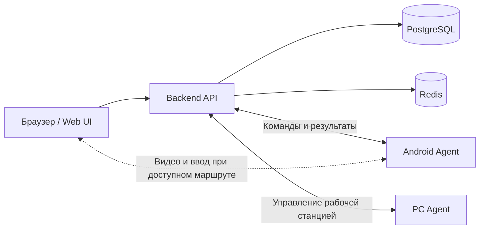

# Sphere Platform

**Единое рабочее пространство для управления Android-устройствами и эмуляторами:**
каталог парка, экран и ручное управление, сценарии, задания и наблюдаемость.
Репозиторий объединяет Web-интерфейс, backend, Android- и PC-агенты, контракты и
эксплуатационные инструкции.

[Начать работу](#начало-работы) · [Возможности](#для-чего-нужна-платформа) ·
[Архитектура](#архитектура) · [Документация](docs/README.md) ·
[API](docs/api-endpoints.md) · [Текущее состояние](#текущее-состояние)

---

## Текущее состояние

**Пакет исправлений от 14 ноября.** На отдельном стенде проверены свежесть
VPN и присутствия, группы и пакетные запуски, привязки приложений, расписания,
триггеры, доставка вебхуков и квоты журналов. На пилоте приняты курсор аудита и результат Android-агента. В реестре принято
14 из 50 пунктов. Ещё 28 выполнены частично.

[Реестр работ](docs/operations/WORK-STATUS.md) ·
[Приёмка вебхуков и хранения журналов](docs/audits/2026-11-14/WEBHOOK-AND-LOG-ACCEPTANCE.md) ·
[Поставка на пилот](docs/audits/2026-11-14/ENTERPRISE-PILOT-DELIVERY.md) ·
[Аудит и обновление парка](docs/audits/2026-11-14/AUDIT-CURSOR-AND-FLEET-ACCEPTANCE.md)

**Веб-аудит и план развития от 13–14 ноября 2026 года опубликованы.** В отчёте
29 страниц и 5 серверных обработчиков Next.js связаны с доказательствами и
сценариями приёмки. Приоритеты выпуска охватывают статусы парка, членство в
группах, пакетные запуски, результаты команд и наблюдаемость.

[Сводка веб-аудита](docs/audits/2026-11-13/README.md) ·
[Покрытие и границы проверки](docs/audits/2026-11-13/WEB-CLOSURE.md) ·
[План развития](docs/audits/2026-11-13/WEB-OPERATOR-PLAN.md) ·
[Журналирование](docs/audits/2026-11-13/LOGGING.md)

**Технический аудит от 11 ноября 2026 года завершён. Штатный профиль Enterprise Production не прошёл приёмку.**
В изолированных проверках подтверждены миграции, запуск API с отдельно настроенной
ролью PostgreSQL и восстановление тестовых данных. Блокеры касаются штатного
развёртывания, восстановления и исполнения команд. Приёмка подписанного APK на
устройствах и сетевой отказоустойчивости остаётся открытой.

[Итоговая оценка и приоритеты](docs/audits/2026-11-11/ASSESSMENT.md) ·
[Реестр находок и доказательства](docs/audits/2026-11-11/README.md) ·
[Протокол закрытия](docs/audits/2026-11-11/CLOSURE.md)

## Для чего нужна платформа

Sphere помогает оператору работать с устройствами как с управляемым парком:
найти нужную группу, открыть экран устройства, подготовить сценарий и проследить
его выполнение. Сервер хранит данные и управляет доставкой команд; агент на
Android выполняет допустимые операции и сообщает результаты.

| Возможность | Что можно делать | Подробнее |
| --- | --- | --- |
| **Парк устройств** | Просматривать устройства, группы, локации и доступное состояние. | [Каталог](docs/operations/DEVICE-CATALOG.md) · [группы](docs/operations/GROUP-HIERARCHY.md) |
| **Экран и управление** | Смотреть поток, открыть карточку устройства и использовать доступные элементы ввода. | [Устройства и потоки](docs/operations/DEVICE-STREAM-GUIDE.md) |
| **Сценарии и задания** | Создавать графы в Script Studio, сохранять версии, запускать задания и изучать результаты. | [Script Studio](docs/operations/SCRIPT-STUDIO.md) · [задания](docs/operations/TASKS-AND-ORCHESTRATION.md) |
| **Оркестрация** | Настраивать pipeline, расписания и связанные события. | [Задания и оркестрация](docs/operations/TASKS-AND-ORCHESTRATION.md) |
| **VPN и интеграции** | Управлять каталогом VPN-профилей и изучать доступные интеграционные контракты. | [VPN](docs/operations/VPN-WEB-GUIDE.md) · [n8n: доставка и повторы](docs/operations/N8N-INTEGRATION.md) |
| **Исследование маршрутов** | Записывать действия и работать с экспериментальными инструментами обучения и навигации. | [Teaching](docs/operations/TEACHING-WEB.md) · [Route Studio](docs/operations/ROUTE-STUDIO.md) |

Доступность действий зависит от роли, версии агента и состояния конкретной
установки. Принятие команды сервером, ответ агента и фактический результат на
устройстве — разные события; проверяйте их по соответствующему руководству.
Экспериментальные и проектные возможности имеют отдельные условия применения.

<a id="architecture"></a>
## Архитектура



Схема показывает основные связи, а не точную топологию развёрнутого стенда.
Например, наличие direct-транспорта в исходниках не подтверждает, что прямой
маршрут доступен или включён в конкретной сети. Подробности:
[архитектура](docs/architecture.md), [протокол подключения Android](docs/architecture/ANDROID-CONNECTION-PROTOCOL.md)
и [архитектурные решения](docs/adr/README.md).

## Начало работы

Для переустановки Windows или переноса на SSD используйте
[руководство по запуску и восстановлению](docs/operations/migration-2026-11-02/README.md).
Там описаны автоматическая пустая установка, закрытый экспорт данных и отдельный
импорт прежних баз, маршрутов и настроек. Код и private данные хранятся раздельно.

Выберите сценарий до запуска: **новый изолированный стенд**, **разработка** или
работа с уже существующей установкой. Их конфигурация, порты и данные могут
отличаться.

### Новый изолированный стенд на Windows

1. Подготовьте Git, работающий Docker Desktop с Linux containers и PowerShell
   5.1 или новее. Нужен Compose 2.24.4 или новее и минимум 20 GiB свободного
   места для сборки; Python и Node для сервера устанавливаются внутри образов.
2. Склонируйте репозиторий и выберите нужную ветку или revision:

   ```powershell
   git clone --branch codex/enterprise-audit-20260905 --single-branch https://github.com/RootOne1337/sphere-platform.git
   cd sphere-platform
   ```

3. Создайте новый изолированный стенд и первого администратора:

   ```powershell
   powershell -NoProfile -ExecutionPolicy Bypass -File scripts/migration/new-install.ps1 -Mode New -AdminEmail owner@example.com
   ```

   Замените email на свой. Launcher создаёт отдельные тома и случайные секреты,
   применяет миграции и проверяет API login. Пароль находится в приватном
   `admin.env`, путь выводится в конце. Повторный запуск `New` создаёт ещё один
   стенд; управление уже созданным и импорт старых данных описаны в
   [руководстве переноса](docs/operations/migration-2026-11-02/README.md).
4. Откройте `http://127.0.0.1:28080/login`. Затем отдельно
   подтвердите подключение нужного агента, конечный результат тестового задания и
   получение кадра. Health endpoint не заменяет эту проверку.

Проверка production-развёртывания дополнительно включает роли и права базы,
резервное копирование, сетевой доступ, TLS и фактическую установку агентов.
[Startup](docs/operations/STARTUP.md) · [Deployment](docs/deployment.md) ·
[Runbooks](docs/runbooks/README.md)

### Разработка и документация

Основные версии CI: Python 3.12 для backend и PC Agent, Node.js 24 для frontend,
JDK 17 и Android SDK для Android. Точные команды и настройка тестовой среды —
в [руководстве разработчика](docs/development.md); вклад и review — в
[CONTRIBUTING](CONTRIBUTING.md).

Ниже — автономные проверки документации из корня checkout; они не запускают
устройства или сервисы:

```bash
python -m scripts.check_documentation_status
python -m unittest discover -s tests -p 'test_documentation*.py'
```

Проверки контролируют инвентарь, часть ссылок и другие ограниченные контракты,
но не устанавливают достоверность каждого утверждения. Чтобы найти документы,
которые стоит пересмотреть после изменения кода, используйте
[процесс обновления](docs/operations/DOCUMENTATION-WORKFLOW.md).

## Структура репозитория

| Каталог | Содержимое |
| --- | --- |
| [`frontend/`](frontend/) | Next.js-приложение, компоненты и тесты интерфейса. |
| [`backend/`](backend/) | FastAPI, модели, сервисы, WebSocket и фоновые процессы. |
| [`android/`](android/) | Android-агент и его сборка. |
| [`pc-agent/`](pc-agent/) | Агент рабочей станции и интеграция с её инструментами. |
| [`motor_worker/`](motor_worker/) | Экспериментальные инструменты управления и исследования маршрутов. |
| [`infrastructure/`](infrastructure/) · [`alembic/`](alembic/) | Конфигурация развёртывания, наблюдаемость и миграции. |
| [`docs/`](docs/) · [`specs/`](specs/) | Руководства и контракты; проектные требования и исторические материалы. |
| [`tests/`](tests/) · [`scripts/`](scripts/) | Проверки, инструменты разработки и эксплуатации. |

## Документация и состояние

- [Аудит веба и план развития от 13–14 ноября](docs/audits/2026-11-13/README.md) — операторские цепочки, журналирование и план расширений.
- [Каталог документации](docs/README.md) — инструкции, API, архитектура и runbooks.
- [HTTP API](docs/api-endpoints.md) · [OpenAPI](docs/openapi.json) · [пояснения к API](docs/api-reference.md) — схема HTTP не охватывает все WebSocket-контракты.
- [Web-интерфейс](docs/web-ui-guide.md) · [Android Agent](docs/android-agent.md) · [PC Agent](docs/pc-agent.md) — сценарии и границы компонентов.
- [Аудит от 11 ноября](docs/audits/2026-11-11/README.md) — находки по компонентам, доказательства и статус приёмки.
- [Записанное состояние](docs/operations/CURRENT-STATE.md) · [открытые работы](docs/operations/WORK-STATUS.md) — датированные наблюдения и оставшиеся задачи; проверяйте их применимость к своей установке.
- [Правила документации](docs/DOCUMENTATION.md) · [инвентарь](docs/operations/DOCUMENT-INVENTORY.json) — назначение документов и область автоматических проверок.

Вопросы и предложения — [Support](SUPPORT.md); сообщения об уязвимостях —
[Security](SECURITY.md). Участие регулируется [Code of Conduct](CODE_OF_CONDUCT.md).
Код распространяется на условиях [MIT](LICENSE).
