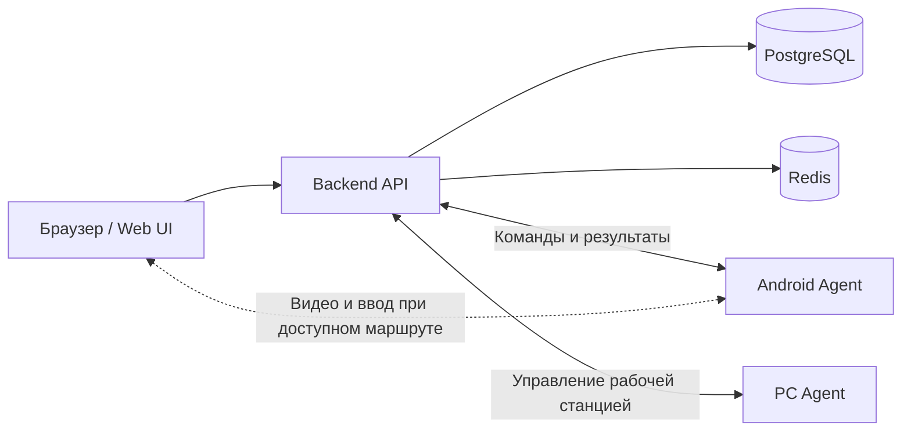

# Sphere Platform

**Единое рабочее пространство для управления Android-устройствами и эмуляторами:**
каталог парка, экран и ручное управление, сценарии, задания и наблюдаемость.
Репозиторий объединяет Web-интерфейс, backend, Android- и PC-агенты, контракты и
эксплуатационные инструкции.

[Начать работу](#начало-работы) · [Возможности](#возможности) ·
[Архитектура](#архитектура) · [Документация](docs/README.md) ·
[API](docs/api-endpoints.md) · [Состояние и ограничения](docs/operations/WORK-STATUS.md)

---

## Для чего нужна платформа

Sphere помогает оператору работать с устройствами как с управляемым парком:
найти нужную группу, открыть экран устройства, подготовить сценарий и проследить
его выполнение. Сервер хранит данные и управляет доставкой команд; агент на
Android выполняет допустимые операции и сообщает результаты.

| Возможность | Что можно делать | Подробнее |
| --- | --- | --- |
| **Парк устройств** | Просматривать устройства, группы, локации и доступное состояние. | [Каталог](docs/operations/DEVICE-CATALOG.md) · [группы](docs/operations/GROUP-HIERARCHY.md) |
| **Экран и управление** | Смотреть поток, открыть карточку устройства и использовать доступные элементы ввода. | [Устройства и потоки](docs/operations/DEVICE-STREAM-GUIDE.md) |
| **Сценарии и задания** | Создавать графы в Script Studio, сохранять версии, запускать задания и изучать результаты. | [Script Studio](docs/operations/SCRIPT-STUDIO.md) · [задания](docs/operations/TASKS-AND-ORCHESTRATION.md) |
| **Оркестрация** | Настраивать pipeline, расписания и связанные события. | [Задания и оркестрация](docs/operations/TASKS-AND-ORCHESTRATION.md) |
| **VPN и интеграции** | Управлять каталогом VPN-профилей и изучать доступные интеграционные контракты. | [VPN](docs/operations/VPN-WEB-GUIDE.md) · [n8n: ограничения](docs/operations/N8N-INTEGRATION.md) |
| **Исследование маршрутов** | Записывать действия и работать с экспериментальными инструментами обучения и навигации. | [Teaching](docs/operations/TEACHING-WEB.md) · [Route Studio](docs/operations/ROUTE-STUDIO.md) |

Доступность действий зависит от роли, версии агента и состояния конкретной
установки. Принятие команды сервером, ответ агента и фактический результат на
устройстве — разные события; проверяйте их по соответствующему руководству.
Экспериментальные и проектные возможности имеют отдельные условия применения.

<a id="architecture"></a>
## Архитектура



Схема показывает основные связи, а не точную топологию развёрнутого стенда.
Например, наличие direct-транспорта в исходниках не подтверждает, что прямой
маршрут доступен или включён в конкретной сети. Подробности:
[архитектура](docs/architecture.md), [протокол подключения Android](docs/architecture/ANDROID-CONNECTION-PROTOCOL.md)
и [архитектурные решения](docs/adr/README.md).

## Начало работы

Выберите сценарий до запуска: **новый изолированный стенд**, **разработка** или
работа с уже существующей установкой. Их конфигурация, порты и данные могут
отличаться.

### Новый изолированный стенд на Windows

1. Подготовьте Git, Python 3.12, PowerShell 7 и Docker Compose v2; для production
   overlay требуется Compose 2.24.4 или новее. Проверьте свободные порты и выберите
   отдельное имя Compose project.
2. Склонируйте репозиторий и выберите нужную ветку или revision:

   ```powershell
   git clone https://github.com/RootOne1337/sphere-platform.git
   cd sphere-platform
   ```

3. Прочитайте [первую установку](docs/operations/STARTUP.md#first-install) и
   [конфигурацию](docs/configuration.md). Для **нового** окружения инструкция
   описывает создание `.env.local`, настройку адресов и запуск bootstrap.
   Launcher создаёт и изменяет данные: поднимает сервисы, применяет миграции и
   настраивает начальные учётные данные. Для существующего стенда сначала определите
   его project, env, volumes и доступы; шаблон не является готовой конфигурацией.
4. После запуска проверьте вход в Web и `/api/v1/health/readyz`. Затем отдельно
   подтвердите подключение нужного агента, конечный результат тестового задания и
   получение кадра. Health endpoint не заменяет эту проверку.

Проверка production-развёртывания дополнительно включает роли и права базы,
резервное копирование, сетевой доступ, TLS и фактическую установку агентов.
[Startup](docs/operations/STARTUP.md) · [Deployment](docs/deployment.md) ·
[Runbooks](docs/runbooks/README.md)

### Разработка и документация

Основные версии CI: Python 3.12 для backend и PC Agent, Node.js 24 для frontend,
JDK 17 и Android SDK для Android. Точные команды и настройка тестовой среды —
в [руководстве разработчика](docs/development.md); вклад и review — в
[CONTRIBUTING](CONTRIBUTING.md).

Ниже — автономные проверки документации из корня checkout; они не запускают
устройства или сервисы:

```bash
python -m scripts.check_documentation_status
python -m unittest discover -s tests -p 'test_documentation*.py'
```

Проверки контролируют инвентарь, часть ссылок и другие ограниченные контракты,
но не устанавливают достоверность каждого утверждения. Чтобы найти документы,
которые стоит пересмотреть после изменения кода, используйте
[процесс обновления](docs/operations/DOCUMENTATION-WORKFLOW.md).

## Структура репозитория

| Каталог | Содержимое |
| --- | --- |
| [`frontend/`](frontend/) | Next.js-приложение, компоненты и тесты интерфейса. |
| [`backend/`](backend/) | FastAPI, модели, сервисы, WebSocket и фоновые процессы. |
| [`android/`](android/) | Android-агент и его сборка. |
| [`pc-agent/`](pc-agent/) | Агент рабочей станции и интеграция с её инструментами. |
| [`motor_worker/`](motor_worker/) | Экспериментальные инструменты управления и исследования маршрутов. |
| [`infrastructure/`](infrastructure/) · [`alembic/`](alembic/) | Конфигурация развёртывания, наблюдаемость и миграции. |
| [`docs/`](docs/) · [`specs/`](specs/) | Руководства и контракты; проектные требования и исторические материалы. |
| [`tests/`](tests/) · [`scripts/`](scripts/) | Проверки, инструменты разработки и эксплуатации. |

## Документация и состояние

- [Каталог документации](docs/README.md) — инструкции, API, архитектура и runbooks.
- [HTTP API](docs/api-endpoints.md) · [OpenAPI](docs/openapi.json) · [пояснения к API](docs/api-reference.md) — схема HTTP не охватывает все WebSocket-контракты.
- [Web-интерфейс](docs/web-ui-guide.md) · [Android Agent](docs/android-agent.md) · [PC Agent](docs/pc-agent.md) — сценарии и границы компонентов.
- [Записанное состояние](docs/operations/CURRENT-STATE.md) · [открытые работы](docs/operations/WORK-STATUS.md) — датированные наблюдения и оставшиеся задачи; проверяйте их применимость к своей установке.
- [Правила документации](docs/DOCUMENTATION.md) · [инвентарь](docs/operations/DOCUMENT-INVENTORY.json) — назначение документов и область автоматических проверок.

Вопросы и предложения — [Support](SUPPORT.md); сообщения об уязвимостях —
[Security](SECURITY.md). Участие регулируется [Code of Conduct](CODE_OF_CONDUCT.md).
Код распространяется на условиях [MIT](LICENSE).
