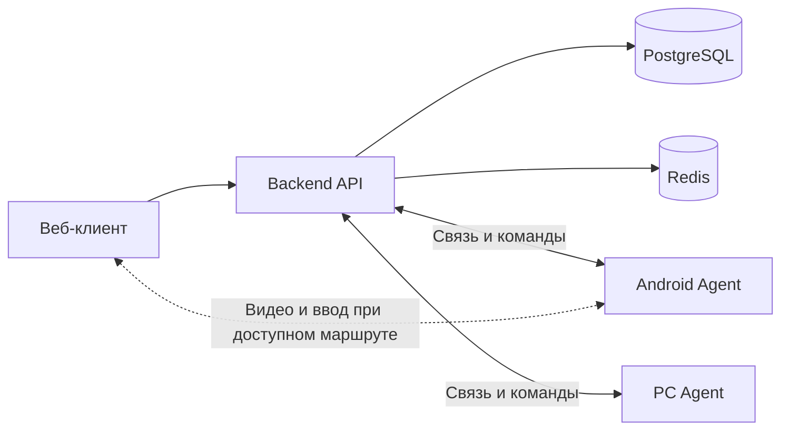

# Sphere Platform

Платформа для управления Android-устройствами и эмуляторами: веб-интерфейс,
сервер управления, Android-агент и инструменты для работы с парком устройств.
Репозиторий объединяет исходный код, контракты, эксплуатационные инструкции и
результаты отдельных проверок.

[Документация](docs/README.md) · [Начало работы](docs/operations/STARTUP.md#first-install) ·
[Разработка](docs/development.md) · [HTTP API](docs/api-endpoints.md) ·
[Ограничения и статус](docs/operations/WORK-STATUS.md)

## Что можно найти в проекте

| Область | Назначение | Где разобраться |
| --- | --- | --- |
| Парк устройств | Каталог, группы, локации и состояние устройств | [Каталог](docs/operations/DEVICE-CATALOG.md), [группы](docs/operations/GROUP-HIERARCHY.md) |
| Экран и управление | Просмотр экрана, маршруты видео и управление устройством | [Web-интерфейс](docs/web-ui-guide.md), [протокол ввода](docs/protocols/CONTINUOUS-INPUT-SERVER.md) |
| Сценарии и задачи | Редактор графов, версии сценариев и исполнение задач | [Script Studio](docs/operations/SCRIPT-STUDIO.md), [версии](docs/operations/SCRIPT-VERSIONS.md) |
| Сеть и агенты | Android-агент, PC-агент и управление VPN-профилями | [Android](docs/android-agent.md), [PC](docs/pc-agent.md), [VPN](docs/operations/VPN-PROFILES.md) |
| Запись и исследование маршрутов | Инструменты обучения, просмотра и экспериментальной навигации | [Teaching](docs/operations/TEACHING-WEB.md), [Route Studio](docs/operations/ROUTE-STUDIO.md), [Motor Worker](docs/operations/MOTOR-WORKER.md) |

Наличие кода или описания не означает приёмку всех функций, устройств или сетей.
В частности, исследовательские возможности навигации и записи имеют отдельные
условия допуска. Начните с [записанного состояния](docs/operations/CURRENT-STATE.md)
и [открытых работ](docs/operations/WORK-STATUS.md); проверяйте дату, область и
доказательства каждого результата перед эксплуатацией.

## Как устроена платформа

Это обзор основных компонентов, а не схема конкретной установленной среды.
Подробнее: [архитектура](docs/architecture.md), [протокол Android](docs/architecture/ANDROID-CONNECTION-PROTOCOL.md)
и [решения ADR](docs/adr/README.md).

## Начало работы

1. Для **нового изолированного окружения** прочитайте [Startup](docs/operations/STARTUP.md#first-install)
   и [конфигурацию](docs/configuration.md). Руководство описывает зависимости,
   bootstrap и проверку готовности.
2. Для существующего стенда используйте [Local pilot](docs/operations/LOCAL-PILOT.md):
   имена Compose-проектов, конфигурация, порты и volumes могут отличаться.
3. Перед подключением устройств и выполнением действий проверьте доступ, версию
   агента и условия сценария. Отдельно подтверждайте фактический результат на устройстве.

Для настройки разработки, тестов и сборок используйте [руководство разработчика](docs/development.md)
и [Contributing](CONTRIBUTING.md). Команды и инструкции следует выбирать для своей
среды; успешная сборка сама по себе не подтверждает готовность установленной системы.

## Документация и проверка

[Каталог документации](docs/README.md) помогает найти инструкции, API, архитектуру,
runbooks и историю проверок. [Правила актуальности](docs/DOCUMENTATION.md) описывают,
как различать действующие руководства, проектные материалы и датированные снимки.
[Машинный реестр](docs/operations/STATUS-REGISTRY.json) и
[инвентарь](docs/operations/DOCUMENT-INVENTORY.json) содержат записанные данные;
их проверки не заменяют сверку с исходным кодом или работающей установкой.

Вопросы — [Support](SUPPORT.md), сообщения об уязвимостях — [Security](SECURITY.md).
Участие регулируется [Code of Conduct](CODE_OF_CONDUCT.md), код распространяется
на условиях [MIT](LICENSE).
