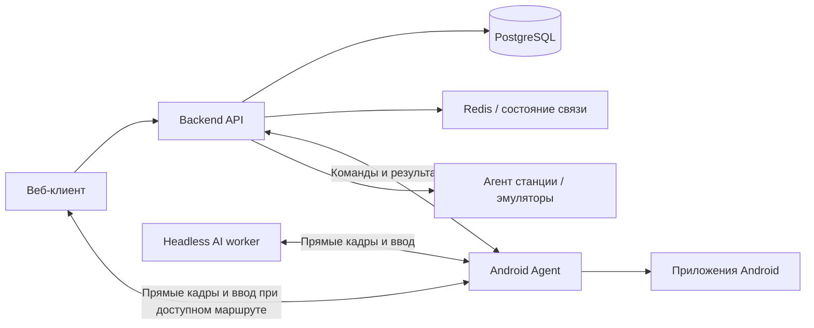

# Sphere Platform

**29 октября — усилена точность первой обработки.** Исправлены пересчёт
центров пикселей OpenCV/COLMAP и ложные отказы экранной сетки; потерянные
треки и разрывы исходника обрабатываются явно. Полная обработка `Kakaska228`:
174/174 камер, 14 622 точки, 4096 runtime-опор; проверка на исходнике —
225/233 подтверждены, чужая локация — 0/154. Живое A→B ещё не принято.
[Проверки, привязки и ограничения](docs/audits/2026-10-29/SCAN-POINT-ACCURACY.md).

**29 октября — восстановление всего видео по непрерывным трекам.** Route-only
обработка сопровождает реальные точки через все кадры и адаптивно выбирает
ракурсы. `Kakaska228` восстановлена до конца: 174/174 камер, 14 642 точки,
4096 runtime-ориентиров, без прежних обратных скачков. Исходник и старая
попытка сохранены. Подготовка карты завершена; узнавание на исходном видео
ещё даёт потери (210/233 подтверждены), живой A→B не принят.
[Причины, эксперименты и ограничения](docs/audits/2026-10-29/KAKASKA228-RECOVERY.md).

**29 октября — исправлен старт записи из эмулятора.** На 3015 установлен
`record-focus-20261029-v2`: режим «только видео» выбран по умолчанию, уход
фокуса во время проверки квоты не отменяет старт, чужой `pointercancel` не
завершает запись. Причина неполного результата показана отдельно; библиотека
допускает до 100 записей с прежней проверкой квоты. 955 stream-тестов и
локальная сборка прошли. Для новой попытки обновите страницу до старта.
[Причины, проверки и границы приёмки](docs/audits/2026-10-29/RECORDING-FOCUS-RECOVERY.md).

**29 октября — карта-компас и живая консоль маршрута.** На 3015 установлен
`route-compass-20261029-v1`: плавный поворот схемы вслед за взглядом камеры,
ручной поворот и сброс; в «Направлении» рядом показаны карта, исходный кадр
и живой результат. Новая запись по умолчанию запускает подготовку после
успешного сохранения; отчёты остановленных проверок сохраняются локально.
953 stream-теста, 99 Python-проверок, TypeScript и локальная сборка прошли.
Повтор A → B в игре остаётся отдельной непроведённой приёмкой.
[Поставка и точные ограничения](docs/audits/2026-10-29/ROUTE-COMPASS-LIVE-READINESS.md).

**29 октября — отбор последнего ракурса.** При подготовке PNG слишком близкий
к концу регулярный кадр заменяется точным последним. На `fuflo228` хвостовые
интервалы отбора стали 300/300 мс вместо 269/31 мс, исходные 915 кадров
1920×1080 сохранены. Это исправление выборки, качество новых поз ещё не измерено.
[Проверка на исходном видео](docs/audits/2026-10-29/ROUTE-TAIL-SAMPLING.md).

**29 октября — ориентация карты и глубина ориентиров.** На 3015 установлен
`map-frame-20261029-v1`: загрузчик сохраняет повороты камер, схема привязана
к первому ракурсу и не отражает право/лево из-за знаков PCA. Путь бирюзовый;
точки имеют режимы глубины, дистанции и RGB. Предупреждения о позах выделены
отдельно. 943 stream-теста и локальная сборка прошли.
[Проверка на настоящей записи](docs/audits/2026-10-29/ROUTE-MAP-FRAME-AND-DEPTH.md).

**29 октября — исправлена подготовка ориентиров по памяти.** На 3015 установлен
`route-resource-fix-20261029-v1`; обработчик 3342 восстановлен. CPU-экспорт
рассчитывает бюджет по размеру исходника (для `fuflo228` 6,25 ГиБ), вместо
общего требования 12 ГиБ. Неполная карта показывает фактические интервалы;
повторный экспорт пропущенных камер не запускается. Отдельная проверка
123 камер заняла 106 с при пиковом commit 857 МиБ. Полный повтор маршрута
в игре ещё не принят.
[Причины, измерения и поставка](docs/audits/2026-10-29/ROUTE-PREPARATION-RESOURCES.md).

**28 октября — пеший пилот в студии маршрутов.** На 3015 установлен
`walk-pilot-20261028-v2`: запись при управлении из эмулятора, подготовка карты,
интерактивный просмотр и отдельный ограниченный тест аналогового стика.
Исправлена несовместимость экстрактора между подготовкой и live-сервисом.
Реальное повторение пути в игре ещё предстоит проверить.
[Первый пеший тест](docs/operations/WALK-ROUTE-PILOT.md) ·
[Поставка и ограничения](docs/audits/2026-10-28/WALK-PILOT-READINESS.md).

**28 октября — студия маршрутов и интерактивные ориентиры.** На 3015 установлен
локальный веб `auto-geometry-20261028-v1`; схема связана с исходным H.264 по
манифесту и времени кадра. Дополнительная схема открывается автоматически при
выборе связанной записи, без ручной загрузки JSON. Для `fuflo228` к
локальному заданию прикреплена геометрия на 123 камеры / 22 014 точек;
исходная попытка на 54 камеры сохранена отдельно. Автономное прохождение
маршрута пока не подтверждено.
[Как пользоваться студией](docs/operations/ROUTE-STUDIO.md) ·
[Фактическое состояние](docs/audits/2026-10-28/ROUTE-END-TO-END-STATUS.md).

**Текущая локальная установка:** UI `route-temporal-20261029-v5` / API `1afdc529`.
Записи об установках ниже и выше описывают последовательные исторические срезы.

**27 октября — установлен UI35b60254:** выбор прохода перенесён также в режим
«Направление», ошибки подготовки отображаются понятнее. Локально прошли2737
frontend-тестов и HTTP-проверка пакета; браузерная приёмка открыта. Запись
test228 сохранена; экспериментальное объединение камер ещё не доказывает
надёжной навигации. [Диагностика](docs/audits/2026-10-27/TEST228-RECOVERY.md).

**27 октября — установлен UI219fc85b:** компактная студия маршрутов показывает
состояние локального обработчика и ограничения качества источника; добавлены
поиск записей и подтверждение удаления. Локальный CI:2732 теста. Устойчивые
30 FPS и независимый живой проход ещё не подтверждены. [Проверки](docs/audits/2026-10-26/ROUTE-TRACE-PROJECTION-PREVIEW.md).

**27 октября — установлен UI3022695b:** студия записи, сцены и ручной проверки
направления доступна на основной странице потока. Прямое видео PH011 и новый
интерфейс осмотрены; пользовательский повтор маршрута и реальная частота30 FPS
ещё не приняты. [Проверки, ограничения и моторные эксперименты](docs/audits/2026-10-26/ROUTE-TRACE-PROJECTION-PREVIEW.md).

**26 октября — установлен веб60c0dc7a:** физические клавиши можно назначить
зонам стика/транспорта на странице записи. Локальный CI2719 tests/types,
Linux package26 страниц/72 assets;45 других контейнеров сохранены.
Новая браузерная приёмка открыта; строка выше обозначает последний принятый
браузерный срез. [Поставка](docs/audits/2026-10-26/motor-overlay/web-delivery.json).

**26 октября — динамическая проверка3D-проекции:** отдельное локальное окно
с512 исходными кадрами, панорамированием/масштабом схемы и показом отказов
привязки. Более плотная169-view SfM-проба отклонена из-за скачка масштаба;
исходная сцена сохранена. Это диагностический просмотр записи, не live-автопилот.
[Проекция, графики и реальные границы](docs/audits/2026-10-26/ROUTE-TRACE-PROJECTION-PREVIEW.md).

Для той же карты добавлено opt-in сопровождение3D-опор: те же167/177 подтверждений,
медиана локализации111,70→8,20ms при p95=137,81ms. В отдельном read-only live-окне
можно выбрать этот метод; полный цикл200ms и автономный повтор пока не приняты.

**26 октября — проверка целеуказания моторным моделям.**360 offline-ответов
NitroGen/P2P не подтвердили устойчивое следование нарисованной линии. Модели
сохранены; условия нового теста, роль3D-ориентиров, динамики и ночного освещения
зафиксированы в [отчёте](docs/audits/2026-10-26/MOTOR-ROUTE-CONDITIONING.md).
Проверены четыре стиля подсказки; у NitroGen форма влияет на ответ, но навигация
ещё не принята.

**26 октября — PH011 обновлён до APK92/10292.** GPU→I420 захват проверен на настоящем игровом экране1920×1080:25,929 decoded FPS и4,996 RGB-наблюдения/с, packet loss0. Android отдельно подтвердил26,459 новых rendered frames/s; это не один повтор cache. Один контакт1200ms с коррекциями200ms дал7/7 native APPLIED и CLOSED; VPN/исключение Sphere сохранены. Это конечная транспортная проверка, не готовая навигация ИИ. Новая браузерная приёмка ещё открыта. [Квитанция и пределы](docs/audits/2026-10-26/PH011-APK92-GPU-PLANAR-CAPTURE.md).

Это последний срез с конечной браузерной приёмкой; более поздняя установленная
поставка описана ниже и пока не прошла эту часть проверки.

**Повтор маршрута с неточным стартом, 25 октября:** добавлен отдельный sparse-map
локализатор и offline-проверка проекции пути без воспроизведения клавиш. На Route012
после исключения132опорных кадров лишь7из157наблюдений дали подтверждённую привязку;
автономный повтор не допущен. [Результаты](docs/audits/2026-10-25/ROUTE-RELOCALIZATION-ADMISSION.md) ·
[Контракт локализации](docs/design/VISUAL-ROUTE-RELOCALIZATION.md).

**Историческая проверка 25 октября:** локальный обработчик 3342 восстановлен из
`f808b486`, отвечает с ожидаемым CORS и работает отдельным фоновым процессом.
Для Route012 выполнены два варианта готового Spirula Studio 2026.10.16 на RX 9070:
153 FullHD-ракурса, 142 зарегистрированы, две компоненты; обе полученные сетки
отклонены из-за пропусков и деформаций. Добавлен offline-анализ кадров/пауз;
новый формат видео не даст engine depth. [Прогон готового решения](docs/audits/2026-10-25/SPIRULA-TURNKEY-TRIAL.md) ·
[Захват Android и данные для навигации](docs/design/ANDROID-CAPTURE-AND-NAVIGATION-EVIDENCE.md).
Ранее исправлены скачки камер вперёд и пустой результат OpenMVS; прошли
80 профильных Python-тестов. [Предыдущие опыты DA3](docs/audits/2026-10-25/NEURAL-CAMERA-REFINEMENT.md).

**Поставка 25 октября — покрытие маршрута:** веб и локальный 3D-обработчик `49f8b12a`
были установлены на портах 3015/3342. В маршруте 012 сохранены шесть дополнительных
моделей участков: вместе они включают все 81 выбранный ракурс за 44,146 с. В вебе
видны интервалы, исходные кадры, дефекты моделей и предупреждение о траектории камер.
Это диагностические фрагменты; цельная навигационная карта ещё не принята.
Прошли 115 Python-тестов и 2702 теста фронтенда; 45 других контейнеров сохранены.
[Проверить участки](docs/operations/TEACHING-SURFACE-MODEL.md) ·
[Повтор восьмиминутного маршрута: реальные границы](docs/design/LONG-ROUTE-TEACH-REPEAT.md) ·
[Доставка и опыты](docs/audits/2026-10-25/ROUTE-COVERAGE-AND-LONG-REPEAT-LOCAL-DELIVERY.json).

**Установлено25 октября — поверхности:** веб и локальный обработчик3D `43a2164f`,
API `1afdc529`. В «Маршрут012» доступен сохранённый **фрагмент21–38/81камер**:
99076треугольников,18текстурFullHD,14.3MB GLB; в Web добавлены текстуры,
поверхности/нормали/каркас, камеры прохода, fullscreen и скачиваниеGLB.
Полный81-кадровый mesh-кандидат отклонён из-за ложных перемычек и сохранён отдельно.
101Python-тест,194frontend-suite/2697tests и проверка производственного пакета
прошли;45других контейнеров и исходная Gaussian-сцена сохранены. Метрическая
точность/навигация не приняты. Конечная визуальная проверка страницы остановлена
физическимEscape пользователя; browser acceptance остаётся открытой.
[Открыть и проверить модель](docs/operations/TEACHING-SURFACE-MODEL.md) ·
[Квитанция](docs/audits/2026-10-25/ROUTE-SURFACE-FRAGMENT-LOCAL-DELIVERY.json).

**Предыдущая поставка25 октября:** веб `91c30eca`, API `1afdc529`, локальный обработчик3D `714817c5`;
Android/VPN в этой итерации не менялись. Для «Маршрут012» сохранены458исходных
FullHD-кадров и восстановлены **все81выбранный ракурс**:432262гауссианы,
30000итераций. Добавлены ограниченное связывание дальних кадров и профиль
высокой детализации. На одинаковых9контрольных ракурсах PSNR вырос26.51→29.06dB,
SSIM0.826→0.881; сравнения нативного рендера проверены.87Python-тестов/94subtests
и193frontend-suite/2693tests прошли;45других контейнеров сохранены.
Метрическая карта, коллизии, автономная навигация и конечная визуальная приёмка
страницы в профиле пользователя остаются открытыми. [Рабочий процесс и пределы](docs/operations/TEACHING-DENSE-RECONSTRUCTION.md)
· [Квитанция подробной сцены](docs/audits/2026-10-25/DENSE-RECONSTRUCTION-FULL-DETAIL-LOCAL-DELIVERY.json).

**Предыдущий проверенный срез24 октября:** PH011 по последней проверенной доставке APK90/10290, веб `56605338`, API `1afdc529`. Транспортная раскладка проверена на Android fixture:803/803кадра, газ1805мс и руль1784мс с одним DOWN/UP. Ранее проверены190,215с игровой записи6026/6026кадров с параллельным относительным3D. Папочный browser export, master1080p, общая карта и автономный повтор ещё не приняты. [Доказательства](docs/audits/2026-10-24/WEB-TEACHING-VEHICLE-FOLLOWUP.json).

Управление Android-парком: устройства, прямой экран и ввод, сценарии, оркестрация,
VPN и диагностика в одном рабочем месте. Android APK исполняет операции на
устройстве; веб служит клиентом, backend хранит состояния и координирует работу.

Текущая работа ведётся в [PR #19](https://github.com/RootOne1337/sphere-platform/pull/19),
ветка `codex/enterprise-audit-20260905`. Исходники, успешно собранный артефакт,
установленная версия и принятая функция — разные состояния.

[Начать установку](docs/operations/STARTUP.md#first-install) ·
[Локальный pilot](docs/operations/LOCAL-PILOT.md) ·
[Работы и ограничения](docs/operations/WORK-STATUS.md) ·
[HTTP API](docs/api-endpoints.md)

**Предыдущий этап24 октября — APK89 и запись маршрута.** APK1.2.89/10289 установлена только на PH011, хеш пакета проверен. Реальная browser-запись:1205/1205кадров,21,144с,56,94FPS; WASD удержан1206мс одним DOWN/UP, камера и кнопка независимы, CLOSED подтверждён. Это Android debug fixture, не игровой маршрут. Исправлены управление до записи и лимит2/5/10минут; подготовлен локальный DA3/Rerun3D preview. Единая карта, importer и автономный A→B ещё не приняты. [Инструкция](docs/operations/TEACHING-WEB.md) · [Квитанция](docs/audits/2026-10-24/WEB-TEACHING-DELIVERY.json).

**Предыдущий этап24 октября — worker0.8.1: подготовка keyboard teaching.** Read-only `.smp/.kmp`
inspector нашёл26 bindings в referenced profile; macros не исполняются.303 motor
tests/Ruff passed. На том этапе actor single-pointer: полный WASD+camera+jump ещё не
готов. Уточнены1080p/320DPI,100% teach render и отдельная3D reconstruction/viewer.
[Настройки, управление и границы визуализации](docs/audits/2026-10-24/LDPLAYER-KEYMAP-READINESS081.md) ·
[План3.6](docs/design/MOTOR-AI-PLATFORM.md#268-клавиатурный-teach-run-dpi-и-честная-визуализация).

**Предыдущий этап24 октября — worker0.8.0: запись обучающего прохода.** Добавлены исходный H.264,
журнал собственного ручного ввода, временная локальная панель и проверяемые пакеты
последовательных ориентиров.295 motor tests/Ruff прошли; на PH011 все137 frames
финального5-секундного read-only теста декодированы. На PH011 также подтверждены
14/14 APPLIED двух жестов, один с удержанием3с; game screen отключён за AFK.
Качественную запись можно готовить; реальный1080p60, low-render repeat и объезд не приняты.
[Что реализовано и как проверить](docs/audits/2026-10-24/MOTOR-TEACHING080.md) ·
[План3.5](docs/design/MOTOR-AI-PLATFORM.md#267-реализация080-и-допуск-обучающей-записи).

**Предыдущий срез23 октября — worker0.7.5: общий RGB и память ориентиров.** Один сохранённый вид
без RGB занял107KB и распознался50/50 раз в новом capture epoch. Совместно работала
P2P150M:74 ответа за~15с, без Android input.263 motor tests/Ruff прошли.
Один ранний observer имел gap1,02с; A→B, объезд и полный latency SLA ещё открыты.
Перед физическим прогоном после AFK нужен новый вход и восстановление маршрута.
[Метод, измерения и ограничения](docs/audits/2026-10-23/MOTOR-ROUTE-VIEWS075.md) ·
[План3.4](docs/design/MOTOR-AI-PLATFORM.md#265-первый-компонент075-и-короткий-практический-путь) ·
[Методы навигации, миникарта и качество записи](docs/audits/2026-10-23/NAVIGATION-METHODS-CAPTURE-RESEARCH.md).

**Предыдущий срез23 октября — worker0.7.4: perception отдельно от навигации.** YOLOE-26s FP32 на
прямом PH011:125/75 свежих observations за25/15с, минимум5 в полной секунде;
receiver age p95 около104/115мс. FP16 этого pipeline отклонён, качество препятствий
ещё не принято; Android input0.241 motor tests/Ruff прошли.
[Измерения и ограничения](docs/audits/2026-10-23/MOTOR-PERCEPTION074.md) ·
[План3.2: общая навигация и память маршрутов](docs/design/MOTOR-AI-PLATFORM.md#26-опциональная-память-маршрутов-вместо-магической-стрелки).

**23 октября, поздний срез — память возвращена, P2P действительно работает на5Гц.**
После однократного reclaim чистого кеша WSL Windows commit снизился80,00→65,82GiB
без перезапуска контейнеров. P2P150M на игровом потоке:124 ответа за~25с, минимум5
в каждом полном секундном окне. Ввод выключен, автономная навигация не принята.
Qwen0.8B/2B не прошли координатное grounding и obstacle qualification;231 motor tests
прошли. [Результаты и ограничения](docs/audits/2026-10-23/MOTOR-MEMORY-RECOVERY073.md).

**23 октября — PH011: APK88, отдельный AWG2 и проверка ходьбы.** Установленный SHA
подтверждён; kernel rules исключают Sphere UID. После операторского обхода ограды
конечный GPS/CV-контроллер прошёл590→582м на5,125Гц с непрерывным стиком.
221 motor tests прошли. Прибытие и автоматический обход ещё не приняты; текущие
нейросетевые опыты в том раннем срезе остановлены ресурсным guard до inference.
[Результаты и границы](docs/audits/2026-10-23/PH011-APK88-MOTOR-CALIBRATION.md) ·
[Обновлённый план motor AI3.2](docs/design/MOTOR-AI-PLATFORM.md).

## Возможности и текущая проверка

| Область | Что есть | Что проверять перед расширением |
| --- | --- | --- |
| Устройства | Каталог, группы, локации, identity, состояние соединения, задания | Свежесть данных и доступность конкретного агента |
| Экран и ввод | WebRTC, server fallback, диагностика маршрута, совместный ввод | Реальные кадры/ACK, смена сети и длительная нагрузка; сам ICE не доказывает управление |
| Script Studio | Визуальный граф, версии, запись траекторий, запуск и отмена | Точность таймингов, смена владельца ввода и условия конкретного устройства |
| Оркестрация | Задания, batches, расписания и pipelines | Подтверждённый terminal outcome отдельно от отправки команды |
| VPN | Зашифрованный каталог, пакет до 100 `.conf`, версии, архив, Android runtime и оценка скорости | Встроенный provider и выборочный kill switch ещё проходят приёмку |
| Моторный ИИ | Headless worker, прямые кадры/ввод, локальные модельные эксперименты | Универсальная навигация и игра без вмешательства пока не приняты |

Точные версии APK и результаты по устройствам находятся в
[машинном реестре](docs/operations/STATUS-REGISTRY.json). Последняя подтверждённая
адресная установка — APK88 на PH030 и PH011 с независимой проверкой SHA. PH010/PH025
остаются на APK85; 17 offline не обновлены.
Полного production SLA для всех сетей и сценариев пока нет.

## Что обновлено

**23 октября — APK88 собран локально и установлен на PH030.**
После настоящей перезагрузки VPN восстановился автоматически: проверены новый
kernel boot ID, действующие маршруты, HTTPS и VPN-IP. После загрузки прошли
прямое PC-видео, 5 RGB-наблюдений/с и непрерывный жест с подтверждённым освобождением.
Новых GitHub jobs нет. VPN пока зависит от временного PC-шлюза до 24 октября
00:08 UTC+5; телефонный браузер, ранний boot kill switch и прямой Android WAN
остаются отдельной приёмкой.
[Установка, перезагрузка и точные границы](docs/audits/2026-10-23/PH030-APK88-LOCAL-AUTOSTART.md).

Ниже — предыдущие датированные этапы; их конечные состояния могли измениться.

**PH030: VPN-интернет работает через ограниченный LAN-шлюз.** AWG2,
все приложения кроме Sphere: HTTPS/DNS, отдельный внешний IP, блокировка при
паузе и потере шлюза проверены. 15-минутное наблюдение сети прошло. Пользователь
зашёл в игру; отдельная проверка стрима выявила ICE без ответов и блокировку
ввода `root_handoff_unknown`. APK87 с исправлениями подготовлен к облачной
проверке, ещё не установлен. Прямой WAN, независимость от ПК и общая VPN-приёмка
остаются открытыми. [Результаты и ограничения](docs/audits/2026-10-23/PH030-AWG2-LAN-GATEWAY-CANARY.md).

**APK85 собран в GitHub и установлен на четырёх online устройствах.** Полный
Android CI и настроенная облачная сборка успешны; payload проверен после локальной
переподписи прежним сертификатом. Версия и установленный SHA подтверждены на
PH010/PH011/PH025/PH030. Память пользователя не освобождалась, эмуляторы не перезапускались.
[Поставка, CI и экраны](docs/audits/2026-10-22/VPN-APK85-CLOUD-AND-ADDRESSED-DELIVERY.md).

**Исправление VPN-телеметрии установлено.** Основной WebSocket-цикл теперь
принимает отчёты Android. Полный backend CI прошёл 4428 тестов; совпадение RPC/API
и диагностика desktop/mobile проверены на установленном сайте.
[Доставка и экраны](docs/audits/2026-10-22/VPN-STATUS-ROUTING-LIVE-DELIVERY.md).

**Живой VPN-тест выявил дефект APK84.** Дополнительная packet mark мешала TCP/DNS
тестового приложения на PH011; без неё трафик проходил. Управление Sphere
сохранялось. Guard plan 4 в APK85 устраняет дополнительную mark. Локальный AWG1
опыт прошёл 17 HTTP-ответов, pause/resume, аварийную изоляцию и cleanup; повторные
TCP/DNS через внешний WG всё ещё нестабильны. Общая приёмка VPN остаётся открытой.
[Новый конечный опыт](docs/audits/2026-10-22/VPN-APK85-MAIN-CANARY.md) ·
[Первоначальный дефект](docs/audits/2026-10-22/VPN-APK84-MAIN-CANARY.md).

**Предыдущая поставка 22 октября — VPN workspace и каталог.** Четыре вкладки,
диагностика устройства, импорт, версии и архив проверены на desktop/mobile.
Для каталога применена добавочная миграция, настроены независимое шифрование и
ограниченный DB-login с RLS. Физические VPN этим обновлением не менялись.
[Поставка и реальные скриншоты](docs/audits/2026-10-22/VPN-CATALOG-LIVE-DELIVERY.md).

**Массовый импорт до 100 профилей установлен и проверен.** Предварительная
проверка каждого файла, атомарное сохранение и восстановление по прежним ID
при потере ответа. Поддерживаются `.conf` WG/AWG; прокси/ZIP/распределение по
устройствам — отдельные этапы. Backend CI: 4422 passed; frontend: 2630.
Вживую проверены ошибка файла №37, строка 100, rollback и потеря ответа без
повторной записи. [Поставка и скриншоты](docs/audits/2026-10-22/VPN-BATCH-LIVE-DELIVERY.md),
[контракт](docs/operations/VPN-PROFILES.md).

**Расширение VPN-платформы.** Проработаны метрики UID, пулы, аренды выходов,
proxy adapters и единый исполнитель для UI/скриптов/pipelines с учётом наших
смежных VPN-репозиториев. [План и источники](docs/design/VPN-FLEET-CONTROL.md).

## Как устроена система

Управляющее соединение Sphere должно сохраняться при сбое прикладного VPN.
Туннель выбранных приложений и сеть управления разделяются на уровне Android
UID/сокетов; один список IP управляющего сервера это не заменяет.
Подробнее: [архитектура](docs/architecture.md),
[Android agent](docs/android-agent.md), [VPN/egress](docs/design/VPN-EGRESS-ARCHITECTURE.md).

## Запуск и обновление

1. Для нового окружения используйте [Startup](docs/operations/STARTUP.md#first-install).
   Существующий pilot обновляется по [своему runbook](docs/operations/LOCAL-PILOT.md),
   с сохранением env/volumes и проектных имён.
2. Выберите согласованную ревизию кода, конфигурации и миграций. Текущая ветка
   аудита отличается от `main`; обычный clone сам её не выбирает.
3. Подготовьте PostgreSQL/Redis, bootstrap администратора и enrollment,
   затем readiness API/веба. На Windows нужны PowerShell 7, Python 3.12,
   Git и Docker Compose v2; детали инструментов — в [Development](docs/development.md).
4. Установите APK под свою discovery identity и доверенный ключ. Чужой pilot APK
   не заменяет сборку для вашей установки. [Параметры](docs/configuration.md).
5. Проверьте новое устройство конечным безопасным заданием, свежим кадром и
   восстановлением связи. Завершённый HTTP-запрос не равен исполнению на Android.

Для другой сети нужны доступный HTTPS/WSS ingress и signed discovery:
[Remote pilot](docs/operations/REMOTE-PILOT.md).

## Проверки и поставка

Frontend проверяется Jest/TypeScript и сборкой runtime с HTTP/assets probe.
Backend — тестами, включая отдельные PostgreSQL/Redis, RLS реального login,
миграции и перезапуск упакованного процесса. Android — unit/lint/build,
разделением ordinary/release/canary и проверкой native ABI. Точные инструменты
описаны в [Development](docs/development.md) и workflow-файлах репозитория.

Hosted CI можно запускать вручную; разовое включение не означает включённые
постоянные автосборки. Для VPN-кандидата CI собирает закреплённый WG/AWG native
provider с Android BOOTTIME/JNI patch. Тестовая CI-подпись не является подписью
установленных агентов. Production/pilot install и реальные lifecycle/fault tests
выполняются отдельно. Секреты и приватные конфиги не входят в отчёты/артефакты.

## Документация по задачам

| Задача | Документ |
| --- | --- |
| Актуальное состояние и незакрытые требования | [WORK-STATUS](docs/operations/WORK-STATUS.md) · [STATUS-REGISTRY](docs/operations/STATUS-REGISTRY.json) |
| Первая установка / локальный стенд | [Startup](docs/operations/STARTUP.md) · [Local pilot](docs/operations/LOCAL-PILOT.md) |
| Удалённые устройства | [Remote pilot](docs/operations/REMOTE-PILOT.md) |
| Android и агент станции | [Android](docs/android-agent.md) · [PC-agent](docs/pc-agent.md) |
| Запись и версии сценариев | [Script Studio](docs/operations/SCRIPT-STUDIO.md) · [Script versions](docs/operations/SCRIPT-VERSIONS.md) |
| Подтверждения исполнения | [Task control protocol](docs/security/task-control-protocol.md) |
| VPN: профили / результаты операций | [VPN profiles](docs/operations/VPN-PROFILES.md) · [VPN outcomes](docs/operations/VPN-CONTROL-OUTCOMES.md) |
| VPN: изоляция / пулы / метрики / интеграции | [Egress architecture](docs/design/VPN-EGRESS-ARCHITECTURE.md) · [Fleet control](docs/design/VPN-FLEET-CONTROL.md) |
| Моторный ИИ и worker | [AI architecture](docs/design/MOTOR-AI-PLATFORM.md) · [Worker](docs/operations/MOTOR-WORKER.md) |
| API для интеграций | [Endpoint catalog](docs/api-endpoints.md) · [OpenAPI](docs/openapi.json) |
| История реализации и конечных проверок | [Аудиты](docs/audits/) · [Прежний README](docs/history/README-20261022.md) |

## Разработка

Начните с [Development](docs/development.md), [Contributing](CONTRIBUTING.md)
и [Security](SECURITY.md). Изменения протоколов сопровождаются версиями контрактов,
отрицательными проверками и отдельной записью о границах приёмки. Игровая логика
остаётся в профилях/сценариях и сменяемых адаптерах.
