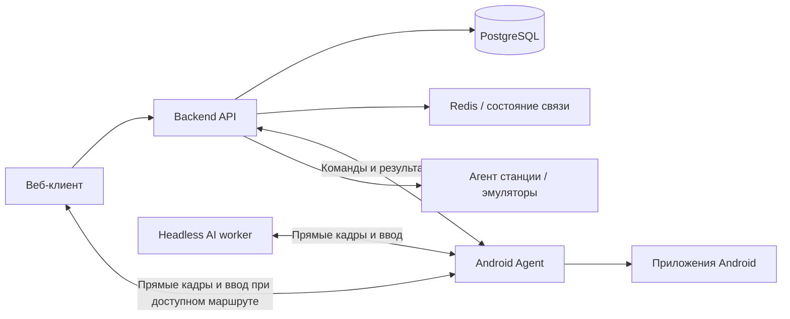

# Sphere Platform

Управление Android-парком: устройства, прямой экран и ввод, сценарии, оркестрация,
VPN и диагностика в одном рабочем месте. Android APK исполняет операции на
устройстве; веб служит клиентом, backend хранит состояния и координирует работу.

**Проверенная установка:** UI `a239baa2` / API `1afdc529`.

Текущая работа ведётся в [PR #19](https://github.com/RootOne1337/sphere-platform/pull/19),
ветка `codex/enterprise-audit-20260905`. Исходники, успешно собранный артефакт,
установленная версия и принятая функция — разные состояния.

[Начать установку](docs/operations/STARTUP.md#first-install) ·
[Локальный pilot](docs/operations/LOCAL-PILOT.md) ·
[Работы и ограничения](docs/operations/WORK-STATUS.md) ·
[HTTP API](docs/api-endpoints.md)

## Возможности и текущая проверка

| Область | Что есть | Что проверять перед расширением |
| --- | --- | --- |
| Устройства | Каталог, группы, локации, identity, состояние соединения, задания | Свежесть данных и доступность конкретного агента |
| Экран и ввод | WebRTC, server fallback, диагностика маршрута, совместный ввод | Реальные кадры/ACK, смена сети и длительная нагрузка; сам ICE не доказывает управление |
| Script Studio | Визуальный граф, версии, запись траекторий, запуск и отмена | Точность таймингов, смена владельца ввода и условия конкретного устройства |
| Оркестрация | Задания, batches, расписания и pipelines | Подтверждённый terminal outcome отдельно от отправки команды |
| VPN | Зашифрованный каталог, пакет до 100 `.conf`, версии, архив, Android runtime и оценка скорости | Встроенный provider и выборочный kill switch ещё проходят приёмку |
| Моторный ИИ | Headless worker, прямые кадры/ввод, локальные модельные эксперименты | Универсальная навигация и игра без вмешательства пока не приняты |

Точные версии APK и результаты по устройствам находятся в
[машинном реестре](docs/operations/STATUS-REGISTRY.json). Последняя подтверждённая
адресная установка — APK86 на PH030 с независимой проверкой SHA. PH010/PH011/PH025
остаются на APK85; 17 offline не обновлены.
Полного production SLA для всех сетей и сценариев пока нет.

## Что обновлено

**Backend обновлён, APK86 установлен на PH030.** Включён широкий режим и
проверена блокировка приложений при паузе, Sphere остаётся напрямую. Рабочий
выход в интернет ещё не принят: обычный WG и клиентский compatibility A/B не
дали HTTPS. API запретил удалить созданный тестовый WG peer; до выбора
пользователя дополнительный AWG peer не создаётся. PH030 оставлена на паузе
с блокировкой приложений.
[Поставка, реальные пробы и ограничение](docs/audits/2026-10-22/VPN-APK86-ALLAPPS-PH030-CANARY.md).

**APK85 собран в GitHub и установлен на четырёх online устройствах.** Полный
Android CI и настроенная облачная сборка успешны; payload проверен после локальной
переподписи прежним сертификатом. Версия и установленный SHA подтверждены на
PH010/PH011/PH025/PH030. Память пользователя не освобождалась, эмуляторы не перезапускались.
[Поставка, CI и экраны](docs/audits/2026-10-22/VPN-APK85-CLOUD-AND-ADDRESSED-DELIVERY.md).

**Исправление VPN-телеметрии установлено.** Основной WebSocket-цикл теперь
принимает отчёты Android. Полный backend CI прошёл 4428 тестов; совпадение RPC/API
и диагностика desktop/mobile проверены на установленном сайте.
[Доставка и экраны](docs/audits/2026-10-22/VPN-STATUS-ROUTING-LIVE-DELIVERY.md).

**Живой VPN-тест выявил дефект APK84.** Дополнительная packet mark мешала TCP/DNS
тестового приложения на PH011; без неё трафик проходил. Управление Sphere
сохранялось. Guard plan 4 в APK85 устраняет дополнительную mark. Локальный AWG1
опыт прошёл 17 HTTP-ответов, pause/resume, аварийную изоляцию и cleanup; повторные
TCP/DNS через внешний WG всё ещё нестабильны. Общая приёмка VPN остаётся открытой.
[Новый конечный опыт](docs/audits/2026-10-22/VPN-APK85-MAIN-CANARY.md) ·
[Первоначальный дефект](docs/audits/2026-10-22/VPN-APK84-MAIN-CANARY.md).

**Предыдущая поставка 22 октября — VPN workspace и каталог.** Четыре вкладки,
диагностика устройства, импорт, версии и архив проверены на desktop/mobile.
Для каталога применена добавочная миграция, настроены независимое шифрование и
ограниченный DB-login с RLS. Физические VPN этим обновлением не менялись.
[Поставка и реальные скриншоты](docs/audits/2026-10-22/VPN-CATALOG-LIVE-DELIVERY.md).

**Массовый импорт до 100 профилей установлен и проверен.** Предварительная
проверка каждого файла, атомарное сохранение и восстановление по прежним ID
при потере ответа. Поддерживаются `.conf` WG/AWG; прокси/ZIP/распределение по
устройствам — отдельные этапы. Backend CI: 4422 passed; frontend: 2630.
Вживую проверены ошибка файла №37, строка 100, rollback и потеря ответа без
повторной записи. [Поставка и скриншоты](docs/audits/2026-10-22/VPN-BATCH-LIVE-DELIVERY.md),
[контракт](docs/operations/VPN-PROFILES.md).

**Расширение VPN-платформы.** Проработаны метрики UID, пулы, аренды выходов,
proxy adapters и единый исполнитель для UI/скриптов/pipelines с учётом наших
смежных VPN-репозиториев. [План и источники](docs/design/VPN-FLEET-CONTROL.md).

## Как устроена система

Управляющее соединение Sphere должно сохраняться при сбое прикладного VPN.
Туннель выбранных приложений и сеть управления разделяются на уровне Android
UID/сокетов; один список IP управляющего сервера это не заменяет.
Подробнее: [архитектура](docs/architecture.md),
[Android agent](docs/android-agent.md), [VPN/egress](docs/design/VPN-EGRESS-ARCHITECTURE.md).

## Запуск и обновление

1. Для нового окружения используйте [Startup](docs/operations/STARTUP.md#first-install).
   Существующий pilot обновляется по [своему runbook](docs/operations/LOCAL-PILOT.md),
   с сохранением env/volumes и проектных имён.
2. Выберите согласованную ревизию кода, конфигурации и миграций. Текущая ветка
   аудита отличается от `main`; обычный clone сам её не выбирает.
3. Подготовьте PostgreSQL/Redis, bootstrap администратора и enrollment,
   затем readiness API/веба. На Windows нужны PowerShell 7, Python 3.12,
   Git и Docker Compose v2; детали инструментов — в [Development](docs/development.md).
4. Установите APK под свою discovery identity и доверенный ключ. Чужой pilot APK
   не заменяет сборку для вашей установки. [Параметры](docs/configuration.md).
5. Проверьте новое устройство конечным безопасным заданием, свежим кадром и
   восстановлением связи. Завершённый HTTP-запрос не равен исполнению на Android.

Для другой сети нужны доступный HTTPS/WSS ingress и signed discovery:
[Remote pilot](docs/operations/REMOTE-PILOT.md).

## Проверки и поставка

Frontend проверяется Jest/TypeScript и сборкой runtime с HTTP/assets probe.
Backend — тестами, включая отдельные PostgreSQL/Redis, RLS реального login,
миграции и перезапуск упакованного процесса. Android — unit/lint/build,
разделением ordinary/release/canary и проверкой native ABI. Точные инструменты
описаны в [Development](docs/development.md) и workflow-файлах репозитория.

Hosted CI можно запускать вручную; разовое включение не означает включённые
постоянные автосборки. Для VPN-кандидата CI собирает закреплённый WG/AWG native
provider с Android BOOTTIME/JNI patch. Тестовая CI-подпись не является подписью
установленных агентов. Production/pilot install и реальные lifecycle/fault tests
выполняются отдельно. Секреты и приватные конфиги не входят в отчёты/артефакты.

## Документация по задачам

| Задача | Документ |
| --- | --- |
| Актуальное состояние и незакрытые требования | [WORK-STATUS](docs/operations/WORK-STATUS.md) · [STATUS-REGISTRY](docs/operations/STATUS-REGISTRY.json) |
| Первая установка / локальный стенд | [Startup](docs/operations/STARTUP.md) · [Local pilot](docs/operations/LOCAL-PILOT.md) |
| Удалённые устройства | [Remote pilot](docs/operations/REMOTE-PILOT.md) |
| Android и агент станции | [Android](docs/android-agent.md) · [PC-agent](docs/pc-agent.md) |
| Запись и версии сценариев | [Script Studio](docs/operations/SCRIPT-STUDIO.md) · [Script versions](docs/operations/SCRIPT-VERSIONS.md) |
| Подтверждения исполнения | [Task control protocol](docs/security/task-control-protocol.md) |
| VPN: профили / результаты операций | [VPN profiles](docs/operations/VPN-PROFILES.md) · [VPN outcomes](docs/operations/VPN-CONTROL-OUTCOMES.md) |
| VPN: изоляция / пулы / метрики / интеграции | [Egress architecture](docs/design/VPN-EGRESS-ARCHITECTURE.md) · [Fleet control](docs/design/VPN-FLEET-CONTROL.md) |
| Моторный ИИ и worker | [AI architecture](docs/design/MOTOR-AI-PLATFORM.md) · [Worker](docs/operations/MOTOR-WORKER.md) |
| API для интеграций | [Endpoint catalog](docs/api-endpoints.md) · [OpenAPI](docs/openapi.json) |
| История реализации и конечных проверок | [Аудиты](docs/audits/) · [Прежний README](docs/history/README-20261022.md) |

## Разработка

Начните с [Development](docs/development.md), [Contributing](CONTRIBUTING.md)
и [Security](SECURITY.md). Изменения протоколов сопровождаются версиями контрактов,
отрицательными проверками и отдельной записью о границах приёмки. Игровая логика
остаётся в профилях/сценариях и сменяемых адаптерах.
