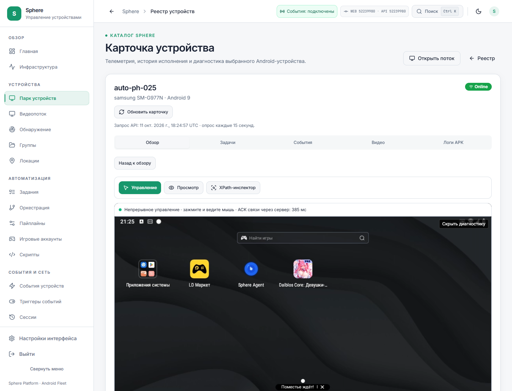

# Установка API/UI522 и APK55 после ремонта Windows

Дата: 11 октября 2026. Это новый срез установки; прежние receipts подготовки,
запрета установки, APK54 и исторического WebRTC сохраняются без переписывания.
Машинное подтверждение: [POSTBOOT-IDLE55-DELIVERY.json](POSTBOOT-IDLE55-DELIVERY.json).

## Результат

На обоих адресах установлен исходный код
`5223998002451b935a25e01f1034b727561588bd`:

- локальный веб: `http://127.0.0.1:3015`;
- публичный веб: `https://sphere-agent-canary-20260927.ru.tuna.am`;
- 15 доступных совместимых эмуляторов имеют проверенную установленную APK
  `1.2.55-dev / 10255`;
- 6 offline записей устройств не получили команду и не имеют подтверждённого
  установленного пакета;
- PH010 и PH011 на3015, PH025 черезTuna прошли конечную проверку видео и одного
  непрерывного жеста: удержать мышь, провести, изменить направление, отпустить;
- эти три проверки использовали **серверный WebSocket**. Прямой ICE/RTP/input
  в них не установился. Полная приёмка прямого маршрута и задержки открыта.

Установка кода прямого ввода и успешный прямой ввод — разные результаты.
Состояние реестра теперь `DIRECT_MEDIA_PILOT_INSTALLED`, с явно непринятыми
direct input execution, production, locality, latency и soak.

## Ремонт диска и Git

После ручной перезагрузки пользователя Wininit1001, record136433,
17:39:39UTC сообщил завершение CHKDSK:

- исправлен индекс каталога NTFS и bitmap;
- 5 orphan files возвращены в исходный каталог;
- в отчёте0KB bad sectors;
- Windows сообщила завершение коррекции без дополнительных требуемых действий.

Preflight перед сборкой и после установки показывает C: `Healthy / OK`.
Это снимает прежний запрет установки `volume_not_ready`. Аппаратная причина
повторных повреждений этим не определена; устранение всей потери места не принято.

Оставшиеся10 повреждённых loose Git objects заменены байтами, ранее независимо
полученными из GitHub и проверенными по zlib/SHA256 и Git blob SHA1. Перед заменой
сохранены исходные повреждённые байты. После ремонта `git fsck --full --no-reflogs`
завершился с0; HEAD и tracked working changes не изменялись. Reset, откат проекта,
перезапись рабочих файлов и миграция базы данных не выполнялись.

## Сборка и подпись APK

Пакет: `com.sphereplatform.agent.pilot.debug`.

| Поле | Значение |
| --- | --- |
| Версия | 1.2.55-dev / 10255 |
| Размер | 57 688 052B |
| SHA256 APK | `9abe0fce7846cfc61e1d19142b2ce854d096eac71b63fe5ba0ec6465030892ca` |
| SHA256 сертификата | `3ab40797d26e4f52f9e440afc6fe69f197caef71a5a27c63c86735bb1801871f` |
| Исходный код | `5223998002451b935a25e01f1034b727561588bd` |
| Android tree | `5a7aabad42b30dd4bb8295b02057b87b36272fec` |
| Signed discovery | version28 |

Сборка завершилась18:00:02UTC после чистого preflight. Совместно включены
WebRTC, planar input и continuous input; GPU/OES путь выключен. Локально выполнены
lint, unit tests и assemble для dev и enterprise: по1038 tests,0failures,0errors,
3skips. Это результат локального совместного профиля; прежний CI receipt с иным
числом skips не меняется.

Все три CI source522 ранее завершились успешно:

- Android38155828219: обычные варианты и отдельный совместный профиль;
- backend38155832799:4028 JUnit records/43skips, без errors/failures;
- frontend38155832805:154 suites/2226 tests,26pages/73assets, image admission.

Подготовка и точные границы CI сохранены в
[STREAM-IDLE-PROGRESS-RECOVERY](STREAM-IDLE-PROGRESS-RECOVERY.md).
Временный CI signing key не использовался для обновления существующего pilot.

## Что установлено в API и веб

Оба образа загружены из authenticated GitHub Actions artifacts. Архивы проверены
по независимым artifact metadata SHA256; OCI config identity сопоставлена
с загруженным containerd manifest. Не выполнялась новая локальная Docker build.

| Компонент | CI config image |
| --- | --- |
| Backend | `sha256:108d965b5b31be041174649c60ded75ca482b70e7e11ab2a4c4891b927bd8773` |
| Frontend | `sha256:913b6894e9dfc45aae38289ff47719e445f36137df4b5d963ea53080094432d7` |

Backend installer допустил14 изменённых файлов в своём allowlist. Прежняя схема
`20261006_script_catalog_metadata` сохранена. При каждой замене остальные45
контейнеров сохранены; dependencies, SQL data и migration heads не менялись.

Проверено на обоих origin:

- build revision API522;
- readiness PostgreSQL/Redis OK;
- совпадают29 JS/CSS ресурсов маршрута `/stream`;
- anonymous stream history возвращает401;
- авторизованный history имеет private/no-store;
- контракт10sessions,32KiB/session,7days сохранён;
- включены direct video/input admission для прежних15 явно разрешённых IDs.

Из установленного backend независимо получен `app.openapi()` без lifespan hooks:
146paths,184operations. Canonical SHA256
`a9332b7be3f7b9469392b9572a9f0ffa005219aaad95678a8ae6f4853e8f30a4`
совпал с текущим `docs/openapi.json`. Это проверка HTTP деклараций, не native
исполнения или работоспособности каждого бизнес-сценария.

## OTA: выполненные установки и реальная автоматика

APK55 опубликован как `android-canary / dev`. Каждому из15 совместимых online
устройств выдан один адресный durable grant. После рестарта APK проверены:

1. результат той же команды `completed`;
2. reported version10255;
3. SHA256 фактически установленного `base.apk`, совпадающий с артефактом.

Подтверждены PH010–020, PH022, PH025, PH028 и PH030. PH021/023/024/026/027/029
offline и не получили команду. Неизвестный пакет или подпись offline записи
не считаются совместимыми по одному имени. Очистки данных и ручных ADB installs
не было. Повторная отправка завершённых команд не использовалась.

Ответ на вопрос «новая версия сама приходит сразу?» — **частично**:

- обычный `UpdateCheckWorker` проверяет `platform=android` каждые6часов;
- при старте приложения и первом management connect экземпляра service ставится
  дополнительная проверка с jitter0–120s;
- every reconnect сейчас не ставит новую проверку: есть guard на экземпляр service;
- worker скачивает и проверяет SHA256, package, signer/version; возможность тихой
  установки определяется имеющимся root/PackageInstaller доступом;
- публикация релиза сейчас не содержит мгновенного fleet push;
- обычный poll не выбирает `android-canary`, поэтому текущая доставка выполнена
  адресными grants, а не автоматическим повышением обычного канала.

Важные исходники:
[UpdateCheckWorker](../../../android/app/src/main/kotlin/com/sphereplatform/agent/workers/UpdateCheckWorker.kt),
[CommandDispatcher](../../../android/app/src/main/kotlin/com/sphereplatform/agent/commands/CommandDispatcher.kt),
[updates router](../../../backend/api/v1/updates/router.py).
Обычный канал не повышен до pilot.debug артефакта, несовместимого с другим package.
Для будущего полностью автоматического rollout требуется durable desired version
по совместимому package/flavor/signer и политике волн, включая offline catch-up.

## Конечные браузерные проверки

| Устройство | Origin | Transport видео/ввода | ACK наблюдения после жеста | Canvas frames | Decode/render errors |
| --- | --- | --- | --- | --- | --- |
| PH010 |3015|server WebSocket|263ms|254|0/0|
| PH011 |3015|server WebSocket|224ms|161|0/0|
| PH025 |Tuna HTTPS|server WebSocket|294ms|57|0/0|

ACK — отдельное измерение подтверждения ввода. Оно не равно glass-to-glass video
latency и не доказывает физически ближайший сетевой путь. Числа — конечные
наблюдения, не SLA/p95 всего сеанса.

Неподвижный экран продолжает кодироваться примерно1FPS. Счётчики Android явно
разделяют возраст последнего raw capture/input и последнего encoded output;
повтор cached raw frame не выдаётся за новый захват. На изменениях после жеста
браузер продолжал получать кадры. Во всех трёх проверках directFrames0.

Скриншот визуально проверен: отображается Android home, статус ready и текущие
WEB/API522. Это конечный desktop viewport, не новая приёмка всех mobile flows.

Во время14 параллельных OTA downloads на PH010 наблюдались idle native receipt
timeouts, автоматические повторные подключения и ACK до1125ms. Последующий
сеанс после18:12UTC показывал ready, новые кадры,0decode/render errors и ACK187ms
в срезе18:18UTC. Причина совпадения с загрузками не доказана; soak остаётся OPEN.

## Прямой канал: что установлено, что ещё не работает

Новые browser/native journals показывают прохождение signaling и обмен offer/answer.
ICE остаётся checking, DTLS new, ни одной выбранной пары с ответами. В ограниченной
приватной проверке PH011 совпали browser/APK server-reflexive addresses; APK host
candidate принадлежит гостевой приватной сети, не видимой среди host interfaces.
Сами IP, candidate IDs, SDP/ICE keys и сертификаты в этот публичный receipt не включены.

Это сужает поиск до сетевой достижимости, NAT hairpin, multicast/mDNS, VPN routing
или firewall, но не определяет единственную причину. Закрытие неудавшегося native
peer проверено в коде: оно инвалидирует ввод только если session принадлежит
активному direct owner; чужой server owner по одному закрытию не снимается.

Медиасервер приложения и HTTPS tunnel не участвуют в успешно выбранном прямом RTP
пути; однако возможность его выбрать зависит от достижимых кандидатов. На этом
стенде TURN endpoint/credentials не подключены. Невозможность direct socket требует
отдельного TURN fallback; это не обещание100% direct во всех NAT/VPN.
См. официальные [WebRTC ICE](https://webrtc.org/getting-started/peer-connections),
[TURN](https://webrtc.org/getting-started/turn-server),
[Android DNS resolver/mDNS](https://source.android.com/docs/core/ota/modular-system/dns-resolver).
Документация Android resolver не является доказательством поведения Android9/LDPlayer
или собранного SDK; гипотеза mDNS требует отдельной сетевой проверки.

## Сборщик и незакрытые пункты

После reboot прежнее elevated окно завершилось. Новый worker39092 с17:57:31UTC
собирает до721 samples/24h с интервалом120s и бюджетом16MiB;24 named files,
process RAM/commit/IO и периодический Docker/WSL. Он unprivileged, memberOfJob=true;
VSS, автозапуск и независимое время жизни не гарантированы. Разрыв покрытия
17:30:25→17:57:31UTC сохранён. IO процесса не доказывает запись именно на C:.

Следующая работа по приоритету:

1. Доказать direct route на том же host, LAN и внешней сети, отдельно native input
   и real presentation; подключить управляемый TURN fallback для недостижимых пар.
2. Разобрать idle receipt timeouts и влияние нагрузки/management connection;
   принять reconnect/idle/held-touch soak. Не повторять неизвестные касания.
3. Добавить точные `idle_receipt_timeout` и `pointer_receipt_timeout` в согласованный
   browser/API telemetry whitelist: сейчас остаётся generic timeout.
4. Исправить static ACK tooltip, который продолжает описывать server WebSocket
   даже при отдельно корректно отображаемом direct transport.
5. Довести автоматическую политику выпуска/назначения совместимых APK и offline
   catch-up; публикация и установка должны оставаться разными состояниями.
6. Проверить CSS preload warning на login черезTuna: CSS загрузился, но одно
   предупреждение ещё воспроизведено. Отсутствие500 в этих finite flows не доказывает
   отсутствие ошибок всех вкладок.
7. Довести lifetime/autostart/privileged coverage сборщика и установить writer
   устойчивой потери C:. NTFS/Git восстановлены, причина повреждений не установлена.

Пять подготовленных source corrections перенесены из `pendingCorrections`
в `installedCorrections`; это доставка без полной native acceptance.
Продуктовый реестр сохраняет9 принятых в своём scope и41 открытый пункт.
Новые кадры и успешная установка не закрывают весь исходный enterprise backlog.
