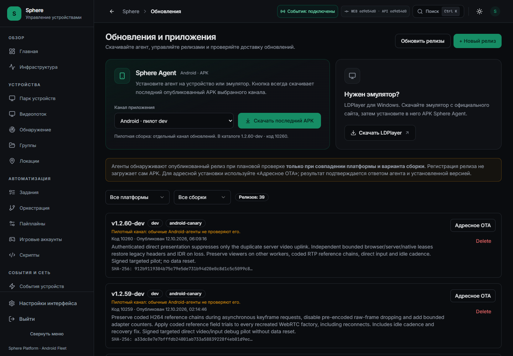
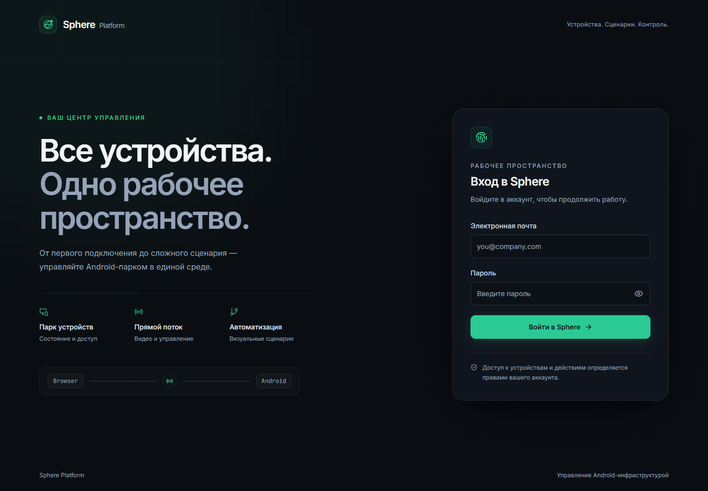

# Актуальный APK и страница входа: установленная доработка

Дата: 12 октября 2026 года. UI и API `ed9d54d090e2b5a5d471502335ddf6b8b86dbd35`
установлены на 3015 и Tuna. [Неизменяемый протокол](APK-DOWNLOAD-AND-LOGIN-OBSERVATION.json)
связывает CI, образы, живые HTTP-проверки, браузерные скачивания и проверку прямого ввода.
Текущие работы: [WORK-STATUS](../../operations/WORK-STATUS.md).

## Что доступно пользователю

На странице «Обновления и приложения» появились карточки Sphere Agent и LDPlayer.
Кнопка «Скачать последний APK» скачивает файл в браузере, показывает объём получения
и позволяет отменить запрос. Рядом указан канал и последняя известная страничке версия.
Сам сервер определяет актуальный релиз заново при каждом скачивании.

Канал по умолчанию — `android-canary/dev`, явно подписанный «Android · пилот dev».
Доступны также `android/dev`, `android/enterprise` и `android-canary/enterprise`.
Каналы самостоятельны: APK с большим номером из другого канала не подставляется.
Обычный канал `android/dev` остался на `10209`; его содержание этой доставкой не менялось.

Кнопка LDPlayer ведёт на [официальный сайт](https://www.ldplayer.net/).
Установщик эмулятора не перепаковывается и не раздаётся сервером Sphere.



## HTTP-контракт и работа с файлом

`GET /api/v1/updates/downloads/latest?platform=android-canary&flavor=dev`
использует JWT оператора и разрешение `device:read`. Агентский `/artifacts/{sha256}`
сохранил собственную авторизацию. Анонимный запрос нового endpoint проверен: `401`.

Сервер отдаёт управляемый опубликованный файл через `FileResponse` с MIME
`application/vnd.android.package-archive`, безопасным именем, размером, `private, no-store`,
SHA-256 и кодом версии в заголовках. Range `bytes=0-15` проверен на обоих адресах:
`206`, правильный `Content-Range` и точные байты опубликованного APK.

Отсутствующий канал возвращает `404`. Внешний URL последнего релиза — `409`:
сервер не пересылает туда пользовательскую авторизацию и не заменяет файл старым релизом.
Неверный каталог и недопустимый размер завершаются ошибкой. Имя файла не принимает
произвольный путь из каталога. Доступ к symlink/non-file не допускается существующим
проверяющим кодом хранилища. Эти ветки покрыты серверными тестами, но не являются
заявлением о проверке каждой роли на живом парке.

Фронтенд допускает только APK MIME и ненулевой размер до 200 MiB. Таймаут загрузки
120 секунд отделён от обычного короткого API-таймаута. Повторный клик не запускает
параллельную загрузку; отмена и уход со страницы прерывают запрос. Blob URL освобождается
с ограниченным временем жизни. HTML-ошибка прокси не сохраняется как APK.

У Tuna наблюдались два одинаковых `X-Content-Type-Options: nosniff`: второй добавляет
входной прокси. На 3015 заголовок один. Значения проверены по отдельности; это не
расхождение содержимого APK. Публичные JS/CSS всех трёх проверенных маршрутов
`/login`, `/updates`, `/stream` совпали по SHA-256 — 32 уникальных файла в объединении.

## Полные скачивания в обычном Chrome

| Адрес | HTTP | Получено байт | От клика до сохранения тестового файла |
| --- | --- | --- | --- |
| 3015 | 200 | 57 688 052 | 927 мс |
| Tuna | 200 | 57 688 052 | 8 489 мс |

Это два конечных измерения, а не гарантия скорости другой сети.
В обоих случаях имя — `SphereAgent-1.2.60-dev-android-canary-dev.apk`, SHA-256:

```text
912b9119304b75c79e5de731b94d20e0c8d1c5c5099c8e409c30bed7c56a88f4
```

Сохраняется ранее подписанная APK `1.2.60-dev / 10260` из `e9c550e8`.
Дерево `android/` в источниках установленного веба/API и этой APK одинаково.
Новая версия APK ради страницы входа не выпускалась.

Предыдущий [протокол доставки APK60](DIRECT-VIDEO-HANDOVER-OBSERVATION.json)
подтверждает установленный SHA и завершённую OTA для 15 устройств.
Свежий срез после установки API: 14 онлайн, все сообщают `10260`; семь офлайн.
Reported version не считается новым доказательством installed SHA. Среди офлайн
PH030 имел подтверждённый APK60 ранее; шесть остальных не подтверждены обновлёнными.

## Вход и тема

Страница входа получила единый тёмный экран с отдельной адаптацией формы.
По умолчанию новый профиль открывает `neo-dark`. Проверенные сохранённые настройки
`light-corporate/spacious` сохраняются для рабочего пространства, а сам вход остаётся
тёмным. Известные токены применяются до первого отображения; произвольный CSS из
хранилища не выполняется. Добавлены недостающие accent/destructive foreground tokens.

На обоих адресах проверены 1440×1000, 390×844, 320×740, 844×390 и 768×1024:
горизонтального переполнения нет, поля и основная кнопка высотой 48 px.
Показать/скрыть пароль работает. Авторизация настоящего оператора завершилась
переходом в dashboard. JS-ошибок и отказов статических ресурсов в этих проходах нет.
Пустой профиль может получить ожидаемый `401` при проверке refresh-сессии.

MFA и защита от устаревшего результата входа сохранены и прошли unit-регрессии.
Живой вход пользователя с включённым MFA в этой проверке не выполнялся.
Полная матрица ролей, zoom, screen reader и всех тем остаётся отдельным критерием.



## Проверка транспорта после установки

На PH010 обычный Chrome получил прямое WebRTC-видео через оба адреса веба.
В каждом проходе зарегистрировано 66 callbacks реально представленных кадров.
В отдельном интервале около 2,2 секунды счётчики серверных бинарных пакетов и байтов
не росли, а прямые RTP-кадры продолжали поступать.

Через 3015 отправлены и подтверждены 13 событий жеста, включая DOWN, 11 MOVE и UP.
Через Tuna — 14, включая DOWN, 12 MOVE и UP. Серверных touch events — ноль.
Подтверждения получены от Android, повторной отправки действий не было.
Оба собственных зрителя закрыты штатным переходом, браузеры закрыты.

Короткие сетевые RTT 0–2 мс в этих срезах не измеряют полную задержку картинки.
FPS 27–30 в этом тесте не доказывает 60 FPS. Физическая смена сети, самый близкий
маршрут во всех топологиях, совместный ввод, звук и клавиатура не приняты.
Предыдущие шесть управляемых обрывов RTC относятся к источнику UI331 и сохраняются
в [историческом транспортном протоколе](DIRECT-VIDEO-HANDOVER.md).
Отказ удалённой PH025 с отсутствием ICE-ответов остаётся [открытым](PH025-ICE-CANDIDATE-TYPES-OBSERVATION.json).

## Сборки, установка и статус аудита

[Frontend CI](https://github.com/RootOne1337/sphere-platform/actions/runs/38246537397):
156 suites / 2 260 tests, TypeScript и production build прошли.
[Backend CI](https://github.com/RootOne1337/sphere-platform/actions/runs/38246537467):
3 762 tests / 361 subtests, 43 skips; lint, типы, RLS, проверки образа и security jobs прошли.
[Android CI того же источника](https://github.com/RootOne1337/sphere-platform/actions/runs/38246537360)
также прошёл. Использован уже опубликованный APK60, не smoke APK из этого CI.

Каждая установка сохранила остальные 45 контейнеров. Миграций SQL не было;
allowlist прямого канала и локальное mDNS-согласование сохранены.
HTTP-схема прочитана из работающего образа без запуска lifespan: 147 paths / 185 operations,
канонический SHA совпал с `docs/openapi.json` установленного источника.

Добавлены конечные требования CHAT-21 и CHAT-22. Product-счётчик сохраняет
9 принятых ограниченных областей / 41 открытый пункт; семь legacy findings не закрыты.
Эта доставка не завершает общий аудит транспорта или всего интерфейса.
