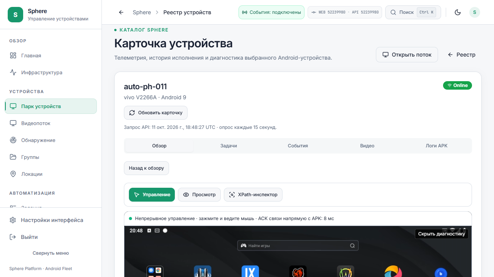

# Поток: смена сети, задержка, неподвижный экран и совместное управление

Это дополнение к [установке API/UI522 и APK55](../2026-10-11/POSTBOOT-IDLE55-DELIVERY.md).
Машиночитаемый срез: [STREAM-NETWORK-CADENCE-FOLLOWUP.json](STREAM-NETWORK-CADENCE-FOLLOWUP.json).
Даты в измерениях указаны в UTC; локальный день пользователя уже12 октября.

## Что установлено и что ещё готовится

На момент этого среза API/UI522 установлены на3015 иTuna, APK1.2.55-dev/10255
подтверждён installed SHA на15 доступных совместимых эмуляторах. Шесть offline
записей не имеют проверенного пакета и queued grant. Новый source candidate10256
ещё не установлен. Публикация, команда установки и installed hash — разные этапы.
Обычная OTA проверяет каталог раз в6часов и один раз при запуске сервиса с jitter
до120секунд. Canary доставляется адресно; мгновенный fleet push при публикации и
durable desired-version/offline catch-up ещё не реализованы.

## PH030: наблюдения до и после смены сети

В сохранённой истории есть реальные сеансы `direct_webrtc` одновременно для видео
и непрерывного ввода, ICE/DTLS connected и полученные native ICE responses. Например,
сеанс18:26:18→18:42:09UTC отобразил930 прямых кадров; финальный сетевой RTT24ms,
native control ACK38ms. Это измерения разных этапов, не полная задержка изображения.

Выбранный путь был NAT/UDP. Такой WebRTC путь обходится без медиапроксирования через
backend, но не доказывает loopback или самый короткий маршрут внутри ноутбука.
Android в эмуляторе имеет отдельную виртуальную сеть; нахождение программ на одном
ноутбуке само по себе не делает их IP-сокеты loopback-сокетами.

После пользовательской смены Wi-Fi на мобильную сеть последние новые попытки
имеют0 direct frames, ICE checking, DTLS new, исходящие запросы без ответов с обеих
сторон. Видео переключилось на server WebSocket; появились queue recoveries и
`server_runtime_retry`. Нужное поведение при смене сети **не принято**. Точный
timestamp переключения интерфейса не измерен; вывод опирается на порядок сеансов
и сообщение пользователя, не на синхронизированную трассу двух интерфейсов.

Прямой канал раньше существовал. Его ближайший локальный маршрут и устойчивое
повторное установление после смены сети ещё не обеспечены. Это два отдельных дефекта.

## Основной ПК: контролируемый эксперимент с ICE

В отдельном принадлежащем тесту Chrome отключено только скрытие local IP через mDNS.
Пользовательский браузер, Windows, VPN и сетевые правила не менялись. В этом
эксперименте установлен NAT/UDP peer, наблюдался сетевой RTT около1ms и длительное
представление кадров без смены peer. Это диагностический опыт, не предлагаемая
настройка браузера и не приёмка обычного Chrome/ноутбука.

Новый аппаратный тест сначала прокрутил canvas в видимую область, затем выполнил
DOWN, движения в обе стороны и UP. Получены14 соответствующих native INPUT/status1
receipts, включая UP;0 touch events отправлены через сервер. ACK действия15ms.
Сетевой RTT1ms и ACK15ms не являются glass-to-glass latency.

Результат сильно сужает поиск до объявления/достижимости host candidates, mDNS,
NAT hairpin и маршрутизации виртуального Android. Он не доказывает единственную
причину каждого LAN/VPN/carrier отказа. TURN fallback пока не подключён. Условия,
при которых сети запрещают прямую связность, нельзя исправить обещанием100% direct.

## Корректировка прежней приёмки жестов

У старого browser helper обнаружена возможность получить canvas bounds за пределами
viewport и отправить мышь вне видимой страницы. Состояние ready, heartbeat ACK и
возросший счётчик кадров не доказывают исполнение DOWN/MOVE/UP. Прежние frozen
receipts сохранены как история, но не используются для полной приёмки жестов.
Новый критерий — видимая геометрия, наблюдённые пакеты и точные native receipts
вплоть до UP/CANCEL, с отдельной проверкой отсутствия серверной отправки direct touch.

## Повторные отказы и source candidate10256

PH025 продолжил получать `native_receipt_timeout` после завершения массовых OTA
downloads:18:31:22 и18:33:20UTC. Последние control ACK258/262ms, decode/render errors0.
Совпадение первых отказов с загрузками не было доказательством их единственной причины.
Management/lease/сетевая трасса и failure/recovery soak остаются открытыми.

Подготовлены следующие изменения; installed подтверждение добавляется отдельным receipt:

1. APK повторно кодирует последние принадлежащие сеансу raw pixels с текущей
   целевой частотой энкодера, вместо разового повторения в секунду. Нет повторной
   отправки старых compressed access units. Нехватка codec input coalesces один
   pending raw refresh; реальный capture и повтор кадра считаются отдельно.
2. Текущий default остаётся30FPS. Валидация интервала допускает1..60, но это ещё
   **не** native source-rate60FPS, не гарантия60 на software encoder и не интерфейс
   персональных профилей FPS/битрейта/разрешения. Нельзя закрыть эти требования
   одной заменой числа: нужны codec level/capabilities, budgets и измерения нагрузки.
3. Browser low-delay preference использует `jitterBufferTarget=0` и независимо
   поддерживаемый Chromium `playoutDelayHint=0`. Подсказка не отключает необходимый
   сетевой jitter buffer и не обещает нулевую задержку.
4. `online` и Network Information `change` coalesce в одно новое согласование
   через500ms. Старый peer/control/renderer сначала инвалидируется; касания не
   переносятся и не повторяются. Смена сети отменяет cooldown старого маршрута.
   Событие `change` также приходит при изменении оценки RTT/пропускной способности:
   такие обновления не обрывают активный исправный поток. Явная смена типа интерфейса
   и `online` запускают новый peer; при недоступном типе интерфейса активный канал
   восстанавливается по фактическому отказу ICE. Это покрыто отдельными регрессиями.
5. Поздний capability reply после смены фокуса больше не оставляет автоматический
   probe навсегда занятым. После возврата пригодной поверхности допускается новый
   probe, если нет незавершённого legacy gesture.
6. Причины idle/pointer receipt timeout и ограниченный pre-release snapshot
   сохраняются в последних10 сеансах; сводка переживает вытеснение15 rolling samples.
   Только счётчики, фаза и времена; без координат, owner, SDP, IP и свободного текста.
7. ACK tooltip показывает фактический control transport и не называет DataChannel
   серверным WebSocket. Сетевой RTT, input ACK, buffer/decode и возраст картинки
   по-прежнему не объединены в выдуманное общее число latency.

## Совместный ввод и физический эмулятор — открытая работа

Текущая система имеет одного continuous native owner и одну direct peer session
на APK. Второй пользователь не получает независимый одновременный continuous
input. Вкладки нельзя объявлять совместно работающими на основании нескольких viewers.
Переключение фокуса с браузера на эмулятор также освобождает браузерный owner;
это событие lifecycle, а не доказательство остановки видео или отклонения физического тапа.

Требуется явная shared-operator policy: новый DOWN отменяет прежний gesture,
последующие MOVE/UP старого оператора не воздействуют на новый; системные кнопки,
текст, recorder и локальный физический ввод рассматриваются вместе. Неизвестный
native CANCEL нельзя выдавать за подтверждённый release. Нужны multi-peer budgets,
тесты двух/трёх вкладок, rotation, background, packet loss и audit причин handoff.

## Локальный build cache и целостность

При проверке candidate найден восстановленный generated KSP Java file из2327
байтов0xff; creation19:07:54UTC и mtime17:54:25UTC. Исходники Git прошли fsck0,
Windows сообщает Healthy/OK. Такой срез совместим с повреждённым прежним результатом
сборки, но не устанавливает hardware/cache/filesystem root cause. Сохранены hash
и приватный образец; сборка повторяется штатной генерацией с отключёнными build cache
и incremental reuse. Source files и глобальные dependency caches не удаляются.

## Основания технических решений

- [Chromium RTCRtpReceiver API](https://chromium.googlesource.com/chromium/src/third_party/+/refs/heads/main/blink/renderer/modules/peerconnection/rtc_rtp_receiver.idl): оба receive hints.
- [W3C WebRTC extensions](https://w3c.github.io/webrtc-extensions/#dom-rtcrtpreceiver-jitterbuffertarget): target и фактическая буферизация различаются.
- [WebRTC ICE](https://webrtc.org/getting-started/peer-connections): обмен candidates и выбор достижимой пары.
- [WebRTC TURN](https://webrtc.org/getting-started/turn-server): fallback при недостижимом прямом пути.
- [Android DNS resolver](https://source.android.com/docs/core/ota/modular-system/dns-resolver): описание современного resolver, не гарантия mDNS в Android9/LDPlayer.

Продуктовые9 принятых и41 открытый пункт не изменены. Этот follow-up не закрывает
enterprise backlog, nearest-route,60FPS/shared input, WAN/TURN, latency SLA или soak.
