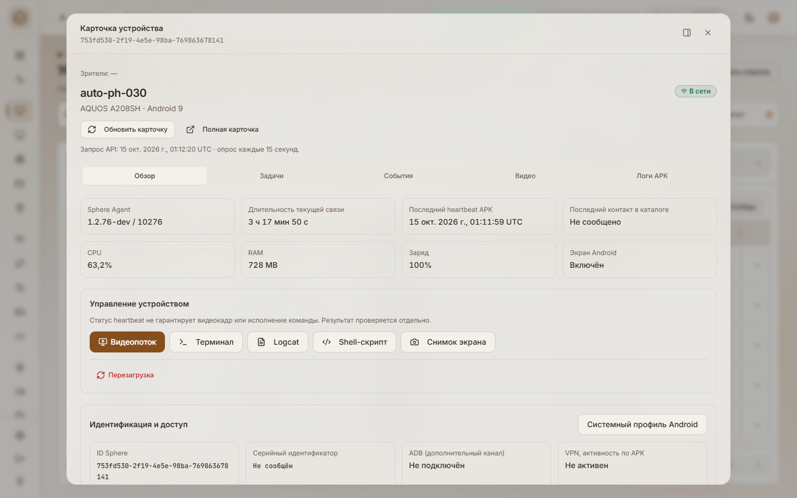
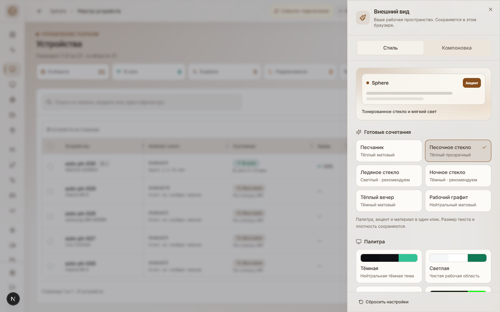
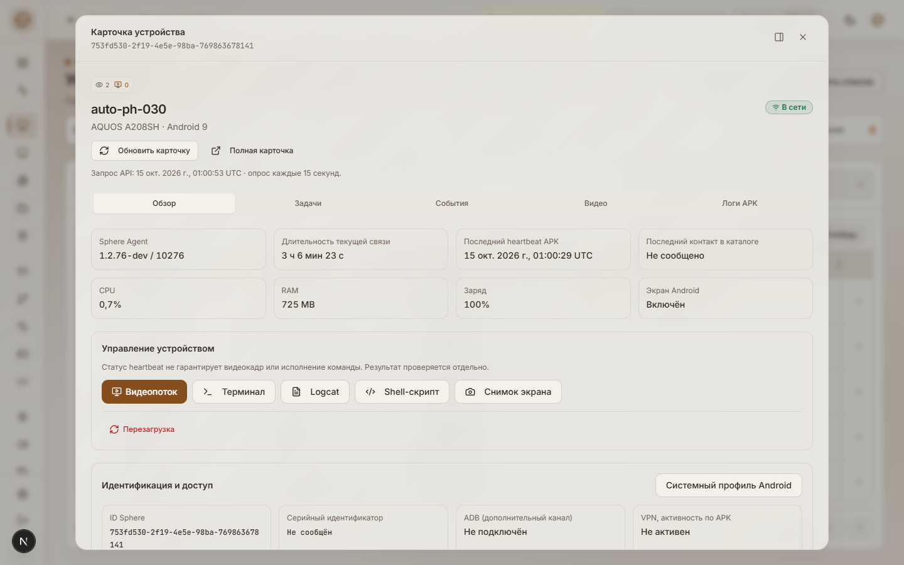
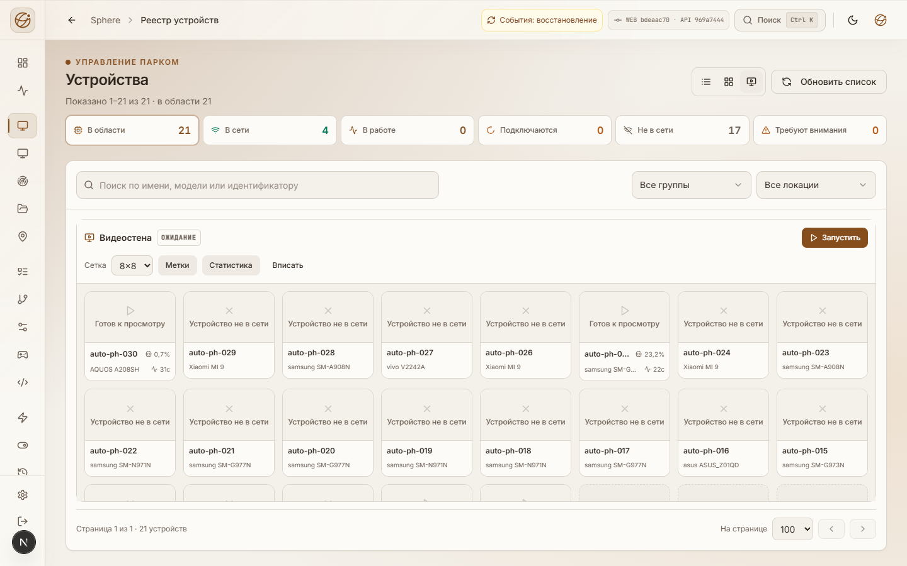
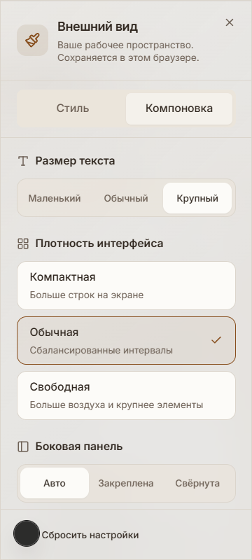

# Материалы, палитры, окна и видеостена

15 октября 2026. Продолжение [первой UI-поставки](UI-REFINEMENT-DELIVERY.md)
по скриншотам и замечаниям пользователя. UI `92bd6dd8` установлен на 3015 и Tuna из exact-source CI **38663692630**.
[Подтверждение установки и конечные проверки](MATERIALS-INSPECTOR-INSTALLED.json). Установленную версию показывает
[реестр работ](../../operations/WORK-STATUS.md).

## Реализовано

**Матовый и стеклянный режимы теперь различаются фактически.** Прежнее стекло
действовало только на почти непрозрачную навигацию над однотонным фоном.
Теперь стекло включает статический тонированный фон, прозрачные chrome,
диалоги и меню, размытие, тонкий блик и тень. Интенсивность: лёгкая, средняя,
яркая. Матовый режим убирает фоновые подсветки и фильтры, поверхности непрозрачны.
Рабочие таблицы, редактор и видео сохраняют непрозрачный фон.

В песочном ярком стекле браузер измерил background alpha **0,72** и blur **28 px**;
матовый вариант той же палитры — непрозрачный фон и `backdrop-filter: none`.
Системное reduced-transparency отключает фильтр поверхностей и фоновые подсветки.
Без поддержки backdrop-filter используются непрозрачные поверхности.

**Восемь палитр.** Песочная получила более выраженную тёплую иерархию фонов;
добавлены тёмная «Дюна» и светлый холодный «Туман». Быстрый переключатель
соединяет пары Песочная↔Дюна и Туман↔Deep Space. Основные текстовые пары всех
8×6 сочетаний палитры/акцента проходят порог 4,5:1. Это не полная визуальная
аттестация всех прозрачных, hover или disabled состояний.

**Шесть готовых сочетаний:** Песчаник, Песочное стекло, Ледяное стекло,
Ночное стекло, Тёплый вечер, Рабочий графит. Они явно задают палитру, акцент,
материал и интенсивность, сохраняя плотность и размер текста. Для материала
есть отдельная кнопка рекомендуемого сочетания. Простое изменение материала
не перезаписывает выбранный пользователем акцент.

Панель оформления разделена на **Стиль / Компоновка**. Есть живой пример
материала, настройки интенсивности, плавных/минимальных анимаций и формата
карточки устройства. Сохранённые настройки v0/v1 мигрируют в v2; разрешённые
значения проверяются. Before-paint и React используют одинаковые токены.

**Карточка устройства по умолчанию — окно.** На 1440×900 это 1200×852 px,
независимо прокручиваемое тело и постоянный header. На широком теле метрики
расположены в четыре колонки. Панель справа остаётся пользовательской опцией;
режим меняется прямо в header, не размонтируя открытые детали/вкладку.
На узком телефоне карточка занимает весь viewport. Escape возвращает фокус
на актуальную кнопку устройства, включая замену строки при live refresh.
Исправлена длинная ссылка, расширявшая внутреннюю область на 360 px с крупным текстом.

**Общие короткие анимации** открытия/закрытия окон и панелей, overlay,
вкладок и контролов. Они не запускаются при каждом heartbeat или кадре.
Минимальный режим сохраняется; системное reduced-motion имеет приоритет.
Новые библиотеки анимации не подключались: используются существующие Radix
и CSS, без постоянной анимации фона и blur видеокадров.

**Видеостена:** grid rows больше не сжимаются по доступной высоте, видеообласть
и footer разделены. В 64 слотах при 1440 px пересечений прямоугольников нет.
В маленькой ячейке используется короткая строка канала/RTT, остальные измерения
доступны в её описании. CPU ограничен одной десятичной цифрой; имена и модель
обрезаются внутри своей области. Ручной запуск, read-only и лимит подписок
сохранены. Это не нагрузочная приёмка 64 одновременно активных декодеров.

## Проверки

[Протокол исходников](MATERIALS-INSPECTOR-OBSERVATION.json): локально
**169 suites / 2464 tests**, TypeScript; после финальных изменений подписи и
переключателя — 35 целевых тестов. Exact-source CI повторяет весь frontend.

В Chrome проверены действительные CSS-материалы, F5, сохранение вкладки при
modal↔drawer, фокус/Escape, reduced-motion и reduced-transparency, 64 слота,
phone 390×844/360×800 с большим текстом и landscape 844×390. Обнаруженные
переполнение и устаревший HMR-прогон сохранены как исправленные наблюдения.
В source QA нет JS-ошибок; эмуляция телефона не заменяет физическую OS-клавиатуру.

Порт 3016 не проксирует events WebSocket. Один dev login redirect остался в
Loading до явного перехода: исправление auth не заявляется, чистый packaged
login и состояние установленного UI проверены отдельно в подтверждении установки.
Системный профиль, Android-файловый менеджер, оставшиеся формы/роли и длительный
performance/transport soak остаются в общем аудите. APK/API этой UI-волной не меняются.

## Состояния source QA

Эти снимки сделаны на 3016; индикатор events на них не описывает production gateway.
Установленная карточка показана выше; оба production origin проверены отдельно.

## Основания решений

Для заметного backdrop-filter требуется прозрачный фон и содержимое под ним;
это учтено согласно [MDN](https://developer.mozilla.org/en-US/docs/Web/CSS/backdrop-filter).
Короткие переходы и системные ограничения движения следуют
[prefers-reduced-motion](https://developer.mozilla.org/en-US/docs/Web/CSS/@media/prefers-reduced-motion).
Разделение рабочих данных и декоративного материала согласуется с
[Apple Materials](https://developer.apple.com/design/human-interface-guidelines/materials).
