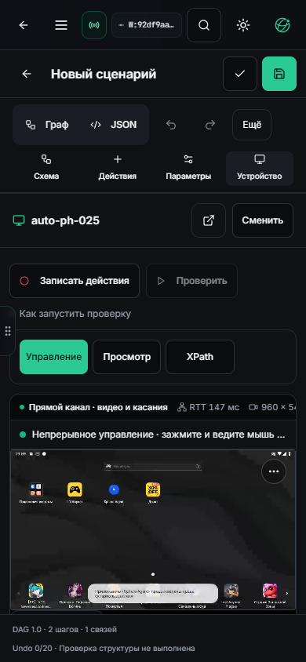
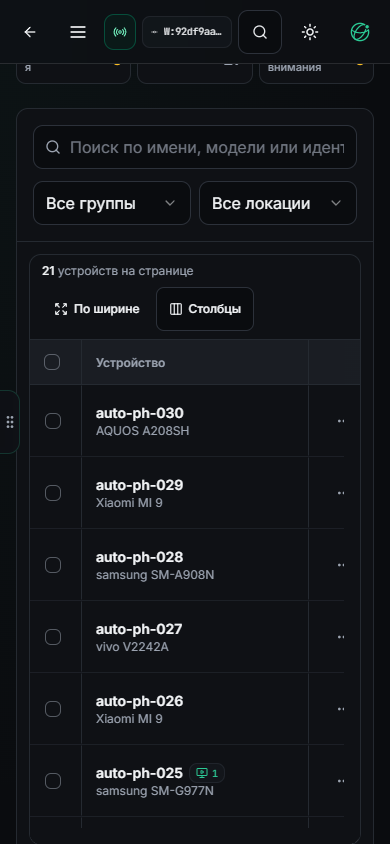

# Режимы Studio, восстановленный кадр и сенсорная компоновка

15 октября 2026. UI `92df9aaf`. Установлен на3015/Tuna из точного CI38770475062. [Подтверждение установки и отдельные результаты UI/ввода](STUDIO-MODE-LIFECYCLE-INSTALLED.json). API `969a7444`, APK 1.2.76-dev / 10276 и формат сценария не меняются.

## Исправленные причины

В установленном UI7b85aa5b воспроизведено: включение записи из XPath оставляло инспектор активным. Инспектор освобождал native input, а запись бесконечно ждала его готовности. Старт записи теперь выбирает «Управление». Начатое чтение Android-дерева не прерывается HTTP abort: оно завершается перед новым вводом. Переход пользователя в просмотр или XPath останавливает запись с сохранением подтверждённых действий; несовместимые переходы по-прежнему заблокированы при незавершённом вводе.

Отдельно найден дефект оповещения о кадре: после потери источника восстановленный кадр прежнего разрешения не всегда обновлял родительский экран. Прямой renderer вообще не сообщал размеры через этот callback. Теперь первый успешно нарисованный кадр нового socket/capture повторно сообщает размеры, даже если они не изменились. Следующие кадры того же источника не вызывают callback каждый раз. Чужой capture и кадр, который не прошёл renderer, не объявляются готовыми.

Сообщение подготовки записи находится под видео в области результатов. Его появление и исчезновение не сдвигает холст во время native-ввода. Это дополняет [предыдущую коррекцию ACK-строк и записи](DIRECT-RECORDER-ACK.md).

## Мобильная компоновка

На телефоне идентификатор выбранного устройства и переход к его карточке перенесены в заголовок лаборатории. Дублирующая карточка метаданных скрыта на узком экране; на ПК она сохранена. Запись и проверка находятся рядом, пояснение запуска раскрывается отдельно. Три режима занимают одну строку. Полные доступные названия действий сохранены, включая «XPath-инспектор» и целевое устройство проверки.

В Chrome с `isMobile=true`, `hasTouch=true` и viewport390×844: canvas364×205,625px, верх572,5px, низ778,125px; нижняя панель редактора начинается с783px. Кадр помещается целиком до панели; горизонтального переполнения нет. Снимок до уплотнения показывал почти вытесненный за первый экран поток. Эти числа относятся к указанному экрану и настройкам, а не ко всем размерам/масштабам текста.

## Проверки и границы

Модульные проверки покрывают старт записи из View/XPath, ожидание уже выполняющегося чтения без abort, сохранение подтверждённой записи при смене режима, повторное сообщение о первом direct/server кадре того же размера и запрет чужого capture. Локально210 целевых тестов и TypeScript прошли. Итоговый CI38770475062:172 набора/2505 тестов, TypeScript/build и packaged runtime checks прошли. Установленные переходы и результаты ввода записаны отдельно в подтверждении выше.

В source preview визуально проверены четыре перехода режимов и сенсорная компоновка. PH011 во время проверки ушёл офлайн. В preview PH025 наблюдались `idle_receipt_timeout` и автоматическое восстановление при прямом видео. Этот прогон содержит HMR и **не принят как доказательство надёжного исполнения ввода**. Исходные ограничения сохранены в [наблюдении](STUDIO-MODE-LIFECYCLE-OBSERVATION.json); конечный установленный прогон рассматривается отдельно.

Физический телефон/IME, горизонтальный телефон, увеличенный шрифт во всех темах,20+ клиентов, WAN/TURN и длительный soak этой поставкой не принимаются. Произвольный `gesture_path` и запись физических клавиш остаются открытыми. Неподтверждённые команды автоматически не повторяются.

## Установленный прогон: незакрытая проблема управления

На PH025 проверен обычный Chrome через Tuna. Оба тестовых клиента получили прямой видеоканал; сенсорный клиент показал полный кадр 960 × 540 в области 364 × 205,625 px без горизонтального переполнения. Переключения режимов завершились корректно. Это конечная проверка интерфейса, а не приёмка физического телефона.

На ПК кнопка «Домой» получила подтверждение APK за 152 мс по прямому каналу. В том же сеансе наблюдались повторные `idle_receipt_timeout`: пять ожидающих подтверждений, старейший HEARTBEAT около 1263 мс, без удерживаемого пальца. Прямое видео при этом продолжало отображаться; управление становилось недоступным и восстанавливалось. Позже зафиксирован и серверный резерв. Счётчик автоматического восстановления дошёл до 11; до перехода на резерв наблюдалось 2580 прямых кадров при четырёх подключениях.

В начале были одновременно открыты два собственных тестовых клиента. Один затем закрыт; это не изолирует причину. Связь сбоя с совместным управлением, нагрузкой эмулятора, изменением режима или транспортом пока не установлена. Успешное нажатие «Домой» не закрывает проблему. Новая запись жеста в установленном прогоне не принята: во время проверки канал ожидал восстановления. Никакие жесты и команды автоматически не повторялись.

Следующий транспортный прогон должен сравнить один и два клиента с синхронными отметками browser send / APK receive / mailbox / native ACK / DataChannel send / browser receive, отдельно от кадров и signaling. Нужны ограниченные скалярные счётчики и причины отказа; координаты, текст ввода, токены и SDP в общий журнал не включаются. Изменять тайм-ауты без такого сравнения недостаточно для вывода об исправлении.

## Визуальные подтверждения установки

Портретный сенсорный viewport 390 × 844: полный кадр помещается над нижней панелью редактора. Идентификатор устройства не дублируется второй карточкой; три режима остаются в одной строке.

Парк устройств на той же ширине: область AG Grid около 504 px, видны шесть строк. Остальные столбцы доступны внутри горизонтальной прокрутки таблицы; страница по ширине не расползается. Это повторная проверка установленной высоты из предыдущей поставки, а не отдельная новая реализация таблицы.

