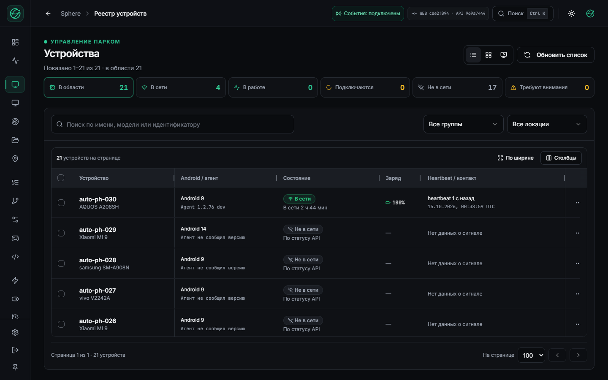
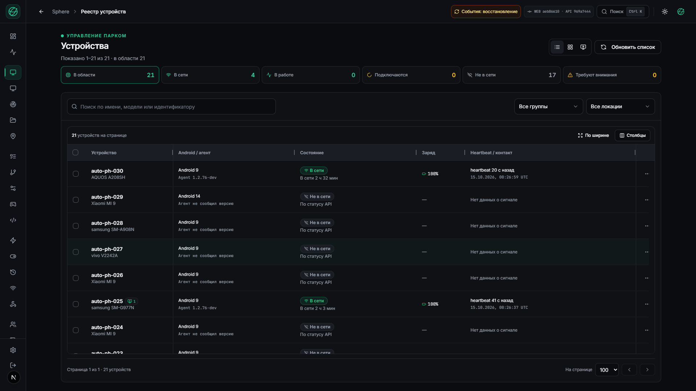
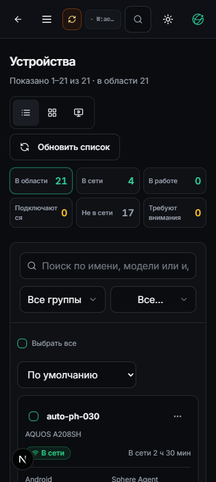
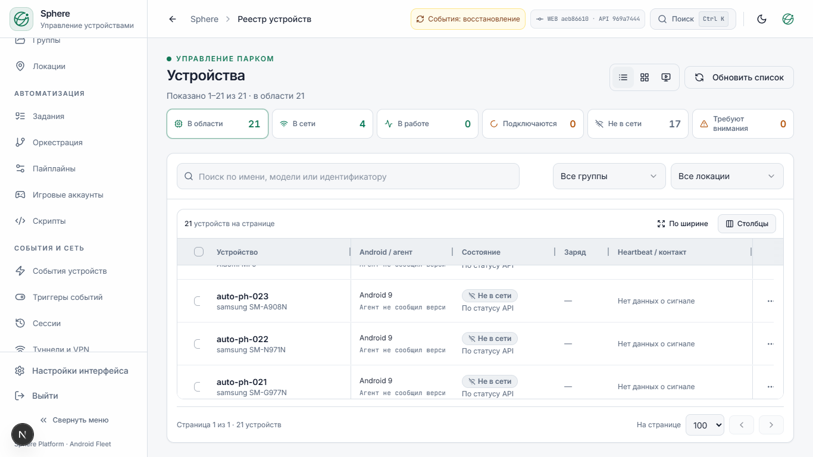
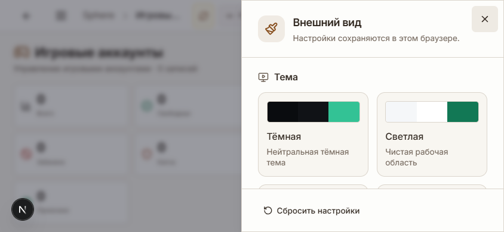

# Парк устройств и общая система оформления

15 октября 2026. Первый этап реализации по [визуальному аудиту](UI-UX-VISUAL-AUDIT.md).
UI `cde2f094` установлен на 3015 и Tuna из exact-source CI **38660271567**.
Бэкенд API `969a7444`, APK76 и OTA-каталог сохранены; другие контейнеры не заменялись.
[Неизменяемое подтверждение установки](UI-REFINEMENT-INSTALLED.json).
Фактическая установленная версия указана в [реестре работ](../../operations/WORK-STATUS.md).

## Что изменилось

Парк использует **AG Grid Community 36.2.0**: изменение ширины мышью,
перетаскивание заголовков, закрепление слева/справа, сортировка и виртуализация.
Это MIT Community, без Enterprise-пакета и лицензионного ключа.
Панель «Столбцы» даёт тот же контроль с клавиатуры: порядок, видимость,
закрепление, числовая ширина, сброс. Неполное или неверное число не сохраняется.
Размер, порядок и закрепление переживают F5. В хранилище попадают только
разрешённые параметры представления, без данных устройств и выделенных строк.

Сортировка применяется к загруженной странице API, как и прежде. Это не
серверная сортировка всего парка. Пагинация API и ограничения прав сохранены.
TanStack остаётся общей моделью выделения и шаблонов ячеек; AG Grid управляет
геометрией и навигацией desktop. Переключение на карточки сохраняет выделение.

На узком экране автоматически используются карточки с основными сведениями,
выделением, сортировкой и меню действий. Desktop grid при первом мобильном
открытии не загружается. «Таблица / Карточки / Видеостена» разделены явно;
видеостена по-прежнему требует ручного запуска захвата.
Сводка парка стала компактнее, footer и основные кнопки переносятся.
Исправлен возврат внутренней прокрутки lazy grid через browser Back: **480→480 px**.

Общий контракт оформления вычисляет тему, акцент, плотность и размер шрифта
одинаково до первого отображения и после загрузки. Шесть палитр, автоматический
акцент и пять отдельных акцентов; старые настройки мигрируют. Светлая тема
пользователя не сбрасывается. Плотность меняет реальные контролы и строки;
она больше не перезаписывает масштаб текста. Обычный общий контрол:
компактный **32 px**, свободный **44 px**; touch targets отдельно увеличиваются.

Боковая панель имеет режимы «Автоматически / Закреплена / Свёрнута».
Автоматический режим открывается при наведении и клавиатурном фокусе,
с плавным изменением рабочей области; reduced-motion учитывается.
Настройки оформления открываются настоящей правой панелью с независимой
прокруткой и footer, включая горизонтальный телефон. Стекло опционально,
применяется к chrome, рабочие данные остаются непрозрачными; есть матовый режим
и fallback при reduced-transparency/отсутствии backdrop-filter.

Добавлен векторный знак Sphere и favicon. Выравнены общие кнопки, поля,
страничные заголовки и карточки. Исправлены обрезанные действия аккаунтов
и видеостены на телефоне, уплотнены действия карточки устройства.
Разные SHA UI/API теперь показаны нейтрально: сами по себе они не доказывают
несовместимость протокола. Значения версий и реальные ошибки сохранены.

## Проверка и границы

[Конечный протокол](UI-REFINEMENT-OBSERVATION.json) связывает тесты и выбранные снимки.
Локально прошли **169 suites / 2455 tests**, `tsc --noEmit` и проверка diff.
Контраст основных непрозрачных текстовых пар проверен для 6×6 сочетаний
палитры и акцента с порогом 4,5:1. Это не аттестация каждого полупрозрачного,
disabled или hover-состояния всех страниц.

В настоящем Chrome проверены resize/drag, числовая ширина и pinning с F5,
выделение клавишей Space без потери фокуса, сброс, hover sidebar, изменение
акцента и плотности, browser Back. Проверены desktop 1920×1080, ноутбук
1366×768, телефон 390×844 и 360×800, landscape 844×390 на выбранных экранах.
Мобильные проверки — эмуляция touch Chromium, не физическая системная клавиатура.
JSDOM-модель AG Grid проверяет связывание данных/прав/настроек, не геометрию.

В редакторе при 1366×768 проверены видимость трёх узлов и сохранение ручного pan
после смены оформления. Новый алгоритм размещения графа не заявляется.
Открытие/закрытие формы аккаунта проверено без создания записи.
Захват экрана, Android-ввод, перезагрузка устройств и сохранение сценария
ради визуальной проверки не запускались.

Разработческий порт 3016 не проксирует events WebSocket: его индикатор
восстановления не считается результатом проверки production gateway.
На установленном UI проверены grid, события, отсутствие JS-ошибок и совпадение ресурсов обоих origin. Отдельный конечный stream smoke записан в подтверждении установки; прежняя расширенная приёмка ввода не повторялась.

## Сопоставление с аудитом

| Пункты | Результат этой поставки |
| --- | --- |
| UX-01,02 | Единый расчёт акцента/темы и реальные размеры плотности; локально проверены. |
| UX-03 | Исправлены основные пары токенов; полная визуальная accessibility-аттестация остаётся открытой. |
| UX-04,05 | Мобильные действия аккаунтов и видеостены помещаются в экран. |
| UX-06 | Отдельный read-only worker системного профиля не реализован. |
| UX-07 | Конечный laptop state и сохранение pan проверены; все графы и размеры не приняты. |
| UX-08,09 | Компактные сводки парка/dashboard и действия устройства; остальные summaries требуют дальнейшей работы. |
| UX-10,11,12 | Режимы sidebar, правая панель оформления, шесть палитр и акценты реализованы. |
| UX-13,14 | Нейтральная provenance, общий Button и контракт оформления; не все локальные стили приложения унифицированы. |
| UX-15 | Терминология парка/видеостены выровнена; вся платформа не переведена повторно. |
| UX-16 | Причина прежнего cold GET не установлена. |
| UX-17 | Исправлена панель оформления; сложные формы с реальной клавиатурой остаются открытыми. |
| UX-18,19,20 | Режимы парка/адаптивная видеостена, векторный знак, optional glass; длительный performance soak не выполнен. |

Android-файловый менеджер остаётся [проектом](../../design/ANDROID-FILE-MANAGER.md).
Бэкенд, APK76 и транспорт не переустанавливаются ради этой UI-поставки.
Подготовленная версия APK77 не объявляется установленной. Прежние ограничения
приёмки стрима и управления остаются в силе; 20 пунктов аудита не закрыты оптом.

## Выбранные состояния

Следующие снимки относятся к source QA на 3016. Индикатор events на них не
описывает установленный gateway; его проверка показана на снимке выше.

## Почему выбран готовый grid

Использованы официальные возможности [Community](https://www.ag-grid.com/react-data-grid/community-vs-enterprise/),
[размеров](https://www.ag-grid.com/react-data-grid/column-sizing/),
[перестановки](https://www.ag-grid.com/react-data-grid/column-moving/),
[сохранения колонок](https://www.ag-grid.com/react-data-grid/column-state/)
и [theming API](https://www.ag-grid.com/react-data-grid/theming-api/).
Ограничения JSDOM учтены согласно [документации тестирования](https://www.ag-grid.com/react-data-grid/testing/):
геометрия и взаимодействие проверены в браузере.
