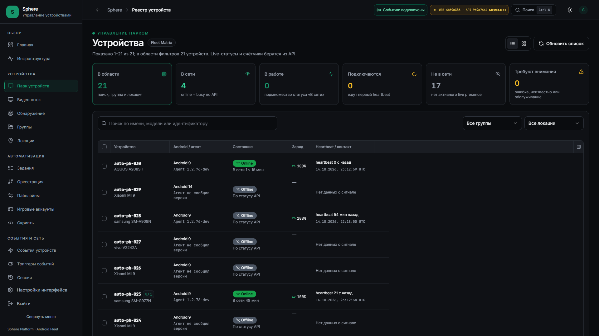
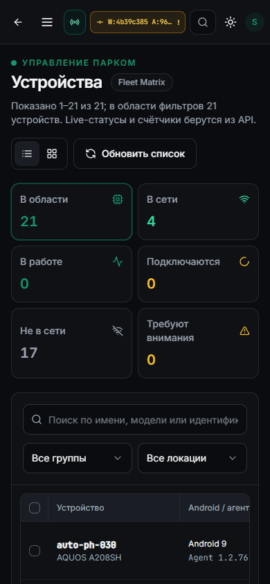
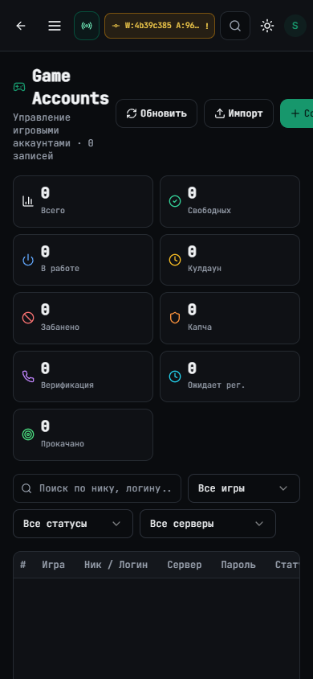
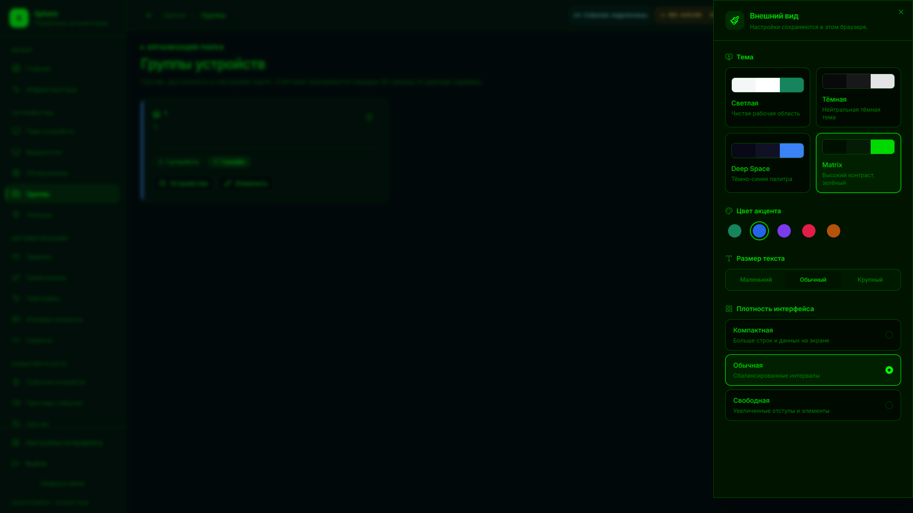

# Аудит интерфейса и план следующего этапа

Срез 15 октября 2026 года. Проверен установленный **UI `4b39c385` / API `969a7444`**.
Рабочий APK 76, настройки транспорта и эмуляторы не обновлялись. Это аудит и
проектирование доработок; перечисленные ниже изменения ещё не установлены.

Главный вывод: требуется выровнять плотность, иерархию действий и поведение
на узких экранах. Добавление новых палитр и стекла нужно выполнять после
исправления существующих ошибок настроек и обрезанных элементов.

## Артефакты и объём проверки

- **29 шаблонов страниц** учтены, включая вход, перенаправления `/` и `/fleet`,
  карточки устройства/задачи и отдельную страницу стрима.
- **127 снимков состояний**, включая страницы, сетку парка, панели, меню,
  настройки тем, формы и подтверждения. **45 снимков содержат открытый dialog**;
  это не 45 разных модальных компонентов.
- **2468 снимков видимых кнопок и кнопок-ссылок** с размерами и состоянием disabled.
  Повторяющиеся элементы разных страниц и строк входят в это число.
- В 151 исходном JSX-файле учтены **509 мест объявления кнопок**, 35 SelectTrigger
  и **47 DialogContent**. Динамические экземпляры могут повторять одно объявление.
- Основные размеры: 1920×1080 и 390×844. Дополнительно проверены 1366×768,
  360×840, 412×915 и горизонтальный телефон 844×390 на выбранных критичных экранах.

[Протокол и измерения](UI-VISUAL-OBSERVATION.json) ·
[Полный инвентарь исходных элементов](UI-CONTROL-INVENTORY.json).

Полная локальная галерея с поиском: `output/playwright/ui-audit-20261015/index.html`.
Размеры и ссылки на отдельные снимки кнопок: `controls.csv` в той же папке.
Артефакты занимают около **27,6 MB**; постоянный сбор скриншотов не запускался.
Полные изображения логов, настроек и runtime-имена оставлены локально.
В Git помещены девять выбранных снимков без токенов, содержимого логов и сетевых адресов.

Состояния stream/quality сняты с блокировкой **собственного** stream WebSocket до
допуска сервером. Они показывают компоновку без захвата экрана или ввода Android.
Это не новая проверка работающего стрима PH025. Все браузеры этого аудита закрыты.

### Границы покрытия

Каждое объявление dialog перечислено в инвентаре, но не каждый условный вариант
визуально воспроизведён. Каталоги аккаунтов, сессий, VPN и расписаний были частично
пустыми; записи ради снимков не создавались. Роли кроме текущего оператора,
нативные системные file/color picker, настоящая экранная клавиатура телефона,
все комбинации темы/акцента и длинные production-данные требуют отдельного прогона.
Снимок desktop и mobile не означает проверку всех шести размеров для каждой страницы.

В исходниках HEAD `f7dabf27` есть три frontend-файла подготовки 77, отличающиеся
от установленного UI: DeviceStream, NativeInputDiagnostic и DeviceInspectorDetail.
Они отмечены в инвентаре. Визуальные результаты относятся к установленному UI;
новое поведение этих исходников не выдается за установленное.

## Подтверждённые проблемы

P1 — мешает действию, достоверности состояния или чтению. P2 — заметно ухудшает
рабочий поток и согласованность. P3 — развитие внешнего вида. Все пункты открыты;
аудит не меняет прежний реестр 9 принятых ограниченных объёмов / 41 открытой работы.

| ID | Приоритет | Факт и доказательство | Доработка и проверяемый результат |
| --- | --- | --- | --- |
| UX-01 | P1 | После выбора синего и перехода в Matrix синий остаётся `aria-pressed=true`, но `--primary` становится `120 100% 50%`. Снимок `desktop-appearance-matrix-blue-selected`. | Один вычисляемый набор theme+accent tokens; переключение в любом порядке и F5 сохраняют выбранный цвет. |
| UX-02 | P1 | «Обновить список» во всех трёх плотностях: **178,1×44 px, 14 px**. `--spacing-base` меняется 1→0,75→1,25, а размер нет. | Плотность должна менять реальные интервалы/строки/контролы, не только переменные. Font scale и density не должны перезаписывать друг друга. |
| UX-03 | P1 | По измеренным непрозрачным токенам: Matrix muted/card **3,68:1**, светлый primary label/primary **3,70:1**. Обычный текст требует 4,5:1. Это проверка пар токенов, не всей страницы. | Автоматическая матрица контрастов для всех допустимых пар; проверить фактический фон, hover/disabled/focus и полупрозрачные поверхности. |
| UX-04 | P1 | На 390 px кнопка «Создать» в аккаунтах заканчивается на **x=441,2**. Document overflow при этом отсутствует: родитель обрезает содержимое. | Перенос toolbar и корректный min-width; основное действие полностью доступно при 360/390/412 px и увеличенном тексте. |
| UX-05 | P1 | В мобильной сетке кнопка «Запустить вещание» заканчивается на **x=442,1** при ширине 390. | Отдельная адаптивная панель видеостены; START/STOP и активный размер сетки доступны без скрытой части toolbar. |
| UX-06 | P1 | Пользователь сообщил `device_input_busy` в профиле PH025 в 22:32:17 UTC 14 октября. Profile отправляет `getprop` через `/shell`; APK `shell()` резервирует discrete input. Это объясняет возможный отказ при существующем shared input owner. Повторный запрос на PH025 не выполнялся. | Типизированное read-only чтение профиля в отдельном worker, без захвата ввода и остановки стрима. Отдельная понятная ошибка и command/trace ID. |
| UX-07 | P1 | В первом виде редактора на ноутбуке 1366×768 узлы частично выходят за видимую область рядом с inspector. Снимок `laptop-scripts-builder`. | Перепроверить fit после готовности pane/ResizeObserver; начальный граф виден целиком, ручной pan/zoom сохраняется при дальнейших изменениях панелей. |
| UX-08 | P2 | На телефоне парк начинается с шести плиток высотой 82–102 px; таблица появляется у нижнего края первого экрана. Подобные большие summaries есть в dashboard/tasks/audit. | Компактная сводка с раскрытием подробностей; первичный список/рабочая область появляется в первом экране. |
| UX-09 | P2 | Шесть действий карточки устройства имеют одинаковый размер **497,3×40 px** на desktop. Видеопоток дублируется основной ссылкой выше. | Одна главная кнопка стрима; компактные группы «Диагностика», «Файлы», «Дополнительно». Перезагрузку отделить от повседневных действий. |
| UX-10 | P2 | Desktop rail после сворачивания — 76 px; после hover — те же 76 px. Сейчас есть ручное expanded/collapsed, нет hover-auto/pin. | Три режима: автоматически / закреплено / только значки; клавиатурный focus и hover работают одинаково, настройки переживают reload. |
| UX-11 | P2 | Drawer внешнего вида на телефоне имеет высоту **812 из 844 px**; desktop 1048 из 1080. Общий max-height dialog отнимает 32 px у заявленного `h-dvh`. | Разделить centered modal и edge drawer; drawer занимает нужную высоту с safe-area, без неожиданного нижнего зазора. |
| UX-12 | P2 | Общий крестик закрытия dialog — 16×16 px без выделенной крупной hit area. Некоторые чекбоксы также 16 px. | Для телефона hit area 44 px; desktop icon action 32–36 px. Минимум WCAG 24 px имеет исключения по расстоянию, поэтому малый элемент не объявляется автоматически нарушением. |
| UX-13 | P2 | Постоянный жёлтый MISMATCH означает только разные commit SHA. Текущая совместимая установка тоже его показывает. | Версии — нейтральная диагностика; тревога только при проверенной несовместимости contract/capabilities. |
| UX-14 | P2 | Одновременно работают themeStore и useUIStore; sidebar mode, font, accent и density распределены между ними. Две библиотеки Button и локальные варианты размеров. | Один контракт preferences и один набор примитивов с миграцией сохранённых значений; не сбрасывать уже выбранную светлую тему. |
| UX-15 | P2 | RU/EN, uppercase monospace и обычный Inter смешаны между registry, accounts, VPN, pipeline и dialogs. Служебные пояснения часто занимают основной экран. | Одна русская терминология действий; monospace для идентификаторов/кода; краткие подписи, детали в help/diagnostics. |
| UX-16 | P2 | На 23,59 s завершился один холодный GET `/login`: первый ответ только на 23,52 s; DOM после ответа готов примерно за 16 ms. | Повторить cold/warm и разделить DNS/connect/proxy/SSR/server timing. Не приписывать этот единичный результат JavaScript или APK. |
| UX-17 | P2 | Большие формы locations/releases/pipeline имеют внутренний scroll; действия могут потребовать длинной прокрутки. Реальная телефонная клавиатура не проверена. | Для сложного окна независимые header/body/footer, контролируемый overflow и проверка visualViewport с клавиатурой. |
| UX-18 | P2 | Видеостена использует отдельный NOC-стиль и английский toolbar; «сетка» выглядит как обычный переключатель вида, но ведёт к управлению потоками. | Явные режимы «Таблица / Карточки / Видеостена», доступные подписи и одинаковая система размеров; ручной запуск захвата сохранить. |
| UX-19 | P3 | Логотип сейчас — буквенный `S` в цветном квадрате. Это placeholder, не разработанная идентичность. | Векторный знак Sphere, wordmark, favicon и одноцветные варианты; узнаваемость в 16/24/32 px и обеих темах. |
| UX-20 | P3 | Стекло используется местами как blur overlay, единого материала и пользовательского переключателя нет. | Опциональный glass для chrome/навигации, непрозрачные рабочие данные; reduced-transparency и performance gate. |

### Что уже работает и нужно сохранить

Общий горизонтальный document overflow в снятых состояниях не обнаружен.
Однако UX-04/05 показывают, почему одного этого числа недостаточно.
Centered dialogs ограничены `100dvh - 2rem` и умеют прокручиваться: форма группы
на 844×390 вписалась в 512×358 px. Это правильная база, а не требование переписать
все модальные окна.

Существуют доступные названия многих icon buttons, мобильный navigation drawer,
dark login, унифицированный PageHeading, reduced-motion CSS и guard несохранённого
редактора. Фактический wheel → переход в группы → browser Back восстановил
scrollTop **650→650**. Эти свойства должны войти в регрессионную приёмку redesign.

## Ключевые снимки

Парк на desktop: сводка и рабочая таблица.

Телефон: сводка и фильтры отодвигают список вниз.

Аккаунты: основная кнопка обрезана справа.

Расхождение выбранного синего акцента и фактической зелёной темы.

Другие оригиналы: [карточка PH025](assets/ui-visual/desktop-device-ph025.png),
[мобильная видеостена](assets/ui-visual/phone-devices-grid.png),
[редактор на ноутбуке](assets/ui-visual/laptop-scripts-builder.png),
[светлая палитра](assets/ui-visual/desktop-appearance-light.png),
[большая форма локации](assets/ui-visual/phone-location-create.png).

## Компоновка и размеры для реализации

Размер определяется задачей и вводом, не только отношением сторон. На desktop
нужны 1920×1080 и 1366×768; на телефоне — 360/390/412 px, portrait/landscape,
динамическая высота браузера, safe-area и открытая клавиатура.

| Элемент | Desktop | Touch / узкий экран |
| --- | --- | --- |
| Основные действия | 36–40 px, ширина по содержимому | Hit area от 44 px; перенос без обрезки |
| Действие строки/значок | 32–36 px; допустимое уплотнение проверить | 44 px либо action menu с такой областью |
| Сводка парка | Одна компактная строка, детали раскрываются | 1–2 строки статусов; не шесть больших карточек |
| Основной список | Плотность строк около 40–48 px, детали отдельно | Краткая карточка/адаптивная строка; horizontal table — дополнительный режим |
| Простое подтверждение | 420–480 px по содержимому | Ширина экрана с 16 px полями, ясная отмена |
| Обычная форма | 520–680 px по числу колонок | Одна колонка, scroll body, доступные действия |
| Рабочее окно файлов | До 1180×780 px, resize при необходимости | Полноэкранное окно с safe-area |
| Длительность переходов | Предложение 160–220 ms | Так же, без hover-зависимых действий; reduce-motion выключает движение |

Это стартовые дизайн-ограничения, ещё не принятые значения. Не нужно просто
уменьшить каждый компонент: большой рабочий файловый менеджер и короткое
подтверждение имеют разные цели.

### Боковая панель и анимации

`auto / pinned / rail`, сохраняемые на этом браузере. Auto открывается при
hover **и focus-within**; короткая задержка открытия/закрытия предотвращает
дёргание при пересечении края. На touch — явная кнопка и overlay, не hover.
Pin доступен в самой панели и настройках. При смене режима не теряются фокус,
scroll, положение графа и существующий WebRTC peer.

Имеющийся width transition нужно проверить под нагрузкой ReactFlow и видеостены.
Для плавного сдвига областей можно использовать FLIP/layout animation из Motion;
сама библиотека предупреждает о возможном искажении детей при scale. Canvas/video
нельзя масштабировать таким способом без отдельной проверки.
Рекомендации по transform/opacity и замеру Rendering:
[web.dev](https://web.dev/articles/animations-guide),
[Motion layout](https://motion.dev/docs/react-layout-animations).

### Темы, акценты, логотип и стекло

Сейчас фактически **4 темы и 5 акцентов**, но важнее их согласованность.
Нужен единый resolver для background/surface/text/border/focus и отдельных
semantic success/warning/error. Пользовательский accent не меняет смысл ошибок.
Дополнительные сдержанные палитры Graphite/Slate/Nord и светлая Paper должны
проходить ту же матрицу контрастов; Matrix сохранить как совместимое предпочтение,
исправив чтение muted-текста.

Настройки: theme, accent, density, text size, sidebar mode, motion и transparency.
Свободный цвет допускается только с проверенным foreground и предупреждением
о проблемной комбинации; preset обязан быть пригодным без ручной настройки.
До первого paint применяются те же вычисленные токены, что после hydration.

Для бренда подготовить SVG-знак сферы/орбиты и отдельный wordmark, а не растровый
баннер. Проверить маленький размер, светлый/тёмный фон и монохром. Новый логотип
в этом аудите не объявляется разработанным.

Glass использовать на navigation/chrome и плавающих toolbar; таблицы, поля,
граф и изображение стрима оставлять читаемыми рабочими поверхностями. Apple
отделяет слой Liquid Glass для управления от слоя контента и рекомендует
сдержанное применение. На вебе предлагается собственный материал на CSS,
а не обещание точной нативной оптики Apple:
[Apple Materials](https://developer.apple.com/design/human-interface-guidelines/materials),
[MDN backdrop-filter](https://developer.mozilla.org/en-US/docs/Web/CSS/Reference/Properties/backdrop-filter).
Нужны непрозрачный fallback, настройка уменьшения прозрачности и замер GPU/frame
budget при активном стриме. Постоянный shader/refraction поверх видео не требуется.

## Страницы: следующий проход доработок

| Страница / шаблон | Основной результат аудита и действие |
| --- | --- |
| `/`, `/fleet` | Перенаправления учтены отдельно; не выдавать alias за дополнительную новую функциональность. |
| `/login` | Dark/mobile вписываются. Отдельно разобрать холодный первый ответ и состояния loading/error/MFA. |
| `/dashboard` | Desktop читается; на телефоне большие summary вытесняют полезную информацию. |
| `/monitoring` | Ограничения метрик остаются честными, но длинное пояснение сворачивается; графики должны быть раньше. |
| `/devices` | Компактная сводка, меньше технических подпунктов, нормальные touch actions, явные три вида. |
| `/devices/[id]` | Главный стрим, компактные диагностические действия, отдельные «Файлы», профиль вне input ownership. |
| `/stream` | Выбор устройств и число плиток сгруппировать; не запускать чужой захват при выборе вида. |
| `/stream/[id]` | Компоновка снята без транспорта. Toolbar/status/quality остаются короткими; live/native приёмка — прежний протокол. |
| `/groups` | Базовая карточка и форма аккуратны; проверить длинное имя, иерархию и удаление с дочерними группами. |
| `/locations` | Нормальный empty state; большая mobile-форма нуждается в доступном footer и soft-keyboard проверке. |
| `/tasks` | Уменьшить вертикальные counters; список заданий и фильтры доступны раньше. |
| `/tasks/[id]` | Карточка выполнения снята; параметры/результат/шаги отделить от primary status и действий. |
| `/orchestration` | RU-термины, меньше NOC-плотности в заголовке; широкие таблицы и большой редактор — отдельные layouts. |
| `/pipeline-settings` | Убрать конкуренцию плотных counters и мелких заголовков; save/status видны на телефоне. |
| `/accounts` | Исправить обрезанную CTA; адаптивные фильтры/строки; условные account dialogs требуют данных для снимков. |
| `/scripts` | Каталог уже имеет list/cards. Уплотнить служебные подсказки, сохранить history и признаки версии. |
| `/scripts/builder` | Auto-fit после pane resize, понятные drawers на телефоне; не сбрасывать dirty graph и pan/zoom. |
| `/events` | Компактные levels/counters; реальные события выше на первом экране. |
| `/event-triggers` | RU-термины, компактные пустые counters; сложной форме нужен footer/validation layout. |
| `/sessions` | Учтён пустой каталог; active session/detail/close не объявлены визуально проверенными. |
| `/vpn` | Разделить статус, политику и операции; англоязычные заголовки привести к общей терминологии. |
| `/webhooks` | Empty/create сняты; success secret и редактирование требуют отдельного controlled fixture. |
| `/users` | Сохранить ограничения self-action/RBAC; проверить роли, длинные email и touch action menu. |
| `/audit` | На телефоне counters занимают первый экран; события/фильтры важнее крупных карточек totals. |
| `/logs` | Уплотнить выбор устройства и служебные пояснения; лог должен появляться раньше, оставаясь читаемым. |
| `/updates` | Latest APK CTA сохранить; историю релизов уплотнить, большие notes раскрывать, статус OTA показывать кратко. |
| `/settings` | Profile/security/API-key states сняты; token/secret success не создавались. Общее оформление отдельно от account security. |

## Готовые инструменты и практические ограничения

| Задача | Решение | Статус выбора |
| --- | --- | --- |
| Dialog/menu/select/focus | Уже установленные Radix primitives | Сохранять семантику и исправлять общий wrapper, не копировать десятки вариантов |
| Тема/плотность | CSS semantic tokens, CVA, текущий Zustand | Исправить общий resolver и миграцию preferences |
| Виртуальные таблицы/каталоги | Текущие TanStack Table/Virtual | Переиспользовать для файлового списка и длинных каталогов |
| Движение панелей | CSS transitions; Motion для сложного FLIP | Motion — кандидат, lazy-load и benchmark до добавления |
| Файловая очередь | Uppy Core/Dashboard/Tus | Кандидат для queue/progress/resume, не готовый Android filesystem provider |
| Визуальные регрессии | Playwright snapshots + размеры; axe-core | Текущий проход не является полным axe/WCAG signoff |

Radix уже даёт focus trap, Escape и семантику dialog:
[официальная документация](https://www.radix-ui.com/primitives/docs/components/dialog).
Требования к размерам и контрасту:
[W3C target size](https://www.w3.org/WAI/WCAG22/Understanding/target-size-minimum.html),
[W3C contrast](https://www.w3.org/WAI/WCAG22/Understanding/contrast-minimum.html).

Проверены и сообщения разработчиков: [Radix mobile keyboard #2323](https://github.com/radix-ui/primitives/issues/2323)
и [Uppy retry #5726](https://github.com/transloadit/uppy/issues/5726).
Это исторические отчёты о пограничных случаях, не доказательство наличия тех же
багов в наших версиях. Они обосновывают реальные phone/keyboard и offline/resume
сценарии в приёмке, даже при использовании готовых библиотек.

## Файловый менеджер и порядок реализации

Требование «Файлы» относится к Android выбранного устройства: папки, переходы,
загрузка/скачивание, прогресс, скорость, остаток времени, отмена и возобновление.
Готового универсального файлового канала сейчас нет; OTA/download APK и original
PNG не дают его автоматически. [Отдельный контракт и этапы](../../design/ANDROID-FILE-MANAGER.md)
разделяют browser UI, Android provider и передачу больших файлов.

| Этап | Содержание | Условие завершения |
| --- | --- | --- |
| 1 | UX-01…07: поведение тем/плотности, contrast, clipped CTA, read-only profile и fit | Воспроизводимые дефекты проходят regression на desktop/mobile; транспорт не регрессирует |
| 2 | Общие размеры, компактные registry/detail, sidebar modes, modal/drawer primitives | Фокус/Back/scroll/dirty editor сохранены; все доступные dialogs и реальные телефоны проверены |
| 3 | Логотип, дополнительные согласованные палитры, опциональный glass | Контраст, reduce-motion/transparency и stream performance budget проходят |
| 4 | Android filesystem listing и надёжный upload/download | Capability/права/целостность/resume/retention и параллельный стрим проверены |
| 5 | Оптимизация прямой передачи файлов и расширенная матрица | Не увеличивает очереди управления/видео сверх согласованного бюджета |

На каждый исправляемый пункт: конкретный before/after снимок, source change,
функциональная проверка и сохранённый отрицательный кейс. Для новых dialogs нужны
controlled fixtures/компонентные stories; отсутствующая запись не заменяет визуальную
приёмку. Никакая UI-полировка не должна пересоздавать работающий media peer только
из-за theme/sidebar/fullscreen change.

[Зафиксированный транспорт](STREAM-CONTROL-FREEZE.md) ·
[Реестр состояния](../../operations/STATUS-REGISTRY.json).
