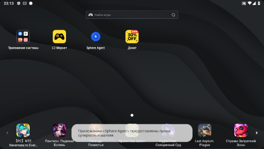
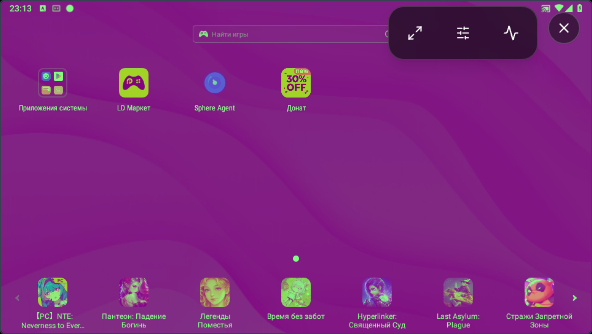

# Прямой транспорт при временном запрете ввода

16 октября 2026. Веб `19c4272b` установлен на 3015 и Tuna; API `969a7444`, APK 1.2.76-dev / 10276 сохранены. Последующая правка фоновых ICE-попыток учитывается отдельно ниже.

## Найденная причина

В UI92df9aaf режим «Просмотр» отключал callback канала управления в `DeviceStream`. `LiveDirectVideo` воспринимал это как изменение разрешения на согласование каналов и пересоздавал WebRTC peer вместе с видео. Возврат из просмотра, включая запуск записи, повторял согласование. В установленном браузере воспроизведено: при двух уже открытых каналах нажатие «Просмотр» сразу создало третий, новый видеоканал. Предыдущие проверки одного `eligible` не покрывали эту зависимость.

Разрешение роли на согласование прямого канала теперь передаётся отдельно через `directControlAuthorized`. Выбор просмотра, временная блокировка исполнения и ожидание уже начатого чтения Android-дерева не меняют его. Сам ввод по-прежнему требует разрешённого режима, собственного кадра и native READY. Режим просмотра освобождает своего участника ввода, а возвращение в управление получает новый READY по сохранённому каналу. Отзыв роли отключает согласование; серверная проверка прав сохраняется.

Существующие потребители без нового свойства сохраняют прежнее поведение. Правка не меняет протокол APK, формат сценария, тайм-ауты команд и правила неподтверждённых результатов. Команды не повторяются.

## Проверки

Локально прошли 172 набора / 2507 тестов фронтенда, включая 188 целевых проверок, и TypeScript. Тесты различают временный View/read lock и отзыв роли; сохранённый канал не разрешает отправку касаний в режиме просмотра. Точный CI38794901325 завершился успешно: тесты, типы, production build и проверки упакованного образа. Неизменённые backend/Android CI отменены для экономии минут; они не объявлены прошедшими в этом коммите.

В source preview цикл «Просмотр → запись → XPath → запись» сохранил те же открытые видео- и control-каналы. Оба касания получили подтверждение APK; «Домой» подтверждён за 189 мс. Начатое чтение дерева завершалось до возвращения native-ввода. Source preview содержит HMR и не служит доказательством установленной версии. [Результаты source-прогона](MODE-TRANSPORT-AUTHORIZATION-SOURCE.json).

В установленном UI `fc7cdad4` тот же цикл сохранил одну пару открытых каналов. Два записанных касания подтверждены APK; «Домой» через Tuna — 211 мс. Отдельный обычный Chrome без инструментирования на 3015 подтвердил «Домой» за 223 мс. Это время ответа Android, а не задержка картинки. Дерево из 42 элементов прочиталось после закрытия только второго собственного контролирующего клиента; при активном другом участнике APK возвращал `native_input_busy`. Такой отказ не объявляется успешной совместной инспекцией. [Установленный прогон](MODE-TRANSPORT-AUTHORIZATION-INSTALLED.json).

При ширине 390 px кадр целиком помещается над нижней панелью Studio, горизонтального переполнения нет. Это resize настольного браузера с `coarse=false`, не тест физического телефона. В нативном fullscreen проверено отсутствие двух постоянных полос статуса; инструменты остаются компактным наложением.

## Текущий инцидент PH030

После сообщения пользователя прочитаны последние десять сохранённых сеансов. В попытке около 20:15 UTC браузер отправил 144 ICE-запроса без ответов, затем получил `connection_deadline`. В следующем подключении появился прямой UDP-путь `nat`, но управление остановилось на `idle_receipt_timeout`: ожидались пять heartbeat ACK, старейший — 1264 мс, буфер отправки — 0 B, разрыв тиков — 16 мс. Касание не удерживалось. Это подтверждает реальный отказ; состояние APK `online` его не опровергает. Исторический `root_input_busy` из heartbeat имеет возраст около 11 часов и не приписывается этому инциденту.

[Сохранённые значения исходного инцидента](PH030-ROUTE-CONTROL-INCIDENT.json). В ограниченных записях старейшие подробности вытесняются; порядковый номер native peer в отчёте не подменяет отсутствующее сопоставление с конкретной попыткой браузера.

Дополнительно воспроизведена гонка резервного ввода: ответ `touch_capability`, запрошенный после отказа ICE, приходил уже во время следующей попытки WebRTC и отбрасывался. Регрессионный тест сначала упал: ожидался один `touch_open`, получено ноль. В `19c4272b` первая попытка остаётся приоритетно прямой; последующие фоновые попытки больше не блокируют admission fallback. Смена рабочего владельца по-прежнему требует точного RELEASE, неизвестные жесты не повторяются. Локально прошли 172 набора / 2508 тестов и TypeScript. Точный frontend CI38801815635 прошёл; образ установлен на 3015 и Tuna с сохранением 45 остальных контейнеров и OTA-каталога. [Подтверждение установки и проверки](FALLBACK-ADMISSION-INSTALLED.json), [локальный результат с опубликованным статусом GitHub](FALLBACK-ADMISSION-VALIDATION.json).

Прямой путь не гарантирует обход VPN: в отдельном наблюдении с данного ПК выбран `srflx → srflx`, UDP, с RTT около 200 мс. Серверная пересылка медиа отсутствует, но физический маршрут и влияние VPN этим не исключены. Нельзя выдавать `nat` за localhost или LAN.

В [отдельном двуклиентном наблюдении](PH030-TWO-VIEWER-OBSERVATION.json) основной peer просуществовал 562 секунды без закрытия каналов. В 48 парных снимках состояния оба клиента были READY; у инструментированного клиента два heartbeat ожидались больше 1000 мс. Итоговые inbound RTP-счётчики: 324723 полученных пакета, 10389 потерянных, 18056 NACK, 141 PLI. Последний RTT выбранной пары — 166 мс. Это фиксирует сетевые потери, но не определяет, возникли ли они в VPN, Wi-Fi, мобильной сети или ином участке. Отдельный конечный успешный прогон не отменяет отказ исходного сеанса. Android-команды и клики в этом наблюдении не отправлялись.

## Открытое искажение цвета

На PH025 исходный PNG Android выглядит нормально, а декодированное прямое видео и canvas имеют пурпурно-зелёный сдвиг. Для неподвижного участка обоев получено RGBA `[33,36,39,255]` в PNG и `[128,35,133,255]` одновременно в декодированном video и canvas. Это исключает исключительно CSS-причину, но не устанавливает конкретную ошибку захвата, преобразования, кодирования или декодирования. Снимок и видеокадр имеют разные моменты получения; это локальная проверка цвета статичного участка, не измерение общего качества или задержки.

| Исходный PNG Android | Прямое видео |
| --- | --- |
|  |  |

Исправление цвета в этой поставке не заявляется.

## Что остаётся открытым

Перед исправлением один обычный клиент PH025 прошёл 124 секунды без восстановления управления. После подключения второго были повторные тайм-ауты heartbeat; это наблюдалось и без переключения режимов. Следовательно, найденная причина пересоздания peer не объясняет все сбои. [Исходное наблюдение](INPUT-LIVENESS-BASELINE.json).

В новом инструментированном двуклиентном source-прогоне через 246 секунд управление было ready, но наблюдатель зарегистрировал две задержки heartbeat более 1000 мс. Это не приёмка общей стабильности и не доказательство конкретной сетевой либо нативной причины. Следующий шаг — сопоставить browser send/receive с приёмом APK, очередью, native ACK и отправкой ответа. Увеличение тайм-аутов без такой локализации не считается исправлением.

Физический телефон/IME, массовое совместное управление, WAN/TURN, произвольная траектория записи и длительный soak остаются открытыми. В этой поставке меняется только веб.

В установленном диагностическом браузере прямой signaling намеренно завершался локально, а настоящие `touch_capability` задерживались на 1250 мс. Первый ответ пересёк начало следующей попытки; fallback открылся во время третьей попытки и сохранил native READY при последующих попытках. Одно касание пустой области получило два настоящих input ACK со статусом 1 — DOWN и UP. Android-ответы не подменялись. Отдельный обычный браузер подтвердил Home за 869 мс, отправленный ещё при отображении server fallback, и затем перешёл к прямым видео/управлению с RTT171 мс. Эта конечная проверка не объявляется общей надёжностью или доказательством устранения прежних heartbeat-сбоев.

[Последняя сверка установленного прямого потока](FALLBACK-ADMISSION-CURRENT.json) дополнительно связывает текущую версию с фактическим счётчиком отображённых WebRTC-кадров. Старая конечная проверка режимов хранится отдельно.
