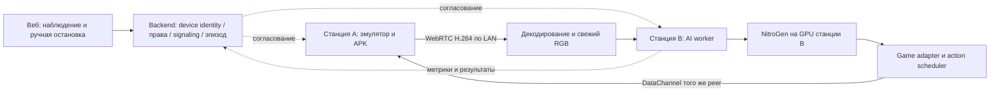

# NitroGen и Sphere: готовность отдельной GPU-станции в LAN

16 октября 2026 · исследование источников, проверка исходников Sphere и чтение локального оборудования.

**Последующее уточнение владельца:** Black Russia, профиль зон как в эмуляторе и 50×4–5 observations/с.
[Дополнительный разбор sampling, навигации и нагрузки](NITROGEN-NAVIGATION-AND-BUDGET.md) и
[проект профилей](../../design/GAME-CONTROL-PROFILES.md) дополняют этот датированный аудит.

**Вердикт: транспортная основа есть; подключение «запустили модель — Android уже играет» ещё не готово.**
Нужны машинный клиент потока, наблюдения с проверяемой свежестью, игровой адаптер ввода и исполнитель эпизода.
Переписывать весь стрим или переносить модель в APK для этого не требуется.

Проверяем сценарий владельца: станция A запускает эмуляторы; отдельная станция B с GPU получает кадры
и возвращает управление по LAN. Примеры игр — GTA San Andreas и Black Rush; конкретные Android build,
эмулятор, GPU и игровой сценарий пока не выбраны. Доступ по SSH и развёртывание — последующий этап.

[Машиночитаемое заключение, хеши источников и локальный аппаратный срез](NITROGEN-READINESS.json).
Исходники Sphere рассмотрены на `aeade1a0`. Установленная база предыдущего испытания:
UI `19c4272b`, API `969a7444`, APK `1.2.76-dev / 10276`;
[точная квитанция](FALLBACK-ADMISSION-CURRENT.json). Во время этого аудита установку и поток повторно
не испытывали; веса не скачивали, сторонний код не запускали, игровые действия не отправляли.

## 1. Что действительно представляет собой NitroGen

В [NVIDIA model card](https://huggingface.co/nvidia/NitroGen) описана vision-to-action модель около
493 млн параметров: RGB 256×256 → действия геймпада. Это соответствует направлению нашего проекта.
Однако Android, LDPlayer и готового Sphere-коннектора в референсном запуске нет.

[README зафиксированного кода](https://github.com/MineDojo/NitroGen/blob/32608444660950ffda95e1e57c79632ad65bea10/README.md)
называет модель исследовательской, реагирующей на последний кадр; не обещает прохождение целой игры,
долгосрочный план или самостоятельное улучшение. Runner поддерживает Windows games, а inference
допускается на Linux. Публикация весов в namespace NVIDIA не превращает runner в готовый продукт для Android.

В [статье, разделах 2.3 и A](https://arxiv.org/html/2601.02427v1) используются один кадр контекста,
16 действий в пакете и 16 шагов denoising. Это отдельные величины. Языкового задания вроде
«пройди миссию» в данном интерфейсе нет. Даже успешная доставка кадров и кнопок не доказывает,
что конкретный checkpoint умеет нужный эпизод GTA/Black Rush. Проверенного результата именно
для выбранной владельцем Android-версии в рассмотренных источниках нет.

Зафиксированы:

| Компонент | Ревизия / факт |
| --- | --- |
| Код MineDojo/NitroGen | `32608444660950ffda95e1e57c79632ad65bea10`, commit 25 января 2026 |
| Веса nvidia/NitroGen | revision `584c8dded734d032f07a4bcc0ccb330e703298c4` |
| `ng.pt` | 1 974 723 762 байт; заявленный LFS SHA-256 `a266f5fb9c7dbdcdf97216558d2d82075a9a994b824cda69afa9fd3280260a81` |
| Проверка весов | Только metadata; файл не загружен, локальная checksum не подтверждена |
| Лицензии кода и файла LICENSE модели | Тексты совпали, SHA-256 `564046abbef821cefd5c169d34ee1e96b3dfb72cf0be81de41ef8f4a1323c5a3` |

§3.3 опубликованной [лицензии кода](https://github.com/MineDojo/NitroGen/blob/32608444660950ffda95e1e57c79632ad65bea10/LICENSE)
ограничивает использование некоммерческими исследовательскими целями. Такой же текст получен из
[LICENSE выбранной ревизии весов](https://huggingface.co/nvidia/NitroGen/blob/584c8dded734d032f07a4bcc0ccb330e703298c4/LICENSE).
Коммерческое использование этими проверками не разрешено. Архитектура worker должна позволять замену модели;
инженерная готовность и применимость лицензии учитываются отдельно.

## 2. Найденные несовпадения документации и реального API

Model card сообщает форму 21×16 с 17 кнопками, статья использует другие размерности.
В закреплённом [shared.py](https://github.com/MineDojo/NitroGen/blob/32608444660950ffda95e1e57c79632ad65bea10/nitrogen/shared.py)
на самом деле **21 button/trigger column + 4 координаты стиков = 25 значений на шаг**.
В [issue #43](https://github.com/MineDojo/NitroGen/issues/43) участник с ролью COLLABORATOR
подтверждает 25 измерений и неиспользуемые `GUIDE`/`RIGHT_BOTTOM`/`RIGHT_LEFT`/`RIGHT_RIGHT`/`RIGHT_UP`.
Порядок токенов сохранён в JSON-квитанции; нельзя маппить в Android по порядку из картинки геймпада.

[InferenceSession](https://github.com/MineDojo/NitroGen/blob/32608444660950ffda95e1e57c79632ad65bea10/nitrogen/inference_session.py)
возвращает `j_left`, `j_right`, `buttons`; загрузчик задаёт `action_downsample_ratio=1`.
Реальные формы и длину пакета нужно проверить при загрузке checkpoint, а не объявлять проверенными по статье:
`action_horizon` приходит из checkpoint, другие defaults в коде отличаются.
Нужны контроль finite/NaN, диапазонов, длины, отключённых menu buttons и калибровка знаков осей.
Тот же загрузчик явно использует `cuda`, а prediction — BF16 autocast. Совместимость конкретной
GPU/драйвера/Torch нужно проверить; готового AMD/CPU backend этот код не предоставляет.

В [ModelClient](https://github.com/MineDojo/NitroGen/blob/32608444660950ffda95e1e57c79632ad65bea10/nitrogen/inference_client.py)
есть параметр удалённого `host`, но `scripts/play.py` предоставляет только `--port` и создаёт localhost client.
Удалённый inference технически предусмотрен, готового удалённого APK runner из этого не следует.
30-секундный receive timeout клиента не подходит как бюджет моторного управления.

## 3. Что пишут пользователи и авторы

Это первичные обсуждения людей, запускавших код. Они помогают выбрать проверки, но не заменяют наш benchmark.

| Источник | Наблюдение | Практическое следствие |
| --- | --- | --- |
| [#24: память и производительность](https://github.com/MineDojo/NitroGen/issues/24) | Пользователи называют примерно 2.5–4 GB VRAM и жалуются на низкую скорость; другие связывают её с XSpeedHack и сообщают об улучшениях после изменений. Условия и версии различаются. | Не выбирать GPU и число эмуляторов по этим цифрам. Измерять inference отдельно от игры/захвата/runner. |
| [#28: около 20 FPS](https://github.com/MineDojo/NitroGen/issues/28) | Сообщение пользователя, обсуждаются изменения runner из #24. | FPS окна игры, поток видео и количество prediction/sec должны быть разными метриками. |
| [#44: ввод попадает в активное окно](https://github.com/MineDojo/NitroGen/issues/44) | COLLABORATOR объясняет: ViGEmBus создаёт глобальный виртуальный USB-геймпад; `--process` не привязывает его к PID. | Для нескольких эмуляторов нельзя полагаться на активное окно Windows. Нужна адресация устройства через APK либо доказанная привязка контроллера к экземпляру эмулятора. |
| [#34: эмуляторы](https://github.com/MineDojo/NitroGen/issues/34) | Пользователь получает capture, но не input в Dolphin/PS2-сценарии; рассмотренный issue без решения. | Это не доказательство неисправности LDPlayer, но готовность эмуляторов нельзя вывести из успешного capture. |
| [#36: направление Y](https://github.com/MineDojo/NitroGen/issues/36) | Обсуждается несовпадение соглашений об оси; ответ без роли maintainer. | Проверить знак и диапазон на стенде; не переворачивать ось только по комментарию. |

## 4. Состояние Sphere по исходникам и последним квитанциям

| ID | Блок | Состояние и недостающая работа |
| --- | --- | --- |
| NG-01 | Прямые видео и управление | Основа реализована и имеет конечные проверки. Это не приёмка AI, всего LAN или непрерывного SLA. |
| NG-02 | Клиент GPU-станции | Headless клиент нашего signaling, video track, DataChannel и capability negotiation отсутствует. Browser-код нельзя просто импортировать в Python. |
| NG-03 | Свежесть наблюдения | Внутренний frame sequence есть; общего ID кадра и capture→action correlation на wire нет. Нужны metadata и согласование часов. |
| NG-04 | Цвет изображения | Открыт дефект: native PNG нормальный, direct video/canvas на PH025 имеют пурпурно-зелёное искажение. Для vision-модели это существенная ошибка входа. |
| NG-05 | Игровой ввод | Есть touch и клавиатура. Нет игрового протокола двух стиков/триггеров; touch bridge поддерживает один палец. |
| NG-06 | Исполнитель эпизода | Нет AI lease, ограниченного scheduler пакетов действий, правил human takeover и остановки по отсутствию свежего кадра/inference. |
| NG-07 | GPU и скорость | Будущая GPU-станция не обследована. CUDA, VRAM, задержка и sustained throughput не измерены. |
| NG-08 | Несколько игр | Нет независимого model state на устройство, admission limit и проверки fairness под нагрузкой. |
| NG-09 | Восстановление | Открыты PH030 ICE/idle-ACK сбои и зависимость живой сессии от signaling. Они существенны и для AI-клиента. |
| NG-10 | Условия использования | Исследовательская лицензия проверена; commercial clearance отсутствует. |
| NG-11 | Умение играть | Нет испытанного игрового эпизода, success baseline, game profile или fine-tuning результата. |

Подтверждающие локальные источники:

- [EncodedCaptureFrame](../../../android/app/src/main/kotlin/com/sphereplatform/agent/streaming/EncodedCaptureFrame.kt)
  содержит `sequence` и `timestampNs`. [FramePackager](../../../android/app/src/main/kotlin/com/sphereplatform/agent/streaming/FramePackager.kt)
  v1/v2 передаёт относительный wall-clock timestamp и, в v2, capture UUID, но не этот sequence.
  [Backend frames](../../../backend/websocket/frames.py) отмечает собственное время приёма.
  Это не абсолютное время получения изображения Android и не доказанная сквозная свежесть.
- [RootTouchBridge](../../../android/app/src/main/java/com/sphereplatform/agent/commands/RootTouchBridge.java)
  создаёт один `TOOL_TYPE_FINGER` с `SOURCE_TOUCHSCREEN`; клавиши — `SOURCE_KEYBOARD`.
  [Клавиатурный протокол](../../../frontend/src/features/stream/remoteKeyboardProtocol.ts)
  не объявляет analog axes/gamepad buttons.
  [SharedPointerArbiter](../../../android/app/src/main/kotlin/com/sphereplatform/agent/commands/SharedPointerArbiter.kt)
  допускает 10 участников, но один удерживаемый палец. Это не десять одновременных контактов.
- [Browser directProbe](../../../frontend/src/features/stream/directProbe.ts) посылает renewal каждые 5 секунд
  и останавливается при недоступности signaling; [APK transport](../../../android/app/src/directProbe/kotlin/com/sphereplatform/agent/direct/DirectProbeTransport.kt)
  проверяет generation и lease. Отдельный `AutonomousSessionGrant` ещё не доказывает независимость живой сессии от backend.
- [Последний аудит стрима](MODE-TRANSPORT-AUTHORIZATION.md), [PH030 incident](PH030-ROUTE-CONTROL-INCIDENT.json)
  и [наблюдение двух viewer](PH030-TWO-VIEWER-OBSERVATION.json) содержат ограничения и конечные результаты.
  Direct `srflx` через текущий маршрут не означает гарантированный LAN-путь или обход VPN.
- [PC-agent requirements](../../../pc-agent/requirements.txt) не содержат inference stack.
  Текущий PC-agent не является NitroGen worker или готовым декодером для модели.

На текущем ПК чтение Windows обнаружило AMD Radeon RX 9070, AMD integrated graphics и Parsec display adapter;
`nvidia-smi` в PATH отсутствует. В проверенном audit venv отсутствуют Torch, Transformers, PyZMQ, aiortc,
PyAV и PyNvVideoCodec. Это не обследование будущей станции B и не препятствие её использованию.
VRAM из 32-битного WMI `AdapterRAM` не вычисляется; CUDA здесь не запускалась.

## 5. Предлагаемая архитектура для двух станций

Это проектное решение, ещё не установленные сервисы.

GPU worker становится самостоятельным участником существующего прямого транспорта. Ему не нужен открытый
браузер, а кадрам не нужен маршрут browser canvas → backend → GPU. На GPU-станции работают network client,
decoder, preprocessing, model и scheduler. Ресурсы аккаунта, выбор игры и результаты остаются в backend.
Модель сменяется через adapter interface. Для существующего browser-клиента установка NitroGen не нужна.

Для первого измеримого прототипа подходит [aiortc](https://aiortc.readthedocs.io/en/latest/api.html):
готовые peer/video/DataChannel primitives, но нашу аутентификацию, формат управления, ограничения и lifecycle
потребуется реализовать. Это не готовый Sphere connector и не обещание аппаратного декодирования.
CPU decode + перенос RGB на GPU допустимы для baseline, если измеренные задержки укладываются в budget.

Для оптимизации есть [NVIDIA PyNvVideoCodec](https://docs.nvidia.com/video-technologies/pynvvideocodec/pynvc-api-reference/decoder.html):
NVDEC, device-memory frames, CUDA/DLPack interoperability. Это decoder, а не полный WebRTC client;
стыковка RTP depacketization, decoder buffers и CUDA streams требует отдельной работы.
[LOW/ZERO latency modes](https://docs.nvidia.com/video-technologies/pynvvideocodec/pynvc-api-prog-guide/using_pynvvideocodec_apis.html)
допустимы только при подходящем потоке без B-frames. «Zero latency» decoder не означает нулевую задержку системы.

Готовый [serve.py](https://github.com/MineDojo/NitroGen/blob/32608444660950ffda95e1e57c79632ad65bea10/scripts/serve.py)
использует один mutable session, синхронный REP socket, Python pickle и bind `tcp://*:5555` без auth/TLS.
Это не внешний production API. Начальный worker должен вызывать модель локально на станции B либо
использовать ограниченный loopback service с изменённым bind; выдуманного `--host` flag у server нет.
Внешний worker contract должен иметь типизированные payload, bounds и аутентификацию устройства.
Несколько эмуляторов нельзя смешивать в одном исходном `InferenceSession`: у него общие history/reset/game state.

## 6. Два варианта игрового адаптера

1. **Виртуальный Android gamepad на конкретном устройстве.** Предпочтителен, если игра реально поддерживает
   контроллер. Нужны объявленный InputDevice, кнопки, axes, dead zones, triggers, held-state/release и проверка
   именно с данным APK/эмулятором. Просто подставить keycode в текущий keyboard bridge недостаточно:
   [Android различает SOURCE_GAMEPAD и SOURCE_JOYSTICK](https://developer.android.com/games/sdk/game-controller/controller-input),
   а игры могут проверять device capabilities.
2. **Gamepad → touch/keyboard profile.** Для игры с экранными контролами: левый stick → виртуальный joystick,
   правый → камера, кнопки → зоны/клавиши. Нужны координатная калибровка, несколько pointer IDs, одновременные
   удержания, смена layout (пешком/машина/меню), rotation/DPI и отмена всего состояния. Действующий single-finger
   executor не может одновременно вести два виртуальных стика и нажимать третью зону.

Какой вариант подходит GTA San Andreas/Black Rush, проверяется на выбранных сборках; названия игры недостаточно.
Отдельно Windows virtual gamepad у эмулятора возможен только после доказанной привязки к экземпляру, без зависимости
от фокуса окна. Ни этот вариант, ни Android gamepad сейчас не объявляются реализованными.

Готовый ориентир для Android-ввода — [UHID gamepad в scrcpy](https://github.com/Genymobile/scrcpy/blob/master/doc/gamepad.md):
виртуальное физическое HID-устройство создаётся в Android через kernel UHID. Это кандидат на переиспользование
подхода/компонентов после проверки `/dev/uhid` и прав в выбранном эмуляторе. Документация предупреждает о проблемах
прав на старых Android. CLI scrcpy передаёт подключённые физические gamepads, а не выход NitroGen автоматически;
model→HID reports и device binding всё равно нужны. AOA-вариант работает на USB-уровне и не решает наш LAN-сценарий.

## 7. Контракты наблюдений и действий до первого запуска

| Контракт | Обязательные поля / поведение |
| --- | --- |
| Observation | device, episode, capture epoch, frame sequence, source capture time, receive/decode times, clock uncertainty, source size/rotation, RGB format/color range, transform revision, maximum age |
| Prediction | model/checkpoint/config revision, observation ID, inference start/end, output shape, game adapter revision, horizon и action period |
| Action state | lease/owner, epoch, sequence, originating observation, buttons/axes/contacts, duration, deadline, superseded-by sequence |
| Receipt | accepted/rejected/expired/unknown, native accepted time, applied sequence и reason; отдельно наблюдаемый игровой результат |

Это будущий контракт, не описание существующего API. Epoch/frame metadata нужно связать с direct RTP path,
а не изменить только server FramePackager. На разных ПК монотонные часы не сравниваются напрямую:
нужны clock mapping/uncertainty и локальные интервалы. ACK InputDispatcher означает принятую инъекцию,
не доказательство реакции игры или появления нового кадра.

Требования к реализации:

- После decode хранить одно последнее пригодное наблюдение, не копить секунды кадров. Нельзя произвольно
  выбрасывать H.264 delta packets до decode: сломаются зависимости кадров. После потери reference нужен refresh.
- Проверять RGB/BGR, YUV matrix/range, stride, crop, rotation и resize по эталону native PNG/цветовых полос.
  Исходный runner resize-ит полный кадр до 256×256; letterbox/crop — отдельный изменяющий вход эксперимент.
- При reset/capture epoch/reconnect обнулять observation history, queued predictions и held controls.
  Старый action chunk не воспроизводится после восстановления. Sticks обновляются последним состоянием;
  края кнопок и neutral/release должны иметь явное подтверждение или известный отказ.
- AI получает отдельную device-bound lease. Human takeover прекращает AI actions и отпускает controls;
  постоянная борьба «последний нажал» между человеком и моделью не является production policy.
- При пропавшем видео, stale observation, перегрузке GPU или падении worker — neutral/release по локальному
  watchdog, без ожидания backend. Lease и stop должны охватывать все оси, кнопки и пальцы.
- Текущие signaling dependency и idle input failure должны быть воспроизведены в worker fault tests.
  Сохранение LAN data path при потере backend — отдельная ещё не принятая функция.

## 8. Частота, задержка и объём данных

Нужно раздельно измерять source FPS, transport/decode FPS, observation/sec модели, prediction/sec и частоту
исполнения действий. Старые требования operator wall `2 FPS` не являются контрактом моторной модели.

[play.py](https://github.com/MineDojo/NitroGen/blob/32608444660950ffda95e1e57c79632ad65bea10/scripts/play.py)
после prediction исполняет весь пакет последовательно с `env_fps=60`. Пакет из 16 шагов при ratio=1 занимает
примерно 267 мс, плюс inference и прочие стадии. Это расчёт, а не замер GPU; 60 action updates/sec не означают
60 свежих решений/sec. Укорачивание исполняемого пакета/receding horizon требует оценки качества поведения.
Референсный [Windows game_env](https://github.com/MineDojo/NitroGen/blob/32608444660950ffda95e1e57c79632ad65bea10/nitrogen/game_env.py)
также управляет временем игры через XSpeedHack; его результаты нельзя автоматически
переносить на Android, где мир продолжает работать во время inference.

Отправка несжатого RGB 960×540×3×60 требует примерно 746 Мбит/с до сетевых накладных расходов; 1920×1080 —
около 2.99 Гбит/с на устройство. Это арифметика для RGB8, не рекомендация и не замер LAN.
Предпочтительный baseline — H.264 по прямому пути, нормальная цветопередача и свежий кадр. Поток модели
256×256 не нуждается в безусловном максимальном битрейте 4K; качество выбирается измерением ошибок и результата игры.

Отчёт должен содержать p50/p95/p99: capture→decoded RGB, age при начале inference, preprocessing/H2D,
GPU inference, prediction→dispatch, dispatch→native ACK, action→следующий наблюдаемый ответ игры.
Дополнительно — selected ICE path, packet loss/NACK/PLI, decode drops, CUDA memory peak, queues/expired actions,
neutral watchdog, episode stop reason и success rate. Network RTT и browser buffer не заменяют эти измерения.

`play.py` по умолчанию сохраняет PNG наблюдений, две MP4 и JSONL действий без quota/retention.
Наш worker должен начинать с отключённой записью изображений, bounded metadata и опциональным ограниченным
episode recording. Веса ~1.97 GB не включают Python/CUDA packages, encoder assets и runtime memory.

## 9. Проверки при последующем доступе по SSH

Порядок работ, без заявления об уже пройденных этапах:

1. **Аппаратный preflight станции B:** ОС/драйвер/NVIDIA GPU/VRAM, CUDA и BF16 capability,
   версии Python/Torch, RAM/диск, доступность LAN-интерфейса. Проверять реальный target, не AMD этого ПК.
   Изолированное окружение, pinned commit/model/assets/dependency lock. [pyproject.toml](https://github.com/MineDojo/NitroGen/blob/32608444660950ffda95e1e57c79632ad65bea10/pyproject.toml)
   содержит неприбитые зависимости; extra `serve` не удаляет base dependencies, в том числе Windows runner.
2. **Вход модели без управления игрой:** проверить checksum, config и 25-column schema, прогреть GPU,
   измерить 100+ predictions на фиксированных RGB. Проверить shape, диапазоны, non-finite, peak VRAM,
   timeout/reset и устойчивость под нагрузкой. Никаких выводов о gameplay только по успешному tensor output.
3. **APK ↔ worker без модели:** actual direct video + control READY, цветовой эталон, frame age,
   последовательность/эпохи; 30 минут наблюдения. Принудительно разорвать peer/сеть/signaling и завершить worker.
   Требуются automatic recovery, ноль старых повторённых действий и neutral всех held controls.
4. **Игровой ввод по сценарию:** один выбранный эмулятор, вперёд/назад, обе оси камеры, trigger, две кнопки,
   одновременное движение+камера+действие, отпускание, rotation, human takeover. Проверить фактическую реакцию
   выбранной игры, изоляцию от соседнего эмулятора и от фокуса Windows.
5. **Один supervised episode:** подключить NitroGen к проверенному адаптеру, записать хотя бы 10 повторов
   одного короткого задания с baseline ручного управления и фиксированным стартом. Отделить ошибку модели
   от неправильного mapping/опоздавшего кадра/неприменённого действия. Планирование и fine-tuning — отдельные задачи.
6. **Масштабирование 2 → 4 → 8 устройств:** независимые состояния/reset, admission limit по p99 и VRAM,
   отсутствие starvation; сначала shared model weights с отдельным состоянием, batching только после измерений.
   Число обслуживаемых эмуляторов сейчас неизвестно.

Цифры длительности/количества выше — предложенные критерии испытания, не выполненные тесты и не SLA.
Latency budget выбирается до приёмки под конкретную игру и GPU. До закрытия NG-02…NG-11 статус
остаётся `ADAPTERS_REQUIRED_NOT_READY_FOR_GAMEPLAY`.

## Проверка этого аудита

Сверены SHA-256 14 upstream-файлов и 11 локальных исходников; код модели для этого не импортировался.
Проверены совпадение code/model LICENSE, список 21 токена и согласованность JSON/канонического статуса.
Локально прошёл 41 тест документационного реестра; проверка инвентаря 494 Markdown и локальных ссылок —
без ошибок. Это проверка документации и доказательств, не тест GPU, стрима или игровой модели.
