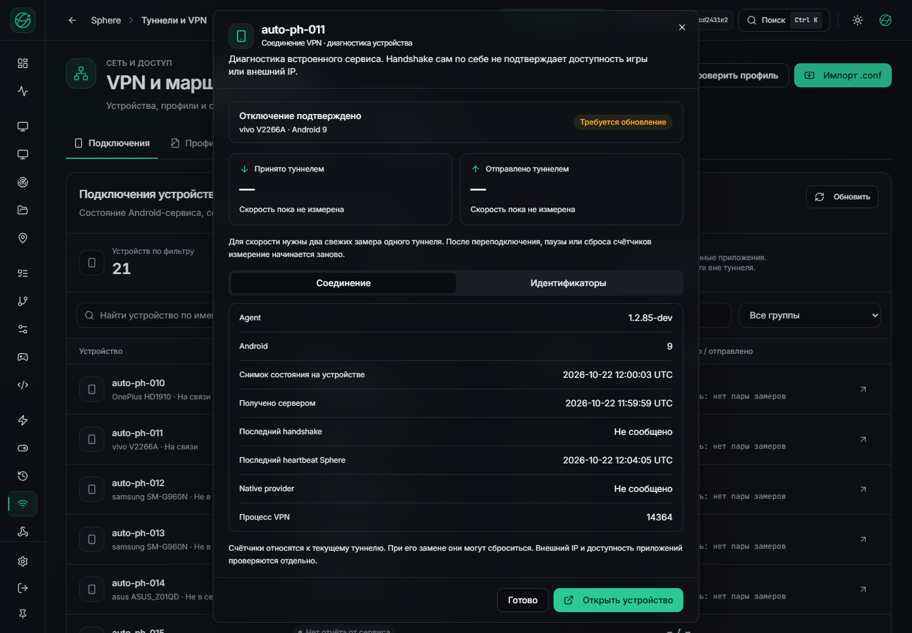
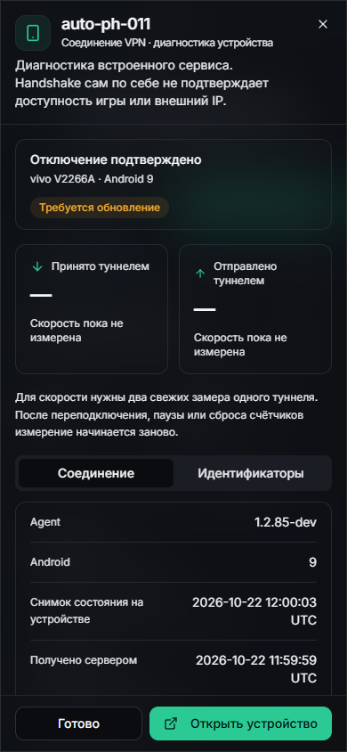

# APK85: облачная сборка и четыре подтверждённые установки

22 октября 2026. APK `1.2.85-dev /10285` установлен адресным OTA на PH010,
PH011, PH025 и PH030. На каждом устройстве независимо прочитан SHA установленного
пакета. Из 21 известного устройства четыре online; 17 offline не обновлены.

| Проверка | Результат |
| --- | --- |
| Package | `com.sphereplatform.agent.pilot.debug` |
| Источник настроенного APK | `3b437ee8c5a0067f3cfb792b25e8b383e739fc88` |
| Android tree | `e46c0b42dc23fee4261b779f6db84095c6dc16be` |
| Установленный SHA-256 | `9f2bdbe7e7040a0013b5636088426d01a8b8cae99dcfefb0dddd1400868a9180` |
| Размер | 73 217 607 байт |
| Полный hosted Android CI | [39764211758](https://github.com/RootOne1337/sphere-platform/actions/runs/39764211758), success |
| Настроенная облачная сборка | [39771397160](https://github.com/RootOne1337/sphere-platform/actions/runs/39771397160), success |
| Веб / API | UI `46dd02ff` / API `cd2431e2`, сохранены |

Полный Android-прогон проверил 1277 тестов на каждый debug-вариант: ошибок и
падений нет, по одному skip. Проверены обычные/release ограничения, direct/native
ввод и JNI для трёх ABI. Настроенная сборка отдельно проверила тот же Android tree,
native-builder и рецепт полного прогона, затем скомпилировала и проверила Dev APK.
Пропущенный full job во втором запуске не подменяет успешный первый прогон.

Для экономии памяти пользователя Gradle выполнялся в GitHub. В публичный artifact
попали только зашифрованный bundle и квитанция. Закрытые ключи подписи/получателя и
WG-профиль туда не передавались. Одноразовый configuration secret удалён с проверкой.
На рабочей станции пакет расшифрован и переподписан прежним pilot-сертификатом;
936 записей payload остались неизменными. Сертификат облачной сборки отличается
от установленного и отражён отдельно в [квитанции](VPN-APK85-CLOUD-AND-ADDRESSED-DELIVERY.json).

Обновления не очищали данные игр и не перезапускали эмуляторы. Обычный Android
канал обновлений сохранён: опубликован canary artifact и выданы четыре адресных
разрешения, без универсального назначения всем устройствам. VPN-профили этим
обновлением на PH010/PH025/PH030 не применялись.

На установленном сайте проверена диагностика APK85 при 1440×1000 и 390×844.
Мобильные document/dialog имеют ширину 390 px без горизонтального переполнения;
нижние действия доступны. Собственный QA-браузер закрыт. Подпись «Требуется
обновление» относится к старому native sample, но может быть воспринята как
требование обновить APK; уточнение формулировки остаётся отдельной правкой.

Физический VPN проверялся отдельно: [конечный опыт основного APK](VPN-APK85-MAIN-CANARY.md).
Успешная установка не закрывает нестабильность внешнего WG, DNS/IPv6, AWG3.1
obfuscation, длинную нагрузку и production executor/leases. Порядок повторной
облачной сборки: [ANDROID-CLOUD-PILOT](../../operations/ANDROID-CLOUD-PILOT.md).
