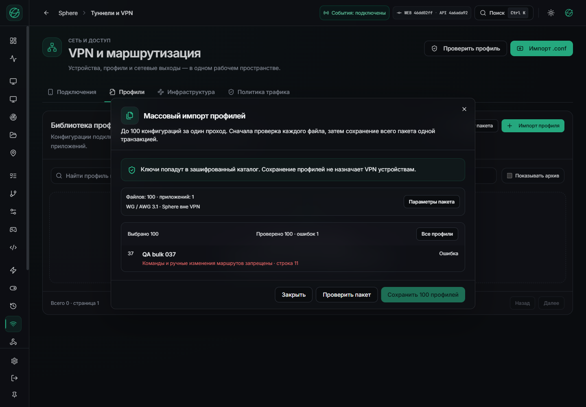
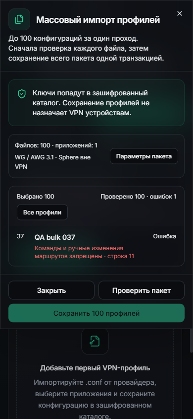
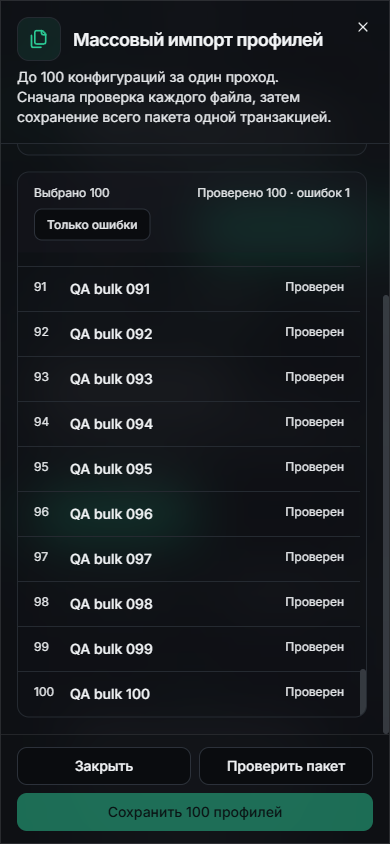
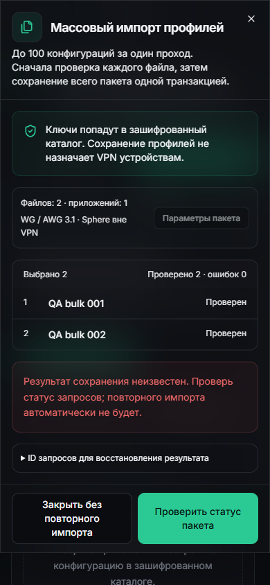
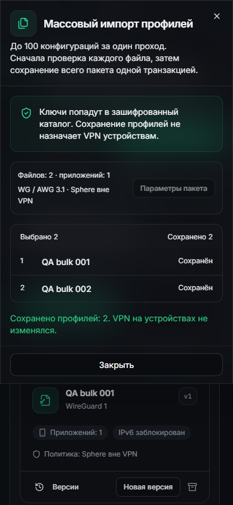
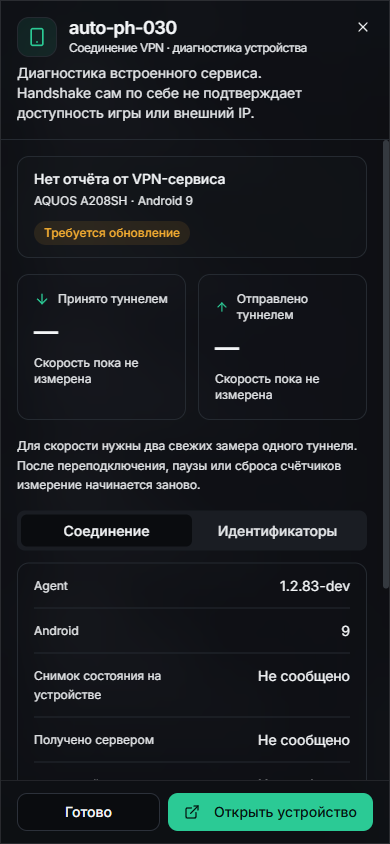

# VPN: пакетный импорт установлен и проверен вживую

22 октября 2026 · UI `46dd02ff` / API `4a6ada92` на `localhost:3015`.
[Квитанция поставки](VPN-BATCH-LIVE-DELIVERY.json),
[runtime observation](VPN-BATCH-RUNTIME-OBSERVATION.json),
[CI и ограничения](VPN-BATCH-CI-VALIDATION.md).

Оба образа установлены из проверенных GitHub artifacts. При каждой замене
сохранены остальные 45 контейнеров; schema head `20261021_vpn_profiles`,
секреты и нормальный OTA-канал не менялись. После первоначальных отказов по
Windows commit установка прошла при штатно допустимом запасе памяти.
Защитные пороги, процессы пользователя, эмуляторы и зависимости не менялись.

На настоящем сайте проверены 100 синтетических `.conf`: файл №37 с запрещённой
директивой вынесен в список ошибок, сохранение всего пакета заблокировано.
Список переключается на все 100 строк; строка 100 достижима, действия закреплены.
На 390×844 ширина документа и dialog — 390 px. Desktop проверен на 1440×1000.

Для двух валидных тестовых профилей сервер завершил HTTP 200, после чего
Playwright намеренно оборвал ответ только в своём браузере. UI показал неизвестный
исход и восстановил обе квитанции одним запросом статуса. Запрос сохранения был
один; при восстановлении новых запросов сохранения не было. Затем live API
подтвердил метаданные/status, неизвестный ID и откат новой строки при позднем
конфликте request ID. Обе тестовые записи архивированы, устройства не назначались.

В диагностике APK83 неизвестные счётчики и скорость показаны как отсутствие
данных. Расчёт скорости новой UI проверен исходными тестами/CI, но реальные
две native samples этим проходом не получены. Это не аппаратный touch test,
не приёмка VPN, stream/input, per-app accounting, прокси или production SLA.
В браузере был один ожидаемый искусственный network fault; нулевая ошибка console
для всего прохода не заявляется. Собственный QA-браузер закрыт.

