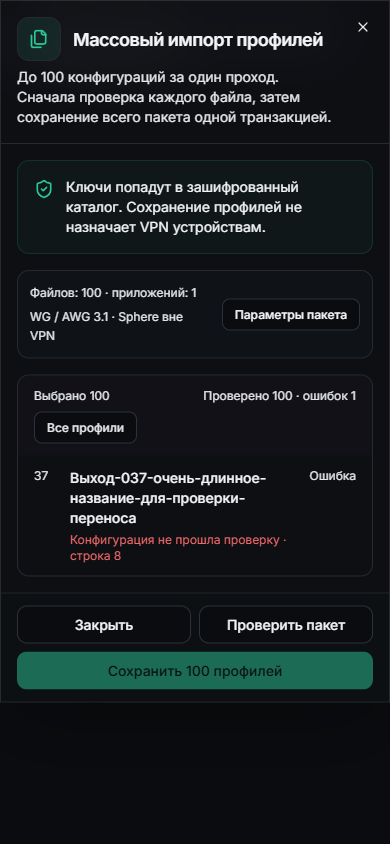
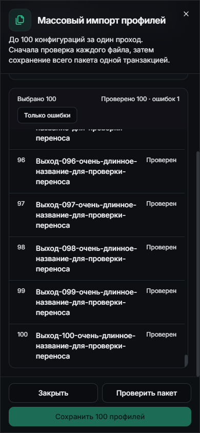
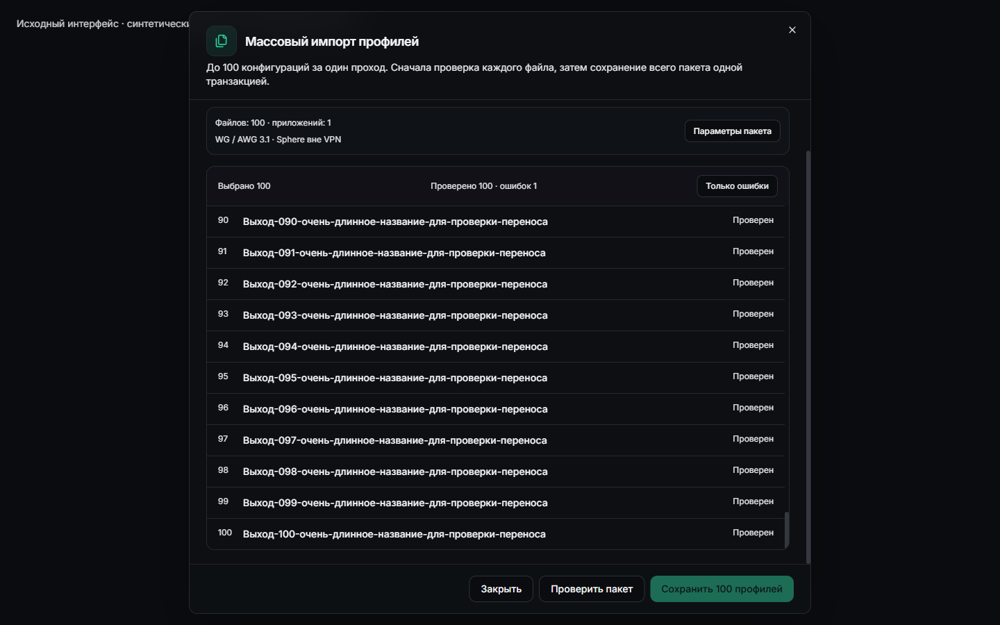

# Массовый импорт VPN: исходный код и визуальная проверка

22 октября 2026. [Квитанция с хешами](VPN-BULK-SOURCE.json).

Добавлен импорт до 100 `.conf`, общая политика приложений, проверка каждого файла,
атомарная запись новых профилей/аудита и read-only статус прежних request ID.
После неизвестного результата конфиги удаляются из refs и импорт не повторяется.
Скрипты, назначение устройствам и применение VPN этим этапом не реализованы.

230 локальных VPN tests прошли; UI-пакет имеет 7 целевых проверок, TypeScript
прошёл. Mypy проверяет 279 backend files без ошибок. В hosted suite добавлены
100 imports под минимальной ролью/RLS, rollback после позднего конфликта и
пересекающиеся конкурентные пакеты в обратном порядке. Итог hosted CI ещё нужен.

На реальных React-компонентах и синтетическом API проверены 100 файлов, длинные
имена, ошибка файла 37, возврат к полному списку и доступ к строке 100. Параметры
после проверки сворачиваются, кнопки закреплены. На 390×844 document/dialog width
равны 390 px. Собственные браузер и loopback preview остановлены. Это исходный
visual harness, не установленный сайт и не аппаратный touch test.

Hosted frontend прошёл тесты, types, build и HTTP/assets probe runtime image,
но прежний archive verifier ожидал config digest вместо OCI target ID.
Отказ сохранён, образ не устанавливался. Новый verifier проверяет полную
цепочку index/manifest → config/layers, SHA blobs, размеры и прежние границы.
Основание: [Moby containerd ImageInspect](https://github.com/moby/moby/blob/master/daemon/containerd/image_inspect.go),
[Docker image store](https://docs.docker.com/engine/storage/containerd/).

Backend image probe также встретил ECR data limit: добавлен однократный fallback
на тот же Docker Official Image digest, не на другой tag. Для OAEP оставлен
совместимый AndroidKeyStore MGF1/SHA-1 при основном SHA-256; локальное исключение
Bandit B303 ограничено одной строкой и опирается на
[официальный Android OAEP контракт](https://developer.android.com/privacy-and-security/cryptography#oaep-mgf1-message-digest).
Новые облачные результаты и установка оформляются отдельной квитанцией.
