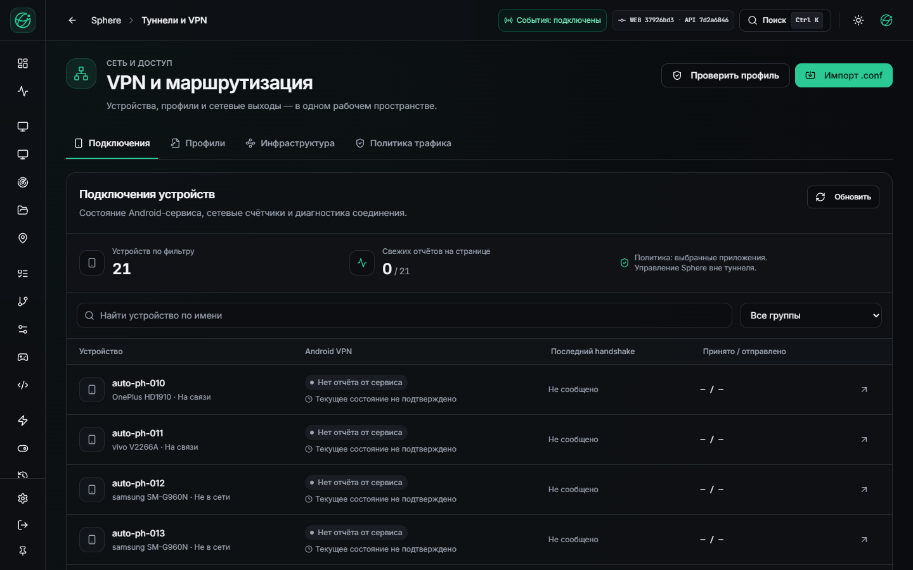
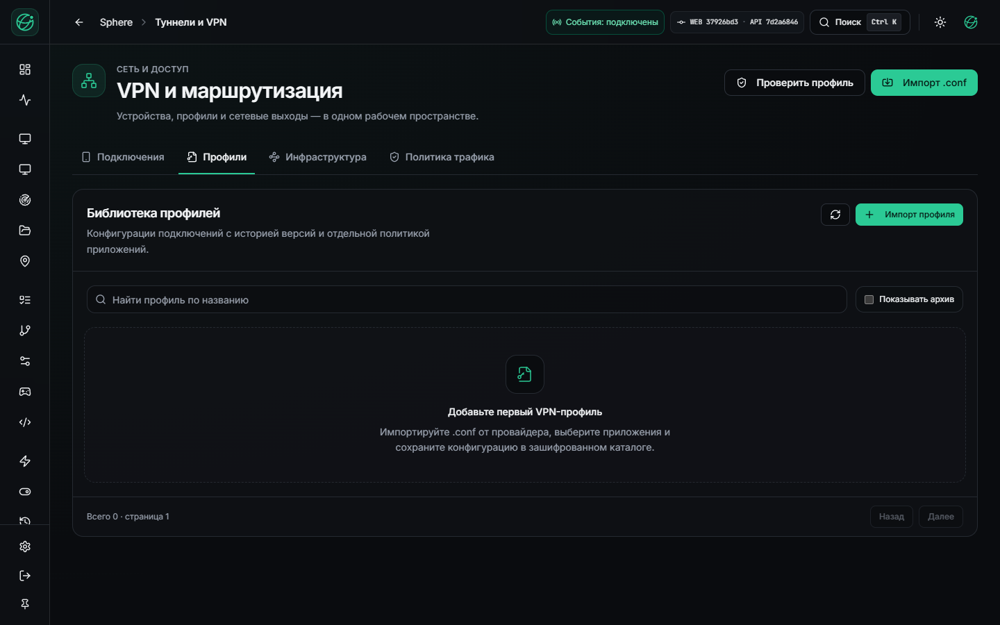
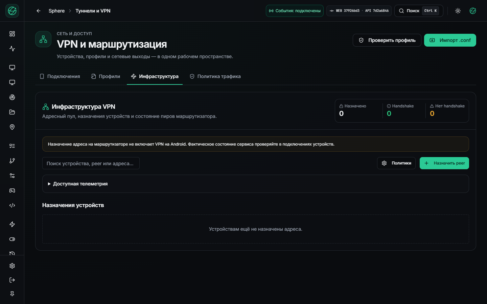
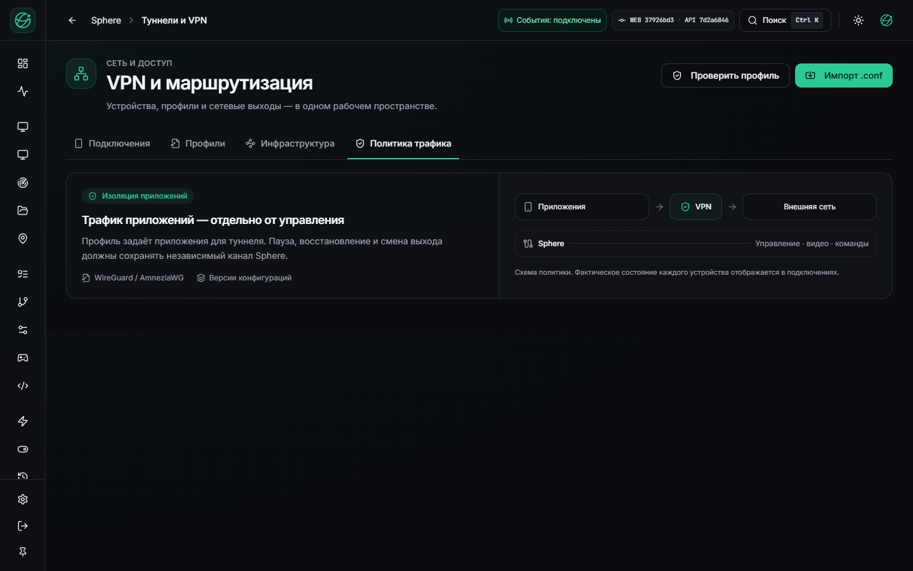
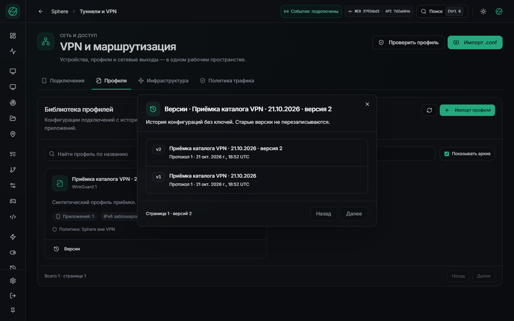
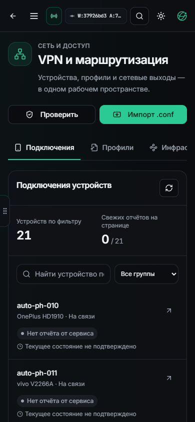
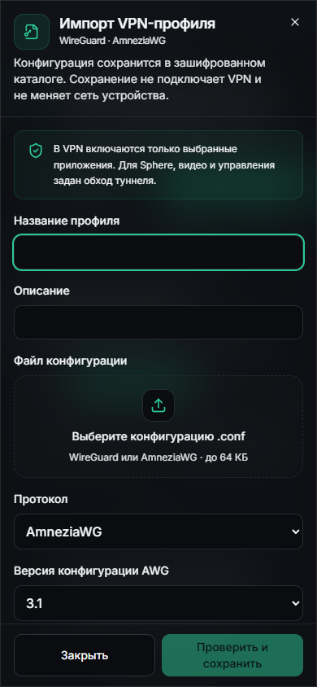
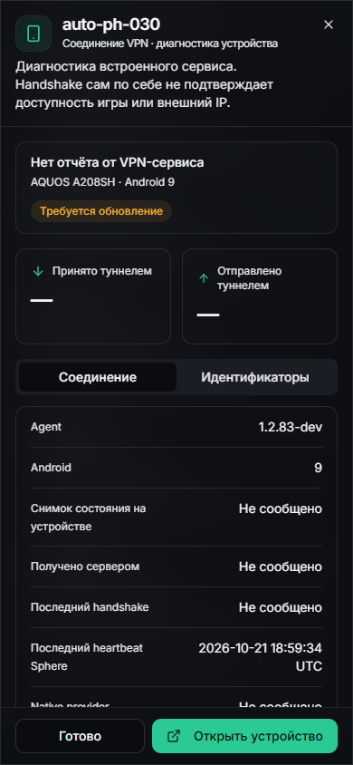

# VPN: установленный каталог и рабочее пространство

22 октября 2026, Asia/Yekaterinburg. UI `37926bd3`, API `7d2a6846`, локальный
адрес `http://127.0.0.1:3015/vpn`. [Измерения и квитанции](VPN-CATALOG-LIVE-DELIVERY.json).

На работающий сервер доставлены новая страница и зашифрованный каталог профилей.
Подключения устройств, профили, инфраструктура и политика трафика открываются
самостоятельными вкладками. Импорт и диагностика на телефоне используют доступную
ширину и высоту; заголовок и действия остаются на месте при прокрутке полей.
Скриншоты ниже сняты с установленного сайта и реальных API-ответов.

## Что проверено

- Веб: полный CI 2606 passed; Linux image HTTP probe 26 страниц/72 assets.
- API: 4440 passed, 63 skipped, 659 subtests, coverage 82,49%; packaged runtime,
  повторный старт и multiprocess metrics probes прошли.
- Приватная копия БД полностью восстановлена во временном PostgreSQL; миграционный
  worker и HTTP-цикл проверены с минимальными правами отдельной роли. Прежние данные
  проверенных таблиц сохранились. Временные сервисы удалены.
- Рабочая миграция подтверждена. Вход выполнен под настоящим catalog login,
  проверены RLS и tenant. Основная привилегированная роль API остаётся прежней.
- Через установленный API выполнены import, повтор того же UUID, import-status,
  revision/history и archive синтетического профиля. Профиль не назначен устройствам
  и оставлен в архиве. Конфиг/ключи не возвращены в публичных metadata.
- Browser: 1440×900 и 390×844, четыре вкладки, импорт, диагностика PH030, история.
  Мобильные document/dialog имеют ширину 390 px. В авторизованном VPN-проходе
  console errors/warnings 0. Собственный браузер проверки закрыт.

Переход схемы добавляет две таблицы. После успешной миграции установка API однажды
была остановлена resource guard; продолжение сверило квитанцию и не повторяло
создание роли/смену пароля. Прежние API/UI-образы сохранены для возврата. Секреты
и database archive в Git не добавлены; off-host recovery не проверен.

## Установленный интерфейс

Подключения: реестр 21 устройства. APK83 ещё не передаёт новый VPN service report,
поэтому UI показывает неизвестное состояние и необходимость обновления. Доступность
устройства и зелёный heartbeat не объявляются подтверждением туннеля.

Каталог без активных профилей; тестовая запись доступна только при показе архива.

Инфраструктура сохраняет отдельный смысл назначения router peer.

История настоящих сохранённых revisions синтетического профиля.

Мобильные подключения, импорт и диагностика:

## Открытые этапы

APK84 собран локально, но полный Android CI/OTA admission и single-APK VPN fault pilot
ещё не пройдены. Полный Android CI требует 12 GiB свободной RAM. Server durable
operation journal, уникальные client leases и общий физический исполнитель для
UI/script/orchestration остаются отдельной работой. Доставка каталога не закрывает
их и не подтверждает Android egress/fail-closed/media/control в конечном APK.

В этом проходе не отправлялись команды устройствам, не менялись игровые данные
или физические VPN. Аппаратные touch/keyboard проверки телефона не проводились.
