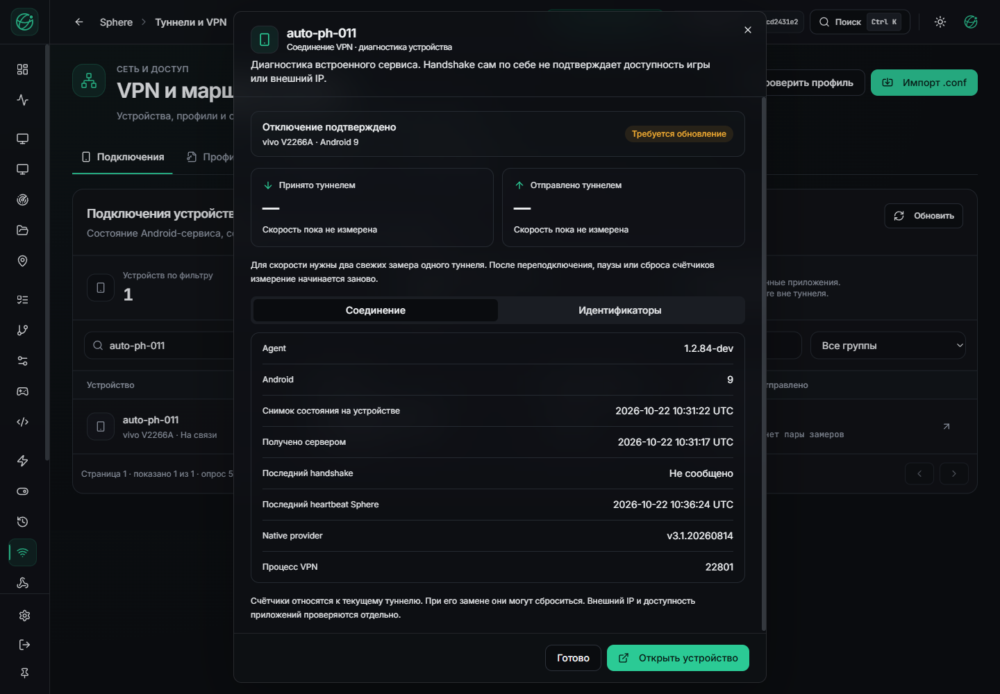

# VPN-статус Android: исправление установлено и проверено

22 октября 2026. Установлен API `cd2431e2`, образ
`sha256:cf84467ff9fe581f18cc67ecdb3a28a128466fd670d7de1737e26995d4f3f3b3`.
UI остаётся `46dd02ff`. Полный backend CI: **4428 passed**, 107 skipped,
668 subtests, coverage 82,57%; [run 39681623774](https://github.com/RootOne1337/sphere-platform/actions/runs/39681623774).

Первоначальная замена была остановлена по Windows commit headroom. Позже свежая
проверка прошла без исключения порогов. Установщик повторно использовал уже
проверенный локальный образ; повторного импорта архива не было. Schema head
`20261021_vpn_profiles`, OTA-каталог и 45 соседних контейнеров сохранены.
Это продолжение прежнего [checkpoint](VPN-STATUS-ROUTING-INSTALL-CHECKPOINT.json),
который остаётся историческим свидетельством остановленной попытки.

## Реальная проверка

RPC состояния APK84 на PH011 завершён; его snapshot и WS session совпали с
аутентифицированным `/vpn/runtime`. Отдельный процесс `:vpn` подтверждён.
Старый `sampledAtEpochMs` состояния IDLE сохранился: повторное чтение не делает
старые данные свежими. В последующем физическом опыте API получил состояния
применения, паузы, возобновления и подтверждённого отключения.

На реальном установленном сайте проверены 1440×1000 и 390×844. Диагностика показывает
Agent 1.2.84-dev, Android 9, native version и PID; вкладка идентификаторов доступна,
действия закреплены внизу. Ширина документа и модального окна на телефоне — 390 px,
горизонтального переполнения нет. Устаревший снимок не подменяется текущим heartbeat,
отсутствующие счётчики не заменяются вымышленным нулём. QA-браузер закрыт.
До входа был ожидаемый 401 refresh; заявление о полностью чистой консоли не делается.

| Проверка на телефоне | Экран |
| --- | --- |
| Состояние и закреплённые действия | [Диагностика](assets/vpn-status84-live/mobile-diagnostics.png) |
| UUID и код причины | [Идентификаторы](assets/vpn-status84-live/mobile-identifiers.png) |
| Фильтр и строка PH011 | [Список](assets/vpn-status84-live/mobile-list.png) |

Квитанции: [доставка](VPN-STATUS-ROUTING-LIVE-DELIVERY.json),
[наблюдение UI/API](VPN-STATUS-ROUTING-RUNTIME-OBSERVATION.json).
Работоспособность передачи статуса не равна работоспособности VPN:
[живой опыт APK84 выявил отдельный дефект маркировки пакетов](VPN-APK84-MAIN-CANARY.md).

## Замер ресурсов

Коллектор `eb507890` получает память через Windows `GetPerformanceInfo` после
завершения процесса проверки тома. Размеры страниц преобразуются в байты;
недоступные счётчики не дают допуска. Пороги RAM/disk/commit не менялись.
102 локальных теста и 108 subtests установщиков/коллектора прошли; отдельный
набор контейнерных контрактов — 86 тестов. Это проверки утилит, отдельно от
4428 backend tests CI.

Официальные определения:
[GetPerformanceInfo](https://learn.microsoft.com/en-us/windows/win32/api/psapi/nf-psapi-getperformanceinfo),
[поля и соответствие системным счётчикам](https://learn.microsoft.com/en-us/windows/win32/memory/memory-performance-information).
Оптимизация измерения не устраняет реальную нехватку commit: перед каждой тяжёлой
операцией нужен новый допуск.
