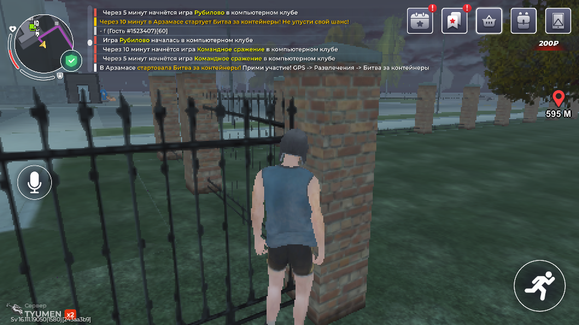
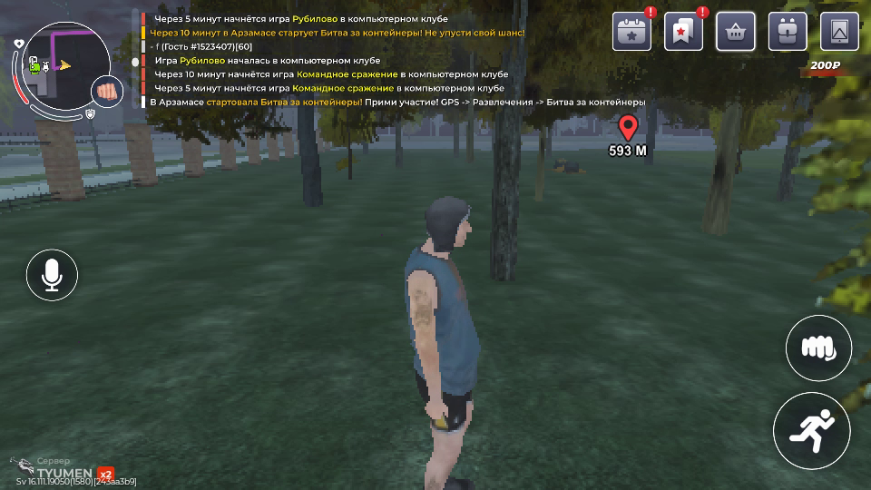
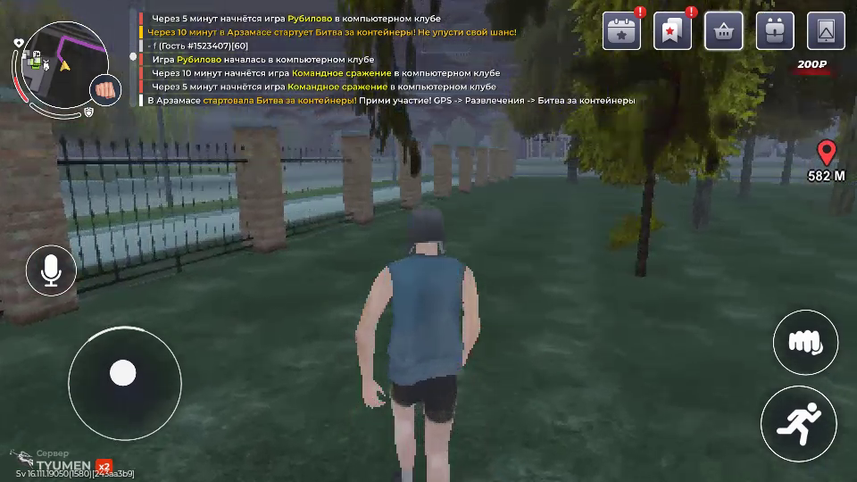

# PH011: APK88, отдельный AWG2 и конечные опыты ходьбы

**23 октября 2026 · worker0.7.2 · ограниченная физическая проверка, не production-приёмка.**
Машинная квитанция: [JSON](PH011-APK88-MOTOR-CALIBRATION.json).
Модель не управляла в этих опытах: использован калиброванный GPS/CV-контроллер
и один явно выбранный оператором обход. Прибытие к цели не подтверждено.

## Что установлено и проверено

PH011 обновлён адресной OTA до `1.2.88-dev /10288`. SHA установленного пакета
`355af6f5ecc6697bd8fee66ff9f085bdbf9841e80bb201f8d48515a1ac7e9bca`
независимо прочитан повторно в12:57 UTC. Использован ранее собранный локально
APK source `6ad0df5f`; новых сборок или GitHub jobs нет. Игра не очищалась,
обычный канал обновлений и другие устройства не менялись.

Создан ровно один отдельный клиент на существующем AWG2-сервере; ключ PH030
не переиспользован. Ответ API создания был успешен, но его первоначальный счётчик
клиентов отставал. Выполнена сверка чтением по public key вместо повторного POST.
PH011 подключается к provider endpoint без дополнительного PC ciphertext relay.
VPN основного ПК остаётся внешним сетевым условием; это не доказательство самого
короткого физического пути.

Kernel proof в12:56 UTC подтвердил guard v5, актуальный boot ID/tun index,
IPv4 default через TUN с резервным blackhole, обе OUTPUT-цепочки и UID rules.
Диапазоны приложений основного пользователя: `10000–10081`, `10083–99999`;
Sphere UID **10082** исключён. IPv6 приложений заблокирован. System UID0–9999
и дополнительные Android users этой проверкой не охвачены. Реальный reboot
PH011 и независимое измерение HTTPS exit IP не выполнялись. Загрузка обновления
игры и вход в игровой мир наблюдались; их нельзя выдавать за полный VPN soak.

Текущий смешанный парк: APK85 на PH010/PH025, APK88 на PH011/PH030. Даты package
proof для каждого устройства сохранены отдельно;17 offline не обновлялись.

## Физические результаты

| Опыт | Наблюдение | Ввод и остановка | Вывод |
| --- | --- | --- | --- |
| Первый GPS-контроллер,20с |104 коррекции; персонаж упёрся в ограду,595м до цели |46/46 APPLIED; CLOSED | Остановился по бюджету времени. Это обнаруженный дефект, не obstacle recognition. |
| Короткий операторский обход |1,2с назад-вправо на траву;595→593м |3/3 APPLIED; CLOSED | Геометрия обхода выбрана человеком по свежему кадру, не нейросетью. |
| Первый flow-контроллер |593→590м |5/5 APPLIED; CLOSED | Автоматическая остановка из-за недостатка признаков на тёмном фоне. |
| Исправленный flow + плавный стик,8с |590→582м;43 наблюдения,5,125Гц; max gap214,334мс |8/8 APPLIED; один DOWN, семь MOVE, затем подтверждённый participant close | Конечная ходьба вдоль ограды. На этом отрезке нового препятствия не встретил. |

До первого физического GPS-прогона был отдельный неудачный запуск с неверным
именем поля capture epoch:0 решений/0 событий, CLOSED. Он сохранён в квитанции.
В последнем опыте полные секундные окна отсчитываются от первого принятого
наблюдения, а не от Android capture clock; точные counts есть в JSON.

Стик остаётся удержанным между коррекциями. Частота изменения координат не обязана
равняться5 APPLIED/с: прежнее положение уже действует, если новое намерение
совпадает. Завершение каждого опыта проверено отдельно по native participant close.

## Изменения worker0.7.2

- `WalkingSteering` регулирует величину отклонения, плавно набирает скорость и
  снижает её на резком изменении курса. `blocked`, `unknown`, потеря направления,
  stale frame или разрыв обработки останавливают немедленно, без медленного ramp-down.
- `NavigationSupervisor` не считает время без наблюдений временем застревания.
  Разрыв более500мс требует остановки; неизвестная recovery при таком разрыве
  остаётся терминальной. Повтор capture timestamp не продлевает управление.
- Flow sensor выбирает до96 признаков по восьми фоновым ячейкам, исключает HUD
  и центрального персонажа, проверяет forward/backward correspondence и покрытие
  минимум трёх ячеек. Тёмный фон больше не подавляется одной яркой группой углов.
- Застревание оценивается по доле времени неподвижного фона, а не максимуму
  displacement во всём окне: единичный выброс анимации не обновляет3с движения.

Source `4fe45153`;221 motor tests и Ruff прошли. Эти компоненты сами не отправляют
ввод и не включают физический GPS provider в общем CLI. Private runner ограничен
временем, числом событий и явно отмеченной операторской оценкой свободного места.
Flow не различает поворот камеры и перемещение персонажа; семантическая оценка
препятствий, GPS/distance fusion, camera actuator и multitouch остаются работой.

## Почему текущий тест ещё не нейросетевой

P2P150M загрузилась, но после warm-up Windows commit превысил неизменный порог85%.
Изолированный bounded BF16/RoPE-кандидат снизил выделения, но также не прошёл
ресурсный допуск. Полная численная эквивалентность этого кандидата не принята.

Скачаны и проверены по SHA Qwen3.5-0.8B Q4_K_M и F16 vision projector из pinned
`unsloth` quantization repo: суммарно около737,5MB. Runtime — официальный
llama.cpp b11836, Vulkan RX9070. Успешно загрузились и Vulkan-, и CPU-варианты,
но оба остановлены **до первого prediction**: после загрузки commit составил
87,803GB и86,990GB при лимите101,336GB. Оба принадлежащих тесту процесса закрыты.
Наличие весов и свободной VRAM не доказывает доступность системной памяти.

Официальный `embeddinggemma-300m` для text conditioning P2P остаётся gated;
ранние P2P-опыты использовали нулевой текстовый embedding. Qwen нельзя просто
подставить вместо этого encoder: другое embedding space. Предсказаний модели
и современной VLM в текущем срезе **0**, и5Гц neural inference здесь не заявляются.
Пользовательские процессы, WSL и пороги RAM/commit не менялись.

## Следующие условия приёмки

1. Освободить достаточный подтверждённый ресурсный резерв для реального model
   inference, не ослабляя guard. Проверить противоположные цели на одном свежем RGB.
2. Получать оценку препятствия/свободной стороны и прогресса с confidence и
   freshness. При неизвестности останавливаться; не считать исчезновение метки arrival.
3. На одном и том же препятствии подтвердить обнаружение застревания, выбор
   проходимого обхода, восстановление прогресса и остановку при повторном провале.
4. Отдельно калибровать камеру и прыжок: двойной tap нужной кнопки и действие
   при удерживаемом стике требуют проверенной схемы multitouch/передачи контактов.
5. Измерять source capture→action, восстановление после падения/потери сцены,
   новый маршрут, vehicle control и нагрузку нескольких устройств отдельно.

Три опубликованных PNG занимают около1,17MB. Worker хранит один latest frame
в RAM; continuous screenshot/video archive этим опытом не включался. Снимки
сохранены явно для этой конечной проверки; старые изображения из чата не выдавались
за текущий экран.
