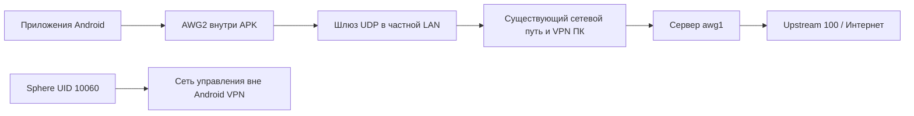

# PH030: рабочий AWG2 через локальный шлюз

23 октября 2026 года по времени Asia/Yekaterinburg; UTC-метки в квитанции
приходятся на 22 октября. [Машинная квитанция](PH030-AWG2-LAN-GATEWAY-CANARY.json).
Проверка одного устройства; общей production-приёмки VPN нет.

## Результат

На PH030 работает VPN всех обычных приложений user 0, кроме UID Sphere.
Chrome загрузил 2ip и показал **64.145.94.74**. Независимые HTTPS-пробы под UID
игры прошли по IP и по имени. Под UID Sphere запрос идёт с другим исходным
адресом; управляющая WebSocket-сессия не сменилась. Исходный IP Sphere не публикуется.

Пользователь подтвердил загрузку обновлений Black Russia, вход и движение в
игре. Отдельное наблюдение сети длилось не менее 900 с: 11 свежих снимков
native provider и тот же PID/управляющая сессия. Два свежих изображения с
интервалом около пяти минут показывают персонажа в игровом мире. Продолжение
15-минутной проверки экрана остановлено отказом `device_input_busy`: при
подключении пользователя возник `root_handoff_unknown`, после чего ввод
перешёл в `cleanup_unknown`. Полное 15-минутное игровое окно не принято.
Отсутствие внутреннего game reconnect между снимками не доказано. Непрерывный видеозахват
и моторный ИИ в этой проверке не запускались. Перед окном наблюдения один раз
выведено уже установленное приложение на передний план; во время окна запусков,
касаний и запросов переподключения от наблюдателя не было.

## Как проходит трафик

Это **рабочий обходной путь через ПК**, а не исправление прямого Android → WAN.
Без LAN-шлюза Android получал handshake, но не рабочий HTTPS. Точная причина
различия путей не установлена: утверждения о блокировке провайдером, неисправности
эмулятора или бане игры проверка не доказывает.

Встроенный VPN находится в одном APK, но текущий транспорт дополнительно
зависит от процесса на этом ПК и его существующего VPN. Шлюз работает с
ограниченной арендой 24 часа; точное время истечения — в JSON. Автозапуска и HA
нет. При его остановке Android guard должен оставаться закрытым.
[Запуск, остановка и ограничения](../../operations/VPN-LAN-GATEWAY-CANARY.md).

## Защита при потере пути

| Состояние | HTTPS UID Sphere | HTTPS IPv4 и DNS UID игры | IPv6 UID игры |
| --- | --- | --- | --- |
| Активный рабочий путь | Проходит вне туннеля | Проходит через VPN | Блокируется |
| Явная пауза | Проходит | Блокируется | Блокируется |
| Шлюз остановлен, Android TUN остаётся активным | Проходит | Блокируется | Блокируется |
| Шлюз запущен заново, Android TUN не пересоздавался | Проходит | Снова проходит | Блокируется |

Проверены обе семейства UID rules/FILTER и blackhole defaults, guard plan 5,
диапазоны `10000–10059` / `10061–99999`, исключение точного UID `10060`.
Все обычные процессы текущего пакета Sphere имеют этот UID. Системные службы,
сетевая делегация другому UID, reboot и дополнительные Android users/profiles
не включены в принятую область. Это не обещание универсального kill switch
для каждого системного процесса Android.

Остановка шлюза проведена до длительного наблюдения. Во время наблюдения
VPN-профиль, маршруты и шлюз не менялись. Счётчики native и шлюза росли; снимки
и их отметки времени сохранены в квитанции. Сам handshake не использовался
как доказательство интернета или входа в игровой мир.

## Что изменено у провайдера

После отдельного разрешения пользователя создан ровно один AWG peer на уже
существующем `awg1`. Старый WG peer оставлен неактивным: API запрещает удаление
(`FORBIDDEN_DELETE`). Другие peer и серверы не создавались. Неоднозначный readback
после успешного POST разрешён чтением списка без повторного создания.

Upstream 105 показывал `healthy`, но host HTTPS с тем же AWG peer не проходил.
После scoped repair и отдельного переключения **только awg1 с 105 на 100**
независимый userspace probe на ПК прошёл HTTPS по IP за 326 мс, по имени за
409 мс. При переключении awg1 содержал только наш тестовый peer. Привязки
соседних WG/AWG серверов не менялись. Число peers не означает число разных
выходных IP: привязка upstream относится ко всему WG/AWG серверу.

Применён согласованный AWG2: S1..S4=32, Jc=6, Jmin=100, Jmax=400;
скалярные H сохранены. Клиентский A/B с официальной I1-сигнатурой не помог и
отменён. Эти параметры не объявляются универсальным сетевым решением.
API выдаёт параметры 2.0; строка native provider `v3.1.20260814` и формат
OpenAPI 3.1.0 не означают, что на сервере работает протокол AWG3.1.
[Контракт и исследованный исходник сервиса](../../design/WG-ROUTER-PROVIDER-INTEGRATION.md).

## Поставка и проверки

- UI `a239baa2` и API `1afdc529` сохранены, Docker image ID повторно сверены.
  Схема БД и каналы обновлений в этом проходе не менялись.
- На PH030 остаётся APK86 / `1.2.86-dev` /10286. На PH010/PH011/PH025 — APK85.
  Пакетные SHA и времена их независимой проверки перенесены из прежней
  квитанции как исторические доказательства, без новой установки.
- В том же зашифрованном профиле активна ревизия 9 с Endpoint локального шлюза.
  Новый APK для смены адреса профиля не требовался.
- Добавлен воспроизводимый `tools/vpn_lan_relay.py`: ciphertext only, один LAN
  IP, фиксированный upstream, предел пакетов/размера, STOP и срок аренды.
  Публичный маркер H1 служит выбору endpoint, **не аутентификации шлюза**.
- 11 локальных тестов прошли: ограничение источника, смена порта, packet budget,
  неверные CLI параметры, реальная UDP-передача без изменения байтов,
  остановка/истечение аренды и освобождение сокетов. Ruff прошёл.
- Удаление трёх собственных Android diagnostic fixtures ожидает восстановления
  ввода: `device_input_busy` не обходится. Временные nginx locations уже
  восстановлены. Один ограниченный gateway-процесс намеренно оставлен работать.
  Ключи, пароль, исходный IP Sphere и сырой трафик
  не включены в публичные доказательства.

## Выявленный дефект стрима и управления

Пользователь подключился с телефона в той же LAN, без VPN на ноутбуке.
История стрима подтвердила fallback `server_websocket`: ICE оставался
`checking`, ответов STUN-проверок не было с обеих сторон. Android NetworkMonitor
перечислял как Wi-Fi, так и VPN, несмотря на исключение UID Sphere.
Отдельно native input зафиксировал `root_handoff_unknown` и `cleanup_unknown`;
это блокирует ввод даже через сервер. Успешный VPN soak не закрывает эти дефекты.
Подготовка APK87 исключает VPN из ICE и устраняет лишнюю FIFO-проверку shell,
который не отправлял input; непроверенное освобождение ввода не обходится.
Физическая приёмка исправлений остаётся отдельной от этой сетевой квитанции.

## Следующий допуск

1. Сделать путь независимым от пользовательского ПК: исправить прямую WAN-связь
   или поставить управляемый шлюз с собственной сетевой приёмкой.
2. Добавить аутентифицированное владение шлюзом, аренды/восстановление и честный
   статус transport/egress в UI; истечение не должно открывать исходный IP.
3. Отдельно аттестовать сервер AWG3.1 и согласованный формат клиента; миграция
   сервера не выполняется автоматически по номеру библиотеки Android.
4. Проверить reboot, делегированные UID, дополнительные users, смену сети и
   длительную нагрузку; затем расширять на другие устройства.
5. После стабильной сети отдельно возвращаться к моторному ИИ, измеряя возраст
   кадра и подтверждённое действие, а не только сетевой RTT.

Официальные материалы: [AmneziaWG](https://docs.amnezia.org/documentation/amnezia-wg/),
[диагностика отсутствия трафика](https://docs.amnezia.org/troubleshooting/self-hosted-amneziawg-not-working/).
