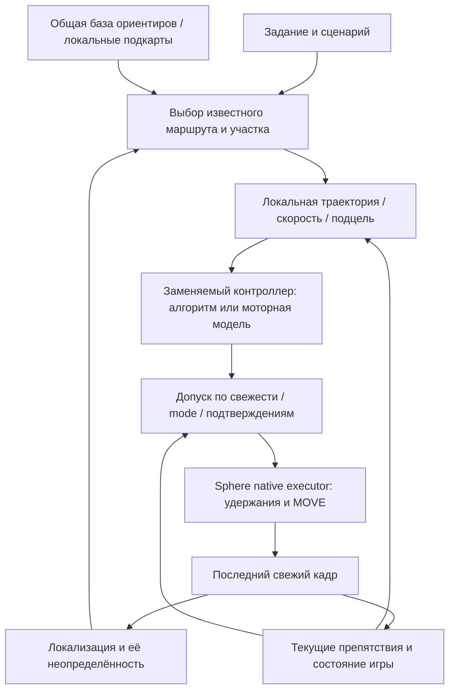

# Навигация по записанному маршруту: ответы на 30 вопросов перед игровым тестом

Дата исследования: 24 октября 2026. Контекст: Sphere, Android/LDPlayer,
RX9070 16 GB для текущего pilot, возможные RTX3070M 8 GB для дальнейшего запуска.
Это техническое решение и протокол эксперимента, а не акт приёмки автономного фарма.
Основной [архитектурный план](../../design/MOTOR-AI-PLATFORM.md) остаётся общим для разных игр.
Дополнительный запрос о плотной сцене, помещении и свободной3D прогулке разобран
в [выборе dense pipeline и viewer](../../design/LIVE-ROUTE-RECONSTRUCTION.md#плотный-3d-проход-помещение-и-виртуальная-прогулка):
фактические ограничения preview, Brush наAMD, mesh и Gaussian варианты, требования
к покрытию и отличия от настоящегоLiDAR. Эти backend пока не установлены.

## Решение, которое предлагаю проверить

Идея «показать маршрут и затем повторять с обратной связью» реалистична.
Предположение «один Full HD проезд даст точную карту мира и гарантированный
автономный повтор при 480×270 внутреннего рендера» пока не подтверждено.
Видеозапись не раскрывает невидимые поверхности, игровые коллизии и будущие
движения транспорта. Качество записи необходимо, но само по себе недостаточно.

Для первого рабочего результата выбираем **маршрутный граф, визуальную
локализацию по ориентирам и локальную проверку проезда**. Разреженную 3D-геометрию
добавляем там, где она действительно улучшает оценку положения и управление.
Плотная модель всего города и Gaussian Splatting не являются предварительными
условиями первого A→B. Это инженерный выбор для нашего ограничения по ресурсам,
а не утверждение, что такой стек уже работает в Sphere.

Уточнять исходные условия заново не требуется: оборудование, диапазон разрешений,
цель 3–5 коррекций/с и намерение запускать десятки клиентов известны из истории.
В основном эксперименте считаем, что доступны только изображения и собственный
подтверждённый ввод. Миникарта/координаты — отдельные опциональные adapters.
Режим камеры, транспорт, допустимую скорость и конечное действие фиксируем перед
конкретным прогоном; один профиль не переносим автоматически с ходьбы на скутер.

### Что уже подтверждено в нашем проекте

| Область | Проверенный факт | Чего факт не доказывает |
|---|---|---|
| Последний веб | Образ `566053388ff79437c8f777fefbf361bda5eed792` запущен в review UI и healthy при текущем чтении Docker; локальный gate: 189 наборов / 2681 тест | Работу всех игровых сценариев |
| PH011 | По квитанции доставки APK90/10290, SHA установленного пакета проверен; новый APK для транспортной раскладки не требовался | Что каждый эмулятор обновлён до этой версии |
| Игровая запись | Ранее проверены 6026/6026 кадров за 190,215 с, среднее 31,67 FPS, SHA/журнал/CLOSED | Full HD60, 500-метровый маршрут или автономный повтор |
| Транспортные удержания | Новый browser trial: 803/803 кадра; газ 1805 мс, руль 1784 мс, по одному DOWN/UP, удержания перекрываются | Умение модели ездить на скутере: проверка выполнена на Android fixture |
| Наблюдения 5 Hz | Read-only trial: 48 RGB-наблюдений за 10,006 с, 4,797 Hz; максимальный receive gap 417,412 мс | Строгие 5 Hz без провалов; полную задержку Android capture→APPLIED |
| 3D | DA3-SMALL и Rerun показывают две картинки, облако точек и камеры | Единую сшитую карту, метры, проходимость или динамический объезд |
| Сохранение | Скачанные пять отдельных файлов транспортного клипа независимо проверены | Системный выбор папки во всех браузерах: в IAB он сразу отменился, проверка обычного Windows-браузера остановлена инструментом |

Историческая доставка: [WEB-TEACHING-DELIVERY.json](WEB-TEACHING-DELIVERY.json).
Последующие локальные квитанции: `.local-pilot/teaching90-vehicle-delivery/vehicle-proof.json`,
`web-installed.json`, `.local-pilot/local-ci/runs/20261024T180239Z-3ee83e89/receipt.json`.
Это датированные доказательства; состояние APK в этом исследовании повторно не менялось.

## 1–6. Создание карты

### 1. Можно ли восстановить навигационную карту из обычного видео?

Да, при достаточной видимости статичных ориентиров, движении камеры с параллаксом
и проверке геометрии. Но результат не гарантирован для произвольного ролика.
У монокулярной реконструкции без независимого масштаба нет доказанного перевода
единиц в метры. Скрытая за зданием дорога, невидимый бордюр или прозрачная игровая
коллизия из одного проезда могут вообще не восстановиться.

Для навигации достаточно покрытия нужного коридора и надёжной локализации в нём;
полная копия мира не обязательна. [COLMAP](https://colmap.github.io/tutorial.html)
предоставляет восстановление камер и разреженных точек с дальнейшей плотной
обработкой, но его результат ещё нужно проверить на нашем игровом материале.

Даже модель с названием metric depth не устанавливает соответствие её оценок
реальным единицам конкретной игры: перспективы, масштабы объектов и камера могут
отличаться от обучающих сцен. Нужны независимые anchors/измерения либо честные
относительные единицы. Известный рост нарисованного персонажа — гипотеза масштаба,
а не гарантированная калибровка.

### 2. Какие технологии сочетать?

| Технология | Роль в предлагаемом эксперименте | Ограничение |
|---|---|---|
| Visual teach-and-repeat / топологический граф | Последовательность ориентиров, ветвления, прогресс по показанному коридору | Сам граф не знает свободный объезд и может спутать похожие улицы |
| COLMAP / SfM | Offline опорные камеры, разреженная геометрия и оптимизация | Нужны согласованные виды; динамика и повторяющиеся фасады мешают |
| SLAM / visual odometry | Относительное движение между коррекциями, локальные подкарты | Дрейф, потеря tracking; монокулярный scale неоднозначен |
| hloc + локальные признаки + LightGlue | Найти место в базе и геометрически проверить соответствия | Поиск похожей картинки ещё не pose; требуется достаточное число надёжных совпадений |
| VGGT / DA3 | Кандидаты для depth/pose и инициализации геометрии | Нейронная оценка не гарантирует игровой метрический масштаб или коллизии |
| 3D Gaussian Splatting | Дополнительная визуализация / синтез видов | Хороший вид не означает пригодную collision mesh; не основной локализатор |
| Recast / граф коридоров | Планирование на уже проверенном пространственном представлении | Не восстанавливает отсутствующую геометрию из видео |

Имеет смысл сначала сравнить небольшой набор: существующий ORB baseline,
ALIKED или SuperPoint с LightGlue и разреженной SfM-картой. Не устанавливать
одновременно все тяжёлые системы. hloc уже связывает retrieval, matching и pose
estimation; VGGT экспортирует результат в COLMAP-формат.
[hloc](https://github.com/cvg/Hierarchical-Localization),
[LightGlue](https://github.com/cvg/LightGlue),
[VGGT](https://github.com/facebookresearch/vggt),
[3DGS](https://github.com/graphdeco-inria/gaussian-splatting).

### 3. Отдалять ли камеру?

Не до максимума. Увеличение обзора полезно, пока ориентиры остаются достаточно
крупными. Маленькие столбы, бордюры и разметка на Low могут исчезнуть из полезных
пикселей. Лучше стабильная камера, близкая к будущему рабочему виду, чем красивый
обзор сверху, который при повторе никогда не встречается.

Отдаление камеры и изменение FOV — разные операции. Перемещение камеры меняет
ракурс/окклюзии; FOV меняет intrinsics. Для разных видов нужны отдельные параметры
камеры. При простом масштабировании картинки и прежнем FOV intrinsics можно
масштабировать; при смене crop/zoom это надо пересчитать и проверить.
Для обычной перспективы игрового renderer начальный кандидат — PINHOLE,
не обязательная сложная модель физического объектива.
[Модели камер COLMAP](https://colmap.github.io/cameras.html).

### 4. Какие настройки графики использовать для записи?

Корректировка прежнего совета: **Full HD и render100% полезны, но Ultra во всех
пунктах не требуется**. Важнее сохранить геометрию и вид камеры, которые будут на Low.

| Настройка | Начальный профиль master | Почему |
|---|---|---|
| Android / игра | 1920×1080, DPI320 как начальная настройка UI, render100% | Чёткий исходник; DPI не является калибровкой игровой камеры |
| FPS | Цель 60 при стабильной нагрузке; реальный FPS и gaps измеряем | 120 FPS не нужны для первого опыта; перегрузка хуже стабильного исходника |
| FOV, вид, дистанция камеры | Фиксировать, приблизить к рабочему режиму | Снижение разницы между master и повтором |
| Геометрия, LOD, растительность | Сначала близко к будущему Low | Не строить навигацию на деталях, отсутствующих при повторе |
| Текстуры | Достаточно чёткие, без превышения RAM/VRAM | Сохранить ориентиры; дополнительно нужен настоящий Low-проход |
| Дальность | Покрывать ближайшие решения и торможение | Максимальная дальность не обязательна, резкий pop-in нежелателен |
| Motion blur, depth of field, camera shake | По возможности выключить | Снижение смаза и нестабильности проекции |
| Тени/отражения | Стабильные и согласованные с рабочим режимом | Отражения и движущиеся тени не должны стать anchors |
| Сглаживание | Без заметного смазывания и temporal ghosting | Сравнить по повторяемости признаков, а не только по красоте |

Это предлагаемый профиль эксперимента, не измеренный оптимум Black Russia.
Если FHD60 не удерживается, начнём со стабильного FHD30 и честно зафиксируем это.
При быстром повороте важны короткий смаз и перекрытие, а не номинальное число FPS.

### 5. Как записывать большую территорию?

Сначала один короткий коридор, затем маршрут около 500 м с двумя-тремя поворотами
и возвращением к узнаваемому участку. После успешного восстановления — сеть
маршрутов с общими перекрёстками. Движение плавное, камера стабильная, на поворотах
скорость ниже. Не использовать только вращение на месте: нужен перенос камеры.

Сохраняем всё исходное видео, а keyframes выбираем по смещению, параллаксу,
перекрытию и качеству. Не требуется реконструировать каждый из 60 кадров/с.
Объект должен наблюдаться с нескольких близких и немного отличающихся позиций;
конкретный процент overlap подбираем по успешности регистрации, не объявляем
универсальные 70% гарантией. Обратное направление и другая высота камеры —
дополнительные опыты, а не замена кадров рабочего ракурса.
[Рекомендации COLMAP](https://colmap.github.io/tutorial.html).

### 6. Как объединять районы без дрейфа?

Общие статические ориентиры, перекрывающиеся подкарты, проверенные loop closures
и совместная оптимизация. Монокулярные подкарты сначала могут потребовать Sim(3)
выравнивания — rotation, translation и scale. Нельзя склеивать их по близости
номеров кадров или по одному похожему фасаду. Для непроверенной связи сохраняем
раздельные компоненты и uncertainty.

COLMAP поддерживает merge по общим зарегистрированным изображениям с последующим
bundle adjustment. Это уменьшает ошибки, но не обещает нулевой дрейф. Для
первого teach-and-repeat можно использовать локальные подкарты без идеально
точной общей геометрии города.
[COLMAP FAQ](https://colmap.github.io/faq.html), [VT&R3](https://utiasasrl.github.io/).

## 7–11. Динамика мира

### 7. Как NPC, игроки и машины портят реконструкцию?

Алгоритм может принять движение объекта за движение камеры, создать «призрачную»
поверхность или привязаться к машине, которой в следующий раз нет. Опасны и
собственный персонаж в третьем лице, плавающие имена и интерфейс: они движутся
в другой системе координат. Чем большую часть кадра занимает динамика, тем
меньше надёжных опор. При недостатке опор надо отвергнуть pose, а не достроить её.

### 8. Как отделять постоянное от случайного?

Комбинацией semantic/instance masks, согласованности нескольких видов и анализа
движения после компенсации движения камеры. Неподвижная сегодня машина остаётся
потенциально временным объектом. Полезны повторные независимые проходы и оценка
того, насколько долго landmark подтверждается на разных сессиях.

Маски для pose нужно применять до оценки движения, маски для fusion — до
добавления точек в карту. Наша текущая DA3-маска отбрасывает часть облака уже
после inference и не обеспечивает первый пункт. DynaSLAM подтверждает метод
сочетания геометрии и определения динамического содержимого; его старый стек
Python2.7/Mask R-CNN не предлагается устанавливать как современный turnkey backend.
[DynaSLAM](https://github.com/BertaBescos/DynaSLAM).

### 9. Что делать с другой погодой, временем суток и парковкой?

Хранить несколько вариантов внешнего вида для одних и тех же мест и проверять
положение по устойчивым структурным признакам и последовательности. Фонари,
асфальт и фасады тоже могут сильно меняться по свету; одного признака недостаточно.
Обновления базы принимать после проверки, чтобы одна ошибочная поездка не
«переучила» место на чужую улицу. Начальный тест проводим в похожих условиях,
затем добавляем независимые изменения. Робототехнический multi-experience подход
есть в VT&R, но устойчивость конкретно в игре надо измерить.
[VT&R](https://utiasasrl.github.io/).

### 10. Как учитывать LOD и стриминг?

Сравнивать объекты на сопоставимых дальностях и режимах, понижать доверие к
дальним нестабильным деталям, не закреплять transient pop-in как новую стену.
Хранить профиль графики, версию игры и разновидность камеры вместе с картой.
Проверять, не исчезла ли сама геометрия на Low, а не только текстура.

Отсутствующий в кадре объект не становится доказанно отсутствующей коллизией.
Неизвестный участок — неизвестный, особенно на подъезде к перекрёстку или за
закрывшим обзор грузовиком. Карта должна поддерживать частичную инвалидизацию
после игрового обновления и повторную проверку соответствующего коридора.

### 11. Нужен отдельный слой динамических объектов?

Да. Предлагаем разделить долговременные ориентиры/дороги и текущие препятствия
со сроком годности, скоростью, направлением и uncertainty. Машину можно исключить
из постоянной карты, но она всё равно должна останавливать или изменять текущий
план движения. Старый obstacle track не переносим в новую сессию игры.

## 12–17. Full HD master и настоящий Low

### 12. Насколько различаются FHD High и 540p/render50%?

Очень существенно, но процент потери локализации заранее неизвестен. Если 50%
означает половину каждой стороны, мировой слой имеет около 480×270 против
1920×1080: вчетверо меньше отсчётов по каждой оси, в 16 раз меньше по площади.
Если игра считает slider иначе или использует dynamic resolution, размер надо
проверить. HUD может отрисовываться отдельно в 960×540.

Обычное уменьшение FHD-скриншота не воспроизводит Low: отличаются LOD, фильтрация,
рендер теней, postprocessing, интерфейс и дальность. Реальный Low-датасет обязателен
для доказательства переноса; нейронный upscaler не вернёт исчезнувшую информацию.

### 13. Какие изменения самые опасные?

Для нашего проекта первым проверяем изменившуюся геометрию/LOD/растительность,
вид камеры/FOV/crop, затем потерю мелких ориентиров и освещение. Это порядок
экспериментов, а не доказанный рейтинг для всех локализаторов. Для чисто
appearance-based retrieval свет иногда окажется более критичным, чем LOD.
Размер, DPI, game render scale и intrinsics записываем раздельно.

### 14. Можно ли иметь одну карту для обоих режимов?

Да, **одну геометрическую/топологическую основу с несколькими наборами признаков
и изображений**. Второй полный 3D-мир не обязателен. Но точки, не видимые на Low,
не должны быть единственной опорой локализации. Если игровой patch или Low меняет
проходимую геометрию, это уже отдельная ревизия слоя, которую надо учитывать.
Не выдаём общую map ID за доказательство совместимости режимов.

### 15. Нужны ли настоящие кадры Low?

Да. После master человек повторяет тот же маршрут в 960×540 с настоящим render50%.
Этот проезд сначала только наблюдаем: строим соответствия с master, проверяем
ложные совпадения, видимость ориентиров и возможность оценить относительную pose.
Часть Low-данных можно использовать для настройки, но отдельные повторные проезды
оставляем для проверки без подглядывания и без подбора порога по каждому кадру.

Если используем Low-картинки как дополнительную базу, это надо явно назвать:
«FHD-основа с Low-reference», а не «система работает от одной FHD-записи».

### 16. Как адаптировать локализатор без обучения своей большой модели?

Сначала используем готовые признаки и matcher, retrieval нескольких кандидатов,
проверку геометрии и временную согласованность. Настраиваем scale pyramid,
число признаков и masks на выделенном наборе. Для сложных мест добавляем
несколько reference views реального Low. Fine-tuning небольшого descriptor
рассматриваем только после измеренного провала этих более дешёвых способов.
[hloc](https://github.com/cvg/Hierarchical-Localization).

Восстановление pose через 2D↔3D matching/PnP требует калибровки, достаточных
inliers и пространственно разнообразных опор. Большая homography на одном фасаде
не доказывает положение персонажа на улице. Нужны отрицательные примеры похожих
перекрёстков и право локализатора ответить unknown.

### 17. Super-resolution, признаки или обучение на Low?

Начальный порядок: реальные Low references → устойчивые признаки/геометрическая
проверка → при необходимости адаптация небольшого локализатора. Super-resolution
только отдельная ablation: она может улучшить вид и одновременно придумать
повторяющиеся детали, по которым matcher ошибётся. Не считать синтетическую
резкость новым измерением коллизий. Сравниваем latency и false localization,
а не только визуальное качество увеличенной картинки.

## 18–22. HUD, pose и управление

### 18. Отключать HUD? Использовать миникарту?

Скрыть HUD для master полезно, если управление сохраняется в прежних зонах.
Полного удаления всех надписей требовать нельзя: остаточные world labels,
персонаж и динамические области должны иметь masks/confidence. Исходное видео
сохраняем без закраски. Геометрический observer и HUD observer получают разные
производные одного кадра.

Миникарта, компас и GPS могут давать дешёвые дополнительные наблюдения. Нужна
калибровка zoom/rotation/player icon, уровня карты и её собственного scale.
Левый верхний пиксель большой карты можно назвать (0,0), но это создаёт только
координаты изображения; метры и дорожную связность этим не получаем.
В основном vision-only тесте HUD используем только в отдельно помеченной ветке.

### 19. Как находить pose без игровых координат?

Последовательность: выбрать вероятные места по текущим признакам и истории →
сопоставить локальные признаки с reference → проверить 2D↔3D геометрию или
относительную pose → объединить с недавним визуальным движением и неопределённостью.
При расхождении не прыгать автоматически на дальний похожий район.

На коротком повторяемом коридоре допустима сначала локализация «между ориентирами
12 и 13» плюс ошибка направления/поперечного смещения. Для первых повторов это
может быть дешевле полного глобального SE(3). Однако retrieval без оценки нужной
для руля ошибки остаётся распознаванием места, а не контроллером.

### 20. Что делать с независимой камерой и движением персонажа?

Разделять pose камеры, положение управляемого объекта, направление его корпуса,
скорость и mode. В третьем лице камера не приклеена жёстко: отстаёт, приближается
у стены, вращается отдельно, меняет zoom. Нельзя напрямую рулить направлением,
которое смотрит камера. Для этого нужны проверенный camera-mode adapter,
наблюдение персонажа/транспорта, temporal model и при наличии HUD heading.

Смена «пешком→скутер», вида или FOV инвалидирует соответствующую калибровку.
Удержания не восстанавливаются вслепую. Ускорение и повороты требуют настройки
динамики контроллера на конкретном транспортном профиле. Одинаковая клавиша
не означает одинаковую скорость или радиус поворота во всех играх.

### 21. Как получить NavMesh и реальные коллизии?

Recast умеет строить navmesh из входных triangle meshes, включая фильтрацию
по проходимости. Но ему сначала нужна подходящая геометрия и размеры агента.
Из дырявого monocular облака нельзя автоматически получить истину об игровых
коллизиях. Лестницы, крыши и дорога друг над другом требуют различать уровни.
Пешеходная mesh не является планом для автомобиля с ограничением радиуса поворота.
[Recast](https://github.com/recastnavigation/recastnavigation).

Начальный более простой вариант — проверенный маршрутный коридор/дорожный граф
с направлением, разрешённым способом движения и зонами неопределённости.
Факт человеческого проезда подтверждает проходимость показанной линии только
для тех условий и габаритов. Для неизвестного объезда нужны свежая свободная
зона и возможность вернуться в коридор; визуально низкий забор не означает,
что игра разрешает его перепрыгнуть. Отдельные jump/climb skills квалифицируются.

Связь в графе должна означать подтверждённый переход, а не только совпадение
картинок. Две точки могут видеть один фасад через забор, стекло или с разных
уровней эстакады. Для дороги нужны направление движения, допустимый коридор,
повороты и габариты транспорта; обратная связь не создаётся автоматически по
одному прямому проезду. Плотная mesh без этих атрибутов не обеспечит езду по полосе.

### 22. Как реагировать на потерю pose, препятствие и застревание?

Предлагаемый автомат состояний: `following → slowing/stopped → relocalizing →
following` либо `blocked/needs_operator`. При потере свежего видео/ввода —
подтверждённое освобождение контактов. Для транспорта отпускание газа не равно
мгновенной остановке: торможение — отдельное проверенное действие, а при потере
канала нельзя гарантировать остановку игрового автомобиля.

Препятствие сначала вызывает снижение скорости/остановку. Объезд разрешается
только при наблюдаемом свободном пути. Застревание определяется отсутствием
ожидаемого прогресса при применённом вводе, а не одним OCR расстояния. Бюджет
восстановления конечный; нет бесконечного прыгания, заднего хода или переподключений.
AFK/menu/disconnect — другие состояния, не неподвижный игровой маршрут.
Подобное разделение planner и отдельного collision monitor есть в
[Nav2](https://docs.nav2.org/rolling/tutorials/general_tutorials/using_collision_monitor/using_collision_monitor/);
готового надёжного RGB-дальномера этот компонент нам не добавляет.

## 23–29. Архитектура, ресурсы и доказательства

### 23. Какая архитектура предпочтительна?

Ни моторная модель, ни большая LLM не должны единолично определять безопасность
продолжения по устаревшим кадрам. Высокоуровневая задача меняется редко; локальное
управление работает по актуальному состоянию. Для фиксированного коридора сначала
стоит сравнить обычный контроллер с моторной моделью. Прогноз действий модели
может быть предложением; окончательный исполнитель применяет только допущенное.

Нарисованная на кадре траектория полезна человеку для отладки. Без обучения или
подтверждённого conditioning нельзя предполагать, что NitroGen/P2P обязательно
её понимает. Альтернатива — image-goal policy либо явный контроллер по ошибке
траектории. Проекция самой линии требует достоверных pose/depth/camera parameters;
при неверной pose она может указать прямо в стену.

### 24. Что действительно должно быть нейросетевым?

| Компонент | Начальная реализация |
|---|---|
| Descriptor / обнаружение сложных объектов / depth | Готовая небольшая модель, только если baseline недостаточен |
| Поиск ближайших reference views | Индекс и ограничение по маршрутному контексту |
| Проверка соответствий / pose | Геометрия, RANSAC/PnP, фильтрация |
| Глобальный маршрут | A*/Dijkstra по проверенным связям |
| Руль/скорость на известной линии | PID/геометрический controller как baseline; требует калибровки и pose |
| Сценарии и восстановление | Конечный автомат, таймауты, лимит попыток |
| Отправка касаний | Native executor с lease/ACK; не новая нейросеть |
| Общая текстовая задача | LLM опциональна, вне каждого 200-мс цикла |

Готовая нейросеть не отменяет проверки, что её обучение соответствует нашей
камере, способу движения и допустимым командам.

### 25. Что offline, что online?

Offline: выбор keyframes, маски master, тяжёлая реконструкция/оптимизация,
подготовка descriptors/index, проверка связности и версий, построение коридоров,
проверка нескольких графических профилей. Плотная визуализация тоже offline
по умолчанию; не пересоздавать город на каждом клиенте.

Online: свежий кадр, gameplay-state, положение/heading/progress с uncertainty,
текущие препятствия, подцель, скорость, удержания и проверка результата.
Нужны короткие истории последних наблюдений, но очередь старых решений не нужна.
Большой поиск/relocalization запускается при неопределённости и при остановленном
или ограниченном движении, а не бесконечно нагружает каждый такт.

### 26. Как уложиться в слабые GPU и десятки клиентов?

Одна копия весов и общий неизменяемый map/index; отдельные небольшие состояния
каждого клиента. По клиенту — один последний кадр и один текущий расчёт, deadlines,
fair scheduling. Microbatch имеет смысл только если время набора и выполнения
не старит кадры. Decoder, копирование RGB и преобразования также входят в бюджет.
На перегрузке нужно уменьшать число активных поездок/скорость, а не копить очередь.

Арифметика цели: 50 клиентов × 5 коррекций = 250 завершённых циклов/с. Один
последовательный inference длительностью 150 мс даёт примерно 6,7/с на GPU,
а не 250. Например, batch8 за100мс дал бы80/с; с условным 30% резервом это около
11 клиентов по5Hz на GPU до прочих расходов. **Это пример расчёта, не benchmark.**
Нужен замер полного стека на реальной3070M/RX9070 при нагрузке1→2→4→8 клиентов.
Поддержка CUDA в upstream не подтверждает такой же backend и оптимизации на AMD.
Веса размером1–2GB не означают, что вся рабочая память/активации поместятся в8GB.

### 27. Достаточно ли 3–5 наблюдений/с и какой нужен ping?

5Hz — коррекция примерно раз в200мс, 3Hz — раз в333мс. Между ними газ/стик могут
удерживаться непрерывно. Но достаточность зависит от скорости, видимой дистанции,
торможения, ложных пропусков и полной задержки, а не от сравнения с человеком.

Если событие произошло сразу после выборки кадра, реакция включает почти полный
период наблюдений плюс обработку/сеть/применение. Условные200мс периода +100мс
обработки дают около300мс до реакции; при20м/с это уже6м движения до торможения.
При игре быстрее, слепом повороте или маленьком препятствии нужно снижать скорость
либо повышать частоту нужного наблюдения. Компенсация ping не восстанавливает
информацию о машине, которая ещё не была видна.

Начальные цели для **медленного** canary:5Hz номинально; p95 возраста использованного
кадра на APPLIED≤250мс; deadline и отдельный учёт всех пропусков. Это требования,
не полученные результаты. Полный capture→APPLIED требует согласования часов Android
и worker с оценкой ошибки. Сейчас receiver age такой метрикой не является.
Для остановки полезен бюджет `v × reaction_time + v²/(2a) + margin`, после
измерения реальной игровой динамики; источник сходного принципа —
[Nav2 Collision Monitor](https://docs.nav2.org/rolling/tutorials/general_tutorials/using_collision_monitor/using_collision_monitor/).

### 28. Какие метрики измерять?

| Область | Обязательные показатели |
|---|---|
| Запись | Decode/hash/COMPLETE, фактический FPS и gaps, native DOWN/MOVE/UP/CANCEL, сохранение исходника |
| Локализация | Правильный участок/направление, false localization, tracking loss, relocalization time, reprojection error и inlier coverage |
| Точность | Position/cross-track/heading error относительно независимой истины; метры только при подтверждённом scale |
| Движение | Arrival, доля маршрута, вмешательства, столкновения, нарушения коридора, застревания и восстановление |
| Динамика | Пропуски препятствий, ложные остановки, своевременное торможение, безопасный отказ |
| Время | Capture→APPLIED с clock uncertainty; отдельно decode/selection/preprocess/GPU/ACK, p50/p95/p99 и максимум gaps |
| Ресурсы | CPU/RAM/commit/VRAM, стоимость на клиента, backlog, пропуски deadlines и рост памяти за длительный запуск |

Совпадение с картой, построенной тем же алгоритмом, не является независимой
ground truth. Координаты игровой команды, если доступны, можно оставить только
оценщику и скрыть от контроллера. Без них используем помеченные контрольные точки,
полосу/коридор и ручную оценку, не придумываем метровую точность.

Десять успешных поездок — полезный первый допуск, не production SLA. Для оценки
частоты отказа менее1% с односторонней95% границей при нуле отказов понадобилось
бы минимум299 **независимых** испытаний. Повторы на одной пустой улице зависимы;
нужны разные условия и отчёт обо всех прогонах.

### 29. Какие проекты действительно поддерживают этот выбор?

| Проект / первичный источник | Что показано или предоставлено | Почему нельзя просто перенести обещание на Sphere |
|---|---|---|
| [QVPR teach-repeat](https://open.qcr.ai/code/teach_repeat/) | Показанный маршрут, визуальные поправки; опубликован550-метровый outdoor run | Использует monocular camera **и wheel odometry**; у нас показания клавиш не являются wheel odometry |
| [VT&R3](https://utiasasrl.github.io/) | Локальные подкарты и повтор сети изученных путей, несколько experiences | Описанные реализации используют stereo/LiDAR и робототехнический стек; не готовая Android/GTA policy |
| [GuideNav](https://guidedogrobot-navigation.github.io/) / [код](https://github.com/guidedogrobot-navigation/GuideNav) | Vision-only topological route, VPR, relative pose и controller; авторские полевые испытания | Другая камера/динамика; отдельный local planner для динамического объезда не гарантирован самим route follower |
| [ViNT](https://general-navigation-models.github.io/vint/index.html) | Image-goal навигация и адаптация к задачам, включая simulated urban driving | Робототехнические обучающие данные и адаптация; не доказанная zero-shot работа в Black Russia |
| [ULVN2026](https://github.com/hren20/ulvn) | Визуальный граф, belief localization и subgoal search, ROS-free offline core | В README при проверке есть placeholders URL датасета и локальных checkpoints. Полный онлайн trial пока нельзя считать воспроизведённым пакетом |
| [NitroGen](https://github.com/MineDojo/NitroGen) | Pixels→gamepad, imitation learning на игровых данных | Нет доказанного waypoint/trajectory conditioning для нашего маршрута; возможен post-training |
| [Open P2P](https://github.com/elefant-ai/open-p2p) | Keyboard/mouse policy, варианты150M–1200M, опциональный text mode | Большинство авторских экспериментов без text; tested games включают DOOM/Quake/Roblox, не наш A→B. Авторское железо5090+5080 не является замером3070M |
| [DeepGTAV](https://github.com/aitorzip/DeepGTAV) | GTA V research plugin, driving commands и игровые данные | Доступ к внутреннему API и старым версиям desktop GTA V; не pixel-only Android и не Black Russia |
| [CARLA](https://github.com/carla-simulator/carla) | Открытая среда для driving experiments с настраиваемыми датчиками/условиями | Контролируемый simulator, не переносимость готового controller на третье лицо мобильной игры |

Важная проверка готовности: наличие GitHub README и красивого demo не равно
доступным подходящим весам, воспроизводимому запуску и приемлемой задержке.
GuideNav имеет offline replay для сравнений до управления устройством; у ULVN
при проверке не все asset links заполнены. Это реальные различия, влияющие на
порядок экспериментов. [GuideNav code](https://github.com/guidedogrobot-navigation/GuideNav),
[ULVN assets](https://github.com/hren20/ulvn#model-checkpoints).

Reloc3r, используемый GuideNav, тоже требует внимания к единицам: в его
[двухкадровом demo](https://github.com/ffrivera0/reloc3r/blob/main/wild_relpose.py)
translation явно нормируется до длины1. Комментарий «1 meter» в demo не является
измерением масштаба нашей сцены. Его отдельный video localization demo требует
перекрытия с опорными видами и предупреждает об ограничении линейного движения.
[Reloc3r README](https://github.com/ffrivera0/reloc3r).

Проверены и сообщения пользователей DA3. В issue
[#254 от12мая2026](https://github.com/ByteDance-Seed/Depth-Anything-3/issues/254)
автор описывает ghosting внутри/между chunks на широкоугольном видео и отдельно
допускает, что дублирование overlap в его viewer усилило эффект. В issue
[#279 от13сентября2026](https://github.com/ByteDance-Seed/Depth-Anything-3/issues/279)
сообщается о spikes на границах объектов у **DA3MONO-LARGE** на портретах.
Это первичные пользовательские отчёты, а не подтверждённая ошибка нашего Small
или частота отказов в играх. Они задают проверки границ, overlap/fusion и pose;
не служат причиной автоматически менять уже закреплённые веса.

## 30. Минимальный полноценный эксперимент и последовательность реализации

Один ручной FHD-проезд доказывает качество исходника, но не работу автономии на Low.
Предлагается следующий staged end-to-end опыт. Новые стадии не считаются готовыми
только по наличию их названий в этом документе.

| Стадия | Действие | Условие перехода |
|---|---|---|
| E0 · запись | 20–30с проверки клавиш, затем человек записывает маршрут порядка500м: прямая,2–3поворота, статичный объезд, однозначный финал | Полный пакет экспортирован и независимо декодирован; отсутствие необъяснённых input gaps; фактическое качество известно |
| E1 · compiler | Импорт browser v1/v2 с provenance, masks, keyframes, route graph и baseline pose | Нет потери PTS/журнала/режимов; неподдержанный материал отклонён, не «исправлен» молча |
| E2 · карта | Offline сопоставление и разреженная геометрия; восстановление тех же ключевых участков | Нет ложной склейки разных улиц; scale явно unknown или anchored; сохраняется uncertainty |
| E3 · Low shadow | Человек заново едет на реальном960×540/render50%, контроллер только наблюдает | Измерены localization и false matches; сначала ветка FHD-only, затем отдельно FHD+Low references |
| E4 · короткий closed-loop | Автоматически10–30м на малой скорости, ограниченный коридор | Подтверждённый ввод, arrival/stop, отсутствие столкновения; unknown не превращается в движение |
| E5 · весь маршрут | Повтор того же A→B без ручного руля, десять новых попыток с учётом всех отказов | Начальный canary:10/10 arrival без столкновений и вмешательств; это ещё не SLA |
| E6 · отказоустойчивость | Изменение старта/камеры, новое препятствие, потеря pose/кадров, disconnect | Остановка/восстановление в бюджете; никакого продолжения по очереди старых решений |
| E7 · масштаб | Длительный запуск и1→2→4→8 клиентов на целевом GPU | Измеренные p95/p99, ресурсы, deadlines; больше клиентов только после допуска предыдущей ступени |

Для E0 выбираем спокойную локацию и **только один** способ движения. Если нет
скутора, сначала walking route; пеший успех не переименовываем в проверку вождения.
Для E5 нужен хотя бы один реальный объезд известного статичного препятствия.
Для E6 динамическое испытание может успешно закончиться безопасной остановкой;
это ещё не подтверждение автоматического объезда. Сам объезд принимаем отдельным
тестом с возвращением в маршрут и достижением цели.

На E3 сравнить три честно названных варианта: только последовательность ориентиров;
ориентиры+разреженная3D; тот же стек с Low-reference. Для утверждения, что3D
улучшает результат, нужен выигрыш на тех же независимых проездах по false matches,
коридору/arrival и ресурсу. Если лёгкий маршрутный вариант лучше, оставляем его.
Одна успешная остановка/arrival проверяется отдельным наблюдением результата,
а не только распознаванием последнего reference frame.

### Какие компоненты ещё нужны в Sphere для этих стадий

| Код / подсистема | Сейчас | Следующая работа |
|---|---|---|
| `TeachingWorkbench`, worker, contacts | Original H264 и подтверждённый ввод, транспортная калибровка, предел2/5/10мин | Квалифицировать настоящий master1080p, экспорт/восстановление в целевом браузере, camera/render metadata |
| `motor_worker/teach.py` | Строгий собственный worker bundle и offline compile | Импорт browser teaching v1/v2 с сохранением происхождения; форматы не взаимозаменяемы автоматически |
| `motor_worker/browser_teach.py` | Добавлен отдельный offline reader v1/v2, полная SHA/decode/input проверка и full-resolution PNG preparation; камер/масок нет | Quality keyframes, masks и pose backend. Этот reader не подключает browser пакет к `teach compile` автоматически |
| `motor_worker/landmarks.py` | Ограниченный ORB/homography matcher | Сравнить с learned features, retrieval и geometric pose; homography не выдавать за pose |
| `motor_worker/route_memory.py` | До64views, source ticks≤300с, три согласованных последовательных наблюдения; `end_view`, не arrival | Масштабирование/сегментация длинного маршрута, глобальная relocalization, версия карты и неопределённость |
| `scripts/pilot/teaching_scene.py` | Две картинки, process_res280, относительная геометрия пары; окна очищаются | Mask-aware pose frontend, совместимость камер, stitching/optimization/export только после benchmark |
| `motor_worker/goals.py` | Контракты goal revision/capabilities/deadline | Реальный provider, который понимает выбранный goal; обычное поле goal или overlay веса не меняет |
| Runtime executor | Удержания, свежесть, ACK/lease и освобождение | Единая интеграция локализатора/контроллера/collision guard, ограниченные recovery skills и arrival verifier |

Особенно важно ограничение64views/300с: 10-минутный browser master нельзя считать
уже готовым длинным route bundle. В текущем code path `RouteProgress` отвечает
`visual_route_context_not_pose` и сознательно не открывает управление.

### Практическое решение перед ближайшим проездом

Можно готовить качественный **исходник**: FHD, render100%, стабильная камера и
геометрические настройки, близкие к будущему Low. Калибровать клавиши при видимом
HUD, затем проверить их после скрытия интерфейса. Сначала короткая запись и экспорт,
затем500м; один только3D viewer не является приёмкой записи или карты.

После master потребуется новый человеческий Low-проезд для shadow-проверки.
Непосредственно сейчас обещать «запишем500м и сразу автономно поедем в Low» нельзя:
browser importer, route pose/controller и динамический collision layer ещё не
соединены в принятый end-to-end контур. Это конкретная последовательность работ,
которая отделяет полезный сбор данных от преждевременного запуска моторной модели.
