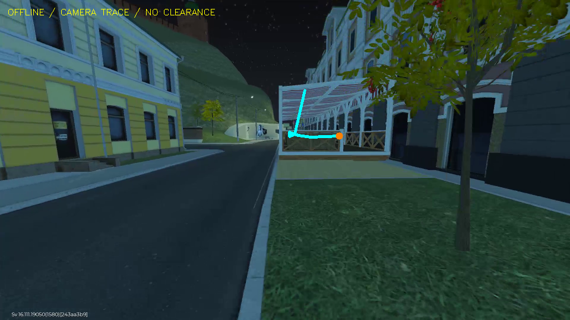
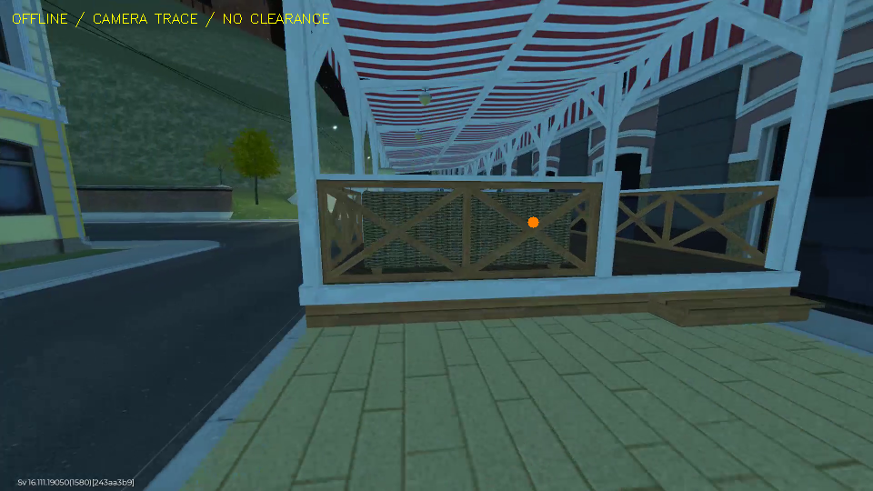

# Route012: привязка к маршруту без точного старта

25 октября 2026. [Квитанция](ROUTE-RELOCALIZATION-ADMISSION.json) фиксирует
результаты, ограничения и хеши. **Автономный повтор не допущен.**

## Что реализовано

Добавлены bounded sparse route, построение признаков в runtime-разрешении,
поиск совместно видимых ориентиров, PnP/RANSAC, подтверждение положения и проекция
ближайшего пути на конкретный RGB. Новый путь ищет старт во всей локальной карте,
не требует первого кадра и не читает записанные нажатия. Он отделён от старого
`RouteProgress`, запуска моторной модели, Web и физического управления.

На известных синтетических 3D-соответствиях реально выполняются matching/PnP:
старт сбоку на 2 m, с поворотом камеры примерно 14° и в середине маршрута
восстанавливается. В state-тестах извлечение признаков заменено этими известными
соответствиями. Это геометрическая проверка кода, не фотометрический тест игры
и не доказательство игровой точности в метрах.

## Реальная запись

Использован прежний Route012: 458 кадров за 44,146 s, без нового ввода в игру.
Взяты 132 камеры главной SfM-компоненты готового Spirula. Их карта остаётся
непринятой: прежние замечания к геометрии/движению камер не отменены.
В 960×540 заново найдены 7210 feature tracks; 928 ориентиров прошли требования
трёх видов, параллакса и reprojection. Нейросети в этом прогоне не запускались.

Карта имеет явные провалы покрытия: у87из132видов меньше24ориентиров, у15их нет.
Даже объединение ближайших соседей оставляет46опорных окрестностей с недостатком
соответствий; максимальный непрерывный интервал таких опор —9,482s. Это необходимая,
но не достаточная проверка: достаточное число ориентиров тоже не гарантирует
правильную локализацию. Добавлен ранний отказ `route_map_has_unobserved_sections`;
на реальной карте отказ проверен. Частичный анализ запускается только явным
`diagnostic_partial_map=True` в offline-пробе.

Все 132 опорных кадра исключены по source index + manifest SHA. Проверены
157 других наблюдений того же ролика с интервалом не менее 200 ms:

| Состояние | Наблюдений |
|---|---:|
| Неизвестное положение | 135 |
| Подтверждение положения | 15 |
| Три согласованных положения, `localized` | 7 |

127 отказов — положение не подтверждено, ещё 8 — неоднозначный прогресс по
траектории. Семь `localized` находятся на коротких участках около 30–32 s и
43,6–44,1 s. Это **не непрерывный повтор** и не новая игровая сессия.

Медиана `RouteLocalizer.observe` — 90,67 ms, p95 — 116,23 ms, максимум — 125,55 ms
на одном процессе с двумя OpenCV-потоками. В эти числа не входят декодирование,
предварительное уменьшение RGB, motor inference, сеть или Android input.
Время наблюдения симулировано media clock; полная live-задержка неизвестна.
После добавления отказа повторная диагностическая проба дала те же состояния:
135/15/7. Её медиана —84,28ms, p95 —137,86ms, максимум —175,00ms; параллельно шли
тесты, поэтому это отдельный срез, а не сравнение ускорения алгоритма.

## Почему исключение только по RGB было ошибочным

Spirula/FFmpeg и PyAV немного по-разному переводят YUV в RGB. На трёх сопоставленных
кадрах среднее абсолютное отличие составляет 0,95–1,23 значения канала, PSNR
44,57–46,64 dB. Все RGB-хеши различаются. Поэтому прежняя промежуточная проба
с `reference_rgb_excluded=0` **не является held-out проверкой** и не принята.
Исправление связывает карту с исходной записью и индексами; отдельный regression
test проверяет изменённые пиксели того же source index и другую запись.

## Проекция не стала дорогой

Линия вычислена из позы камеры и сохранённого camera trace. В изображении она
уходит вверх на конструкцию веранды. Это не проекция проверенной полосы или
проходимого пути. Дорисовывать линию как «готовую траекторию для ИИ» здесь нельзя.

Оранжевая точка — диагностическая цель camera trace. Она не означает достижение
конечной точки персонажем, отсутствие препятствия или правильный маршрут.

## Проверки и дальнейшая работа

Профильный набор: 101 тест и 46 subtests, без ошибок; Ruff прошёл. В частности,
проверяются смещённый/повёрнутый старт, выбросы, плоская геометрия, два одинаковых
далёких места, пересечения пути, разрыв наблюдений, смена контекста, stale RGB,
same-frame overlay, source lineage и неизменность исходного RGB. Конечный экспорт
18-камерного DA3-фрагмента также выполнен через итоговый API: 33 ориентира, без
изменения камер/исходника. Дополнительно прошли 41 тест документации и 94 subtests;
реестр 577 Markdown-документов проверен без ошибок.

Карта не заменена в Web; APK/backend/frontend/VPN не обновлялись, потому что эти
изменения относятся к offline motor worker. Ни одного Android input, нового CI job,
скачивания модели или подтверждённого прибытия в этой итерации нет.

Следующий блокер — восстановление ориентиров в непокрытых участках и связь
camera trace с проходимым путём.
Новая хорошая запись сама по себе этого не гарантирует. Сначала нужно разобрать
камеры/треки этих участков и многозначность пути, затем проверить независимый повтор и влияние
локальной цели на motor policy. [Контракт и порядок допуска](../../design/VISUAL-ROUTE-RELOCALIZATION.md).
