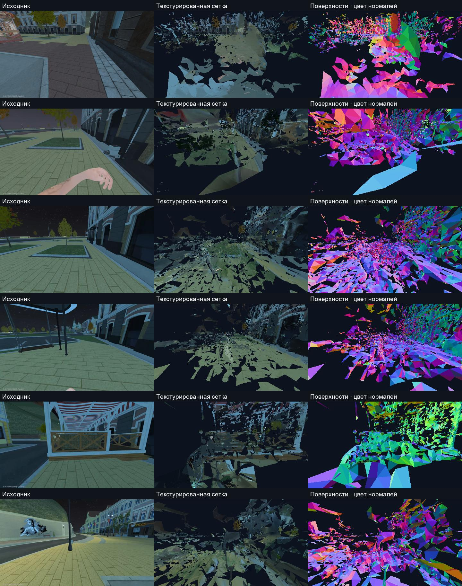
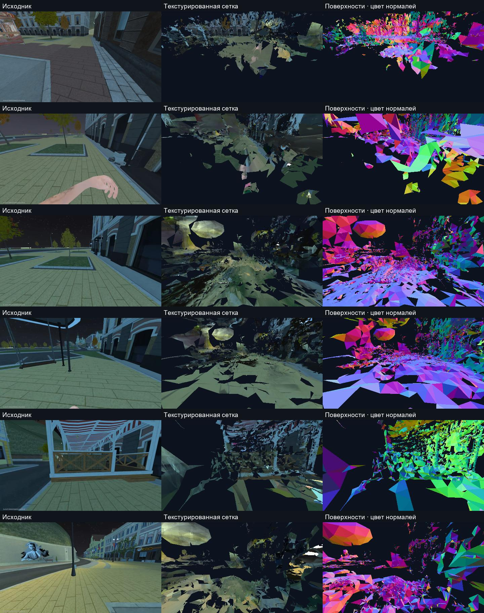
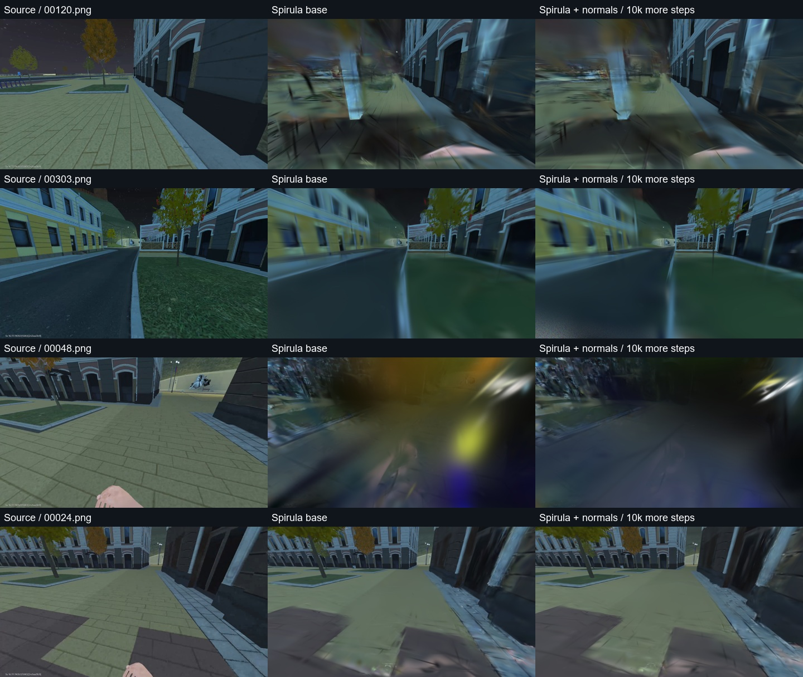

# Маршрут 012: готовое приложение вместо нового движка реконструкции

25 октября 2026. Локальная проверка официального Spirula Studio на исходной
записи пользователя. Это отдельный опыт; прежние модели и запись не заменяются.

## Выбранное решение

[Spirula Studio](https://github.com/harry7557558/spirula-studio) объединяет
извлечение кадров, Structure from Motion, обучение Gaussian Splatting и экспорт
текстурированной сетки в одном приложении. Проверяется официальный Windows
Vulkan-релиз [2026.10.16](https://github.com/harry7557558/spirula-studio/releases/tag/v2026.10.16),
commit `65246c5579c127081bff6f4422bd12a542906f78`. Он фактически обнаружил RX 9070
и использует её. Алгоритмы приложения не переписывались; Python-обвязка только
ограничивает ресурсы, записывает intent и проверяет результат.

Spirula включена в [рекомендации PlayCanvas](https://developer.playcanvas.com/user-manual/gaussian-splatting/creating/recommended-tools/).
Это подтверждает существование готового рабочего процесса, но не его качество
в Black Russia. Последнее устанавливается только нашим отдельным прогоном.

Приложение распаковано в `.local-pilot/reconstruction-tools/spirula-v2026.10.16-windows-vulkan`.
SHA256 официального ZIP: `9b83ba6d78a4ace562d2ad2f964d2e3eb15aaa7a78918eab54e44d8a98a649d0`;
исполняемого файла: `eb57050c90fc046f079d2b788eb62f0cf9639afbe50941ecb4f945d52876bd14`.
Лицензия приложения — GPL-3.0. В APK и производственный Web бинарник не встраивался.

## Исходные данные и сохранность

Используется запись Route012: 458 кадров 1920 × 1080 за 44,146 с. Реальная частота
сохранённых кадров около 10,4 FPS; установка 60 FPS в игре не означает, что все
60 кадров были записаны. Исходный `video.h264` имеет SHA256
`66ef484e6f7160431bd03c6b990daef322e6ca98e0678317775f82ba3f0d60b8`.

Для встроенного декодера Spirula поток перепакован в MP4 без перекодирования.
В результате независимо декодированы и попарно сопоставлены все 458 RGB-кадров:
хеши пикселей и временные метки совпали. SHA256 MP4:
`c5e817699335b804cfdc3f6215db4b99eb9a0ea21cb34fc064414aff8fdaa010`.

Исходное видео, manifest, control, прежние камеры, Gaussian и GLB не изменяются.
Опыты находятся отдельно в `.local-pilot/turnkey-20261025-route012`.
Из этой записи не извлекаются реальные метры: IMU, калиброванного LiDAR и
привязки к игровым координатам в данном входе нет.

## Выполненные этапы

1. Встроенный extractor Spirula выбрал каждый третий кадр: 153 PNG в Full HD.
   Полный этап занял 8,94 с. Это выбор временных ракурсов, не уменьшение их разрешения.
2. Встроенный SfM с ALIKED n32 и LightGlue выполнился за 270,49 с. Использованы
   последовательные связи с перекрытием 10, одна SIMPLE_PINHOLE-камера,
   до 4096 признаков на кадр, максимум стороны изображения 1920 px.
3. Получены **две независимые компоненты**: 132 камеры / 44032 ориентира и
   31 камера / 11742 ориентира. С учётом пересечения зарегистрированы 142 из 153
   изображений. Насильственное объединение не применялось.
4. Для диагностического обучения выбрана первая компонента: 132 из 153 ракурсов,
   0,000–44,063 с. В обучение вида включены 115 изображений, ещё 17 отложены
   штатным режимом interval/8. Их позы решались на общем наборе: это не независимая
   проверка локализации и не новый игровой проход.

Нативный экспорт COLMAP заполняет сохранённые поля `point.error` нулями.
Значение 0 из `compute_mean_reprojection_error()` поэтому не использовано как
измеренная точность. Ошибки заново вычислены проекцией каждого наблюдаемого
3D-ориентира через экспортированные камеры:

| Компонента | Наблюдения | Средняя ошибка | Медиана | p90 | Позади камеры |
|---|---:|---:|---:|---:|---:|
| 0 | 143364 | 0,724 px | 0,577 px | 1,545 px | 0 |
| 1 | 32605 | 0,780 px | 0,647 px | 1,618 px | 0 |

Это внутренняя согласованность по тем же изображениям, не метрическая точность.
У большой компоненты есть семь предупреждений о быстром изменении направления
и три скачка скорости по временной эвристике. Программа не превратила эти
предупреждения в подтверждённую непрерывную навигационную карту.

## Построение поверхности

Первый штатный preset `meshing` завершён на RX 9070 за 1212,20 с:
30000 итераций, до 600000 splats, исходное разрешение, дисковый кеш изображений.
В конечный PLY экспортированы 497288 splats после штатной фильтрации.
Контрольные сохранения — каждые 5000 итераций; встроенный HTTP-viewer отключён.

Native evaluation: 17 строк, средние PSNR 20,200 dB / SSIM 0,781640.
Независимое сопоставление RGB с исходными PNG подтвердило все 17 строк,
но две соответствуют одному и тому же кадру: **16 уникальных изображений**.
После удаления дубликата средние 20,111 dB / 0,779693. Это проверка вида
внутри того же прохода при общих SfM-позах. Она не сравнима напрямую с прежними
9 training-ракурсами Brush и не доказывает точность камеры в новой сессии.

Штатный `mesh` завершился за 41,19 с: **228630 треугольников, 256439 вершин,
один PNG-атлас 8192×8192 внутри GLB**, 49555716 bytes, внешних URI нет.
SHA256 GLB: `442b0f4ec9f197f7562b9b9c47541837e5504a13ada56f5ea38c4d1499148579`.
Hole filling отключён, штатные cleanup/merge и quality-iters=3 сохранены.
Шесть CPU-проекций экспортированных треугольников по исходным K/позам выявили
крупные пропуски земли/фасадов, отдельные фрагменты и растянутые поверхности.
**Этот mesh отклонён для навигации и как полноценный слепок улицы.**

Поскольку preset использует normal maps при их наличии, выполнен ещё один
штатный этап: `geometry --model moge2-vitb --max-size 1064 --num-tokens 2400`.
Приложение получило `moge2-vitb-normal.onnx` из указанного им публичного источника
и создало 132 PNG-нормали за 67,14 с вместе с первоначальной загрузкой.
Чистая обработка после загрузки заняла 21,255 с. Это предсказанные нормали,
а не глубина движка или измерение LiDAR. Отдельный 10000-step вариант запущен
из первого PLY и завершился за 396,58 с в `route012-normals`; первый результат
не изменён. Дополнительные итерации и нормали изменялись одновременно, поэтому
эффект нельзя приписывать исключительно нормалям.

Native evaluation второго варианта: 17 **уникальных** изображений,
20,9148 dB / 0,790897. Порядок строк отличается от первого прогона, а первый
содержал повтор одного кадра вместо другого. После сопоставления SHA256 RGB
на **одинаковых 16 исходных изображениях**:

| Прогон | PSNR | SSIM |
|---|---:|---:|
| Первый, 30000 steps без normal maps | 20,11096 dB | 0,779693 |
| Инициализация первым PLY + normals + 10000 steps | 20,17723 dB | 0,781616 |

Существенного выигрыша по этому сравнению нет. Второй mesh завершился за
31,89 с: 193152 треугольника, 221965 вершин, 43152392 bytes, один встроенный
8192×8192 PNG. SHA256:
`77c74e65d6c8b07988f9d41b06f628d0d5d07d502239d37ba59db43af50dd4ba`.
Его шесть CPU-проекций также показывают большие пропуски и ложные поверхности.
**Оба варианта отклонены** как полноценная модель улицы и основа навигации.
Успешное выполнение готового приложения подтвердилось; требуемое качество — нет.

Повторные подборы числа splats/разрешения атласа на этом решении не объявлены
следующим обязательным этапом. Нужны независимая проверка камеры/перекрытия,
маски динамики и проверка локализации; один лишь более дорогой рендер не устраняет
ошибки базовой геометрии. Сводные результаты и проверки исходников сохранены в
[квитанции](SPIRULA-TURNKEY-TRIAL.json).

Для каждого этапа создаётся отдельный неизменяемый intent. Повтор при
неопределённом результате запрещён. Лимиты: минимум 4 GiB доступной RAM,
20 GiB свободного диска, Windows commit ниже 85%, Windows Job с ограничением
памяти дерева процесса 8 GiB. Исчерпание лимита завершает принадлежащий опыту
процесс, а не ослабляет защиту.

## Восстановление локального обработчика Sphere

При диагностике `Failed to fetch` порт 3342 не слушался. Существующий обработчик
запущен из текущих исходников `f808b486`, затем перенесён в отдельный скрытый
фоновый процесс с собственными журналами. Перед переносом проверено отсутствие
нетерминальных работ; выполняющийся расчёт не прерывался. OPTIONS с Origin
`http://127.0.0.1:3015` вернул 204 с ожидаемым CORS. Запрос без capability
возвращает 403. Это проверка HTTP-доступности и границы доступа, не браузерная
приёмка маршрута в пользовательском профиле.

Фоновые PID/логи сохранены в `.local-pilot/reconstruction-runtime-f808b486`.
Автозапуск после перезагрузки ОС не заявлен. Web `49f8b12a` и backend `1afdc529`
не переустанавливались. Android, VPN и игра не изменялись.

## Просмотр и ограничения

При проверке исходников обнаружен отдельный HTTP-дефект preview3332: ранний
409/410 мог закрывать соединение с непрочитанным POST body. На Windows два
прогона получили `WinError 10053` вместо JSON-отказа; изолированный повтор
между ними проходил. В исходниках исправлено чтение ограниченного тела до
раннего ответа: максимум 512 KiB, исходный socket timeout 12 s сохранён,
chunked/дублированный Content-Length запрещены. Ни очередь inference, ни
допуск к модели/сессии не добавлены. Ошибочные oversized-запросы не читаются.
Regression проверяет прочитанное тело перед busy-ответом, восемь последовательных
сетевых отказов и отрицательные границы framing. После исправления прошли
**139 тестов и 94 subtests**, Ruff и documentation inventory.
Это изменение исходников preview3332; его GPU-процесс в этой итерации не запускался.
Работающий reconstruction API3342 не подменяется этим утверждением.

Официальный WebGL/WASM-viewer скачан отдельно, его файлы сверены с Git blobs
релиза. Запуск отдельного HTTP-сервера для этого viewer был отклонён
автоматической проверкой: `blocked by policy`, без объяснения причины.
Сервер не запускался повторно другим способом.

Более безопасный вариант без сетевого listener: официальный
[@playcanvas/splat-transform](https://developer.playcanvas.com/user-manual/splat-transform/)
2.6.0 установлен только в папку опыта, с lockfile, без install scripts.
Его штатный single-file HTML exporter за 6,34 с создал автономный файл
10899561 bytes с упакованной Gaussian-сценой и шестью диагностическими ракурсами.
SHA256: `c1ab358f9be71974e0f9cbfe17f18d8dfbcd80627665f4f362a0e71a3a391986`.
Исходный PLY не изменён. Статически проверено отсутствие внешних src/href,
пакет содержит встроенный SOG, JS, CSS и настройки.

Открытие этого локального `file://` было отдельно отклонено browser URL policy:
разрешены только HTTP/HTTPS. Другие browser surfaces и перенос на иной сервер
для обхода не использовались. Файл сохранён для самостоятельного открытия;
фактическая браузерная работа HTML и совпадение его камеры ещё **не проверены**.
Нативный GUI Spirula был открыт на промежуточном 5000-step PLY: произвольный
ракурс размыт; это не приёмка конечной сцены. Треугольники окончательного GLB
проверены отдельной CPU-проекцией. Встроенный просмотр нового опыта в Sphere
не установлен и не принят.

В [issue 120](https://github.com/harry7557558/spirula-studio/issues/120) автор
разбирает похожие скачки камер на непрерывном видео: рекомендует перемещение
с перекрытием ракурсов и избегать чистого вращения на месте. Это полезный
диагностический пример, но не доказательство причины всех дефектов нашей записи.
Повышение разрешения само по себе не устраняет неоднозначность геометрии.

## Запасные готовые варианты

| Программа | Почему рассматривается | Статус здесь |
|---|---|---|
| Spirula Studio 2026.10.16 | Полный локальный video → poses → splat → mesh, Vulkan на RX 9070 | Два варианта выполнены; обе поверхности отклонены |
| RealityScan 2.2 | В версии 2.2 официально добавлена RX 9070 и AMD-ускорение реконструкции на Windows | Не установлена; потребуется обычная установка/доступ Epic |
| Agisoft Metashape 2.3.2 | Готовая фотограмметрия с AMD/OpenCL | Не установлена; экспорт зависит от лицензии/активированного trial |
| Brush | Уже используется для Gaussian-обучения | Не заменяет самостоятельное восстановление камер из сырого видео |

Актуальное основание для AMD в RealityScan — именно
[release notes 2.2](https://dev.epicgames.com/documentation/realityscan/realityscan-2-2?lang=en-US),
а не старые требования с обязательной CUDA. Для Metashape проверены
[официальный установщик и ограничения trial/demo](https://www.agisoft.com/downloads/installer/) и
[требования OpenCL/CUDA](https://www.agisoft.com/index.php?id=49).
Покупки, активации лицензий и загрузки пользовательского видео во внешнее облако
не выполнялись.

Критерий выбора — GLB и его сравнение с реальными кадрами в начале, середине
и конце маршрута. Пока качество всей геометрии не подтверждено, использовать
её для построения траектории моторной модели нельзя.
[Что можно получать на Android помимо RGB](../../design/ANDROID-CAPTURE-AND-NAVIGATION-EVIDENCE.md).

## Визуальные доказательства

Слева исходные кадры, в центре реальная проекция треугольников GLB, справа
цвет нормалей поверхности. Чёрные области — отсутствие видимой геометрии,
а не отключённая текстура. Это статическая CPU-диагностика, не screenshot
принятого Web-viewer.

