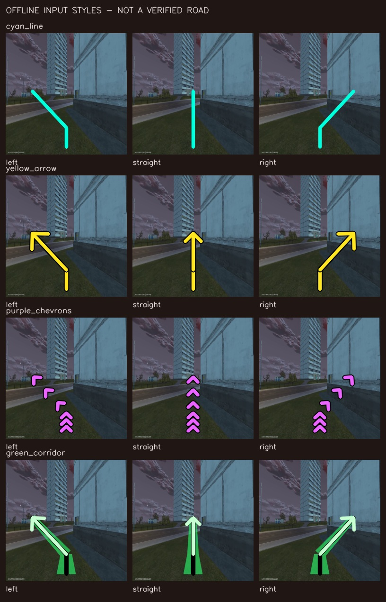

# Маршрут, моторная модель и управление: проверка 26 октября

## Вывод по фактическим пробам

Моторные модели сохраняются. Связка «выученная местность → положение камеры →
локальный путь → моторика» остаётся проверяемым направлением. Но нарисованная
линия сама по себе пока **не является подтверждённым интерфейсом целеуказания**.
Выполнено120 локальных ответов моделей, без Android-ввода и без скачивания весов.
Это предварительная проверка чувствительности, не игровой тест навигации.

| Модель / режим | Ответы | Пар кадр/seed | Повтор исходника совпал | Положительное смещение движения вправо | Положительное смещение камеры вправо | Медиана / p95 wall |
|---|---:|---:|---:|---:|---:|---:|
| Open P2P150M, BF16, без текста | 60 | 12 | 12/12 | 0/12 | 0/12 | 111,24 /162,58ms |
| NitroGen, FP32,8 denoising steps | 60 | 12 | 12/12 | 3/12 | 5/12 | 129,62 /163,65ms |

Знак сравнивается между версиями одной картинки с линией влево и вправо,
с одинаковым seed. Даже малая положительная разница входит в счётчик: это
не порог полезного поворота. Учитывается среднее по выданным состояниям в
ближайшие200ms, а не только первое действие. Проверены четыре разных изображения,
seeds17/29/43, варианты raw/left/straight/right/raw_repeat. Циановая линия —
контрольный стимул, **не геометрически проверенная проекция дороги**.

P2P в данном адаптере возвращает один отсчёт на50ms: оставшиеся150ms не
заполнены выдуманным удержанием. NitroGen выдаёт18 отсчётов/60Hz; для сравнения
используются первые200ms. У обеих моделей перед каждым запросом сброшены история
и RNG. У P2P текстовый embedding нулевой; поэтому это **не отрицательная приёмка
полноценного P2P с инструкцией и временной историей**. У NitroGen8 шагов вместо
штатного режима — отдельное экспериментальное ограничение.

Модельные процессы закрыты с подтверждением. Первая попытка P2P остановилась
после warmup по прежнему порогу12GiB свободной RAM и дала0 ответов; она не
включена в таблицу. Политика памяти не ослаблена. Не выполнялись игровые
касания, провайдерские операции или новые GitHub jobs.

Доказательства: [агрегат и хеши исходных квитанций](motor-overlay/sensitivity.json).
Полные action chunks остались в приватных локальных отчётах. Воспроизводимый
исполнитель: `scripts/pilot/audit_motor_overlay.py`, анализ `summarize` и
`window_steering`;8 unit tests проверяют контрольные пары, длительности,
частичный последний отсчёт, отказ от синтетического продления и неверные входы.

### Дополнение: четыре способа нарисовать подсказку

По следующему запросу пользователя выполнены ещё240 ответов: жёлтая стрелка,
фиолетовые шевроны и зелёный коридор, те же четыре кадра и seeds29/43. Вместе с
исходной циановой линией сравниваются8 пар на каждый стиль/модель. Raw chunks
между стилями совпали полностью у обеих моделей; provider cleanup подтверждён.

| NitroGen, окно200ms | Циановая линия | Жёлтая стрелка | Фиолетовые шевроны | Зелёный коридор |
|---|---:|---:|---:|---:|
| Положительное смещение стика вправо | 2/8 | 4/8 | 4/8 | 5/8 |
| Положительное смещение камеры вправо | 2/8 | 7/8 | 4/8 | 6/8 |
| Обе поправки стика относительно raw больше0,1 по модулю и разных знаков | 0/8 | 0/8 | 1/8 | 0/8 |

Последняя строка — исследовательский числовой порог, не калиброванный порог
игрового поворота. Во всех стилях P2P этого первого кадра/нулевого текста не
дал положительной направленной пары. **Стиль влияет на NitroGen, но устойчивое
сильное направление и достижение цели не подтверждены.** Нельзя выбирать лучший
счётчик после просмотра данных и объявлять его независимой успешной проверкой.

Общий объём двух этапов360 ответов. В [дополнительном агрегате](motor-overlay/styles.json)
320 ответов с общими seeds29/43; прежние40 ответов seed17 остаются в первом
агрегате и в сравнение стилей не входят. Никаких игровых действий. Временная
история, корректная геометрическая цель и instruction mode P2P ещё не проверены.

Линии здесь показывают разные направления; часть может указывать на стену или
закрытую область. Поэтому это тест визуальной чувствительности, а не корректная
road-following задача. Следующий этап должен использовать только проверенные
локальные пути, а затем независимые сцены для оценки выбранного стиля.

## Что действительно даёт реконструкция

Для узнавания места используются подтверждённые статические feature tracks и
2D→3D соответствия с проверкой позы, а не видимые splats как готовые ориентиры.
Наш Route011321 имеет89 зарегистрированных камер и26228 SfM-точек; число splats
не равно числу надёжных ориентиров. Существующая same-clip проверка23/24 PnP
не заменяет новую игровую сессию, другое освещение или старт со смещением.
Масштаб20,35554 условных единиц не даёт права обещать точность в метрах.
[Разбор исходных данных и геометрии](ROUTE-011321-QUALITY-AND-NAVIGATION.md).

Положение игровой камеры и положение персонажа различаются. Камера может
вращаться, приближаться и двигаться вокруг персонажа, особенно при посадке в
транспорт. Поэтому линия центров камер пока не называется дорожным маршрутом.
Для ground path нужны подтверждённые поверхность/высота и связь камеры с
контролируемым объектом. Непросмотренные участки остаются неизвестными.

Игровая интеграция должна предоставлять независимые необязательные источники:

- Базовый: визуальное узнавание статической сцены и геометрическая проверка.
- Миникарта: направление/позиция только после калибровки масштаба, поворота,
  crop и текущего режима карты; наличие миникарты не предполагается у всех игр.
- Black Russia: GPS-линия, метка и доступные игровые координаты как
  дополнительные наблюдения с собственным временем и confidence.
- Состояние: активная игра, меню, disconnect, смена камеры/масштаба. AFK-экран
  не является неподвижным подтверждением успешного движения.

Разногласие источников должно снижать допуск к движению. Нельзя усреднять
ошибочную миникарту с неподтверждённой позой до искусственно уверенного результата.
Игровые команды и screen zones находятся в профиле/адаптере, а не в общем ядре.

## Трафик, NPC, HUD и ночь

HUD и подписи не используются как неподвижные мировые ориентиры. Люди и машины
могут давать ложные tracks/floaters; нужны маски и согласованность наблюдений
между ракурсами. Семантика «машина» сама по себе не доказывает движение: припаркованный
объект тоже может исчезнуть в следующей сессии. Текущий простой exclusion mask
не объявляется полноценным распознаванием динамики.

Статическая карта отвечает за опорную структуру и общий маршрут; текущие кадры
отвечают за актуальные препятствия. Удалённая из реконструкции машина не делает
соответствующее место свободным прямо сейчас. При перекрытии ориентиров,
невозможности проверить путь или потере прогресса — снижение скорости/остановка
и повторная локализация; бесконечное удержание газа недопустимо.

Смена света может сильно менять дескрипторы. В исследовании визуального
teach-and-repeat2025 проверены learned local features и режимы день/ночь;
результаты роботов подтверждают применимость подхода, но не наш игровой SLA.
Для нас необходимы отдельные проходы днём и ночью, другие ракурсы и смещённый
старт. Простое затемнение знакомого кадра полезно как unit stress, но не
считается независимым ночным испытанием.
[Первичная работа](https://arxiv.org/html/2503.13090v1).

## Качество без произвольной дорисовки

Приоритет — исходные детали, хорошие позы, больше информативных наблюдений и
исключение временных объектов. В существующей same-pose held-out RGB-проверке
25k→30k уже практически плато;40k не считается автоматическим улучшением.
[Сравнение checkpoint](ROUTE-011321-CHECKPOINT-COMPARISON.md).

WildGaussians разделяет appearance и occlusion uncertainty; это подходящий
кандидат для сравнительного офлайн-теста, а не обещанное улучшение нашей карты.
Официальная локальная установка использует CUDA11.8 и native rasterizer:
совместимость с RX9070/ROCm отдельно не подтверждена. Новая установка здесь
не выполнялась. [Авторы и код](https://github.com/jkulhanek/wild-gaussians).

SplatSuRe2026 выбирает области для super-resolution с учётом multiview sampling.
Но SR всё равно вносит сгенерированные детали в слабо наблюдённых областях.
Такую обработку можно сравнивать как отдельную визуальную копию; она не
создаёт ground truth расстояний, полос и препятствий и не заменяет исходники.
[Метод авторов](https://splatsure.github.io/).

Полезнее сначала снять master с постоянными FOV/камерой и меньшим сжатием,
проверить пропуски, добавить перекрывающиеся ракурсы поворотов, затем сравнить
геометрию на отложенных изображениях.60FPS помогает выбору чётких кадров, но
не означает60 новых геометрически информативных камер каждую секунду.

## Если моторная модель не следует линии

Официальный NitroGen использует последний кадр и не заявляет длинное планирование.
P2P поддерживает текст, но это отдельный совместимый обученный encoder и режим
инференса, а не произвольная замена embedding на похожий Qwen.
[NitroGen](https://github.com/MineDojo/NitroGen),
[Open P2P](https://github.com/elefant-ai/open-p2p).

Следующий честный тест: одинаковый временной префикс для каждой пары,
проверенная локальная цель и её проекция; для P2P — правильный text encoder,
если получен официальный доступ. Затем короткий закрытый цикл с измерением
поперечной ошибки и прогресса. Одновременно проверяются raw и overlay при
одинаковых условиях. Успех — достижение цели, а не просто изменение действий.

Если conditioning не работает, движение всё равно возможно: планировщик
передаёт локальную цель отдельному калиброванному контроллеру пути, а моторная
политика остаётся сменным кандидатом/советником. Управление камерой, обход и
восстановление проверяются отдельно. Этот fallback ещё не реализован и не
объявлен рабочим. Прямое повторение записанных клавиш не заменяет локализацию.

Дополнительный кандидат для отдельной проверки — ROCKET-2: у него цель задаётся
через goal image/segmentation mask, а cross-view alignment обучен специально.
Официальные авторы показывают перенос из Minecraft в другие3D-среды, но это не
доказательство Black Russia/Android или нашего5Hz на RX9070. Здесь веса не
скачивались, inference не запускался; NitroGen/P2P им не заменены.
[Код авторов](https://github.com/CraftJarvis/ROCKET-2),
[публикацияAAAI2026](https://ojs.aaai.org/index.php/AAAI/article/view/38876).

## Задержка и масштабирование

APK92 отдельно подтвердил25,929 decoded FPS и4,996 свежих RGB-наблюдения/с.
Это [транспортная квитанция](PH011-APK92-GPU-PLANAR-CAPTURE.md), не измерение
всей цепи. Медиана111–130ms здесь относится только к wall одного model request.
В неё не входят source capture, encoder/network, локализация, ввод и ответ игры.
Существующая исследовательская глобальная локализация также не прошла бюджет5Hz.

Для5Hz нужно принимать новое решение каждые200ms, но **не отпускать стик**
каждые200ms. Исполнитель хранит desired state: один DOWN, затем MOVE,
UP при отпускании/остановке. Отдельные deadman/сроки свежести прекращают устаревшее
движение. Нет накопления исторической очереди кадров или запоздалых действий.

Десятки активных окон на1–2 GPU этими пробами не доказаны. Даже идеализированная
последовательная обработка при130ms×5 требует0,65s model wall на одно окно
за секунду, без остальных стадий. Нужны измерения batching, deadlines и admission
по числу активных задач. Ожидание свободного слота допустимо до начала движения;
старое решение нельзя отправлять машине, которая продолжает ехать.

## Что готово для оператора, что ещё проверить

В исходниках страницы записи добавлено назначение физических клавиш шести
ролям: вперёд/газ, назад/тормоз, влево/вправо, действие и медленный ход.
Зоны задаются по существующему экрану;4 транспортные кнопки требуют калибровки
на текущем разрешении. Новые клавиши сохраняются в metadata конкретной записи.
Старые профили без keys продолжают работать с WASD/Space/Shift.
Во время назначения и активного ввода изменения не пересылаются в Android;
Escape сохраняет функцию остановки. Это не универсальный редактор произвольного
числа зон и не синхронизация пресетов между аккаунтами.

Проверено2719 frontend tests, типы и9 Python tests для расширенной пробы. Браузерный инструмент
сейчас падает до исполнения команд при создании kernel assets (Windows error3),
поэтому новая визуальная/интерактивная приёмка не заявлена. Веб60c0dc7a
установлен с сохранением45 других контейнеров; прежний принятый браузерный
срезb1e89797 остаётся историческим доказательством. [Квитанция поставки](motor-overlay/web-delivery.json).
API и APK92 этими правками не меняются.

Первый живой проход должен быть коротким, пешком и на знакомом участке:
новый кадр→подтверждённая поза→проверенная локальная цель→ограниченное действие
с непрерывным контактом→следующий свежий кадр. До управления нужны независимая
локализация и корректная ground projection. Потеря confidence, кадра или
прогресса завершает ввод. Автомобиль и длительный маршрут следуют после этого
теста; текущая квитанция не выдаётся за готовый автопилот.
