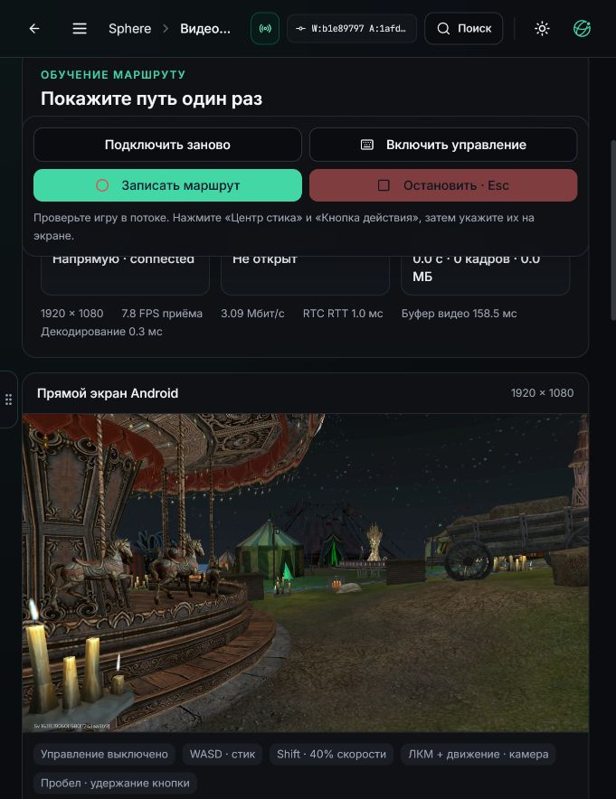

# PH011: APK91, безопасное обновление и проверка Full HD захвата

26 октября 2026. [Квитанция](native91/delivery.json) фиксирует адресную установку
APK91/10291 на PH011, прямой приём и idle-ввод. **Ускорение Full HD не принято:**
native libyuv работает, но чтение GPU-буфера ImageReader остаётся медленным.
Следующий GPU-путь пока проверен только на синтетическом изображении.

## Что действительно поставлено

APK `b26adc72`, SHA256
`2dd205c82785c14499edb52008988b8b1c8d78c31063e6da4521300e04d0daae`.
Версия и независимый SHA установленного пакета проверены. Прежний сертификат
сохранён; все семь native-библиотек побайтово совпадают с APK90. Новый путь
RGBA→I420 использует уже упакованный WebRTC146.7.0, проверяет цвета/stride и
имеет прежний скалярный fallback. Android binary payload VPN не заменялся.

Обычные четыре unit-варианта: 5156 cases, 12 skipped, 0 failures/errors.
Direct/planar/continuous: 2606 cases, 6 skipped, 0 failures/errors.
Итого 7744 выполненных cases. Настроенные dev/enterprise lint, assemble и tests
также прошли. Статус локальных результатов записан в GitHub; Actions jobs0.
Сборка локальная, из свежего каталога, с прежним resource guard.

Пакет размещён и проверен обратным скачиванием до паузы VPN. Обычный Android
update-канал сохранён; recovery grant адресован только PH011. ADB install0,
очистка игры0, reboot0. После OTA старый dual-family guard оставался BLOCKED.
Перед его освобождением установлен второй DROP guard, исключающий Sphere10082.
Временная блокировка снята только после проверки новых маршрутов и native guard.
Окно исходного IP не открывалось; профиль/ревизия и provider peer сохранены.

Отдельные HTTPS-запросы под фактическими UID Sphere10082 и игры10069 завершились
успешно и показали разные выходы. HTTPS с DNS под UID игры также прошёл. Это
конечная проверка конкретного применения; отказоустойчивость/boot/fleet не
выводятся из неё. IP, ключи и токены в отчёт не включены.

## Прямые кадры и ввод

За 20,014s headless read-only приёмник получил176 decoded frames и96 RGB
observations: 8,744 decoded FPS и4,797 RGB observations/s. Packet loss0,
один интервал decoded arrival >250ms, max278,457ms. Пара — host/prflx, UDP,
private/private; NAT-путь не является доказательством физического LAN/loopback.
Последний decoded frame выбирается без исторической FIFO.

В отдельной idle-сессии подтверждены native READY и CLOSED,33 alive receipts,
control lifetime200ms. Медиана alive RTT≈3,67ms, max≈90,92ms. Нажатий/текста0;
APPLIED реального действия не заявлен. Это проверка admission/release, не игры.

В браузере визуально подтверждены исходные1920×1080, direct connection,
RTC RTT≈1ms, приём≈8FPS. Ввод/запись выключены; после проверки поток закрыт
перезагрузкой страницы. Возраст на приёмнике, buffer delay и RTT не названы
полной Android→модель задержкой. Исходный capture clock с моделью ещё не сведен.

## Почему native-конвертер не ускорил захват

[Первый текущий PID](native91/first-rgb-native-timing.json) подтвердил runtime
color/stride self-test. Четыре окна дали108,75–120,06ms conversion, median110,18ms;
queue в codec≈0,2ms. Установленная библиотека x86_64, не ARM-версия через
транслятор. SSSE3 есть, overrides `LIBYUV_*` не найдены.

[Короткий sampled ART профиль](native91/art-sampling-method-cost.json),10ms
sampling,4,817s интервала capture-thread: примерно4,642s wall и4,386s thread CPU
приходятся на `YuvHelper.nativeABGRToI420`. `Memory.memmove` занимает примерно10ms
wall всего профиля. Это приближённая выборка стека, не покадровый benchmark.
Она подтверждает исполнение native fast path и опровергает гипотезу, что здесь
всё ещё используется скалярный fallback или доминирует последняя копия в codec.

Независимые конечные тесты того же native payload:

| Источник / операция,1920×1080 | Измерено |
| --- | --- |
| ABGR→I420 на собственном direct RAM buffer | после первого прохода0,57–1,05ms |
| ABGR→I420 прямо на offscreen GPU ImageReader buffer |103–137ms |
| Копирование GPU ImageReader→owned RAM |64–75ms |
| ABGR→I420 после такой копии |0,89–1,20ms |
| WebRTC GPU `YuvConverter`→I420 | первый57,41ms; затем16,12–30,17ms |

[Все исходные числа, SHA и источники](native91/synthetic-benchmarks.json).
Это реальный эффект GPU mapping/readback в данном эмуляторе. Из этих измерений
нельзя установить единственную внутреннюю причину драйвера/gralloc. Простая
перестановка CPU converter или memcpy не обеспечивает1080p30: сама полная
RGBA-копия уже занимает больше33ms.

## Готовое решение для следующего кандидата

`SurfaceTextureHelper`/`YuvConverter` уже есть в проверенном WebRTC AAR.
Предполагаемый путь: VirtualDisplay→OES texture→GPU YUV conversion→компактный I420
readback→существующий planar OMX encoder. Так сохраняется проверенный planar
codec input и обходится полный RGBA ImageReader readback. Это отличается от
старого EGL→OMX Surface path, у которого ранее измерялись свои задержки.

Пока это кандидат. Нужны lifecycle/ownership проверки, цвет/ориентация,
буферизация, IDR/idle cache, перенастройка геометрии, независимый live capture,
целый кодек/приёмник и сохранение нативного ввода/VPN. Синтетические16–30ms не
объявлены частотой готового стрима, master capture или навигационным допуском.
Мотор, самостоятельный маршрут и overlay-follow не запускались.

Официальные API сверены с фактическим146.7.0 classes.jar;
[исходник GPU converter](https://webrtc.googlesource.com/src/+/refs/heads/main/sdk/android/api/org/webrtc/YuvConverter.java),
[libyuv CPU/SIMD](https://chromium.googlesource.com/libyuv/libyuv/),
[JNI YUV helper](https://webrtc.googlesource.com/src/+/refs/heads/main/sdk/android/src/jni/yuv_helper.cc).
Текущий upstream — справка, версия поставленного AAR зафиксирована отдельно.

## Воспроизводимость

Три конечных Java-пробы сохранены в `scripts/pilot/android/`: `NativeYuvBench`,
`NativeYuvGpuBench`, `GpuYuvConverterBench`. Их входы синтетические; дисплей игры,
нажатия, сеть и настройки они не используют. Библиотека для запуска должна быть
независимо сверена оператором с установленным APK. Изменять/подменять библиотеку
для пробы не требуется.

`python -m scripts.pilot.build_yuv_probe --help` описывает локальную сборку.
Builder принимает только AAR с SHA из dependency verification, не скачивает
зависимости и не выполняет команд на устройстве. Повторная сборка опубликованного
GPU-converter исходника дала тот же JAR SHA `121d3059dcda…852b03`, что реально
исполнялся на PH011. Ruff/py_compile прошли. Новые диагностические файлы были
переданы через существующий LDPlayer ADB только после совпадения boot ID со
Sphere; APK не устанавливался через ADB, daemon не перезапускался. Все измерения
и профилирование выполнялись через Sphere. Профилирование остановлено, временный
localhost file-server закрыт; фоновых benchmark loops нет.
