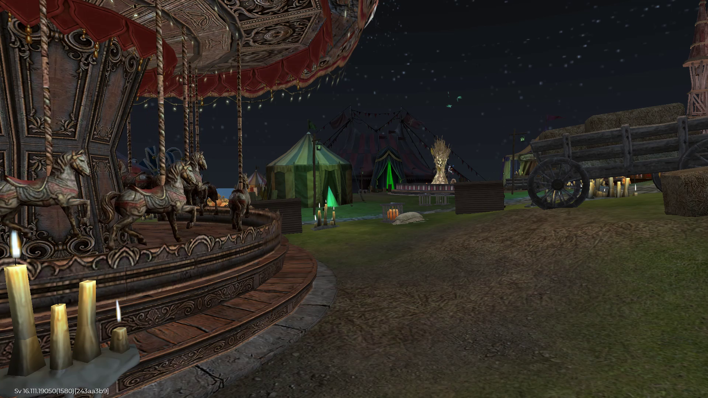

# PH011: APK92 и проверенный GPU→I420 захват

26 октября 2026. APK92/10292 установлен только на PH011. На экране Black Russia
получены **25,929 decoded FPS и 4,996 RGB-наблюдения/с** при 1920×1080.
[Машинная квитанция](native92/delivery.json) связывает исходный код, пакет,
фактический SHA установленного APK, VPN, кадры и конечный тест ввода.
Это конечная транспортная проверка; самостоятельный маршрут ИИ не запускался.

## Что изменилось

Full HD RGBA ImageReader readback в APK91 занимал около110ms на кадр.
[Предыдущий опыт](PH011-APK91-CAPTURE-AND-GPU-BENCHMARK.md) показал, что смена
CPU-конвертера сама по себе этого не исправляет. APK92 использует GPU texture→
WebRTC YuvConverter→компактные I420 planes→прежний planar OMX encoder.
Полный RGBA readback больше не нужен этому пути. Отдельный GL-поток владеет
ресурсами; заимствованные плоскости копируются в принадлежащий кодеку cache.
Новых исторических очередей кадров нет.

Использован уже поставляемый WebRTC146.7.0 с проверенным SHA AAR. Все семь
native-библиотек побайтово совпали с APK91; WG/native payload и сертификат сохранены.
[API YuvConverter](https://webrtc.googlesource.com/src/+/refs/heads/main/sdk/android/api/org/webrtc/YuvConverter.java)
требует одного потока с активным EGL context. Текущий upstream служит справкой;
скомпилированные API отдельно сверены с фиксированной версией AAR.

Режим включается отдельным `SPHERE_STREAM_GPU_PLANAR_INPUT=true`; ему нужны
PLANAR и DIRECT canary, а старый GPU Surface bridge должен быть выключен.
Запрет смешивать старые Surface/planar пути сохранён. Release с новым режимом
отклоняется. [Четыре фактические проверки конфигурации](native92/configuration-contract.json)
подтвердили три ожидаемых отказа и разрешение корректной debug-комбинации.

## Сборка и установка

Исходный код: `ef69ee25342c9f59ed6fd137f03e38295a38b1fa`.
APK SHA256: `a124f61920f09aa6ba5ae7becb14dcd267d05ad6365556478cd968a39c07e0b9`.
Установленный пакет независимо дал тот же SHA. Версия — `1.2.92-dev`/10292.

Полный локальный CI: ordinary5184cases/12skipped и GPU-planar2620cases/6skipped,
ошибок0; всего7786 выполненных cases. Configured dev/enterprise lint, assemble
и по1310cases/3skipped также прошли. Результат локальных unit-проверок опубликован
и прочитан обратно в GitHub. Новых Actions jobs0. Configured-сборка получала
недостающие метаданные двух фиксированных lint-зависимостей из штатных репозиториев;
их уже имевшиеся JAR SHA не изменились. Проверка native payload не ослаблялась.
Порог свободной ОЗУ12GiB сохранён; очистка cache, остановка приложений и reboot
для допуска сборки не выполнялись.

Пакет размещён и проверен обратным скачиванием до паузы VPN; без авторизации
скачивание отвергнуто. Обычный Android update-канал не менялся. Адресный OTA —
только PH011, без ADB install, очистки игры и перезагрузки устройства/хоста.

Старый dual-family UID guard пережил OTA. До его освобождения установлен второй
DROP guard, исключающий Sphere10082. Он снят после проверки нового TUN index,
маршрутов/blackhole и фильтров обеих IP-семей. Подтверждены HANDSHAKE_CONFIRMED,
HTTPS/DNS под UID игры10069 и другой выход Sphere10082. Профиль/запечатанная ревизия
сохранены; provider peers не создавались, окно исходного IP не открывалось.
Ключи, адреса выхода и токены в квитанцию не включены.

## Что измерено на настоящем приёме

| Проверка | APK91 | APK92 |
| --- | ---: | ---: |
| Full HD decoded FPS,20s |8,744 |25,929 |
| RGB observations/s |4,797 |4,996 |
| Потери пакетов |0 |0 |
| Максимальный decoded arrival gap |278,457ms |195,534ms |
| Интервалы arrival >250ms |1 |0 |

Это последовательные проверки одного устройства при одинаковом разрешении и
похожем игровом экране, а не одновременный A/B-тест. В новом20,016s прогоне
получены520 decoded frames и100 RGB-наблюдений. Пара host/prflx, UDP,
private/private; после handover server video bytes0. Это прямой WebRTC/NAT-путь,
но эти признаки отдельно не доказывают физический LAN или loopback.

Отдельные исходные Android-счётчики за30,009s дали794 новых rendered frames
(26,459/s) и лишь2 idle-refresh кадра. Ошибки чтения/кодека0. Поэтому улучшение
здесь подтверждается новыми исходными кадрами, а не одним переизданием cache.
В текущих окнах GPU conversion≈31ms; последующее I420 copy≈1ms. Это средние
по окнам, не покадровый p95. Поздний ограниченный log tail уже не содержал
строки инициализации; первый снимок того же main PID подтвердил color self-test
и запуск GPU planar bridge. Отсутствие строки в позднем tail не названо отказом.

Перед игровым экраном отдельно проверялся рабочий стол:28,674 decoded FPS и
4,896 RGB/s. Этот опыт не подставлен вместо игрового результата. Исходный PNG
Android проверен по SHA/cleanup; ориентация и цвета сопоставлены с decoded PNG.

## Непрерывный контакт и завершение

Idle-сессия подтвердила READY/CLOSED и33 alive receipts, lifetime200ms;
клавиш/касаний0. Затем в явно открытой Android debug fixture выполнен один
контакт с плановой длительностью1200ms: **DOWN→пять MOVE каждые200ms→UP**.
Все7 операций подтверждены native APPLIED; повторных DOWN между коррекциями нет.
Native APPLIED RTT median5,703ms, max7,812ms; максимальное отставание host schedule
19,682ms. Участник подтверждённо закрыт. Это конечный тест протокола/исполнителя,
не измерение точной длительности контакта Android или input-to-visible latency.

Игровой клиент возвращён на передний план, активный capture после проверок
отсутствует. В самой игре тестовых касаний не было; вход на сервер/игровой мир
по одному показанному экрану не объявлен подтверждённым.

## Оставшиеся границы

RGB-приёмник выбирал последний decoded frame без исторической FIFO. Для этой
пробы RGB уменьшался до256×256; это не приёмка preprocessing NitroGen/Pixel2Play
или скорости инференса. Source capture clock с clock модели ещё не сведен:
receiver age, RTT и cadence не равны полной Android→модель задержке.
Master1080p60, длинная запись под нагрузкой и gameplay/navigation SLA остаются
отдельными проверками.

Новая браузерная проверка не выполнена: оба JavaScript-инструмента не смогли
создать kernel assets (Windows error3), reset не помог. Поэтому квитанция не
выдаёт Android PNG/headless proof за приёмку интерфейса браузера. Веб `b1e89797`
и API `1afdc529` сохранены; их прежнее визуальное доказательство — в отчёте APK91.

Локальный API сохранённых3D-сцен3342 восстановлен с проверкой origin/header,
без возобновления jobs и загрузки моделей. SHA всех14 прежних state-файлов
сохранены. Это не доказательство работающего live DA3 preview. Геометрия дорог,
независимая локализация, проекция траектории и её выполнение моторной моделью
не объявлены готовыми этим транспортным результатом.
