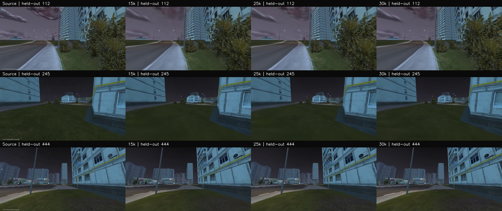

# Маршрут011321: измеренное плато после25k

26октября2026. Продолжение [аудита записи](ROUTE-011321-QUALITY-AND-NAVIGATION.md).
Выполнен предложенный B1: рендер существующих checkpoints на девяти одинаковых
отложенных кадрах с фиксированными PnP-позами. Переобучения и Android input не было;
успешная30k-сцена сохранена. [Полные метрики](route011321/checkpoint-comparison.json)
и [хеши](route011321/checkpoint-comparison-index.json).

| Шаги обучения сохранённого checkpoint | Mean PSNR, dB | Mean SSIM |
|---:|---:|---:|
| 5000 | 29,9712 | 0,89172 |
| 10000 | 30,5799 | 0,90439 |
| 15000 | 31,1421 | 0,91467 |
| 20000 | 31,4764 | 0,91864 |
| 25000 | **31,6183** | **0,91923** |
| 30000 | 31,5976 | 0,91922 |

Рост хорошо виден до20k; прибавка20k→25k уже небольшая. Между25k и30k средние
показатели практически вышли на плато. На этой выборке30k не улучшает25k. Это
основание сначала улучшать исходные данные/виды и геометрию, а не автоматически
добавлять ещё10k итераций. Новый глобальный default25k по девяти соседним кадрам
не вводится; контрольный30k-результат пользователя не заменяется.

## Как исключена подмена обучающими видами

Тестовые source indices: **1,45,112,179,245,289,355,444,510**. Они выбраны равномерно
из23 принятых held-out pose candidates предыдущей пробы. Ни один не входит
в89 исходных видов SfM или Gaussian training. Manifest SHA связывает выборки.
Один неудачный кадр422 с перекрытием листвой не имеет принятой позы и в appearance
сравнение не включён. Следовательно, цифры условны на успешной локализации девяти
кадров; они не означают качество или навигационный успех на всех24 наблюдениях.

Использованы одни RGB, один набор K/поз и один evaluator для всех checkpoint.
Длинная сторона сравнения960; это ещё не проверка сохранения мелких деталей
в полном1920×1080. Новая сессия, другой render scale, погода и false-positive
локации не проверялись. Малые изменения средних не объявляются статистически
значимыми: кадры относятся к одному короткому проходу и связаны во времени.

Перед сравнением сделан контроль преобразования OpenCV/NeRF: девять исходных
reference-view камер и RGB переданы через тот же JSON loader. Получено
PSNR32,544984/SSIM0,93734545 против прежних32,544987/0,93734558. Это подтверждает
соглашения о координатах для данного экспорта. При расхождении более0,02dB или
0,001SSIM runner остановил бы сравнение.

У неизменённого evaluator есть исторически жёстко записанное `held_out=false`:
он не знает происхождения переданного dataset. Raw metrics сохранены с этим
полем без исправления. Внешняя квитанция отдельно доказывает source-index exclusion
и отсутствие training. Помещение девяти query RGB в loader-поле `train.views`
используется только для рендера, обучающий цикл не вызывается. Ошибку этих оценённых
поз нельзя отделить от ошибки Gaussian без независимого pose ground truth.

Все семь GPU-вызовов — только inference существующего PLY, примерно2,4–3s на
вызов без учёта внешнего resource preflight. Проверены binary SHA и source receipt,
перед/во время каждого запуска применялся обычный resource guard. Допуски памяти
и диска не ослаблялись. Хеши master, камеры, query RGB и всех шести PLY после
прогона совпадают с исходными.

Следующее сравнение:150–200 информативных видов с неизменным holdout, отдельной
проверкой поз и сопоставимым бюджетом. Для автономного повторения параллельно
нужны ground-route, visibility/clearance и независимая relocalization. Данный B1
измеряет воспроизведение изображений, а не правильность дорожной поверхности.
