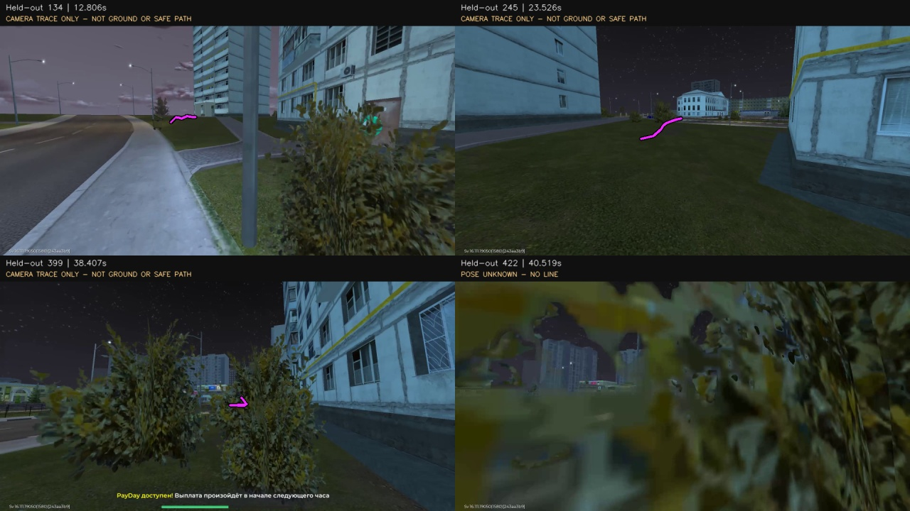

# Маршрут 011321: качество записи, 3D и пригодность для навигации

26 октября 2026. Проверена именно новая запись **«Маршрут 011321 · 512 кадров»**,
job `8140c4bf1cce41819dda4c485fc11d80`, clip `737a9b9ee320415d9d47c6b11a00ef32`.
Базовая ревизия кода: `e3edd22b8158eb15b3e3e07120b43061b290e5af`.
Это отдельная проверка; плохие результаты старого Route012 к ней не относятся.

Новый материал пригоден для дальнейшего эксперимента значительно лучше старого:
все 89 выбранных видов зарегистрировались в одной карте, есть 26 228 3D-ориентиров,
а на 23 из 24 отложенных кадров удалось получить геометрически согласованного
кандидата положения камеры. При этом готовой проверенной карты проходимости,
масштаба в метрах и допуска автономного повторения маршрута ещё нет.

Во время аудита исходная запись, sparse-карта и Gaussian-сцена не изменялись;
новое тяжёлое обучение и управление Android не запускались. Сохранены результаты
лёгкой CPU-проверки локализации и проекции на настоящие отложенные кадры.

Доказательства: [замеры](route011321/measurement.json),
[baseline](route011321/baseline.json), [отложенные позы](route011321/heldout-pose.json),
[проекции](route011321/projection.json), [хеши](route011321/evidence-index.json).
Интерактивная приёмка браузерного 3D-просмотра в этот аудит не входит.

## 1. Что реально записано и что ограничивает качество

| Показатель | Фактическое значение |
|---|---:|
| Разрешение декодированных кадров | 1920 × 1080 |
| Продолжительность по media timestamps | 49,007 s |
| Декодированные / различные RGB-кадры | 512 / 512 |
| Фактическая частота `(N−1)/duration` | **10,427 кадра/с** |
| Полные секундные окна | 9–13 кадров, медиана 10 |
| Средний битрейт H.264 | **3,936 Мбит/с** |
| Объём видеопотока | 24 112 284 bytes |
| Интервал кадров, медиана / p95 / максимум | 100 / 117 / 149 ms |
| Интервалы больше 200 / 500 ms | 0 / 0 |
| Целевой FPS в manifest | 60, с `actual_fps_unverified=true` |
| Завершённость записи / освобождение ввода | Подтверждены |

Это не запись 30 или 60 FPS. Поле `observed_encoded_frames=914` относится к более
широкой сессии подключения, поэтому делить его на длительность этого клипа нельзя.
Регулярные timestamps и отсутствие одинаковых соседних RGB показывают целостность
доставленной последовательности примерно 10 FPS. Они не доказывают отсутствие
пропусков до кодировщика и не подтверждают выдачу игрой 60 кадров каждую секунду.

В журнале этой записи есть1361сопоставленная квитанция ввода: RTT медиана5,9ms,
p9516,7ms, максимум63,9ms. Это время квитанции, не полная задержка от нажатия до
видимого результата игры. Общей калибровки Android capture clock→receiver нет,
поэтому полную задержку Android→модель по этой записи назвать нельзя.

В manifest есть заявление о выключенном HUD. Независимой квитанции настроек
внутриигрового render scale, дальности, AA, motion blur и FOV нет. Full HD на выходе
не доказывает Full HD внутреннего рендера: игра может растягивать меньшую картинку.
На просмотренных кадрах основной HUD действительно отсутствует, но остаются footer
и отдельные игровые уведомления. Семантическая очистка динамики не выполнялась.

Код записи берёт существующий `direct_webrtc_h264`, не делает дополнительное
пережатие в браузере. Следовательно, потерянная до сохранения детализация уже не
восстанавливается увеличением качества Gaussian. Ранее в отдельной диагностике
PH011 подтверждены Full HD и снижение bitrate обычного потока; это не синхронная
пара оригинал/кодек для данного клипа и не основание приписывать ему точный PSNR.

Ограничения здесь: исходный рендер и H.264, отбор только 89 видов, закрытые листвой
участки и невидимые поверхности, ошибки поз, предел числа splats и отсутствие
геометрических ограничений. Доля каждого фактора пока не измерена отдельным A/B.

### Master capture без изменения остальных игровых окон

Это реализуемая отдельная ветка захвата выбранного устройства, но сейчас такой
независимости нет: подписчики `StreamingManager` читают существующий общий encoder.
Поднять его качество означает менять общий источник данного устройства. Остальные
эмуляторы можно оставить в экономичном режиме, однако независимый master на том же
эмуляторе требует отдельного режима/кодировщика и отдельного архива до сетевой
адаптации. Нужно проверить лимит codec instances и стоимость копирования поверхности.

Предлагаемый профиль для измерения, а не обещание: 1080p, внутренний render 100%,
фиксированная камера, устойчивые **30 FPS**, затем сравнение с 60 FPS; bitrate
подбирать по парным кадрам, начальная проба 20–40 Мбит/с. Выключить motion blur,
сохранить текстуры и дальность, эффекты можно уменьшить. На выбранном эмуляторе
проверять захват/encoder/receive/decode по отдельным sequence и monotonic clocks,
длину очередей, dropped counters, заполнение диска. Медленный архив не должен
создавать старую очередь кадров для live-управления.

60 FPS при прежних 4 Мбит/с может дать менее подробный каждый кадр. Для SfM важнее
резкие кадры и перемещение камеры с перекрытием, чем просто частота. Master 30–60 FPS
помогает выбирать более резкий момент, но не требует обучать на каждом кадре.
Уменьшение окон в штатном исполнении — отдельный профиль: перенос карты с master
1080p на 540p/50% render ещё необходимо испытать на независимой записи.

Несжатый RGB1080p60 — около 373 MB/s, более 112 GB за пять минут. Поэтому разумен
качественный сжатый master плюс точные timestamps/калибровка/журнал ввода. Контейнер
MP4 против другого контейнера сам по себе не добавит глубину или позиции камер.
Android MediaProjection выдаёт захват поверхности, а не depth-buffer движка.
[Документация Android](https://developer.android.com/media/grow/media-projection).

## 2. Почему 89 камер и сколько настоящих ориентиров

Это **89 восстановленных положений одной виртуальной камеры**, а не 89 физических
камер и не число кадров в секунду. В `reconstruct_route.py:128` задано:

```python
interval = max(.5, duration / 230)
max_images = 240
```

`prepare_browser` выбирает первый реальный кадр после очередного порога времени,
затем отсчитывает интервал от его timestamp; дополнительно сохраняется последний.
На данной частоте получились интервалы в среднем 557 ms, медиана 565 ms.
Итог: **89 выбраны, 89 зарегистрированы**, 423 исходных кадра не использовались.
Это фиксированный временной отбор, не оценка полезности, резкости или параллакса.

Из имеющихся 512 кадров можно испытать 150–200 информативных видов без новой
записи. Полный текущий pipeline ограничен 240 видами; 250+ требует изменения
ограничений и/или обработки подкарта́ми с проверенной стыковкой. У нижнего уровня
`prepare_browser` другой допустимый диапазон; он не отменяет верхние ограничения
качества и бюджета всего задания.

Для следующих вариантов отбор должен учитывать новые видимые области, резкость,
сдвиг/поворот, перекрытие и падение количества статических соответствий. Почти
одинаковые кадры необязательно полезны. Чистое вращение на месте не создаёт базис
для надёжной триангуляции. Это соответствует рекомендациям по съёмке
[COLMAP](https://colmap.github.io/tutorial.html).

Для длинного маршрута8–10минут правило `duration/230` уже даёт примерно2–2,6s
между выбранными видами. Это может пропускать целые повороты при движении машины.
Поэтому масштабировать этот режим на километры простым сохранением общего
лимита240неправильно: нужны перекрывающиеся локальные подкарты, плотность отбора
по движению/содержимому, связи между частями и проверка стыковки. Текущая удачная
49-секундная сцена не доказывает работоспособность единой8-минутной карты.

| Различаемые сущности | Число / смысл |
|---|---:|
| SfM 3D-точки | **26 228** |
| Наблюдения этих точек в камерах | 154 269 |
| Геометрически проверенные пары изображений | 422 |
| Сумма соответствий внутри этих пар | 360 712; это не уникальные 3D-точки |
| Длина feature track | Медиана 4 вида, p95 16, максимум 55 |
| Наблюдаемые 3D-точки на одну камеру | Минимум 280, медиана 1699 |
| Кандидаты: ≥3 вида, все ошибки ≤3 px, положительная глубина, параллакс ≥1° | **19 377** |
| Строже: ≥5 видов, все ошибки ≤2 px, положительная глубина, параллакс ≥2° | **5446** |
| Точки в текущем sparse preview | 26 228 |
| Gaussian splats | **749 970**, другая сущность |

Фильтры 19 377 и 5446 — воспроизводимые критерии согласованности наблюдений, а не
внешне подтверждённая истинность поверхности. Они не доказывают, что точка статична
или принадлежит дороге. Даже листву можно согласованно восстановить как геометрию,
не получив из этого надёжную коллизионную поверхность.

Независимый пересчёт **обучающих** наблюдений даёт медиану reprojection 0,704 px,
p95 2,799 px, среднее по всем наблюдениям 0,988 px. Среднее 0,855 px в исходном
`result.json` агрегируется по точкам и не равно среднему по всем observations.
Это не held-out метрика. Отрицательных глубин среди сохранённых наблюдений нет;
медиана максимального угла триангуляции track — 12,35°.

## 3. Что улучшать в Gaussian-сцене

Baseline: Brush `0.3.0-system-timing-1`, Vulkan, 30 000 шагов, seed17,
SH degree2, maximum resolution1920, cap750 000 splats. Лог называет устройство
**AMD Radeon RX 9070**, не XT; фактически проверено именно оно. Native training
занял 854 s. Результат содержит 749 970 splats, PLY — 113 996 466 bytes.

К 15k размер экспортов достиг лимита; 15k/20k/25k/30k имеют одинаковый размер файла.
Это не означает одинаковые параметры или одинаковый рендер: после насыщения числа
splats обучение их положений, размеров, opacity и цвета продолжается.

| Изменение | Когда даёт полезный результат | Что требуется измерить |
|---|---|---|
| Более резкий master | Потери текста/границ уже в исходном видео | Парные исходник/кодек, blur, восстановленные детали |
| 160–200 информативных видов | Между текущими видами есть новые детали или слабое покрытие | Held-out RGB, локализация и покрытие, время/VRAM |
| Улучшение matches и bundle adjustment | Плывут позы, K или track consistency | Отложенные соответствия, геометрия и независимые позы |
| Статические маски и очистка динамики | Листва, игроки, транспорт, уведомления загрязняют сцену | Области ошибки до/после; не вырезан ли полезный фон |
| Depth/normal constraints | Нужны согласованные поверхности в слабой текстуре | Межвидовая глубина, нормали, проверка на исходных лучах |
| Densification / cap больше750k | Детали ограничены числом элементов после насыщения cap | Раздельный A/B с фиксированными камерами, ошибки и ресурсы |
| 30k →40k | Отложенная ошибка ещё уменьшается после25–30k | Кривая held-out качества; отсутствие роста floaters |

У текущего запуска не было DA3 depth/normal priors. Просто увеличить iterations
недостаточно: невидимая задняя сторона здания и утраченная компрессией деталь не
становятся измеренными. Увеличение cap также способно улучшать только обучающие
ракурсы и плодить floaters. Значение40k сейчас не допускается
`reconstruction_quality.TRAINING_STEPS`; его нельзя считать существующим режимом.

Сохранённый appearance-check: **PSNR32,545 dB, SSIM0,937**, девять изображений,
сравнение ограничено длинной стороной960. Все девять использовались в обучении,
`held_out=false`. Это подтверждает воспроизведение знакомых ракурсов и не измеряет
ошибку дороги, точность в метрах или качество незнакомого положения камеры.

## 4. Проверенные современные инструменты и AMD

Проверены официальные репозитории и инструкции, включая зависимости, а не только
демонстрации. Новые модели в рамках этого аудита не скачивались и не обучались.

| Инструмент | Практическая роль и ограничения | Состояние на нашей машине |
|---|---|---|
| [Brush](https://github.com/ArthurBrussee/brush) | Cross-platform Gaussian training. Рабочая ветка для качественной визуализации; сама по себе не предоставляет проверенную дорожную mesh | **Фактически работает на RX9070/Vulkan**, текущий baseline |
| [MapAnything](https://github.com/facebookresearch/map-anything) | Предсказывает depth/poses/points/confidence, принимает также известные параметры. Для продукта есть `facebook/map-anything-apache`; обычные weights CC-BY-NC4.0 | Кандидат отдельной пробы малым окном на ROCm; локальный запуск этой модели не подтверждён |
| [Depth Anything3](https://github.com/ByteDance-Seed/Depth-Anything-3) | Полезна pose-conditioned глубина. Small80M/Base120M — Apache2.0; Large1.1/Nested — CC-BY-NC4.0; Metric-Large350M — Apache2.0 | Ранее были локальные DA3-пробы на другом Route012; на011321 глубина ещё не оценивалась |
| [PGSR](https://github.com/zju3dv/PGSR) | Planar Gaussian + multi-view geometric constraints для поверхности | Официальная установка требует CUDA и собственного rasterizer; на AMD/Windows не проверено и не готово «pip install» |
| [GSPrior](https://github.com/takeshie/GSPrior) | CVPR2026: TSDF self-constrained prior, ограничения относительно поверхности; развивает PGSR/GS-Pull | Custom rasterizer, simple-knn и CUDA-зависимости. Готовый AMD-путь не подтверждён; лицензии всего набора требуют уточнения |
| [2DGS](https://github.com/hbb1/2d-gaussian-splatting) | Ориентированные surfel-диски, regularization и meshing; геометрически интереснее обычного набора 3D-эллипсоидов | Официальный fast rasterizer — CUDA; на9070 не запускался |
| [Spirula Studio](https://github.com/harry7557558/spirula-studio) | Готовая цепочка видео→SfM→GS→mesh с Vulkan; более прямой путь к surface A/B на AMD | Уже установлен и пробовался на старом материале. Хорошая mesh именно011321 ещё не получена |

MapAnything/DA3 предсказывают геометрию, не являются подтверждением истинного
масштаба игрового мира. Это не генеративное дорисовывание сцены по тексту, однако
выученный prior тоже может ошибиться. Для MapAnything известные позы из нашей SfM
надо явно подавать как **неметрические**, `is_metric_scale=false`. Нельзя принять
20,36 SfM units за20,36m. Предсказанную поверхность принимать только при поддержке
несколькими реальными кадрами и согласии с проверенными ориентирами.
[MapAnything API и лицензии](https://github.com/facebookresearch/map-anything).

DA3 поддерживает sliding-window streaming; заявленные автором <12GB не являются
нашим замером на89 Full-HD видах. Для street scenes автор предлагает исправленные
checkpoints1.1. Даже «metric» модель не калибрует вымышленный игровой мир без внешних
связей. Основной depth-inference и Gaussian head имеют разные зависимости; CUDA
gaussian head нельзя автоматически считать рабочим на ROCm.
[DA3 models/API](https://raw.githubusercontent.com/ByteDance-Seed/Depth-Anything-3/main/README.md).

У PGSR и2DGS в `setup.py` прямо используются `CUDAExtension`, `.cu` и `nvcc`.
Наличие в нашем ROCm PyTorch вызова `torch.cuda` не делает такие расширения
совместимыми. Их перенос — отдельная инженерная работа. В зависимостях есть
условия research/non-commercial; это тоже ограничение продуктовой интеграции.
[PGSR rasterizer](https://raw.githubusercontent.com/zju3dv/PGSR/main/submodules/diff-plane-rasterization/setup.py),
[2DGS rasterizer](https://raw.githubusercontent.com/hbb1/diff-surfel-rasterization/main/setup.py).

Практический порядок: сохранить успешный Brush, оценить его независимые кадры,
попробовать geometry/depth в отдельном AMD-совместимом процессе. PGSR/GSPrior/2DGS
оставить альтернативами для NVIDIA или обоснованного переноса, не заменять ими
уже рабочий путь по названию статьи.

## 5. Что уже есть для навигации

| Данные | Реальное состояние |
|---|---|
| Относительная sparse-геометрия и ориентиры | Есть, с tracks и reprojection-проверками |
| Камерная траектория и ориентации | Есть, 89 положений; 20,35554 условных единиц пути |
| Gaussian appearance и промежуточные виды | Есть; качество вне обучающих ракурсов отдельно не оценено |
| Плотная согласованная глубина этого маршрута | Проверенного экспорта/валидации нет |
| Земля/дорога и её семантика | Не выделены и не проверены |
| Точные высоты, бордюры, уклоны в метрах | Неизвестны без масштаба и surface validation |
| Проверенная obstacle mesh / clearance | Нет |
| Карта проходимости | **Нет пригодной к допуску карты** |

Opacity/depth от Gaussian-renderer — оценка на основе обученной модели, не датчик
расстояния. Sparse-точки доказывают согласованность определённых лучей, но пустота
между ними не доказывает свободное место. Невидимая сторона, участок за машиной,
листва и слабая текстура должны оставаться `unknown`, а не автоматически `free`.

Для навигационного слоя нужны depth/normal fusion с признаками видимости и
неопределённости, локальная ground surface, отделение препятствий, clearance под
персонажа/машину и локальный costmap. Название «земля» ещё не означает, что по ней
можно ехать: вода, отбойник, высокий бордюр и крыша требуют различения. Динамический
транспорт/игроки обрабатываются по свежим наблюдениям, не замораживаются навечно
в статический маршрут. Красивый render не заменяет эти проверки.

## 6. Камера, персонаж, транспорт и внешние координаты

Восстановленное `camera_to_world` описывает камеру. В first-person она не равна
контактной точке ног/колёс: есть высота, наклон и head bob. В third-person добавляются
плечо, отдаление и автоматический поворот камеры; постоянного сдвига обычно мало.
Текущий `camera_body_transform=null` честно фиксирует отсутствие такой калибровки.

Путь персонажа нужно получать через проверенный camera/body rig или через
пересечение лучей с принятой ground surface и модель высоты/контакта. Для транспорта
дополнительно нужны его габариты, направление и ограничение поворота. Нельзя просто
провести линию через центры камер и назвать её полосой дороги.

Если доступны игровые координаты, записывать их редко, с временем наблюдения и
погрешностью. Несколько распределённых соответствий позволяют оценить устойчивый
Sim(3): масштаб, поворот и перенос. Для определения полной ориентации нужны
неколлинеарные связи; движение почти по одной прямой оставляет вырождение.
Оставить часть координат для проверки, а не подгонять и оценивать на одной выборке.

Миникарта/большая карта — дополнительный адаптер: хранить crop, zoom, поворот,
координаты игрока и опорные объекты. Для плоского участка подходит откалиброванное
2D-преобразование; мосты, тоннели и этажи требуют нескольких уровней. Пиксель
большой карты не становится метром только из-за соглашения «0..1000».

Для игр без GPS/команд остаются относительные подкарты, visual relocalization,
топологические связи и scale-relative ограничения. Абсолютная точность «пара метров»
без внешнего масштаба не доказуема, но повтор локального коридора проверять можно.
Все источники — опциональные адаптеры общей схемы, не BlackRussia-hardcode в ядре.

## 7. Новая проверка локализации: факты и пределы

Из423 неиспользованных кадров выбраны24 распределённых по записи. Их source index
не входит ни в89 SfM-видов, ни в Gaussian training; проверены manifest SHA и PNG SHA.
Поиск кандидатов выполнялся глобально по небольшой галерее RootSIFT всех89 видов,
затем 2D→3D matching и PnP/RANSAC+LM. Индекс времени для выбора кандидатов этой
ветки не использовался. Отдельно посчитана time-neighbour oracle-ветка; она явно
не является слепой локализацией.

| Показатель | Факт |
|---|---:|
| Проверено unseen source frames этого же клипа | 24 |
| Принятые кандидаты позы, global retrieval | **23/24** |
| Time-neighbour oracle | 23/24 |
| Inliers на принятом кадре, минимум / медиана | 340 / 1036 |
| Медиана per-frame median reprojection | **0,724 px** при исходных1920×1080 |
| Максимум per-frame median reprojection среди принятых | 0,868 px |
| Новая игровая сессия / внешний pose ground truth | Нет / нет |
| Подтверждение трёх последовательных поз / live-допуск | В этой пробе не выполнялись |

Порог кандидата: ≥30 inliers, доля≥0,3, median reprojection<2px, поддержка минимум
четырёх ячеек сетки; inliers лежат перед камерой и в пределах4px. Это строгая
проверка соответствий, но не доказательство отсутствия ложной привязки к похожему
зданию. Отдельные альтернативные гипотезы, повторные места и отрицательные примеры
нужно проверять дополнительно.

**Отказ: кадр422,40,519s.** Почти весь экран перекрыт близкой листвой. В global-ветке
было42 соответствия без принятой PnP; даже с известным временем oracle даёт только
10 inliers и одну ячейку покрытия. Это причина для `unknown`, а не для движения
по последней уверенной позе.

Отложенные кадры соседствуют с обучающими, поэтому тест оптимистичен. Он не
доказывает повтор после нового входа, другой камеры, дождя или смены освещения.
Геометрия зданий обычно стабильнее теней, бликов, листвы и динамики, но степень
устойчивости именно этой карты пока неизвестна. Нужны отдельный проход, сдвиги
старта/камеры, другой render scale и отрицательные локации; желательно несколько
условий освещения. Аугментация не заменяет независимый проход.

Полная CPU-проба Full-HD features + две ветки поиска/PnP занимает медиану1,762s,
p951,888s на кадр. Это не изолированный runtime benchmark и **не подтверждение5Hz**.
Существующий runtime имеет меньшую разрешающую способность и другой bounded map;
его старые timings на Route012 нельзя переносить на новый dense map автоматически.
Нужны подбор статических ориентиров, уменьшение features, retrieval/tracking,
профилирование возраста кадра и GPU/CPU-конкуренции. Очередь старых решений недопустима.

## 8. Проекция маршрута на настоящий кадр

Выполнен воспроизводимый offline-тест, без motor inference и Android input:
[audit_route_projection.py](../../../scripts/pilot/audit_route_projection.py).
Для каждой принятой held-out позы выбирается ближайший геометрический сегмент
камерной траектории. Неоднозначные пересечения отбрасываются. До восьми следующих
камерных центров переводятся из мира в камеру и проектируются тем же K:

```text
X_camera = R_world_to_camera · X_world + t
pixel = (K · X_camera).xy / (K · X_camera).z
```

Точки с отрицательной глубиной/за экраном не соединяются через невидимый участок.
Позу, RGB и карту связывают хеши. Формула проверена на тех же точках через
OpenCV projectPoints: максимальная численная разница2,66e−11px. Это проверка
соглашений о координатах и реализации проекции, а не точности игровой геометрии.

**23 позы приняты, на22 кадрах есть минимум две видимые точки линии.** На422 линии
нет. Это кандидаты относительной camera trace, не проверенный след ног/колёс.
Линия может быть выше земли, идти за кустом и не доказывает свободный проход.
Ground correction и depth occlusion test намеренно не подменены произвольным
вертикальным сдвигом. Подписи на изображениях явно отмечают этот предел.



Чтобы получить правильную дорожную линию, осталось связать camera/body,
принять ground/clearance, построить короткую проходимую траекторию к локальной цели,
обновлять K/позу при смене камеры и выполнять occlusion test. Подтверждать положение
несколькими свежими наблюдениями, отклонять неоднозначность и при потере положения
безопасно освобождать управление. После этого отдельно проверить, следует ли
выбранная моторная модель разметке: одна нарисованная линия не гарантирует такой
способности у NitroGen/Pixel2Play.

Повтор этой конкретной диагностической проекции из корня checkout, в новый каталог:

```powershell
.local-pilot/motor-worker-venv/Scripts/python.exe -m scripts.pilot.audit_route_projection `
  --geometry .local-pilot/reconstruction-jobs/8140c4bf1cce41819dda4c485fc11d80/geometry.json `
  --heldout-report .local-pilot/route011321-audit-20261026/heldout/report.json `
  --images .local-pilot/route011321-audit-20261026/heldout/images `
  --output .local-pilot/route011321-audit-20261026/projection-recheck-001
```

Output обязан быть новым: проверка не перезаписывает предыдущие доказательства.
Исходное видео и полные24 PNG остаются локально; в Git не копируются гигабайты кадров.
Public JSON сохраняет позы, indices, пороги, hashes и все результаты; приватные
measurement/held-out probe scripts сохранены рядом с локальными доказательствами,
их SHA включены в evidence-index. Для полного повторения PnP нужны тот же source,
prepared sparse/database и указанные OpenCV/pycolmap; один projection-тест PnP не
пересчитывает. Сохранённые позы не являются независимым ground truth.

## 9. Контролируемое сравнение улучшений

Успешный baseline заморожен. До вариантов сохранить24 held-out source indices
неизменными; дополнительно отложить целые короткие временные блоки и независимый
новый проход. Любые картинки этого holdout исключать из отбора SfM и обучения GS,
включая варианты с увеличением количества камер.

| Вариант | Изменение относительно baseline | Какой вопрос проверяет | Статус |
|---|---|---|---|
| B0 | 89 камер,30k,750k cap | Зафиксированная опора | Получен; 9 train-view appearance и24 held-out PnP |
| B1 | Те же камеры и существующие5k/10k/15k/20k/25k/30k checkpoints | Продолжает ли улучшаться качество после насыщения cap | Файлы уже есть; held-out RGB-сравнение не выполнено |
| B2 | Около160–200 информативных видов,30k,тот жеcap | Даёт ли пользу новое покрытие | Предложен, не запускался |
| B3 | 89 видов, улучшенные static matches/BA,30k | Ограничивают ли результат poses | Предложен; отдельная переменная |
| B4 | Принятый B2/B3 плюс depth/normals из малого окна DA3/MapAnything | Становятся ли поверхности согласованнее | Предложен; веса/зависимости изолировать |
| B5 | Те же принятые poses,30k,cap1–1,25M | Ограничивает ли детали densification-cap | Только после VRAM/preflight; не запускался |
| B6 | Те же данные иcap,40k | Окупается ли ещё10k шагов | Пока режима нет; сначала B1 и ресурсный бюджет |

30k шагов на89 и на180 видах не равны по числу предъявлений каждого вида: при
равномерной выборке это примерно337 против167. Поэтому нужны оба отчёта — при
равном общем времени/числе шагов и при сопоставимой экспозиции видов. Нельзя
списать недообученный B2 на бесполезность дополнительных ракурсов.

Метрики и правила сравнения:

1. **Appearance:** PSNR/SSIM на одних held-out RGB; LPIPS только после проверки
   доступности/версии. Отдельно full-frame и static-mask, исходное разрешение
   против960. Одинаковые exposure/цветовой pipeline. Для сравнения только splats
   фиксировать eval poses/K, чтобы новая подгонка камеры не скрыла ошибку сцены.
2. **Localization:** accepted/unknown/false accept, неоднозначные места,
   распределение inliers, сеточное покрытие, ошибка отложенных соответствий,
   непрерывность и время восстановления. Новые source indices проверять по manifest,
   а не одному RGB SHA: разные декодеры могут менять RGB того же самого кадра.
3. **Pose:** ATE/RPE в метрах и градусах допустимы лишь при независимой привязке.
   Соседняя камера или интерполяция train poses — сравнительный proxy, не истина.
   Сейчас абсолютной ошибки положения этого маршрута нет.
4. **Geometry:** согласованность depth между видами с visibility mask,
   ошибки на подтверждённых sparse tracks, normal consistency, floaters,
   двойные поверхности, слепые области. Для дороги — поверхность под контактом,
   непрерывность высоты/нормалей, бордюр/препятствие и clearance. Chamfer в метрах
   без независимой опорной геометрии не заявлять.
5. **Projection:** размеченные на настоящих held-out кадрах статические точки
   и ground corridor; median/p95/max pixel error и доля кадров с корректным
   видимым сегментом. Проверить поворот, склон, боковой старт, occlusion,
   смену камеры и ветвление маршрута; camera trace не считать разметкой дороги.
6. **Resources:** wall time, peak VRAM/RAM, size, frame age и число ошибок.
   Прирост только train PSNR или ещё100k splats не являются критерием успеха.

Первые наиболее выгодные действия после вопросов: **B1 на существующих экспортах,
затем B2 с информативным отбором**, параллельно отделить ground-route от camera
trace. 40k и новое семейство моделей не являются первым обязательным шагом.
Никакой из улучшенных вариантов ещё не объявлен победителем без этих замеров.

## FOV, способ прохода и визуальный просмотр

K оценён SfM: fx603,696/fy604,486 при1920×1080, что соответствует примерно115,67°
горизонтального FOV в pinhole-модели. Это **расчётная оценка**, не прочитанная
настройка игры. Проверить её независимыми точками и моделью камеры ещё предстоит.

Не стоит сейчас увеличивать FOV ради количества объектов: в кадре станет больше
окружения, но каждый объект займёт меньше пикселей, краевые ошибки и несоответствие
камеры могут возрасти. Важнее фиксированные zoom/FOV, стабильная камера, резкость
и перекрытие. Ехать по целевому маршруту нормально; участки поворота и боковые
видимые фасады полезны для геометрии. Короткие дополнительные виды проблемного
поворота могут быть полезнее тотального увеличения FPS. Вращение на месте не
заменяет изменение позиции.

Просмотр «как Street View» можно сделать непосредственно по сохранённым резким
кадрам и их связям, сохранив исходные детали независимо от качества Gaussian.
Готовый [MapillaryJS](https://github.com/mapillary/mapillary-js) поддерживает
собственный data provider; это кандидат для локального image-sequence viewer.
Такой просмотр не создаёт 360° там, где задняя сторона не снята, и не заменяет
навигационную геометрию. Поддержка360/equirectangular в Spirula тоже предполагает
реальные соответствующие исходные кадры, а не превращает обычный экран в панораму.

Приёмка следующего этапа должна отдельно ответить на три вопроса: узнаём ли место
на независимом проходе, правильно ли строим проходимую локальную линию и следует
ли ей моторная модель с непрерывным удержанием ввода. Удачная реконструкция011321
даёт хорошую базу для проверки этих связей; сама по себе их ещё не подтверждает.
