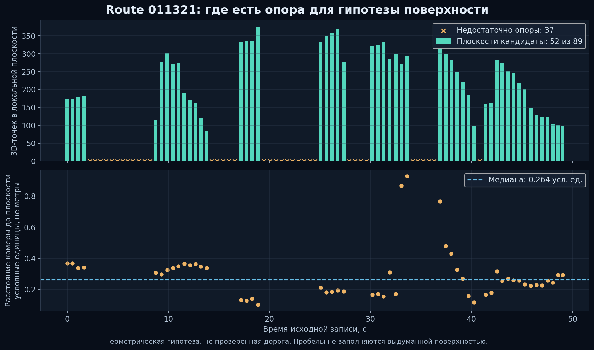
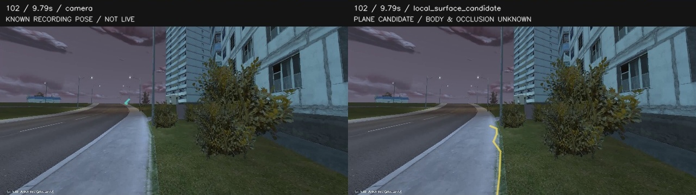
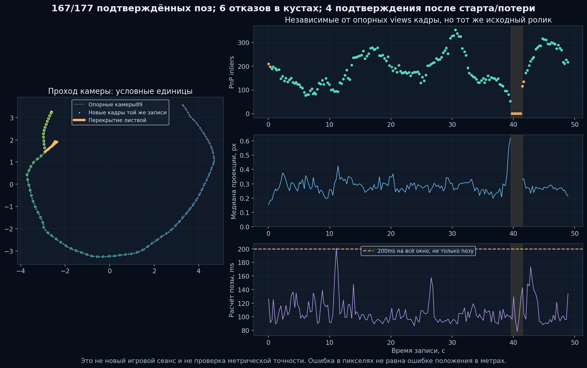
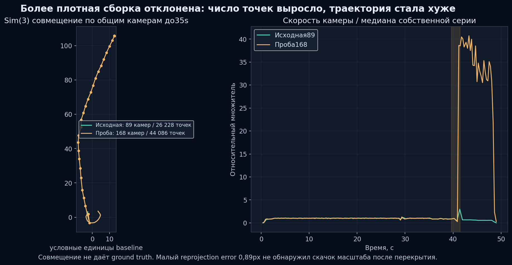
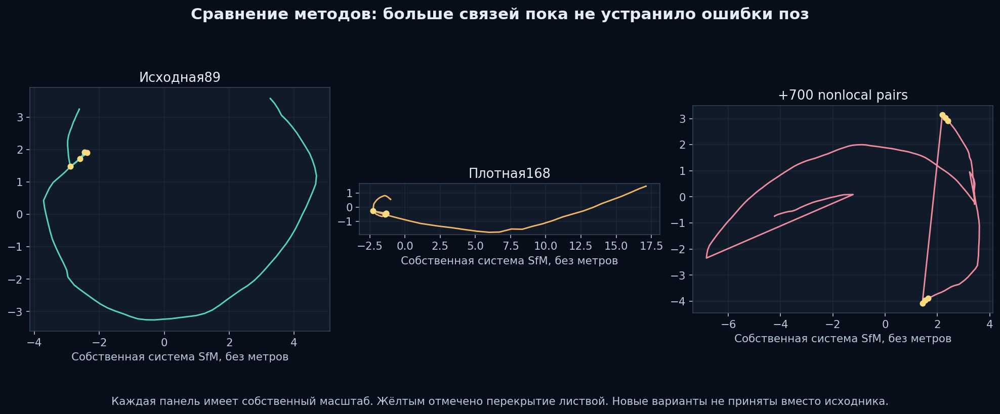
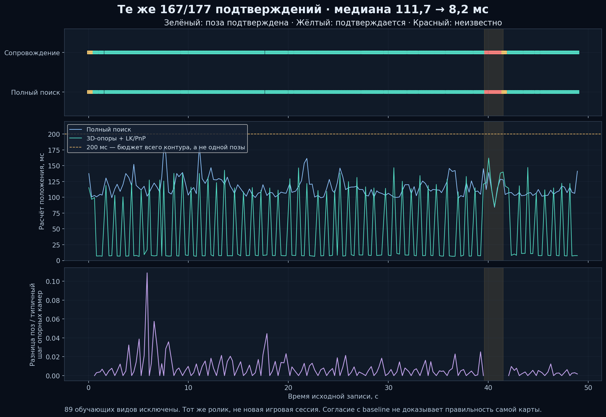
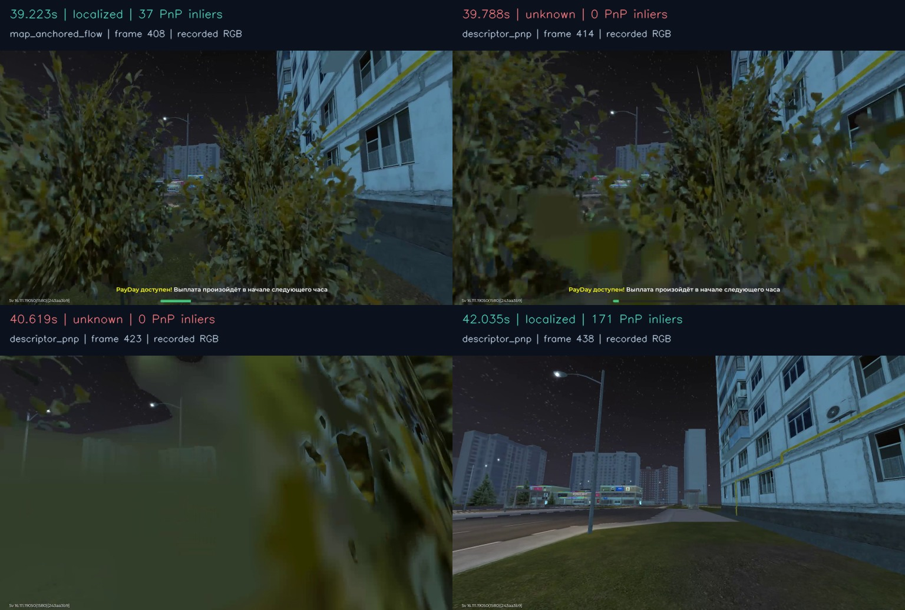

# Динамическая проекция Route011321: видео и гипотезы поверхности

26 октября2026. Это отдельный локальный диагностический просмотр, **не живой
поток и не готовая навигационная траектория**. Главный веб60c0dc7a/API1afdc529,
APK92 и VPN не обновлялись этим экспериментом. Управление Android отсутствует.

## Почему прежние рисунки не решали задачу

Циановая линия, стрелка, шевроны и коридор в
[моторной пробе](MOTOR-ROUTE-CONDITIONING.md) генерировались по шаблонам.
Они не извлекались из3D-маршрута. Их положение в стене не было рекомендацией
двигаться туда; такой стимул проверял только чувствительность модели.

Затем была автоматически спроецирована настоящая последовательность центров
камер. Но центр камеры выше земли, горизонт короткого1,2s отрезка выглядит
как маленькая черта впереди. Простое удлинение или увеличение толщины не
превращает этот путь в дорогу и не учитывает закрывающие объекты.

## Что реализовано и фактически проверено

`scripts/pilot/preview_route_trace.py` связывает geometry.json с исходным
manifest по SHA, проверяет последовательность времени, фиксированную калибровку,
конечные матрицы и правильные вращения. Между опорными позами той же записи
интерполируются центр и SO(3)-вращение; разрывы больше1,5s и экстраполяция
не допускаются. Это **известное время записи**, не распознавание новой позиции.

В производном FullHD MP4 сохранены512/512 кадров и все исходные presentation
timestamps, ошибка readback0s; синтетических кадров0. Номинальные30 в настройке
кодека не объявляются фактическими30FPS: исходник остаётся около10,43FPS.
Размер производного файла36,46MB. Оригинальный H264 и остальные источники
проверены по хешам до/после. Первый v1 экспорт не завершился из-за квантования
времени MP4; исправлены обе time bases и добавлен тест кадров через17ms.
Незавершённый v1 не публиковался, исходник не менялся.

В браузерном просмотре видео и canvas синхронизируются по decoded mediaTime
через requestVideoFrameCallback. Есть pause/seek, выключение линии, регулировки
толщины/прозрачности и общий проход в отдельной PCA-проекции. Последняя не
называется2D-дорожной картой; масштаб условный. Исходная линия появляется
на494 кадрах. За пределами кадра/камерой или у разрыва она не продолжается.
[Readback](route-trace-preview/readback.json).

## Проверка поверхности вместо произвольного сдвига линии

Проверена единая плоскость по нижним центральным областям кадров; она отклонена
как универсальная поверхность всего маршрута. Расстояние камер до неё сильно
меняется, местами почти исчезает. Из красивого render нельзя вывести, что такая
плоскость правильна для всей улицы.

`scripts/pilot/audit_route_surface.py` проверяет локальные геометрические
гипотезы в пяти соседних ракурсах. Используются реальные SfM-точки, наблюдаемые
минимум в двух нижних центральных областях; RANSAC600 с seed17, ограничение
нормали относительно camera-up, минимальная поддержка60 точек/15%, уточнение
SVD. Порог0,08 медианного camera step и расстояния0,4–4 таких step —
**исследовательские безразмерные эвристики**, не доказательство высоты персонажа.
Уточнённая нормаль и высота проверяются заново. Маски NPC, semantic ground,
engine depth и реальная gravity отсутствуют.

Получено52 кандидата из89 опорных видов. Это не52 достоверных дорожных участка.
Разброс рассчитанной высоты0,102–0,928 условных единиц, медиана0,264; выбросы
подтверждают необходимость дополнительного отбора, а не готовность height map.

В режиме «Поверхность · гипотеза» камера проецируется на локальную плоскость,
последующие точки берутся из таких же соседних гипотез. Горизонт до5s, максимум
десять следующих опорных видов. Проекция отрезков обрезается границами экрана,
поэтому линия может начинаться снизу. У пропущенной поверхности или скачка
положения больше двух соседних camera steps цепочка обрывается. Независимые
цепочки через пробелы не соединяются. Это улучшает читаемость, но не создаёт
подтверждённого маршрута тела персонажа.

Такие отрезки видны на189/512 кадров. Этот показатель — покрытие диагностического
display, не успешность навигации. На остальных кадрах показан отказ; скрытого
fallback на выдуманную дорогу нет. Производное видео используется без повторного
кодирования. [Результат](route-trace-preview/surface-readback.json).

[Сравнение шести моментов](route-trace-preview/camera-versus-surface.jpg) показывает
также провалы и перекрытие листвой. Проверка окклюзий **не реализована**: текущая
проекция может отображаться поверх закрывающего объекта. На этом основании
движение не разрешается. Нельзя подменять цельность маршрута соединением линии
сквозь неизвестные области/здания.

## Локальное окно и границы проверки

`serve_route_trace_preview.py` обслуживает четыре фиксированных файла на loopback,
с отдельным случайным URL, проверкой Host, ограничением восьми запросов,
корректными byte ranges для seek и конечным сроком до1h. Нет directory listing,
upload, Android/input API, сторонних URL или токенов Sphere. Сохранённые сцены
и основной сервер не изменяются. Старое окно3348 — camera trace; новое3349 —
сравнение с surface hypotheses. Эти временные адреса не являются постоянными
проектными ссылками и не сохраняются в публичной документации.

HTTP200, range206, неверные Host/path404 и неверный range416 проверены.
Открытие панели поставлено в очередь через Codex. Полная визуальная приёмка
браузера остаётся открытой: CUA/Node REPL падают до выполнения кода при создании
kernel assets. Представленные картинки собраны CPU из настоящих кадров и
тех же projection points, а не выданы за browser screenshots.

В схему добавлены pan, zoom колёсиком, click-to-seek и сброс двойным кликом.
Дополнительная диагностика привязана к точным source/geometry hashes и индексам
всех512 кадров; несовпадение скрывает проекцию. Интервал недостаточной привязки
39,605–41,483s выделен на схеме оранжевым, в21 соответствующем display frame
линия скрыта. Это консервативное расширение шести отказов по177 пробам;
оно не называется оценкой позы каждого из512 кадров.

## Компактная карта и измерение локализации

Из того же sparse model отдельно построена карта с runtime-совместимыми
RootSIFT-признаками960×540. Подтверждены4846 tracks с минимум3 views,
параллаксом от1° и reprojection до3px; сохранены4096 по действующему бюджету.
Все89 соседних окрестностей имеют хотя бы24 ориентира, но два отдельных
ракурса имеют меньше24. Покрытие окрестности необходимо, но недостаточно
для успешного распознавания конкретного кадра.

Из записи исключены89 reference indices. На177 отложенных во времени наблюдениях
167 `localized`,4 `confirming`,6 `unknown`; последние находятся в39,788–41,201s.
Медиана вычисления101,22ms, p95143,51ms, max201,50ms. Для offline-пробы clock
синхронизирован с media time, поэтому эти данные не доказывают своевременную
живую5Hz цепь. В частности, поза~101ms плюс отдельный motor request~110–130ms
уже расходуют больше200ms при последовательном исполнении до учёта сети/ввода.
Нужны оптимизация/разные частоты стадий и измерение полного цикла; ограничения
свежести в live-локализаторе не ослаблены.
[Runtime-карта и результат](route-trace-preview/runtime-localization.json).

Проверка резких разворотов исходных89 камер дала0 срабатываний/0 speed outliers.
Это **не опровержение замечания пользователя**: мягкая петля/неверная поза может
пройти простую эвристику. Отказ по независимым от reference views изображениям
в том же кусте — существенное дополнительное свидетельство. Положение персонажа
на записи не измерено, поэтому причина между физическим смещением игровой камеры
и ошибкой SfM пока не разделена окончательно.

## Проверяемые способы улучшения

Первым запущен изолированный SfM trial: выбор кадров через0,25s вместо0,5s,
те же24 held-out indices заранее исключены, intrinsics закреплены на baseline
estimate, используются имеющиеся pinned RootSIFT+LightGlue/COLMAP4.2.1.
Новые source images/база/модель хранятся отдельно; исходный30k Gaussian checkpoint
не переобучается и не заменяется. Отложенные индексы исключаются также из последнего
принудительно сохраняемого кадра. До сравнения ошибки на тех же held-out кадрах
новый trial не называется улучшением.

Первая проба завершилась:169 выбранных/168 зарегистрированных камер,44086 точек,
mean reprojection0,888px,826 sequential pairs. Она **отклонена**: после перекрытия
листвой наблюдается скачок относительной скорости до~40 медиан и несогласованный
масштаб следующей части пути. Такая траектория не становится правильной от
большего числа точек или малого reprojection error. Исходная89-camera сцена
сохранена. [Квитанция отклонённой пробы](route-trace-preview/denser-trial.json).

Для сравнения применено диагностическое Sim(3)-совмещение по35 общим камерам
до35s; оно не даёт ground truth и не исправляет геометрию. Следующая изолированная
проба добавляет до700 nonlocal BoW/LightGlue correspondence proposals,
эпиполярную проверку и повторный mapping. SQLite копируется через backup API,
исходная база/модель не изменяются. Эта проба также **отклонена**:168/169 камер,
46100 точек,0,916px mean reprojection, но5 разворотов и2 speed outliers;
искажения появляются также вне куста. Больше verified pairs не гарантируют
правильной pose graph на повторяющихся фасадах и слабых пространственных связях.
[Вторая квитанция](route-trace-preview/nonlocal-trial.json).

Последовательные соответствия, геометрическая проверка и общая bundle adjustment
подходят для такого анализа. COLMAP отдельно предупреждает о важности перекрытия,
различающихся точек наблюдения и вырожденной self-calibration; больше похожих
кадров само по себе не гарантирует точности.
[РуководствоCOLMAP](https://colmap.github.io/tutorial.html),
[калибровка и ограничения](https://github.com/colmap/colmap/blob/main/doc/faq.rst).

Как следующий внешний baseline изучен DROID-W/CVPR2026: per-pixel uncertainty
по multiview feature inconsistency снижает влияние движущихся/нестабильных
областей; авторы сообщают около10FPS в своих условиях. Но их открытая установка
требует CUDA11.8, torch2.1 и native extensions; перенос на Windows/RX9070/ROCm
не выполнен. Это кандидат на отдельный тест, не уже установленная возможность.
Физический IMU Android не заменяет движение игровой камеры.
[Работа авторов](https://moyangli00.github.io/droid-w/),
[официальный код](https://github.com/MoyangLi00/DROID-W).

11 Python tests проверяют позы/вращения, отсутствие экстраполяции, пропуски,
разрывы поверхности, обрезку, исходную привязку, VFR MP4 и range-запросы;
ещё2 проверяют локальные плоскости,5 Node tests — синхронизацию с decoded
mediaTime, pause/seek, pan/zoom, исходную привязку диагностики и отсутствие линии
без surface support. Вместе с моторной пробой22 Python tests; отдельно17
тестов browser importer с новыми heldout exclusion cases. Ruff и JS syntax прошли.

## Отдельное окно свежего потока

Реализован `scripts/pilot/live_route_observer.py`: один вручную запускаемый
прогон120s, выбор1–10 наблюдений/с, loopback viewer и один текущий JPEG в RAM.
Никаких архива кадров, моторной модели, replay или native-input data channel.
Загрузка страницы не открывает Android: POST/start требует свой Origin и
явное подтверждение оператора, что он находится в игровом мире. Это
**операторское предположение scene=active**, не автоматический game-state detector.
Остановка/таймаут закрывает peer и удаляет последний preview. Потерянный ответ
start не приводит к автоматическому повтору.

Проекция вычисляется по реальному свежему RGB, без времени исходной записи.
При неопределённой позе показывается raw кадр без линии. Кадр старше400ms от
приёма не отдаётся; browser дополнительно скрывает остановившееся изображение.
Результат не содержит разрешения на движение и не доказывает ground corridor.
Live observer пока показывает только путь камеры; офлайн surface candidates
в него как проверенная дорога не подключены.

Две конечные read-only пробыPH011/10292 прошли по15s на1920×1080:
74 observations каждая,4,929–4,930Hz,25,044–28,780 decoded FPS,0 input channels,
0 команд,0 сохранённых кадров. После исправления часов опубликованы74 свежих
preview, median pose compute100,04ms; все74 позы `unknown/route_pose_not_verified`.
**Положительная live-локализация на изученном участке не подтверждена.** Текущий
экран не был выдан за доказанный маршрут или активный игровой мир.
[Фактические пробы](route-trace-preview/live-observer.json).

Первая проба выявила несовпадение таймеров Python3.12/Windows: receiver использует
QueryPerformanceCounter/perf_counter, default localizer — GetTickCount64/monotonic.
Разница в одном замере была−29,3752ms; это не постоянная поправка. Теперь localizer
явно получает тот же perf_counter, а прежний предел свежести250ms сохранён.
После этого исчезли24 ложных `route_scene_geometry_or_age_unqualified`,
положительные позы от этой правки не выдумывались.

4 дополнительных Python tests покрывают отсутствие input authority, освобождение
preview, один ручной запуск, ресурсный отказ и общий receiver clock. Ещё2 Node
tests покрывают manual start, неопределённый ответ и скрытие старых изображений.
HTTP idle window проверен без старта: GET200, неверный Origin403, отсутствие
scene confirmation409, произвольный path404; после отказов Android не открывался.
Итого43 Python tests и7 Node tests в данном связанном этапе.

## Сопровождение ориентиров между полными поисками

Добавлен отдельный opt-in `AnchoredRouteLocalizer`; существующие callers по
умолчанию продолжают использовать `RouteLocalizer`. Новый вариант не сглаживает
и не редактирует исходную карту. После трёх descriptor/PnP подтверждений он
сопровождает до256 уже проверенных 2D↔3D пар пирамидальным Lucas–Kanade,
проверяет прямой/обратный переход до1px и заново решает абсолютный PnP по тем же
3D-ориентирам. Применяются прежние требования к inliers, пространственной
геометрии, покрытию кадра, неоднозначности, коридору и скачкам положения.

Это использование готового OpenCV, а не новая моторная нейросеть или
воспроизведение клавиш. Метод опирается на локальную стабильность изображения;
большое движение, перекрытие и смена освещения способны его сорвать.
[Официальное описание OpenCV](https://docs.opencv.org/4.13.0/d4/dee/tutorial_optical_flow.html),
[пример авторов с прямой/обратной проверкой](https://github.com/opencv/opencv/blob/4.x/samples/python/lk_track.py).

Без нового успешного descriptor-check опоры действуют менее0,8s. При наступлении
этого срока полный поиск обязателен; его отказ нельзя обойти продолжением flow.
Потеря, menu, gap, expiry и ошибка расчёта очищают опоры и подтверждения.
Повторное определение положения начинается с трёх descriptor-наблюдений.
Нет экстраполяции через листья, изменения масштаба, новых 3D-точек или
«исправления» маршрута только ради цельной линии. В памяти хранится один
предыдущий gray-кадр и максимум256 текущих опор, очереди кадров нет.

Проведено сравнение на точно тех же177 query frames,89 обучающих source indices
исключены в обоих вариантах. Полный поиск и сопровождение дали одинаковые
167 `localized`,4 `confirming`,6 `unknown`; все шесть отказов остались в кустах.
Сопровождение использовано114 раз, полный поиск63 раза. Эта проба подтверждает
ускорение на поддержанных участках, **не улучшение покрытия и не истинность карты**.

| Локализация, CPU/OpenCV8 threads | Медиана | p95 | Максимум |
| --- | ---: | ---: | ---: |
| Descriptor/PnP каждый кадр | 111,70ms | 145,32ms | 181,79ms |
| Descriptor + anchored LK/PnP | 8,20ms | 137,81ms | 162,09ms |

Для контроля выполнена короткая timing-проба девяти тех же query frames при
2/4/8 threads: медианы полного поиска209,96/149,35/105,59ms. Отдельный первый
177-frame прогон с2 threads дал218,90ms для baseline и11,12ms для сопровождения;
его нельзя смешивать с таблицей8-thread прогона. Число threads меняется только
в отдельном процессе эксперимента, настройки эмулятора/хоста не изменяются.
Последний полный прогон проверяет RAM≥12GiB, диск≥20GiB и commit<85% перед
запуском и каждые30 наблюдений; отказ не отменяется. Оригиналы и30k checkpoint
сохранены. Новых моделей, GPU-реконструкций или Android-команд не запускалось.

Разница двух решений камеры на совместно принятых кадрах: p95=0,02461 типичного
шага опорных камер, максимум0,10891 такого шага; угловая p95=0,08717°, максимум
0,20951°. Это **согласие с baseline**, не ошибка относительно ground truth,
не метры и не положение персонажа. В частности, общая ошибка самой карты может
присутствовать в обоих вариантах. [Данные сравнения](route-trace-preview/anchored-tracking.json).

Графики получены из измерений; фотопанель — из исходных RGB записи, без
генеративной дорисовки. Линия графика согласия обрывается в unknown, не соединяет
его нулевой «ошибкой». На40,619s листва закрывает большую часть изображения;
в42,035s приняты171 PnP inlier. Между ними положение не выдумывается.

8,20ms — только медиана локализации при offline media clock. p95 остаётся
137,81ms из-за периодических полных поисков. Вместе с отдельными110–130ms motor
requests это пока **не SLA полного цикла200ms**, не доказательство5Hz live-мотора
и не нагрузочная приёмка десятков эмуляторов. Для масштаба нужен общий бюджет
CPU/GPU и очередей между устройствами; восемь threads на каждое окно обещать нельзя.

В live observer добавлен явный выбор «Ориентиры + сопровождение (эксперимент)»
или полного поиска. Выбор доступен только когда сервер объявляет поддержку;
старое окно без этой возможности продолжает прежний протокол. По открытию
страницы Android не запускается. Один ручной120s прогон, прежние250ms freshness
при расчёте/400ms preview, общий receiver clock, отсутствие модели/native input
сохраняются. Статус показывает фактический метод, отчёт — причины отказов,
число опубликованных и отброшенных preview. Сам UI не является навигационным
допуском. Положительный новый live-проход пользователем ещё нужен.

71 связанных Python tests и8 Node tests прошли: в том числе реальные LK/PnP на
контролируемом изображении, полное перекрытие, несогласованный backward flow,
обязательный descriptor-check, отсутствие RGB после ошибки, запрет сравнивать
разные queries и сохранение12GiB guard. Браузерный визуальный прогон по-прежнему
открыт: повторная инициализация CUA снова остановилась на kernel assets/os error3
до исполнения кода; это не утверждение об отключённых пользователем настройках.

## Что отделяет это от живого повторения

Нужно независимо узнавать позу по свежему кадру и проверять её confidence/возраст,
а не брать время исходной записи. Нужно откалибровать camera→body, подтвердить
ground corridor и динамические препятствия; отдельно — проверить локальную
цель и моторную модель. Полная3D-визуализация и recorded-pose replay не дают
такого допуска. Для live-окна ручной проход будет отделён от исполнителя:
оно сначала только показывает fresh frame, позу/отказ и проекцию без игровых
команд.30FPS визуализации не будут выданы за30 независимых локализаций/с.

### 27 октября: доработка страницы и диагностики

Установлен UI `219fc85b10a8137351c72efa33d86ba21a24f56d` / API `1afdc529`.
Полный локальный frontend CI `20261026T211656Z-be109907`:2732 теста, ошибок0;
упакованный образ и HTTP-проверка прошли, установщик сохранил45 других
контейнеров и каталог обновлений. На открытой странице проверены состояние
локального обработчика, компактная компоновка, поиск по названию и ID, открытие
записи и отдельное подтверждение удаления; удаление не выполнялось. В этом
браузере найдено9 записей, проход `011321` среди них не отображается. Сцена
и read-only карта этого прохода на ПК не удалялись, но доступ к исходной записи
зависит от браузерного профиля и аккаунта; новая независимая live-проверка не
проводилась.

Метрики сохранённых кадров больше не пропадают из-за интервала более секунды;
показываются число таких интервалов и максимум, а график использует максимум
в каждом временном блоке, чтобы редкая пауза не исчезала при уменьшении числа
точек. Период записи считается от первого до последнего кадра. Новый блок
отдельно показывает настройки, предел источника и текущую цель битрейта,
а не выдаёт их за фактическую скорость записи. По
[Android VideoCapabilities](https://developer.android.com/reference/android/media/MediaCodecInfo.VideoCapabilities)
поддержка частоты сама по себе не является замером производительности; по
[спецификации статистики WebRTC](https://www.w3.org/TR/webrtc-stats/)
время в jitter buffer измеряет только один участок приёма.

В предыдущей проверке PH011 средняя GPU-конверсия составляла около31мс,
что делает её кандидатом на дополнительное профилирование, но не доказывает
единственную причину25–26 FPS. Surface-вход кодека и другие пути требуют
отдельного A/B-теста с проверкой цвета, lifecycle, реальной частоты и задержки;
APK в этой поставке не менялся.

Обнаружено, что обработчик3342 из предыдущей временной сессии завершился после
её окончания. Он повторно запущен в текущей сессии, предыдущие14 контрольных
сумм состояний и результатов совпали. Фоновый запуск был отклонён автоматической
проверкой, поэтому долговременная работа после завершения сессии не подтверждена.
Страница показывает отказ и ручную повторную проверку без повторного старта
задач. Необходимо отдельно обеспечить проверенный жизненный цикл сервиса.

## 27 октября: поставка студии и проверка моторных подсказок

Локально установлен UI `3022695b9b477b3fecc80b59aae25e77e96ed350`; API остался
`1afdc529`. Полный локальный frontend CI `20261026T203802Z-fcf5337b` и проверка
образа прошли без GitHub Actions. Установщик подтвердил сохранение45 других
контейнеров и OTA-каталога. В отдельном браузере увидены три режима, выбор зон
клавиш и прямой поток PH011. Переход запись→направление сохранил соединение;
при переходе к сцене поток закрывается. Библиотека этого браузера была пуста:
загрузка пользовательской записи и ручной live-проход ещё не проверены.

На PH011 получены1920×1080 и приблизительно24–27 кадров/с приёма, в отдельных
срезах; это не тест sustained30 FPS и не полная задержка Android→модель. Запрошен
профиль30 FPS /24 Мбит/с; агент подтвердил source60, codec_max_fps30,
max_bitrate_bps12 000 000 и адаптацию WebRTC. Настройки и реальный поток
различаются: установка профиля не доказывает отсутствие потерь или задержек.
Запись сохраняет принятый H.264 без перекодирования и считает реальный cadence;
при скрытом HUD маска по умолчанию отключается. В отдельном браузере произведена
контрольная запись без игровых движений:9,6с,249 кадров,25,9 средних FPS,
8,06 Мбит/с, максимальный интервал85мс, интервалов свыше200мс нет; запись
открыта в собственной библиотеке, ввод подтвердил `CLOSED`. Эта короткая запись
не заменяет новый длинный проход пользователя.

Сцена существующего прохода `8140c4bf1cce41819dda4c485fc11d80` сохранила
исходное видео, камеры и плотную визуализацию. Экспортирована read-only карта:
89 ракурсов,4096 отобранных 3D-ориентиров, подтверждённая связность опор в
каждом окрестном сегменте. Это карта следа камеры; поверхность земли, метры,
коллизии и положение персонажа она не подтверждает. Перезапуск локального
обработчика сохранил12 хешей `state.json`/`control.json`; отказ постороннему
origin проверен. Нельзя подменять неопределённую позу старой линией: ответы
старше250ms от наблюдения браузером скрываются, что не является измерением от
захвата Android.

На четырёх невходивших в восстановление кадрах **того же** видео проверены
связанный реальный след камеры, зеркальные контрпримеры и неизменённый кадр,
три стиля, два seed:24 пары на модель, ни одного игрового действия. NitroGen:
11/24 пар дали положительную разницу по поперечному стику, повтор исходного
кадра совпал во всех парах, медиана инференса126,7ms. Open Pixel2Play150M:
0/24 пар дали положительную разницу по поперечному управлению, повтор исходного
кадра совпал, медиана123,6ms; в этом запуске текстовое представление нулевое,
каждый запрос сбрасывал историю, chunk покрывал50ms. Это не проверка режима
с реальной текстовой целью и не результат замкнутого цикла. Ни одна модель не
принята как следующая нарисованному пути; модель не подключалась к устройству.
На новых проходах и при изменении погоды, камеры и освещения локализация и
устойчивость ещё не проверены. Следующий шаг — ручной повтор маршрута в окне
«Направление» и раздельная оценка ошибок, свежести и привязки к поверхности.
