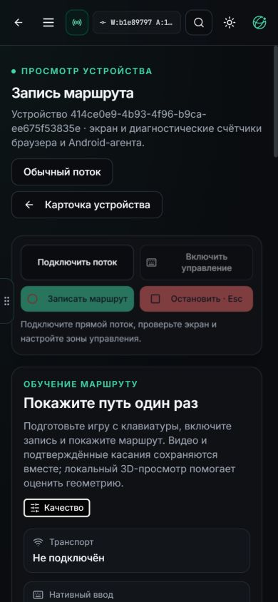

# Запись маршрута: поставка веба и найденный предел захвата

26 октября2026. На localhost3015 установлен Web `b1e89797`; API `1afdc529`
сохранён. [Квитанция](teaching-web-stability/delivery.json) отделяет установленный
веб, браузерную проверку, loopback-тесты и ещё не поставленную оптимизацию APK.

## Что изменилось

Интерактивный SCTP-канал сохраняет порядок, но имеет lifetime200ms вместо
неограниченной повторной доставки. Потерянная команда остаётся неопределённостью;
она не переигрывается. READY/APPLIED/CLOSED, native lease и подтверждение
освобождения не ослаблены. Запоздалый ACK после500ms не может разблокировать
накопленное движение даже при задержке браузерного таймера.

Пустое название автоматически получает дату/время и часть clip ID. Ручное
«Маршрут011321» сохраняется. Старые материалы можно переименовать через отдельный
`label.json`, связанный с SHA manifest. Экспорт переносит эту метку, не изменяя
видео, журнал, исходный manifest и COMPLETE. Библиотека упорядочена по времени,
карточки показывают дату и идентификатор, поэтому одинаковые названия различимы.

Добавлены переходы по времени и увеличение исходных кадров. Это просмотр настоящего
материала, без дорисовывания360°. На телефоне действия расположены2×2. Закреплённая
панель ограничена живой рабочей областью и больше не перекрывает библиотеку ниже.
Ошибка декодирования останавливает просмотр; смена материала очищает зависший
индикатор декодирования.

Страница показывает фактические разрешение, receive FPS, bitrate, сетевой RTC RTT,
буферизацию и декодирование отдельно от native ACK. Capture-only сессия теперь
пишет ограниченную скалярную browser telemetry в существующую историю. Ошибка ввода
сохраняется до нового открытия owner, а не теряется при немедленном CLOSED.

## Проверено

Полный локальный frontend CI: **197 suites /2715 tests**, без пропусков и ошибок;
types, action contract и container/admission проверки прошли. Упакованный Linux
image проверен на26страницах/72ресурсах. Статус реальных локальных результатов
записан в GitHub; новые Actions jobs не запускались. Установка сохранила45других
контейнеров, backend и OTA catalog.

В локальном WebRTC fixture с имитацией APK реально согласованы reliable media
channel и ordered control channel lifetime200ms. Из53Python-кейсов52прошли в общем
прогоне; один новый assert ошибочно ожидал имя protocol-v1 вместо фактическогоv2.
После исправления только этого ожидания соответствующий кейс прошёл отдельно.
Также прошли7subtests. Это имитация Android, не живое управление игрой.

В браузере проверены ревизии, ширина390px без горизонтального переполнения,
выбор сохранённой803-кадровой контрольной записи мышью, переход на кадр53/1,003s,
увеличение200% и завершение декодирования. Существующие записи не переименовывались,
не удалялись и не перезаписывались. Эмулятором при этой проверке не управляли.

## Почему Full HD пока даёт около10FPS

В read-only сессии на Web29510cd7 получено5310показанных кадров за примерно510,7s
наблюдения peer. UDP/direct path имеет RTC RTT≈1ms, ошибок декодирования/рисования0.
Native input остаётся idle. Это не проверка кликов, не новая запись маршрута
и не измерение полной Android→модель задержки.

Backend/native telemetry в том же наблюдении: capture FPS9, encoder FPS9,
capture-read failures0, encoder errors0. Запрошенные60FPS/24Mbps ограничены
активным codec profile30FPS/12Mbps. Browser receive примерно9–11FPS и jitter buffer
около250–330ms. Возраст последнего показанного кадра≈97ms не включает уже прошедшую
буферизацию и не доказывает свежесть исходного Android-наблюдения.

**Свежий logcat показал основной расход:** скалярное преобразование RGBA→I420
занимает примерно92–95ms на Full-HD кадр, один последний интервал131,8ms.
Постановка в codec — около0,24–0,34ms, в последнем интервале1,09ms. Последовательный
93ms converter сам ограничивает throughput примерно10,7FPS. Простой подъём
настройки bitrate/FPS или переключение VPN этот участок не ускоряет.

Код уже запрашивает `jitterBufferTarget=0` и поддерживаемый `playoutDelayHint=0`.
Это предпочтение браузеру, не гарантия нулевого буфера; стандарт позволяет
реализации выбирать фактическую задержку с учётом условий.
[WebRTC specification](https://www.w3.org/TR/webrtc/#dom-rtcrtpreceiver-jitterbuffertarget).

При уходе живого video за область просмотра позднее сработал `video_stalled`:
presentation callback перестал продвигаться. Ограничение свежести не отключалось.
Это отдельный открытый сценарий read-only/background presentation; его нельзя
объявить сетевым разрывом или обойти разрешением ввода по непоказанному кадру.

## Следующий native-кандидат

В уже упакованном WebRTC146.7.0 есть libyuv `YuvHelper.ABGRToI420`. Подготовлен
изолированный fast path с проверкой чёрного/белого/красного/зелёного/синего,
паддинга строк и лимитов, собственным cache для idle refresh и скалярным fallback.
Он активируется только после обычной инициализации native WebRTC. Ordinary
сборки сохраняют путь без WebRTC-зависимости.

На момент этой квитанции новый APK ещё не установлен и ускорение на устройстве
не заявлено. Требуются полные Android-проверки, source-pinned локальная сборка,
подпись прежним сертификатом и адресная PH011-установка с сохранением обеих
семей VPN guard. Затем — реальные цвет/stride self-test, conversion timings,
cadence, decode/очереди, Sphere bypass и подтверждённое освобождение input.
Остальные устройства в этот rollout не входят.

Исходная сцена011321 сохранена. Её [checkpoint-сравнение](ROUTE-011321-CHECKPOINT-COMPARISON.md)
показывает appearance plateau25–30k; навигационная поверхность, независимый повтор
маршрута и motor-policy admission остаются отдельными открытыми проверками.
