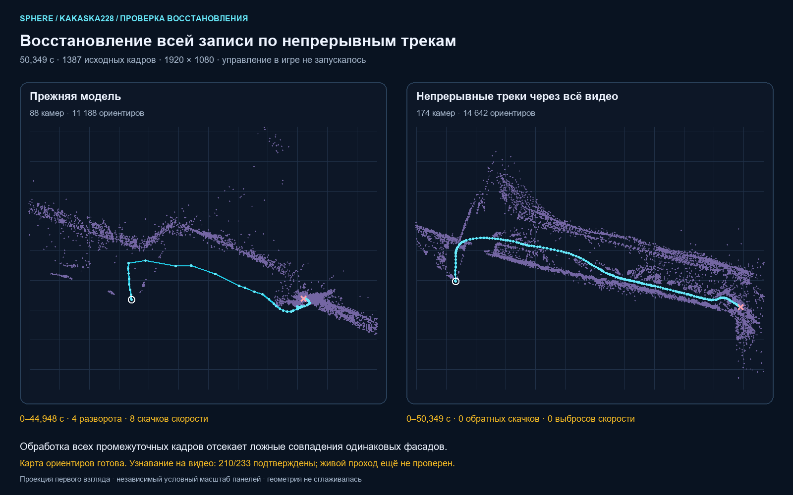

# Kakaska228: исходник, ошибочная геометрия и автоматическое восстановление

Дата: 29 октября 2026. Задание: `b861ac82fcd64425bc583b37f620ba2a`.
Пользователь сообщил о неверной схеме и блокировке пешего теста надписью
«Сначала подготовьте карту ориентиров выбранной записи».

## Фактический исходник

`Kakaska228` сохранена полностью: 1387 кадров, 50,349 секунды, 1920×1080.
Источник — оригинальные H.264 access units; управление выполнялось вне веба.
Получено 27,528 кадра/с и 9,428 Мбит/с; наибольший интервал — 69 мс,
82 интервала превышают 50 мс. Устойчивые 30/60 FPS не подтверждены.
Это не обрыв записи: все исходные кадры доступны для повторной обработки.
SHA манифеста:
`c87b071cd1cdb9d5a47d65dcbeb01f1afe0d4507f9245b55e5a3a8c83a8ff2eb`.

Первый SfM восстановил 88 из 99 отобранных ракурсов и 11 188 точек, в двух
компонентах. Последняя поза приходится на 44,948 с: 5,401 с исходника не
представлены в этой геометрии. Внутренняя ошибка проекции 1,143 px не
доказала достоверность пути. Полученные fx=239,400 и fy=550,443 заметно
различаются, хотя обрабатывается экранная запись. Аудит нашёл четыре
обратных скачка и восемь выбросов скорости. Автоматическая подготовка
действительно запускалась и отказала с `route_camera_motion_requires_review`.

## Проверенные причины и изменения

Схема показывала ошибочно восстановленные камеры, а не все кадры видео.
Повторяющиеся окна и секции длинного фасада создают неоднозначные совпадения;
полнота видео сама по себе не делает все 3D-соответствия правильными.
Сопоставление ближайших реальных кадров на отмеченных интервалах показало
плавное изображение при скачках рассчитанного положения.

Для экранных записей используется `SIMPLE_PINHOLE` с одной фокусной величиной.
Это ограничение модели, не физическая калибровка FOV. Выбор более простой
модели согласуется с [документацией COLMAP](https://colmap.github.io/cameras.html).

Новые route-only задания сначала оценивают движение изображения по всем
исходным кадрам и чаще выбирают ракурсы при большом движении/поворотах.
Выбираются только настоящие индексы, до 240 ракурсов, с сохранением точных
начала и конца. PNG сохраняет исходное разрешение. Признаки не превращаются
в метры; качество рендера игры не объявляется измеренным.

Route-only обработка теперь строит базу наблюдений из непрерывных треков
углов Shi–Tomasi через **каждый исходный кадр**. На выбранных ракурсах
добавляются вновь измеренные углы; внешний вид похожего окна не присваивает
ему идентичность старой точки. Пропавший трек не восстанавливается выдуманным
соответствием. До 1000 текущих углов сопровождаются на 960×540, с прямой и
обратной проверкой ≤0,75 px; координаты измерений переводятся в разрешение
исходных PNG. Совпадения между соседними выбранными ракурсами возникают
только при сохранённой идентичности трека. Затем выполняются геометрическая
верификация COLMAP, триангуляция и bundle adjustment. Нейронная модель и
Gaussian-обучение для этого пути не загружаются.

Для отдельного прежнего dense-пути при подозрительной траектории сохранена
одна ограниченная попытка проверки дескрипторных совпадений через видео.
[Пирамидальный Lucas–Kanade OpenCV](https://docs.opencv.org/4.13.0/d4/dee/tutorial_optical_flow.html)
сопровождает каждую выбранную точку вперёд и обратно. Предложенное совпадение
сохраняется только при непрерывном треке и близком конечном положении.
Геометрическая проверка COLMAP и восстановление выполняются в отдельной
базе. Неподтверждённый кандидат не заменяет исходную модель; позиции не
интерполируются ради красивой линии.

Достройка пропущенных камер с фиксированными существующими позами больше не
применяется к заведомо скачущей опоре. Ошибочную опору нельзя исправить,
одновременно запрещая алгоритму менять её положение.

## Эксперименты на том же видео

| Вариант | Камеры | Точки | Внутренняя ошибка | Обратные скачки / выбросы скорости |
|---|---:|---:|---:|---:|
| Исходный PINHOLE | 88/99 | 11 188 | 1,143 px | 4 / 8 |
| SIMPLE_PINHOLE, исходная выборка | 99/99 | 16 658 | 0,886 px | 6 / 2 |
| Соседние треки, фиксированный фокус | отдельные участки 36 / 42 / 33 | отдельно | 0,71–0,97 px | 0 / 0 на каждом участке |
| Соединение участков по общим 3D-наблюдениям | 99/99 | 9 738 | 0,818 px | 0 / 1 |
| Более частая регулярная выборка + достройка | 190/190 | 38 107 | 0,934 px | 4 / 1 |
| Адаптивная выборка, дескрипторная база | 174/174 | 34 924 | 0,888 px | 6 / 79 |
| Непрерывные реальные углы, исходная выборка | 99/99 | 8 101 | 0,997 px | 0 / 0 |
| Те же треки, фокус оценивается из данных | 99/99 | 8 119 | 1,002 px | 0 / 0 |
| Адаптивные ракурсы + непрерывные углы | **174/174** | **14 642** | **0,960 px** | **0 / 0** |

Треки через короткий интервал подтвердили 87 659 из 122 811 предложенных
соответствий; обработаны все 1387 кадров за 69,6 с. Более длинный вариант
подтвердил 116 035 из 192 175 за 132,3 с. Это время конкретного офлайн-теста,
не обещание скорости на любом ПК. Сами по себе число точек и малая ошибка
проекции не подтверждают связность, масштаб и управление.

У соединённой схемы остался стык около 46,484 с. Для пользователя к заданию
прикреплена `temporal-submaps-99-v1`, строго `DIAGNOSTIC_ONLY`, с привязкой
к тому же манифесту и SHA геометрии. Она открывается как дополнительная схема,
не заменяя рабочую карту. Разные участки соединялись по общим 3D-наблюдениям;
это эксперимент, не готовая универсальная стратегия сшивания.

Адаптивная выборка сама по себе не исправила ложные соответствия. Результат
с непрерывной идентичностью углов восстановил все 174 ракурса до точного
конца 50,349 с. В базе измерено 161 170 наблюдений выбранных камер через все
1387 кадров. Контроль фокуса не основан на ручном значении из этой записи:
успешен и вариант с его оценкой из общей модели камеры.

Экспорт runtime-карты дал **4096** RootSIFT-ориентиров. Их заново измеряют и
триангулируют в согласованном runtime, а не копируют количество точек на
картинке. На каждом из 174 опорных ракурсов имеется не менее 37 таких
ориентиров; неподдержанных соседних интервалов и пропущенных концов нет.
Источник, PNG, бинарная модель, геометрия и карта связаны SHA-квитанциями.

Исправленная ревизия `video-tracks-174-v1` принята в **то же задание**.
Первоначальные prepared/геометрия/качество/квитанция/состояние и старая ссылка
navigation сохранены в `geometry-revisions/video-tracks-174-v1/baseline/`.
Входные video/frames/inputs/manifest/COMPLETE побайтно совпали до и после.
Старый отказ navigation остаётся отдельной попыткой. Новая карта имеет
статус `ready`, `executionQualified=false`; на Android ничего не отправлялось.

Проверена также согласованность стрелки взгляда с восстановленным перемещением.
Для шагов длиннее половины медианного шага сравнивались вектор движения
камеры и её локальная ось +Z: в исходной модели 11 из 53 шагов направлены
против взгляда, медианный угол 69,34°; в новой 0 из 159, медианный угол 4,53°.
Это проверка внутренней согласованности данного преимущественно прямого
прохода, не внешняя разметка ориентации персонажа. Стрейф, поворот головы и
отступление в другой записи могут законно расходиться с направлением взгляда.

## Проверка узнавания на исходном видео

Из исходника взяты 233 кадра с шагом около 200 мс, приведены к 960×540 и
JPEG85, затем поданы в настоящий `AnchoredRouteLocalizer` с измерением времени
вычислений. Это **не независимая запись**: промежуточные кадры уже участвовали
в сопровождении углов. Результат не доказывает работу через неделю, ночью,
при другом ракурсе или на новом живом потоке.

- Прежний тест карты 99 камер: 96 `localized`, 20 `confirming`, 117 `unknown`.
- Текущая карта 174 камер и уточнённый выбор подтверждённых гипотез:
  **183 `localized`, 24 `confirming`, 26 `unknown`**.
- На той же карте добавлен ближайший участок уже подтверждённой свежей позы
  как дополнительный PnP-кандидат. Общие гипотезы всё равно проверяются:
  **210 `localized`, 10 `confirming`, 13 `unknown`**.
- Из последних 13 отказов: 9 неподтверждённых PnP и 4 истечения бюджета 250 мс.
  Эти отказы сохранены, а не заменены линией. Первоначальные 26 отказов
  предыдущего варианта также сохранены в отдельном отчёте.
- В последнем тесте медиана вычисления 10,18 мс за счёт сопровождения уже
  проверенных опор, p95 217,00 мс. Это время данного CPU-теста,
  не Android→веб→ввод задержка.

Изменены и карта, и локализатор, поэтому это сравнение двух полных вариантов,
не изолированное доказательство эффекта одного параметра. Локализатор может
предпочесть согласованную по времени гипотезу только после трёх независимых
подтверждений и только среди поз, уже прошедших полный PnP/покрытие изображения.
Ограничения свежести, движения, числа соответствий и восстановление после
потери не ослаблены. Малое колебание точки на стоянке не объявляется отдельной
ветвью маршрута; настоящая далёкая повторная ветвь остаётся неоднозначной.
Дополнительный кандидат не использует время записанного маршрута как ответ:
только последнюю живую подтверждённую позу, не старше 0,5 с. Без свежего
изображения, текущих соответствий и PnP он не создаёт новую позу. Диагностика
с заведомо известным временем исходника применялась отдельно, только чтобы
выяснить причину потерь; в рабочий поиск такой oracle не включён.

## Веб и автоматический сценарий

- Одна основная кнопка «Подготовить ориентиры»; маски и Gaussian-рендер
  перенесены в дополнительные настройки. После новой записи обработка
  по-прежнему запускается автоматически, если включена исходная опция.
- Счётчик кадров/пар обновляется при поиске признаков и сопоставлении.
  Выбор кадров и проверка треков имеют отдельные названия этапов.
- Пеший режим получает реальную причину текущего отказа. Ошибка после уже
  выполненной подготовки не маскируется приглашением начать её сначала.
- Состояние читается периодически и после отказа; GET не повторяет POST
  обработки, не создаёт новый ввод и не снимает `UNKNOWN`.
- При переходе карты в готовность её геометрия читается заново. Живая поза
  остаётся привязана к точному SHA модели, а не к похожей диагностической схеме.
- Готовая текущая карта имеет приоритет над сохранённой старой дополнительной
  схемой. Дополнительные варианты доступны явно; они не получают живую позу
  основной карты и не подменяют её тайком.

## Границы приёмки

Автономное A→B в игре не проверено. Пользователя убили в онлайн-игре во время
ожидания; ожидать на исходной точке для офлайн-обработки не требуется.
Новые тестовые нажатия, APK, VPN, массовая OTA и GitHub jobs не запускались.
Исходное видео и первоначальная геометрия задания сохранены. Новое поведение
проверено также запуском **полного production route-only пути** на отдельной
копии этой записи: 174/174 камер, 14 612 точек, 0,957 px, ноль обратных скачков
и выбросов скорости, экспорт карты `ready`. Весь проход с подготовкой занял
269,485 с. Незначительное различие числа точек при разных потоках native
решателя сохранено в измерениях, результаты не объявлены побитно одинаковыми.

Локально установлена UI-сборка `route-temporal-20261029-v5`, обработчик 3342
перезапущен с текущими исходниками. Production-сборка сверена с SHA исходников;
HTTP проверяет страницы/ассеты и worker, другие контейнеры сохранены. Пройдено
958 stream-тестов, TypeScript, 72 pytest-проверки новых/связанных этапов,
58 unit-проверок локализации/трекинга/workspace и 22 browser-capture unit-теста.
В suite остаются предупреждения React act и существующего pytest config;
падений целевых проверок нет. Компонентные и HTTP проверки не являются
проверкой управления в живой игре или визуальной приёмкой нового веба.

Подготовка новых заданий автоматизирована; восстановление одинаково сложных
сцен не гарантировано. Неоднозначные позы и неподтверждённая связь участков
не становятся пригодной картой от скрытия предупреждения. Метрический
масштаб, поверхность дороги, положение тела относительно камеры и объезд
препятствий этим экспериментом не доказаны.

Локальные данные итогового сравнения: `.local-pilot/kakaska228-compare-20261029-v4/`.
Диаграмма сравнения построена из настоящих геометрий, не является снимком
браузера и не содержит вручную выпрямленного маршрута.

