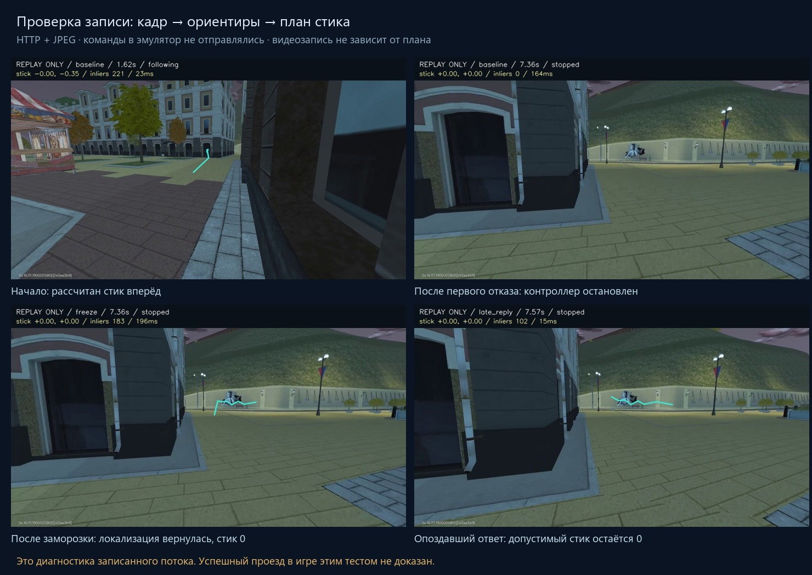
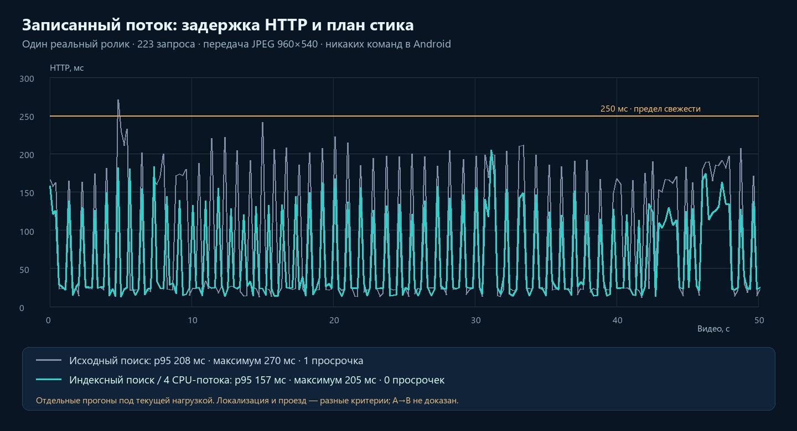

# Сохранённое видео через настоящий API локализации и контроллера

29 октября 2026. Запрос: выяснить, какие прогоны уже были, не повторять их
без новой цели и проверить команды управления на записанном видеопотоке.

## Что проверялось раньше и чего не хватало

Ранее на исходном видео проверялась локализация: 225 `localized`, 6 `confirming`
и 2 `unknown` на 233 кадрах; на другой локации — 154 `unknown`. Отдельные
unit-тесты проверяли пеший контроллер на синтетических текущих позах и в
маленькой кинематической модели. Это не была проверка всей цепочки веба.
Исторические числа: [SCAN-POINT-ACCURACY.md](SCAN-POINT-ACCURACY.md).

Новый прогон использовал уже подготовленную карту 174 камер / 24 024 исходных
точки / 4096 runtime-ориентиров. Повторной реконструкции или Gaussian-тренировки
не было. Из оригинального H.264 декодировались неопорные кадры, уменьшались до
960×540 и сжимались JPEG quality 92, как в живой проверке. Индексы 174 опорных
кадрa исключены. Это та же запись, а не независимый положительный геймплей.

Изображения поступали настоящими HTTP-запросами в production handler:
`replay-start` → `replay-observe` → `replay-stop`. JSON наблюдения содержит
только `id`, `captureEpoch`, `sequence`, `jpeg`. Время видео, номер исходного
кадра и ожидаемая позиция алгоритму не передавались. Они нужны только планировщику
подачи и отчёту. Использовались настоящий монотонный таймер и ограничение
свежести 250 мс; медиавременем расчёт не маскировался.

## Измеренные результаты

Ниже — исходная цепочка с полным BF-поиском и терминальной остановкой при
первой потере позиции. Изменения после этого измерения описаны отдельно ниже.

| Вариант | Кадров | localized / confirming / unknown | Первый отказ контроллера |
|---|---:|---:|---|
| Вся короткая запись, JPEG 92 | 223 | 201 / 14 / 8 | 4,837 с, `walk_pose_binding_or_age` |
| Заморозка изображения на 1 с с отметки 2 с | 64 | 47 / 10 / 7 | 2,270 с, `walk_localization_lost` |
| Пауза подачи 700 мс с отметки 2 с | 61 | 53 / 6 / 2 | 2,736 с, `walk_pose_binding_or_age` |
| Доставка ответа задержана на 300 мс | 63 | 53 / 7 / 3 | Клиент обнуляет стик по сроку; серверный отказ позже |
| JPEG 60, первые 14 с | 63 | 48 / 10 / 5 | 3,187 с, `walk_pose_binding_or_age` |
| Другая локация, первые 8 с | 37 | 0 / 0 / 37 | Ни одной команды движения |

В базовом прогоне первая команда появилась на 0,402 с: приблизительно
`[-0.00017, -0.20]`, то есть вперёд. Получены 20 кадров с допустимым ненулевым
стиком. Медиана самого расчёта — 9,28 мс, p95 — 194,79 мс, максимум — 255,04 мс.
Один выход за 250 мс остановил пилот. Позже узнавание восстановилось, но
контроллер уже оставался терминально остановленным. Это конкретный пробел
между хорошим процентом локализации и успешным автономным повтором.

Варианты со сбоем специально перенесены на раннюю подтверждённую часть пути:
в первом опыте сбой на 8-й секунде мог приходиться уже после остановки пилота
и не доказывал реакцию работающего управления. В таблице использован ранний
прогон, а не эта неудачная постановка опыта. Для JPEG 60 показан один прогон;
он не доказывает, что сжатие само по себе стало причиной задержек.

После первого отказа записанное видео продолжает двигаться, а план остаётся
остановленным. Это сделано для диагностики оставшейся локализации. Такой
результат нельзя объявлять успешным проездом: в игре нулевой стик изменил бы
следующие кадры. Объезд препятствий, камера относительно персонажа, метрическая
точность и прибытие проверяются отдельным замкнутым опытом.

## Что добавлено в веб

На странице маршрута: **«Направление» → «Проверить на записи» → «Запустить
проверку записи»**. Поток Android и калибровка стика для этого режима не нужны.
Нужны выбранная сохранённая запись и готовая карта. Видны исходный кадр с
линией, расчётный стик, прогресс, опоры, время кадр → ответ и причина остановки.
Отчёт сохраняется в локальном архиве после завершения.

Браузер проверяет SHA геометрии/источника существующим парсером, декодирует
исходный H.264 через WebCodecs с проверкой каждого блока и исключает времена
камер восстановления. Целевой ритм — 5 кадров/с, один запрос в полёте, до
55 секунд. Запоздавшие ответы и результаты отменённой генерации не применяются.
Неопределённое закрытие блокирует новый сеанс и переход к живому управлению;
подтверждается закрытие того же идентификатора. Отчёт такой попытки не заменяется
изменённым при повторе закрытия.

В компонент не передаётся native-input owner. Replay имеет отдельный режим
сервера и отдельные endpoints. Его нельзя повысить до живого наблюдения/пешего
пилота, подать через живой `observe` или закрыть от лица другого режима.
Используются общие локализатор и planner. Проверки 250 мс, PnP, покрытия карты,
неоднозначности и ограничение стика 35% не ослаблены. Первый CPU-прогон использовал
два потока OpenCV. Периодический полный поиск дороже сопровождения, что видно
по распределению времени. Далее добавлено ограниченное нейтральное восстановление.

## Ускорение и ограниченное восстановление после проверки

Профиль трёх реальных JPEG показал около 78–81 мс на SIFT, 52–73 мс суммарно
на `knnMatch`, до 39 мс на проверку нескольких PnP-кандидатов. Предварительные
голоса видимости пакетно суммируются с прежними весами. Тест на 2048 запросах,
4096 ориентирах и 174 ракурсах проверяет совпадение весов и порядка кандидатов.

Для карт от 512 ориентиров используется кешируемый индекс FLANN: KD-tree,
4 дерева, 64 проверки, seed 17; маленькие карты сохраняют полный поиск.
[Документация OpenCV](https://docs.opencv.org/4.10.0/dc/dc3/tutorial_py_matcher.html)
описывает такой приближённый поиск. Индекс выбирает только районы-кандидаты;
соответствия в выбранном районе по-прежнему проверяются полным BF, ratio test,
PnP/RANSAC, пространственным покрытием и временными ограничениями. Это не
обещает полноту поиска: индекс может не предложить нужный район. Дескрипторы,
геометрия и формат сохранённой карты не меняются; повторная реконструкция не нужна.

В предварительном полном HTTP-прогоне с индексом получены 213 `localized`,
7 `confirming`, 3 `unknown` на 223 кадрах. Первый отказ прежнего контроллера
переместился с 4,837 на 30,734 с. CPU p95 — 173,40 мс, максимум 206,06 мс;
ответ HTTP максимум 222,10 мс, просрочек не было. На другой локации — 64
`unknown`, ни одной команды движения. Это один срез нагрузки, не гарантия
времени исполнения. В последующем прогоне той же индексной логики были
получены три HTTP-ответа старше 250 мс, хотя сам CPU-расчёт оставался короче.
Поэтому предел проверяется и в браузере; серверного таймера недостаточно.

Пеший контроллер теперь при краткой потере позы отпускает стик и ждёт до двух
секунд. Возобновление требует трёх новых `localized` наблюдений подряд рядом
с последней позой: перемещение и продвижение не больше четырёх движущихся
опорных шагов, обратное продвижение не больше двух, поворот не больше 0,7 рад.
Пауза не сбрасывает свой срок на каждом неизвестном кадре; разрешены максимум
три такие привязки за весь тест. Это единицы SfM, а не метрический коридор.
Истечение 250 мс, разрыв подачи более 500 мс, изменение привязки, отсутствие
прогресса и большие скачки остаются терминальными. Во время ожидания движение
и экстраполяция отсутствуют. После возврата вектор начинается с нуля и растёт
с прежним ограничением скорости.

Новый полный прогон на двух CPU-потоках сохранил 213/223 подтверждённых поз.
Потеря на 30,734 с перевела стик в ноль. На 31,599 с исходное видео уже ушло
дальше разрешённого радиуса от последней позы, поэтому восстановление получило
`walk_relocalization_drift`. Это не успешный проезд и не основание раздвигать
допуски: в настоящем замкнутом контуре после нулевого стика персонаж должен
остановиться, а видео по-прежнему идёт своим заранее записанным путём.

Финальный профиль CPU использует четыре потока OpenCV при одном наблюдении
в полёте. Это ограничение параллелизма, не изменение порогов качества/свежести.
В полном прогоне с этим профилем: 223 кадра, 213 `localized`, 7 `confirming`,
3 `unknown`, ноль HTTP-ответов старше 250 мс, 135 кадров с допустимым ненулевым
стиком. CPU p50/p95/max — 9,42/138,56/188,08 мс, HTTP p95/max —
156,95/205,00 мс. На 31,599 с сохранился отказ `walk_relocalization_drift` из-за движения
самого исходного видео во время нейтрального ожидания. Весь маршрут не объявлен
пройденным. Повышение CPU-бюджета проверено одним полным прогоном; при другой
нагрузке возможны новые просрочки, которые по-прежнему останавливают ввод.
Квитанции сохраняют отдельно прогон до ускорения, индексный эксперимент,
полный принятый рецепт и отрицательные проверки.

## Поставка и проверки

- 57 frontend-тестов, 81 Python unittest, 34 pytest — успешно. Типизация
  `tsc --noEmit --incremental false` и production-сборка — успешно.
- На реальном HTTP проверены новый JPEG-путь, контроллер, заморозка, пауза,
  задержка ответа, более сильное сжатие и отрицательная другая локация. Все
  команды остались числами отчёта; ни один Android input-клиент не создавался.
- Пакет проверки записи установлен на 3015, источник сборки неизменен.
  Две страницы и 31 ресурс проверены по HTTP/SHA, recorder worker совпал,
  контейнер healthy, прочие контейнеры сохранены. API 3342 обновлён, health 200,
  endpoint без capability — 403. Исходные записи/геометрии сохранены по SHA.
- Визуальная приёмка именно новой страницы в настоящем браузере не подтверждена:
  браузерный канал сообщил об отключённом доступе, native AX был недоступен,
  а полученный скриншот относился к другому окну. В него ввод не отправлялся.
  HTTP-проверка пакета и компонентные тесты не подменяют эту приёмку.

Повторять старую реконструкцию и одинаковые прогоны без изменений не нужно.
Набор полезно запускать после изменений в локализаторе, таймингах, JPEG или
контроллере. Запас полной задержки и положительная проверка в замкнутом
контуре остаются открытыми вопросами. Автоматический A→B не объявляется готовым.

Привязки и сводки: [recorded-control-replay-delivery.json](recorded-control-replay-delivery.json).

## Срочное исправление чёрного окна при живом запуске

Пользователь вернулся к началу `Kakaska228` и получил `walk_stream_changed` /
`walk_decision_expired`, ноль совпадений и чёрный canvas. По коду подтверждено:
`stop()` безусловно очищал canvas; до первого законченного ответа локализации
кадр в него вообще не рисовался. Это отдельная ошибка отображения и не
свидетельство повреждённой карты.

Свежесть живого стика привязана к `requestVideoFrameCallback` единственного
исходного video. Источник находился в левой колонке, а управление/карта —
ниже: при прокрутке источник мог оказаться вне представляемой области.
Точную частоту throttling в браузере пользователя удалённо не измеряли.
Теперь колонка закреплена на широком экране; при уходе её рамки из области
видимости тот же video закрепляется миниатюрой. Второй видеопоток, второй
декодер или новый владелец Android-ввода не создаются.

До первого ответа и после Stop показывается исходное изображение с явным
статусом выключенного движения; маршрутная линия старого ответа не сохраняется.
На странице и в архиве видны счётчик кадров источника, возраст последнего
кадра и число завершённых ответов. Ошибка ранней стадии больше не требует
угадывать причину по пустому окну или вручную разбирать JSON.

Скрытие вкладки по-прежнему немедленно отзывает ввод, но больше не обрывает
сам capture-only транспорт. Его присутствие продлевается отдельно от права
управлять. После возврата даётся до одной секунды на возобновление показа;
никакой свежести это ожидание не выдаёт — нужен новый реальный video callback.
Застывший видимый поток по-прежнему завершается. Отдельная внешняя запись
с её encoded heartbeat остаётся прежней.

На стороне браузера единичное истечение разрешения/ответа старше 250 мс
сразу обнуляет стик. При продолжающемся свежем потоке можно до двух секунд
ждать три новых пригодных `localized`/`following` ответа, максимум три раза.
Ни один просроченный вектор не применяется, старый срок команды не продлевается.
Истечение ожидания, изменение/пропажа видео и закрытие владельца остаются
терминальными. Нейтральный вектор разрешён сразу, движение — только после
повторного подтверждения. Это дополняет серверное восстановление позы, не
заменяет его и не доказывает успешный опыт в игре.

Отдельно прогнан реально сохранённый управляемый job `b861ac82…`, доступный
пользователю, с прежними 174 камерами / 14 622 точками. На нём получены 209
`localized`, 10 `confirming`, 4 `unknown` на 223 кадрах, а старый браузерный
предел успел остановить ввод на 4,837 с. Это отличие от новой изолированной
карты 24 024 точек сохранено в отчёте, а не скрыто под улучшенной статистикой.
Новый нейтральный retry на стороне браузера ещё не принят живым проходом.

Текущий установленный UI: `route-live-frame-20261029-v1`, image
`sha256:18eb5912f9a7e846bcf56f69dfa6bd5c273ddb18d125f16ff1975a96c838ad66`.
Health и все 31 ресурса проверены; прочие контейнеры, запись и карта сохранены.
Для уже открытой вкладки нужен reload: старый JavaScript сам не заменяется.

Одна промежуточная сборка была остановлена консервативным порогом 8 ГиБ.
Финальная сборка использовала один worker, V8 heap 1024 MiB, стартовый запас
6,5 ГиБ, остановку ниже 5,5 ГиБ и прежний commit <85%. Пороги Android и
реконструкции не менялись; приложения пользователя не закрывались. Финальная
сборка завершилась успешно с неизменным SHA исходников. Ранее изменённый
во время сборки тестовый файл сделал другую квитанцию непригодной; тот пакет
не устанавливался.

