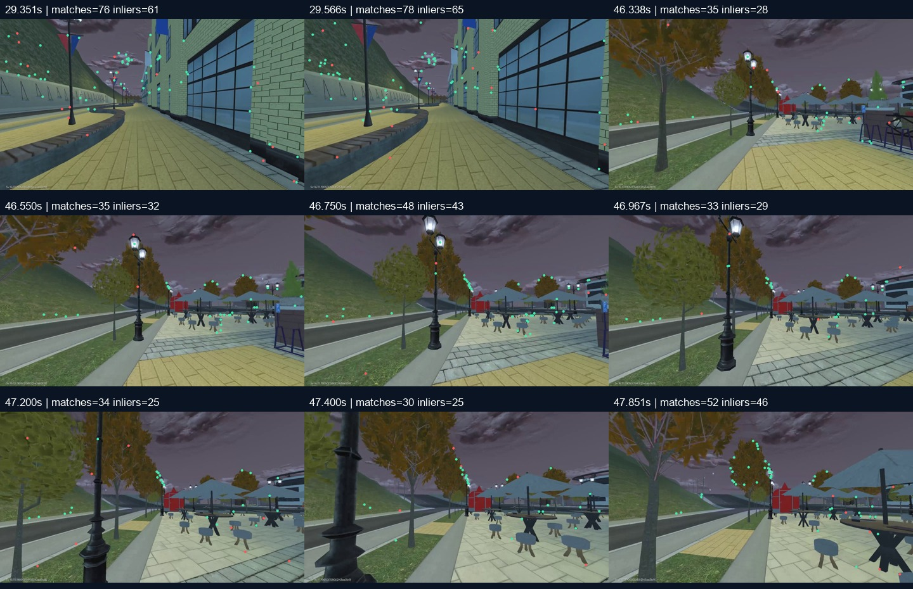

# Точность опорных точек и устойчивость первой обработки

Дата: 29 октября 2026. Проверяется сохранённая `Kakaska228`, без новых
команд Android. Это продолжение [восстановления полного прохода](KAKASKA228-RECOVERY.md).

## Найденные несоответствия

### Зависимость допуска позы от экранной сетки

На 46–47 секундах исходника найдено 25–43 PnP-inlier, с медианной ошибкой
0,30–0,55 px. Они занимают 671–865 px по горизонтали и 160–217 px по
вертикали, но большинство лежит в средней строке сетки 4×3. Прежняя проверка
требовала минимум пять точек в двух разных строках; правильное расположение
могло перестать проходить после небольшого сдвига изображения. Одновременно
диагональная прямая могла пересечь много ячеек без полноценного 2D-покрытия.

Политика `pnp-continuous-image-support-temporal-v4` использует непрерывную
проверку: размах 5–95%, центральную группу без крайних наблюдений и её две
главные оси. Сохраняется минимум 20 inlier и размах 96×54 px. Дополнительно
требуются малая ось ≥12 px, отношение осей ≥0,05, медианное отклонение по
малой оси ≥6 px и площадь эллипса ≥0,5% кадра 960×540. Последние проверки
защищают от прямой и компактной группы с единичными дальними выбросами.

Это замена эвристики пространственной наблюдаемости, а не доказательство
статичности объектов. Пороги PnP/RANSAC, доли inlier, проекции, неплоскостности
3D-опор, возраста кадра, согласованности движения и повторного подтверждения
не ослаблены. Тесты проверяют перенос здоровой группы через старые границы,
узкую полосу, диагональную прямую и удалённые выбросы. Старый тест «полоса»
содержал полноценную область высотой 160 px; он заменён действительно узкой
20-px полосой. Отдельно проверено, что единичный выброс её не исправляет.

### Координаты центров пикселей

OpenCV считает центр первого пикселя `(0,0)`, COLMAP — `(0.5,0.5)`.
Порядок смены начала координат и масштабирования имеет значение. Это
описано в [официальном FAQ COLMAP](https://colmap.github.io/faq.html#using-calibration-from-opencv-kalibr-or-other-tools).

Новые функции явно переводят измеренные точки трекера в исходное разрешение:
`(point + 0.5) * original_size / tracking_size`. Ранее использовалось
`point / scale + 0.5`, что при уменьшении 1920→960 давало ошибку на 0,5
исходного пикселя. Калибровка COLMAP при экспорте в OpenCV теперь сначала
масштабируется, затем из `cx/cy` вычитается 0,5. Учитывается реальный размер
обеих осей после округления. Исходные RGB не изменяются.

Это точечное исправление согласованности измерений; прежнее схлопывание
маршрута объяснялось ложными соответствиями фасадов, а не полупиксельной
ошибкой. Тест с известными лучами проверяет проекцию в нескольких разрешениях,
включая нечётные размеры. Дескрипторный формат не изменён: старые карты не
инвалидируются; новые квитанции обозначают координатную конвенцию явно.

### Потеря треков и пропуски исходника

Общий helper обрабатывает пустые результаты LK и отбрасывает NaN/Inf до
обратного вызова OpenCV. Неудачное измерение не получает предсказанных
координат; следующие выбранные кадры заводят новые идентичности точек.
Это применяется к адаптивной выборке, основной базе видео-треков и
дополнительному фильтру дескрипторных совпадений.

При интервале исходных кадров более 250 мс старые идентичности сбрасываются.
Похожее изображение после пропуска не подтверждает наблюдения внутри него.
Интервалы сохраняются в отчёте, а не закрашиваются интерполяцией поз.
Интеграционный тест использует одинаковые реальные изображения до и после
пропуска: внутри частей соответствия есть, между частями их нет.

## Офлайн-проверки на реальных записях

| Карта / политика | localized | confirming | unknown | Кадров |
|---|---:|---:|---:|---:|
| Прежняя карта, политика v3 | 210 | 10 | 13 | 233 |
| Та же карта, непрерывное покрытие v4 | 225 | 6 | 2 | 233 |
| Новая полная обработка с исправленными центрами пикселей | 225 | 6 | 2 | 233 |
| Другая локация `fuflo228`, отрицательная проверка v4 | 0 | 0 | 154 | 154 |

В проверке v4 на прежней карте не осталось `route_pose_not_verified`;
сохранились одно истечение 250 мс и одна несогласованная поза. Они не
превращены в успешные наблюдения. Противоположная проверка другой локации
важна: больший допуск здоровых групп не должен просто принимать всё подряд.
154 кадра не доказывают отсутствие ложных совпадений во всех играх.

Проверено не только число `localized`, но и соответствие найденного продвижения
известной хронологии исходника. На 225 подтверждённых кадрах медианное
расхождение вдоль восстановленного пути — 0,00128 усл. ед., p95 — 0,00550,
максимум — 0,01816; медианный шаг опорных камер — 0,06649, вся длина — 12,40623.
Ожидаемое продвижение для этого диагностического сравнения линейно вычислялось
по времени соседних **опорных** камер; в рабочее управление такая подсказка
не передаётся. Это согласованность с той же реконструкцией, не ошибка в метрах
относительно независимой разметки. Четыре расхождения более секунды по номеру
референса приходятся на практически неподвижные начало/конец: близкие камеры
там нельзя считать разными местами только по времени.

Для диагностики причин использовалась известная секунда исходника, чтобы
найти правильное соседство опор. В рабочую локализацию эта подсказка не
передавалась. В таблице — настоящий поиск по дескрипторам, проверенные опоры
и сопровождение, без воспроизведения клавиш и без временной oracle-подсказки.

Положительная проверка использует то же видео, из которого строилась карта.
Это проверка воспроизводимости цепочки, **не независимая проверка новой
съёмки**. Изменение освещения, погоды, FOV, стартового положения и объезд
движущихся объектов остаются отдельной приёмкой.

## Проверка полной автоматической цепочки

Полный route-only путь повторяется из исходного H.264 в отдельном задании.
Перед запуском и после экспорта сравниваются SHA исполняемых исходников
рецепта; параметры и входные файлы не правятся в процессе проверки.
Итоговая квитанция хранит эти привязки, количество камер, опор и результат
экспорта. Новая ревизия не подменяет готовую до завершения проверки.

Финальный прогон занял 254,531 с: 174/174 камер, 14 622 исходные 3D-точки,
средняя внутренняя ошибка 0,958 px, ноль обратных скачков/выбросов скорости,
4096 runtime-ориентиров, полный интервал 0–50,349 с. SHA исходников рецепта
совпали до и после. На выбранном задании принята ревизия
`pixel-centers-174-v2`; прежняя готовая ревизия сохранена как baseline
дополнительно к самому первому неудачному результату. Все файлы исходной
записи совпали побайтно. Статус `ready` обозначает подготовленные данные
для проверки, `executionQualified` остаётся `false`.

Проверки: 79 pytest-тестов и 82 unit-теста локализации/трекинга/workspace/
записи; отдельная реальная обработка видео и отрицательная проверка другой
локации. Frontend не менялся, установленный UI `route-temporal-20261029-v5`
использует тот же обработчик и новую связанную геометрию. Свежая визуальная
приёмка в настоящем браузере и живой проход не подменяются HTTP/unit-проверками.

Квитанция поставки и подробные привязки: [scan-point-accuracy-delivery.json](scan-point-accuracy-delivery.json).

Диагностические соответствия на ранее отклонявшихся кадрах:

Зелёные точки — PnP-inlier при проверке соответствующего референса. Референс
здесь выбран по времени специально для разбора отказа; изображение не является
снимком живого управления или независимой проверкой нового прохода.

Маска персонажа сохранена. Автоматической семантической сегментации всех
игроков и машин эти изменения не добавляют. Глубина имеет масштаб SfM;
метры, дорожная поверхность, положение тела относительно камеры и успешное
автономное A→B не заявляются подтверждёнными.
