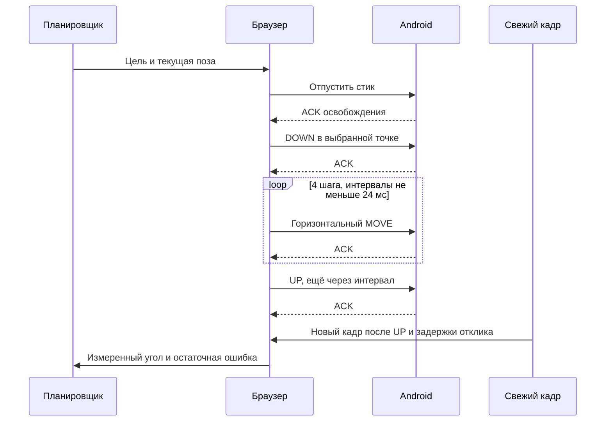

# Камера не поворачивалась после успешной ходьбы: реальные отчёты

Источник: восемь локальных сводок Kakaska228 за 23:40–23:44 29.10.2026,
полученных после установки `5f78eb4d`. Диагностические кадры браузера и его
внутреннее хранилище не читались. Источники видео и реконструкции не изменялись.

## Что произошло

| Запуск | Команды стику: отправлены / подтверждены | Пробы камеры: подтверждены | Причина остановки |
|---|---:|---:|---|
| 23:40:54 · `83bfaad5` | 56 / 56 | 2 | `walk_camera_response_not_observed` |
| 23:42:02 · `650769f1` | 19 / 19 | 2 | та же |
| 23:42:20 · `df3bb886` | 0 / 0 | 2 | та же, подхват уже у поворота |
| 23:44:48 · `d45333e9` | 50 / 50 | 2 | та же |

Четыре других попытки завершились до первого ввода из-за паузы представления
видео около 251–270 мс. Это отдельная проблема старта, а не отказ карты.

Последний длинный запуск: 92 ответа локализации, 14,73 с до остановки, прогресс
8,61%, последний сегмент 13. Перед остановкой — 78 геометрических совпадений,
медианная ошибка проекции около 0,31 px. Обе пробы получили native ACK за
28,7 и 15,3 мс. В других запусках весь жест подтверждался за 21–35 мс.

В старом коде первая проба составляла 0,4% короткой стороны, вторая — 0,8%:
для 1920×1080 это всего **4 и 9 пикселей** после округления. Между DOWN, единственным
MOVE и UP не было минимального интервала. `RootTouchBridge` отправляет события
в Android асинхронно: ACK подтверждает принятие отправки, **не** обработку жеста
игрой и не обновление кадра. По коду указанная причина остановки означает, что
измеренный отклик двух проб был меньше 0,002 рад. Сырые углы старые сводки не
сохраняли; утверждать точное нулевое физическое вращение по ним нельзя.

Малая длина и длительность жеста — обоснованная причина для исправления, но
порог конкретной игры ещё не измерен. Android документирует понятие порога
распознавания движения: [getScaledTouchSlop](https://developer.android.com/reference/android/view/ViewConfiguration#getScaledTouchSlop()),
[обработка жестов](https://developer.android.com/develop/ui/views/touch-and-input/gestures/viewgroup).
Игра может использовать собственную обработку. Координата вне области камеры,
особенности идентификатора пальца и режим игрового управления остаются возможными
причинами, если новая форма свайпа тоже не даст измеримого отклика.

## Исправление

- Первая проба — 1,8%, следующая при отсутствии отклика — 3,2%, последняя —
  максимум 4% короткой стороны: приблизительно 19, 35 и 43 px на Full HD.
- Вместо мгновенного скачка — четыре промежуточных MOVE, каждый после ACK
  предыдущего события и не раньше чем через 24 мс. UP тоже отделён интервалом.
  Нормальная длительность от DOWN до отправки UP — не менее 120 мс.
- Если эффект ниже измеримого порога, минимальная длина последующих свайпов
  ограниченно увеличивается. После трёх тихих ответов или безуспешной максимальной
  пробы тест останавливается. Чувствительность и знак оцениваются заново по кадру.
- Предел 4% не превышается; чрезмерный отклик, неверное направление и несходимость
  по-прежнему останавливают тест. При известной чувствительности минимальный
  шаг не должен прогнозировать более 0,24 рад поворота; иначе показывается
  отдельная причина `walk_camera_resolution_limit`.
- Разрешение кадра на движение остаётся 250 мс. Новый свайп допускается только
  при возрасте решения не больше 70 мс и оставшемся запасе не меньше 170 мс.
  Медленный глобальный поиск не запускает свайп на последней миллисекунде:
  стик нейтрален до следующего быстрого свежего решения.
- Каждый запланированный MOVE заново проверяет свежесть и срок. Stop/закрытие
  отменяет отложенные шаги. Вертикальная координата не меняется. Повторы
  округлённой координаты не оставляют жест навечно ожидающим несуществующий ACK.
- До открытия владельца ввода короткая пауза представления видео допускает
  ограниченное ожидание нового кадра. Android не открывается на старом кадре.
  Уже удерживаемые или неопределённые контакты старые ограничения не обходят.

## Интерфейс и диагностика

Метка «Камера ↔» задаёт **начало свайпа**, не растягиваемый прямоугольник.
На экране теперь нарисован горизонтальный диапазон ±4% короткой стороны.
Калибровка этой версии хранится в памяти вкладки: после её обновления нужно
снова указать центр стика и начало свайпа. Можно выбрать те же свободные места.

Отдельный блок камеры показывает число жестов, подтверждённых Android,
длину в пикселях стрима, длительность последнего жеста и измеренный по ориентирам
поворот/угол до цели. Касания камеры не засчитываются в команды ходьбы.
В локальную сводку добавлены ограниченный журнал углов (32 строки), число
тихих ответов, адаптивная минимальная длина и сводка native-жестов. Старые сводки
остаются читаемыми и не переписываются.

## Проверка и границы результата

Чистый регулятор сравнивался с версией `5f78eb4d` на одной и той же модели:
короткая сторона 540/1080, порог движения 8/12/16 px, оба знака чувствительности,
цели −0,6/+0,6/+1,2 рад. Результат: **6/36 → 36/36 выравниваний**.
При недостижимом в разрешённых пределах пороге 40 px на 540p новая версия
останавливается с `walk_camera_response_not_observed`. Это синтетическая модель
порога и длительности, не физика Black Russia и не доказательство живого прохождения.

Воспроизведение: `node scripts/pilot/compare_walk_camera.cjs .local-pilot/<новый-файл>.json`.
Скрипт транспилирует реальные старую и новую реализации регулятора; Android,
браузер и сеть не используются. Данные: [симуляция](walk-camera-drag-simulation.json),
[сводки живых попыток](walk-camera-drag-live-diagnosis.json),
[проверки и доставка](walk-camera-drag-delivery.json).

Проверены порядок и временные интервалы native-событий, отсутствие вертикальных
движений, раздельные счётчики стика/камеры, истечение срока, отмена будущих MOVE,
выжидание нового кадра до открытия ввода, рост длины при тихом отклике, оба знака
чувствительности, schema/квоты отчёта. Полное прохождение в игре после этого
исправления ещё не проверено. APK не менялся: native-канал уже принимал жесты;
исправлены браузерная форма жеста, регулятор и локальная диагностика.
