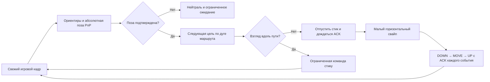

# Подхват маршрута, поворот камеры и стоимость локализации

Дата: 29.10.2026. Проверена текущая реализация; завершённый проход в игре A→B
этими проверками **не подтверждён**. Движение — ограниченный пеший тест до 60 с,
а не готовый автономный водитель для транспорта или сотен окон.

## Что изменилось

Ранее алгоритм вычислял вектор стика относительно текущей камеры, но сам камеру
не поворачивал. Теперь можно включить отдельный горизонтальный регулятор взгляда.
Веб запрашивает калибровку свободной области экрана вне стика и кнопок. Запись
экрана и записанные клавиши не задают последующие нажатия.

### Повторный запуск из середины

Режим «С текущей узнанной точки маршрута» повторно локализует положение по
изображению, проверяет три последовательные локализованные позы и выбирает цель
дальше по **порядку записи**. Предыдущее нажатие или старый процент пути не
восстанавливаются. «Только у начала записи» сохраняет отдельный отказ в середине.
В похожем/неоднозначном месте, вне наблюдённого коридора или при неверном ракурсе
подхват не гарантируется; слепого поиска движением нет.

### Как поворачивается камера

`WalkCameraServo` использует вектор цели в координатах камеры и вращение камеры,
восстановленное по свежим соответствиям. Сначала маленьким свайпом проверяет знак
и чувствительность, затем сравнивает новую позу с позой до свайпа. Поддерживаются
оба знака чувствительности. Новая обратная связь допускается только после
подтверждённого UP, ещё 150 мс и нового номера кадра. Старый кадр нельзя принять
за результат свайпа.

- Только горизонтальное движение: Y у DOWN/MOVE/UP одинаковый.
- Первая проба — 0,4% короткой стороны, вторая при отсутствии отклика — 0,8%.
- Последующие импульсы: до 4% короткой стороны (с округлением до пикселя),
  до 0,12 рад предсказанного поворота; не чаще одного в 400 мс.
- Зона выравнивания — около 8°; вертикальный наклон цели более 0,65 рад останавливает
  тест. Полноценная коррекция pitch не реализована: ракурс нужно восстановить вручную.
- Не более 8 с на выравнивание, 120 импульсов на тест, 2 калибровочные пробы.
  Отсутствующий, чрезмерный или несогласованный отклик приводит к остановке.
- Перед камерой необходимо подтверждённое освобождение всех контактов. Каждый
  этап свайпа требует native ACK; разрешение исходного кадра истекает через 250 мс.
  Устаревший DOWN/MOVE не отправляется. Stop закрывает весь владелец ввода.
- Пока камера выравнивается, стик нейтрален. Сервер отличает это состояние от
  застревания: ждёт только при уменьшающейся ошибке взгляда, максимум 8 с;
  отсутствие улучшения 3 с останавливает тест. После выравнивания обычный
  трёхсекундный контроль прогресса снова действует.

Это эксперимент с обратной связью по позе, а не восстановление физики игры.
Независимая камера третьего лица, автосброс камеры, препятствия, динамические игроки,
ошибки геометрии и значительное изменение освещения остаются предметом живой
проверки. Положение камеры не равно подтверждённому положению ног персонажа.

## Проверки

- 103 frontend-теста, 10 наборов: режим камеры, отказ без калибровки, отдельное
  подтверждение режима сервером, нейтраль стика при свайпе, ACK-порядок,
  истечение разрешения, Stop, запрет свайпа при удерживаемом стике.
- Чистый регулятор в симуляции сходится при чувствительности +12 и −12 рад на
  короткую сторону. Это модель отклика, а не измерение Black Russia.
- 86 Python unit-тестов: локализация, ходьба, карта, локальные сводки, ограниченное
  выравнивание, сохранение контроля реального застревания, неизменяемый режим сессии.
- 36 HTTP/служебных тестов, 5 подслучаев. TypeScript и production build прошли.
- Реальные JPEG сохранённого прохода, исключённые из опорных кадров, прошли
  изолированный HTTP-путь `walk-start → observe → stop` с `cameraTracking=true`.
  В режиме подхвата: 6 локализованных из 10 ответов, 4 последовательных плана
  движения; в режиме начала: отказ в середине и 0 команд движения.
  Это кадры **того же** прохода, без Android, без независимой съёмки и без
  замкнутой физической обратной связи. Источник и карта не изменились.
- Отчёты теперь сохраняют ограниченную сводку камеры: число импульсов,
  число калибровок, оценку чувствительности и причину остановки. Счётчики стика
  по-прежнему считают только контакт 0, не касания камеры.

Данные: [HTTP-проверка](walk-camera-resume-http.json),
[CPU-замер](walk-localization-cost.json),
[доставка и проверки](walk-camera-delivery.json).

## Нагрузка: измерение вместо обещания сотен окон

`check_route_localization_cost.py` обрабатывает 64 настоящих JPEG 960×540 с
маской пешего персонажа, той же картой на 4 096 ориентиров, LK+PnP и планировщиком.
Взято 7,65 с каденции (~8,37 запросов/с); кадры исключены из reference-набора.
Часы источника синтетические: это измерение стоимости вычислений, а не проверка
дедлайнов или скорости реального стрима. CPU измерен `process_time()`, который
учитывает все потоки процесса. GPU-реконструкция не запускается.

| Показатель | 1 поток OpenCV | 4 потока OpenCV |
|---|---:|---:|
| Локализованные ответы | 62 / 64 | 62 / 64 |
| Проверки дескрипторов / LK | 11 / 53 | 11 / 53 |
| Дескрипторы + PnP, p50 / p95 wall | 216 / 301 мс | 144 / 172 мс |
| LK + PnP, p50 / p95 wall | 13,6 / 17,4 мс | 10,7 / 18,9 мс |
| CPU на 7,65 с каденции | 3,03 core-s | 3,78 core-s |
| Расчётная доля ядра на окно | 0,396 | 0,494 |
| Простое умножение на 100 окон | 39,6 ядер | 49,4 ядер |

Это арифметическая экстраполяция, **не** нагрузочный тест 100 окон. Она исключает
эмуляторы, кодирование/декодирование стрима, браузер, HTTP и native input. Более
частая потеря ориентиров и дескрипторный поиск могут повысить нагрузку. Один поток
экономит CPU, но его p95 полной проверки уже превышает 250 мс; поэтому текущий
интерактивный обработчик остаётся на четырёх потоках.

Private bytes диагностического процесса: ~509 МиБ перед загрузкой карты,
~513 МиБ после неё, до ~589 МиБ после прогрева запросов. Разница загрузки карты
~4,7 МиБ; это не измерение полной памяти отдельного эмулятора и не доказательство
линейной стоимости новых сессий. В процессе уже загружены Python и библиотеки.

`RouteWorkspace` сейчас имеет один `self.live`, второй активный запуск отвергается.
Масштабирование ещё не реализовано. Нужны общий неизменяемый кэш карт, ограниченный
пул вычислителей, отдельные состояния трекеров, расписание по свежести и приоритету,
headless-получение кадров и измерение на нескольких одновременных источниках.
Нельзя просто создать 100 копий процесса и назвать это готовой массовой автоматикой.

## Основания выбора метода

Замкнутый регулятор корректирует движение по новому изображению вместо
запоминания длительности нажатий: [Visual servoing, Peter Corke](https://petercorke.com/rvc3p/v-visual-servoing/15-visual-servoing/).
Текущий геометрический этап использует [OpenCV solvePnP](https://docs.opencv.org/4.x/d5/d1f/calib3d_solvePnP.html)
и [оптический поток LK](https://docs.opencv.org/4.x/dc/d6b/group__video__track.html).
Показ браузерного кадра и callback не дают гарантии фиксированного FPS:
[MDN requestVideoFrameCallback](https://developer.mozilla.org/en-US/docs/Web/API/HTMLVideoElement/requestVideoFrameCallback),
[спецификация](https://wicg.github.io/video-rvfc/). Поэтому возраст кадра и ACK
контролируются отдельно; поздний ответ не становится новым разрешением движения.

## Что ещё нельзя объявлять готовым

Не подтверждены полный A→B в игре, автоматическая коррекция вертикального взгляда,
объезд препятствий, метрическая точность, восстановление произвольного ракурса и
массовая работа окон. Проверка интерфейса через IAB в этом запуске заблокирована
ответом инструмента `Local browser use is disabled in Work settings`; native UI
ПК не использовался. Сборка/HTTP/хэши не подменяют визуальную и игровую проверку.
