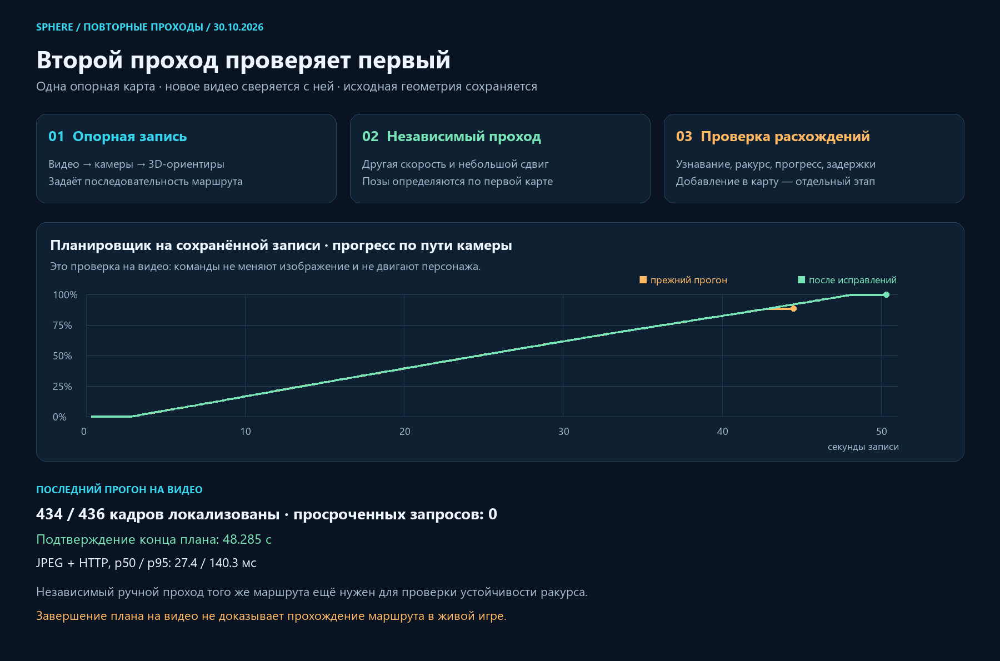

# Второй проход, независимая проверка и задержки локализации

30.10.2026, Asia/Yekaterinburg. Продолжение `ccdb9f18`.

## Зачем нужна ещё одна запись

Для рабочего сценария достаточно стремиться к одной опорной записи.
Вторая запись полезна как независимый контроль: тот же путь с немного другим
положением, ракурсом, скоростью и моментами поворотов. Именно она покажет,
узнаётся ли место за пределами кадров, из которых построена карта.
Покадровое сравнение по одинаковой секунде не подходит: движение человека
не совпадёт по времени. Новые кадры локализуются в **первой** карте через
проверенные 2D–3D соответствия. Затем сравниваются положение, ориентация
и порядок продвижения по маршруту, а не клавиши или тайминги первой записи.

Подход хранить несколько наблюдений одного места называется multi-experience
localization. [MacTavish et al., 2018](https://doi.org/10.1002/rob.21838)
описывают выбор подходящего подмножества накопленных наблюдений в реальном
времени. Это аргумент за ограниченный выбор полезных опорных данных,
а не за загрузку всех кадров всех роликов при каждом решении.

В [VT&R3](https://github.com/utiasASRL/vtr3) есть готовая реализация
multi-experience localization для стереокамеры. Она не является готовой
заменой нашего контура: официальная vision-конфигурация требует GPU/CUDA,
а вход у нас — монокулярный Android-видеопоток и RX 9070 XT. Код VT&R3
не скачивался и не подключался.

Работа [Predictive and adaptive maps](https://arxiv.org/abs/2603.12460)
рассматривает выбор, удаление и добавление признаков при изменении внешнего
вида среды. В arXiv она загружена в 2026 году, но указана публикация IROS
2019. Новая дата загрузки не делает сам метод новым.

Практический порядок для нас:

1. Запись A остаётся опорной картой и задаёт маршрут.
2. Запись B проходит проверку на этой карте. Небольшое смещение и различие
   скорости полезнее, чем попытка попасть в каждый пиксель первого видео.
3. По B измеряются участки потери позиции, число геометрических совпадений,
   положение относительно маршрута, ракурс и задержки. Метры не объявляются,
   пока игровой масштаб не привязан к внешнему источнику.
4. Добавление данных B в карту — отдельная операция с проверкой согласования.
   До этого B остаётся независимой проверкой. Если по ней изменить карту,
   прежние результаты B больше не являются отложенным тестом.

Много обязательных проходов не требуется. Сейчас полезен один второй ручной
проход того же места. Дополнительные условия дня/ночи стоит проверять позже,
по конкретным отказам. Автоматический проход особенно полезен для анализа
цепочки «кадр → решение → ACK → изменение ракурса/положения».

## Что уже сохраняется и что ещё не подключено

Живой пеший тест уже сохраняет ограниченную диагностику: до 60 кадров,
позы, команды и native ACK, интервалы источника, JPEG/HTTP и long tasks.
Одновременная полноценная запись второго H.264 во время `piloting` в текущей
странице **не подключена**: обычная кнопка записи блокируется активным
вводом. В этой поставке такой параллельный рекордер не заявляется.
Десятки полных роликов при каждом тесте также не сохраняются автоматически.

Нельзя просто усреднить два независимых PCA-графика или две монокулярные
реконструкции: у них могут различаться масштаб и система координат.
Проверка второго видео по первой карте избегает этой неоднозначности.
Игроки, транспорт и надписи не становятся надёжными неподвижными ориентирами
только потому, что видны в нескольких кадрах.

## Реализованная проверка второго файла

Локальный HTTP-стенд `scripts/pilot/check_route_full_replay.py` теперь принимает
`--query <input другой записи>`. Опорная карта не перестраивается и не
изменяется. Поддерживается ограниченный прогон до 55 секунд, без Android-ввода.
Временная минимальная копия карты удаляется по завершении.

- Сохраняются ID и SHA-256 видео/manifest обеих записей.
- Переименованная побайтовая копия исходного видео остаётся тестом на том же
  видео; опорные кадры из запросов исключаются.
- Другие имена и разные байты сами по себе не доказывают независимый игровой
  проход: перекодирование может менять файл. Отчёт явно оставляет
  `independentGameplayConfirmed=false` и `sameRouteVerified=false`.
- Повторно использованный ID с другим видео и другое соотношение сторон
  отвергаются. Совпадение FOV по одному соотношению сторон не доказывается.
- В локализатор не передаются время исходного ролика, индекс опорного кадра,
  записанные клавиши или ожидаемое место. Его задача — узнать текущий кадр.
- Проверка SHA выполняется потоково, без чтения полного ролика в один буфер.
- На ошибке закрытия сеанса изолированный HTTP-сервер всё равно освобождается.
- Помимо времени HTTP теперь измеряется возраст запроса **с начала подготовки
  JPEG**. Ответ HTTP за 200 ms после кодирования 100 ms не получает разрешение
  движения. Доставка Android и настоящее браузерное кодирование этим стендом
  не измерены; их нельзя объявлять нулевыми.

Проверен другой имеющийся ролик: 73 кадра за первые 10 секунд, все unknown,
все команды нейтральны, просроченных ответов нет. Его начальный вид относится
к другой улице, поэтому это проверка отказа узнавания, **не второй удачный
проход того же маршрута**. Положительного независимого теста того же пути
пока нет. В вебе отдельный выбор пары записей в этой поставке не добавлялся.

Пример воспроизведения локального стенда:

```powershell
.local-pilot/motor-worker-venv/Scripts/python.exe -m scripts.pilot.check_route_full_replay `
  --job .local-pilot/reconstruction-jobs/b861ac82fcd64425bc583b37f620ba2a `
  --query .local-pilot/reconstruction-jobs/QUERY_JOB/input `
  --max-seconds 55 --output .local-pilot/NEW_UNIQUE_COMPARISON
```

## Что исправлено в основном контуре

Разделение старого полного прогона по методам показало:

| Метод | Наблюдений | Медиана ответа | p95 | Ответов >250 ms |
|---|---:|---:|---:|---:|
| Map-anchored optical flow + PnP | 343 | 24,7 ms | 36,1 ms | 0 |
| Повторное descriptor-PnP распознавание | 77 | 158,7 ms | 254,9 ms | 8 |

`check_route_descriptor_cost.py` отдельно измеряет извлечение SIFT,
поиск кандидатов, подмножества соответствий и PnP. Он не обходит рабочие
проверки при управлении: это изолированный профиль, не тест допуска позы.

На одинаковых 16 исходных кадрах при четырёх потоках и восьми кандидатах:

| Измерение | EPnP | AP3P |
|---|---:|---:|
| Полное холодное распознавание, p50 | 178,5 ms | 154,3 ms |
| Полное холодное распознавание, p95 | 231,9 ms | 181,4 ms |
| Собственно PnP всех кандидатов, p50 | 53,4 ms | 21,7 ms |
| Кадров с геометрической гипотезой | 16/16 | 16/16 |

Максимальная разница поз между решателями — 0,041° и 0,0161 медианного шага
камер; это согласие методов, не измеренная абсолютная точность в игре.
В рабочем RANSAC теперь используется AP3P для генерации гипотез.
Остаются 300 iterations, confidence 0,999, 3 px, уточнение LM, доля/число
inliers, пространственное покрытие, проверки глубины, конкурирующих поз,
коридора и свежести. [Документация OpenCV](https://docs.opencv.org/4.x/d5/d1f/calib3d_solvePnP.html)
описывает AP3P и последующее уточнение позы. Версия runtime-политики —
`pnp-ap3p-continuous-image-support-temporal-v5`; descriptor pipeline сохранён,
перестраивать существующую карту не требуется.

Следующая выявленная остановка была вызвана бюджетом восстановления:
геометрически допустимые позы с 20–23 inliers считались полной потерей
позиции. На четвёртом таком кратком эпизоде контроллер завершал весь запуск.
Теперь слабая уверенность сохраняет нейтральный стик, но не расходует
счётчик трёх полных потерь позиции. По-прежнему нужны три новые позы с
минимум 24 inliers. Ожидание ограничено 2 s за эпизод и 6 s суммарно.
Если позиция действительно теряется, эпизод расходует прежний счётчик.
Сильные геометрические отказы не переводятся в эту мягкую паузу.

Также исправлена терминальная отчётность: после `arrived` следующий запрос
не превращает уже подтверждённое завершение в `stopped`. Стик остаётся
нейтральным, достигнутый прогресс сохраняется.

## Граница результата

Итоговая версия кода в полном HTTP-прогоне: 436 отложенных запросов за
50,332 s исходной записи, 434 localized и 2 confirming, без unknown.
План впервые подтвердил конец на 48,285 s, затем сохранял `arrived` и
нейтральный стик. Терминальных отказов `stopped` в этом прогоне не было.
С учётом подготовки JPEG: p50 27,4 ms, p95 140,3 ms, максимум 188,4 ms,
просроченных запросов 0. Пропущены 7 запоздавших кадров вместо накопления
очереди. Private memory процесса: выборочный максимум 133,7 MiB; это не
память эмулятора, браузера или реконструкции.

Сборка Next завершилась успешно с неизменным SHA исходников. Локальный веб
3015 обновлён; проверены две страницы, 31 asset, SHA worker и новый bundle.
Остальные контейнеры сохранены. API 3342 перезапущен существующим watchdog,
исходные карты и видео не изменены. APK и протокол ввода не менялись.
Визуальное принятие страницы браузерной автоматизацией в этом проходе
не выполнялось; проверка поставки основана на component tests, HTTP и SHA.

Проверки: 164 Python tests passed, 63 subtests passed, один пропуск из-за
необязательной video dependency; 52 frontend tests passed в четырёх suites.
В старом тесте TeachingNavigation остались React `act(...)` warnings,
они не выдаются за чистый browser-console тест.



Полный тест записи подаёт реальные изображения на HTTP-локализатор и
планировщик, но видео не реагирует на команды. Подтверждённый конец плана
здесь ещё не означает физическое прохождение в игре. В независимом повторе
надо проверить узнавание при смещении; в замкнутом игровом тесте — управление,
реальный отклик камеры, препятствия и движение персонажа.

Точная поставка, результаты и хеши — в
[route-repeat-evidence.json](route-repeat-evidence.json).
