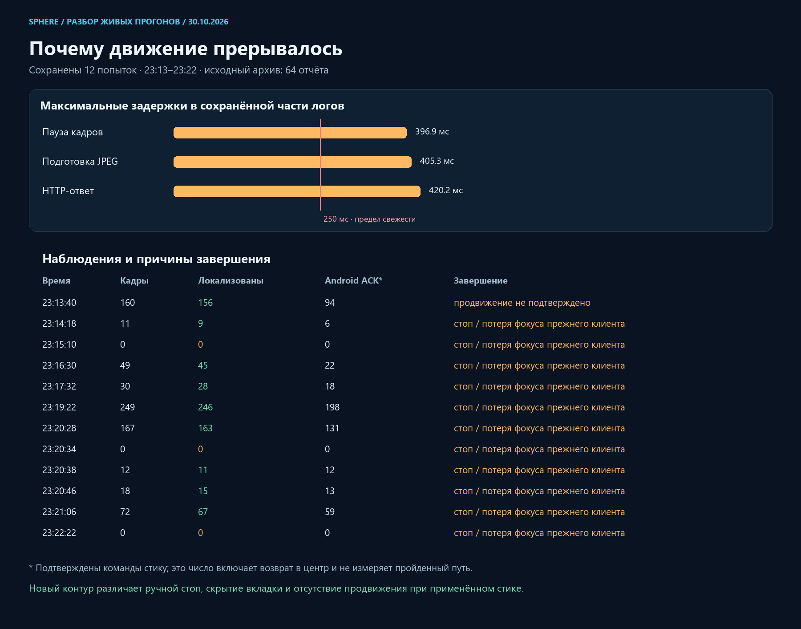
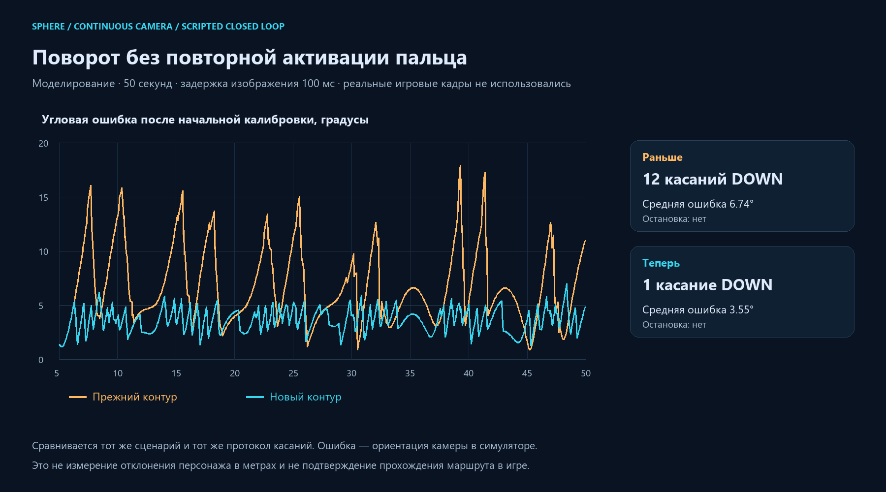

# Live repeat: focus, applied motion and continuous camera

2026-10-30, Asia/Yekaterinburg. Baseline `7c5fa377`; client delivered by this change: **`walk_live_v5`**.

## New live evidence

Preserved the complete rolling local folder before analysis in `.local-pilot/walk-followup-20261030-2325/reports-before.zip`. Twelve reports were written at approximately 23:13–23:22. ZIP timestamps have two-second precision.

All twelve lack `clientVersion`, encoder timing fields and the new native event tail. No processor frame archives accompanied them. This establishes that the already-open page was still executing the earlier client, even though the previous release image had been installed. Installing a frontend container does not replace JavaScript already executing in an open tab. These attempts therefore cannot measure the VideoFrame capture change from the preceding release.

One report ended with `walk_no_route_progress`. Eleven used `walk_manual_stop`, including three that closed before producing any observation. That old code used the same label for a Stop/Escape action, window blur and document hiding. Consequently these eleven records do **not** prove that the user pressed Stop. The exact trigger cannot be recovered from their overloaded reason field.

Recognition was frequently successful: one run had 246 localized observations out of 249; another had 163 out of 167. The last moving report reached internal segment 90 with 67 of 72 observations localized. This agrees with the user getting further along the route between restarts. Applied input commands still do not measure travelled distance or prove a completed route.

The surviving stage tails show maximum source callback gaps of 396.9 ms, JPEG preparation of 405.3 ms and HTTP round trips of 420.2 ms. They are separate maxima and must not be summed. The reports do not contain the corresponding pixels or full native timeline.

## Corrections

### Focus is not an operator stop

Removed window-blur termination from `WalkingRoutePilot` and exempted the autonomous `piloting` phase in the parent `TeachingWorkbench`. Manual held-key/mouse release behavior is retained for manual control. A visible page with a fresh source can continue while the emulator has keyboard focus. A hidden document still closes input, with `walk_page_hidden` rather than `walk_manual_stop`; stream identity, freshness, native ACK and stop/deadline checks remain active.

### No-progress monitoring uses applied input time

The follower previously measured three wall-clock seconds without route progress. The browser can deliberately override a nonzero plan with a neutral stick while activating or calibrating the camera. The server did not know about that pause. This creates a reproducible false blocked-route condition; it does not establish that an obstacle was present in the user's run.

The new `applied_stick_v1` observation contract carries `motionActive`, bound to the same session, epoch and query sequence. In the real lease it requires a non-neutral requested stick, an Android `applied` receipt for pointer 0, a fresh stream, a live lease and an unexpired decision. A camera-pointer ACK, a plan alone or an ACK at the stick centre does not qualify. Neutralization clears requested motion immediately.

The follower counts bounded fresh intervals with that feedback. Camera/ACK waits do not consume the translation stall interval. Three seconds of qualified applied stick without sufficient route progress still stop the run. This remains an **input application** observation, not proof that the game physically moved the character. The status now says that progression was not confirmed and that the cause is unknown; it does not assert an obstacle.

The effort clock and flag are included in scalar reports and exact-frame archive metadata. Sampling of progress history is bounded independently of query rate. The recorded-only replay retains its separate legacy observation mode and cannot acquire input authority.

### Keep the camera finger active between small corrections

After successful alignment, the previous reference-view servo sent UP. The next correction therefore required DOWN and touch-slop activation again. With a calibrated gain, the reference-view servo now retains one camera finger across small bends. Small corrections and translation can run together under fresh permits. Re-centering, first gain identification, large direction errors, expiry and unqualified geometry retain their separate neutral/closure paths.

The first attempt at this correction exposed another fault in the 50-second simulation: weak or cancelling axis commands could leave a response baseline almost ten seconds old. A later bend then caused a false `walk_camera_response_not_observed`. Weak response windows now expire at their local observation horizon; meaningful frozen/reversed response checks remain tested.

Also corrected report validation: cumulative camera MOVE counts may exceed 120 over a run, while the servo's 120 limit applies to each alignment. The scalar report now admits up to 4096, matching the finite journal bound. A successful longer run is no longer rejected solely for 229 total camera updates.

### Do not alternate overview orientations when a live pose expires

The map previously selected live heading when the 250 ms pose was fresh, then immediately selected the recorded reference heading when it expired. Their difference could rotate the overview without any corresponding game-camera turn.

`NavigationRouteContext` now keeps the last confirmed orientation for presentation. Expiry still removes the live-position pin; the map explains that the displayed orientation is held. It does not alternate to a different reference heading. This display state never supplies a localization result or input permit. Depth-colour painting also stays anchored while the pin expires.

The source-image viewer remains a throttled reference comparison, up to one update per second, with its own displayed/requested timestamp. It is not the current input image or the controller's next target. A mismatch with the last displayed reference alone cannot prove that the follower is trying to return to that recorded camera.

### Detect the open stale client before input starts

The processor now requires `walk_live_v5` for a live walking start and negotiates `applied_stick_v1`. An old page receives a direct instruction to refresh the tab before any new walking session or native input can open. The current page shows `Контур walk_live_v5`. Recordings and stored geometry require no migration. APK input protocol is unchanged.

## Measured controller comparison

The matched scenario uses the production contact protocol and camera controller in a deterministic camera plant: 50 seconds, 20 source observations/s, 100 ms visual delay, 16 px touch slop, signed gains and periodic 130 ms processing delays. Poses are scripted, not estimated from real images.

| Metric | Previous | New |
|---|---:|---:|
| Camera DOWN events | 12 | 1 |
| Camera MOVE events | 199 | 229 |
| Mean orientation error after 5 s | 6.74° | 3.55° |
| Maximum orientation error after 5 s | 17.95° | 7.00° |
| Terminal failure in this scenario | none | none |

More MOVE updates on one held contact are continuous control; they are not repeated taps. The comparison does not measure physical route deviation, obstacle avoidance, metre accuracy or successful live A→B completion.

All **23 camera/contact scenarios** pass, including frozen/reversed response detection and short video gaps. Regression tests: **132 frontend tests in 12 suites**, **155 Python tests plus 60 subtests**, one optional-video-dependency skip. The subsequent cumulative-counter report test run also passed 10 tests and 5 subtests.

## Research checked

- [Visual Teach & Repeat 3, authors' project](https://utiasasrl.github.io/) uses local submaps and a separate path-following control system. Its documented stereo/LiDAR and robotics runtime requirements make it unsuitable as a direct replacement for this Android screen-only input.
- [FFI-VTR, 2025 paper](https://arxiv.org/html/2507.12800v1) combines adjacent-keyframe evidence and motion decisions. Its obstacle handling uses a separate LiDAR occupancy map. This supports separating route evidence, smooth control and obstacle assessment; it does not justify interpreting a stalled visual estimate as a detected obstacle. Its models/planner were not installed or claimed as tested here.

The implemented corrections address measured control/state faults. No learned geometry, unobserved road surface or synthetic future game frame was added. A side offset of 1–3 metres is not a validated tolerance: the reconstruction still has unknown metric scale and no verified traversability map.

## Delivery and remaining acceptance

Final frontend source fingerprint: `f82cf1d222f53b2380d319b6cf707fc116e19000141c7c5ca72bb986a823ea38`.

Image: `sphere-route-local:walk-followup-20261030-v5`, ID `sha256:b51ef08224dc173352262f524b1ac9c07ea8710d98b3f50acadf6d46809058de`. Probed two pages, 31 assets and both worker hashes before installing. The local review UI is healthy; other containers were preserved. The local processor was reloaded through its existing watchdog; source-video, geometry and navigation asset hashes were unchanged. Rollback frontend image: `sphere-route-local:walk-live-20261030-v2`.

The first build was stopped by the build wrapper's 85% system-commit guard. A new bounded build retained one worker, a 1 GiB Node heap and at least 5.5 GiB available RAM, with a build-only 90% commit ceiling, and completed. Live-control and reconstruction resource guards were not changed. No unrelated application was closed and no cache or recording was deleted.

Rollback requires a matching frontend and processor from `7c5fa377`; the previous frontend alone is intentionally rejected by the new live-start version contract.

The current user browser tab could not be inspected through the available browser tool: it returned a kernel-assets path error. Delivery was checked through unit/integration tests, the isolated camera plant, the production build and local HTTP/image receipts. No real game input was sent during this investigation. A smooth new live pass is still unverified.

After one refresh of the existing route page, the panel must show `walk_live_v5`. The version gate prevents another silent test with the earlier client. [Machine-readable evidence](walk-followup/delivery-evidence.json) records the test and installation receipts.
