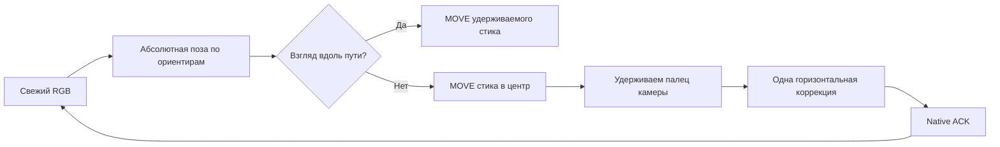

# Удерживаемый стик, камера и опорный кадр

Разбор живых попыток Kakaska228 30.10.2026, 00:06–00:15 по Екатеринбургу.
Исходное видео и карта не изменялись. Новая реализация ещё не прошла полный
замкнутый A→B в игре; локальные тесты не считаются таким прохождением.

## Факты из отчётов

Сохранены 19 сводок: 5 остановок `walk_camera_response_not_observed`,
4 `camera_stroke_expired`, 1 `walk_camera_resolution_limit`, 1 ручная остановка,
1 `walk_camera_gain_unqualified`, 1 `walk_stream_changed`, 6 `walk_decision_expired`.
Последние дополнительные попытки узнавали участки до **24,198 с исходной записи**.
Это время эталона, не расстояние и не доказательство достижения конца маршрута.

Показательный запуск `a77eb546`: 212 наблюдений, 142 подтверждённые команды
стику, 9 завершённых свайпов. Последние измеренные повороты — около 6,15°,
6,55° и 5,72°. Перед остановкой оставались 82 совпадения; завершение произошло
при паузе представления видео 252 мс. В другом запуске зарегистрировано
14 переходов в нейтраль примерно за 10 секунд. Сообщённое пользователем
приседание согласуется с повторными DOWN после таких отпусканий, но обработчик
жеста самой игры не исследовался.

В четырёх последних попытках исходного окна 00:12–00:13 число совпадений было нулевым.
Состояние ожидания свежего ответа при этом ошибочно сохранялось даже после
поступления новых валидных ответов UNKNOWN: таймер 2 с завершал тест с
неподходящей причиной `walk_decision_expired`.

Данные: [живые сводки](walk-continuity-live-diagnosis.json),
[проверки и доставка](walk-continuity-delivery.json),
[проверка записанных кадров около 19 с](walk-continuity-source19-http.json).
Внутреннее хранилище браузера не читалось; сведения получены из сохранённых
локальным обработчиком сводок без кадров и секретов.

## Стик: один палец вместо повторных нажатий

В пешем автоматическом режиме `applyWalkingStick` отправляет первый DOWN в
калиброванный центр, затем MOVE к нужному положению. Временная нейтраль — MOVE
обратно в центр с сохранением того же контакта. Возобновление — очередной MOVE,
а не новый DOWN. Окончательный Stop закрывает владельца и отменяет контакты.
Ручная клавиатура сохраняет обычное отпускание при отпускании клавиши.

`WalkStickSlew` ограничивает рост отклонения от реально отправленного вектора:
после вынужденной нейтрали старое желаемое значение сервера не возвращается
скачком. Набор ограничен 1,2 единицы нормированного стика в секунду с ограничением
шага времени; нейтрализация по недостоверному кадру остаётся немедленной.

Проверка реального сериализатора протокола через 12 пауз/возобновлений:
**один DOWN контакта 0, ноль промежуточных UP**. ACK и жесты второго контакта
проходят через тот же `TeachingContacts`, что используется в вебе.

Для уже подтверждённого центра стика разрешено ограниченное ожидание видео
по существующему idle-лимиту до 1 с. Оно не разрешает устаревший MOVE из центра.
Направленное или неподтверждённое касание по-прежнему отзывается при старом видео;
UNKNOWN-освобождение не позволяет открыть нового владельца.

## Камера: удерживаемый горизонтальный свайп

Новый `WalkCameraDrag` не использует цепочку `setTimeout` с заранее
запланированными точками. Он выдаёт ровно один DOWN/MOVE/UP на свежем решении,
ждёт native ACK и измеряет отклик на новом локализованном кадре. Между
коррекциями палец остаётся на экране, поэтому порог начала свайпа не приходится
преодолевать после каждого маленького движения.

- Начало поворота — ошибка больше 0,20 рад; завершение — меньше 0,08 рад.
  Гистерезис уменьшает переключения у одного порога. Стик на время поворота
  остаётся в центре. Одновременная езда с поворотом камеры не реализована.
- Шаг MOVE ограничен 6% короткой стороны; весь жест ограничен ±25% вокруг
  выбранной точки и безопасными границами экрана. У края палец переставляется
  с паузой не меньше 600 мс. Координата Y неизменна.
- Первый шаг калибровки — 1,8%. При тихом отклике палец удерживается до 400 мс
  для проверки следующими кадрами, затем допускается ограниченное увеличение
  шага. Отдельный тихий ответ на прежних 4% больше не завершает тест немедленно.
- После первого измеримого движения минимальный шаг уменьшается: активационная
  длина нового жеста не превращается в неизменный большой шаг коррекции.
  Это отдельно проверено на модели с большим порогом начала движения.
- Чувствительность и знак определяются по относительному вращению камер до/после
  MOVE. Малый шум позы не инвертирует уже определённый знак.
- В snapshot указан `mode=continuous_drag_v1`. Для совместимости имя
  `afterUpMs` в строке feedback сохранено; в этом режиме это интервал после ACK
  текущего MOVE, а не после поднятия пальца. Это не измерение полной задержки игры.
- Лимиты времени, количества коррекций, свежести 250 мс и подтверждений 500 мс
  сохранены. Новый фронтенд требует явного ACK `cameraControl=continuous_drag_v1`
  до открытия Android-ввода; старый интерфейс остаётся в отдельном legacy-режиме.

Калибровочная точка — начало свайпа. Растягивать прямоугольник не нужно.
Полоса показывает доступное перемещение. Пока калибровка живёт в памяти страницы:
после перезагрузки нужно указать центр стика и начало свайпа заново.

## Паузы и локализация

Частота запросов ограничена 20 Гц, остаётся один запрос в работе без очереди.
Обновление React-представления и карты ограничено 5 Гц; журнал сохраняет все
наблюдения. Изменение частоты не подтверждает готовность сотен окон: обработчик
по-прежнему допускает одну активную сессию; нового нагрузочного теста флота нет.

Любой свежий связанный ответ завершает ожидание доставки. UNKNOWN при этом
остаётся нейтральным и не приобретает право движения. Его причина `poseReason`
теперь сохраняется и в компактной сводке. Разрыв наблюдений 0,5–2 с переводит
планировщик в нейтраль с тремя новыми подтверждениями рядом с прежним положением.
Больший разрыв, скачок карты/эпохи, выход из коридора, превышение бюджета или
неизвестное освобождение остаются причинами остановки. Это не автоматическое
переоткрытие потерянного native-канала.

## Опорное изображение и карта

Галочка «Опорный кадр вслед за локализацией» относится только к просмотру.
Она не задаёт управление и не служит входом текущего локализатора.

Раньше смена времени очищала canvas и отменяла декодер; при частом обновлении
пользователь видел чёрный прямоугольник. Теперь работает один декодер-запрос:
новые цели объединяются, проверенный кадр остаётся видимым до следующего готового
изображения. Декодирование идёт в отдельный canvas; вывод меняется после проверки
хэшей. Подпись содержит время **фактически показанного** кадра; ожидаемое время
показано отдельно. Смена источника отменяет старую работу и очищает изображение.

API возвращает `referenceTicks90k` по исходным временам карты локализатора.
Предпросмотр использует это время вместо предположения, что индекс сегмента
совпадает с индексом камеры просматриваемой схемы. Обновление эквивалентного
объекта задания больше не загружает геометрию заново и не сбрасывает время к нулю.
При UNKNOWN явно указано, что опорный кадр — предыдущее изображение для сравнения,
а не текущая локализованная позиция.

Проверены native-последовательности, оба знака чувствительности, удержание пальца,
нейтраль без двойных нажатий, старые/неподтверждённые команды, восстановление
планировщика, гистерезис, сопоставление времени и декодирование с объединением
запросов. Полное прохождение в игре, устранение всех игровых жестов приседания
и визуальная плавность на конкретном эмуляторе после исправления ещё не подтверждены.
IAB-инструмент сообщил отключённый локальный доступ; окна ПК не использовались.
