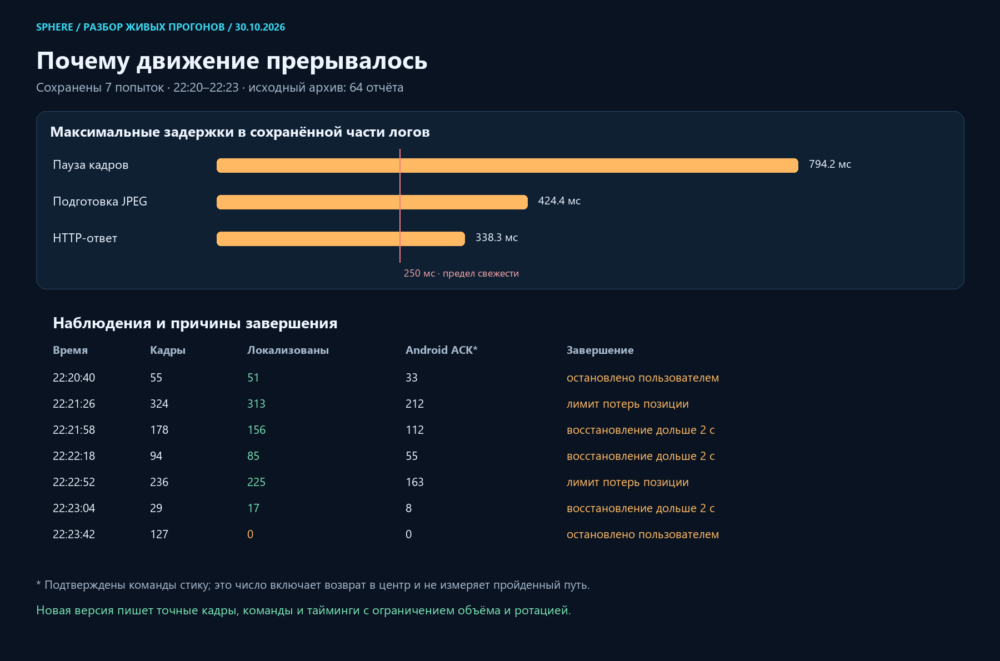

# Live walking: stop causes and capture correction

Date: 2026-10-30, Asia/Yekaterinburg. Baseline: `e1e42515`.

## What the surviving reports establish

The original local folder contained exactly 64 reports. The previous implementation rejected the next new report at that count, rather than rotating old reports. All 64 originals were preserved in `.local-pilot/walk-live-20261030-2228/reports-before.zip` before changing retention. Seven reports in that archive cover 22:20:40–22:23:42. This is a partial record of the user's repeated live attempts, not proof that only seven attempts happened.

The reproducible scalar analysis is [walk-live-report-analysis.json](walk-live-report-analysis.json); its chart is below. ZIP timestamps have two-second precision. Applied Android commands include neutral moves and are not a measure of distance or successful route completion.



| Local time | Observations | Localized | Applied stick commands | Completion reason |
|---|---:|---:|---:|---|
| 22:20:40 | 55 | 51 | 33 | manual stop |
| 22:21:26 | 324 | 313 | 212 | relocalization budget |
| 22:21:58 | 178 | 156 | 112 | relocalization timeout |
| 22:22:18 | 94 | 85 | 55 | relocalization timeout |
| 22:22:52 | 236 | 225 | 163 | relocalization budget |
| 22:23:04 | 29 | 17 | 8 | relocalization timeout |
| 22:23:42 | 127 | 0 | 0 | manual stop |

All seven report native release as `closed`. The highest internal segment in these reports is 81. This cannot be equated with the user's displayed camera 130: the report set is incomplete and the UI and follower indices are not interchangeable.

The detailed stage trace was only a rolling tail of 256 events. Its observed maxima are:

- Source callback gap: **794.2 ms**.
- JPEG preparation: **424.4 ms**.
- Local HTTP round trip: **338.3 ms**.

These maxima belong to different queries and must not be added together. Typical HTTP medians in the moving runs were approximately 20–24 ms. Thus a multi-second model inference is not established by this evidence. A separate later stream-history sample had approximately 1 ms WebRTC RTT and 0.4 ms decode time, but was collected after the test interval and cannot establish those timings during a stop.

Two budget failures contained short transport gaps (`route_observation_gap`) that consumed the same counter as genuine loss of position. In the final attempt 126 of 127 observations were `route_pose_not_verified`, with no applied movement. Old scalar summaries did not contain the actual query images or native event sequence, so the visual reason for that final failure cannot be determined from them. It is not evidence of an input failure or of insufficient RAM by itself.

## Why known future route points did not prevent pauses

The follower already chooses a local target ahead on the recorded camera path, approximately 1.5 median camera steps away. The browser holds one stick contact and updates it; it is not intended to issue a new tap for every reference image. However, expired frame/pose permits neutralize that contact. Repeated transport stalls and recovery acquisition consequently appear as stop/go even when the next route target is known.

Offline forward/backward processing can refine the stored map. It cannot establish the current live pose after an image gap. Extending movement blindly through unverified frames would conceal the problem and can steer through a turn incorrectly. This change reduces avoidable capture latency and separates transport recovery from actual location-loss recovery without increasing the 250 ms movement freshness limit.

## Implemented changes

1. `walkFrameEncoder.ts` now snapshots the displayed video with a transferable `VideoFrame` where available. Resizing, JPEG encoding and hashing run in the existing worker. The asynchronous resized `createImageBitmap(video)` path remains a fallback. One pending query, frame closure, timeout and retry rules remain bounded. This does not change the master recording resolution or bitrate.
2. The worker reports capture, worker, JPEG and hash timings separately. Browser reports also include video presentation/media clocks and available WebRTC receive/capture/decode metadata. Unsupported timing fields remain null; these estimates do not claim a hardware-synchronized end-to-end clock.
3. Short frame gaps and frames that expire during localization no longer consume the three genuine position-loss recoveries. Movement is neutral during recovery, and still requires three fresh qualified poses, at most two seconds per recovery and six seconds in total. Epoch, corridor and pose-jump checks remain enforced.
4. The localizer retains a qualified submap candidate hint for at most two seconds after the last qualified pose. It only influences candidate retrieval. It cannot provide a pose, resolve an ambiguous image, skip PnP or authorize input.
5. Stage aggregates cover the whole run even when the last 256 detailed rows rotate. Local scalar reports include client version, absolute run start, requested stick values, bounded native input events and localization method. Oversized uploads are reduced below 480 KiB while preserving the final observation and closure tail; the full bounded browser archive is not mutated.
6. The UI shows `walk_live_v4`, capture mode and current recognition state. A paused camera controller no longer overwrites a failed localization reason with its own neutral-wait reason.
7. The existing diagnostic checkbox also enables exact query-frame retention on the processor. This makes the next visual failure inspectable without asking the user to export browser-only data manually.

The `VideoFrame` approach uses the standard [WebCodecs VideoFrame interface](https://www.w3.org/TR/webcodecs/#videoframe-interface). Browser support is feature-detected; the implementation does not introduce a new model or a GPU reconstruction dependency.

## Diagnostic storage limits

Limits are **per reconstruction job**, not an unlimited global archive:

| Data | Limit and write behavior |
|---|---|
| Processor scalar summaries | Rolling 64 files, at most 32 MiB; a new successful file replaces the oldest generated report |
| Exact query images in RAM | At most 12 JPEGs, at most 2 MiB, at most 2 samples/s |
| Processor frame archives | One ZIP on stop or session expiry, at most 2 MiB each; rolling 16 ZIPs, at most 32 MiB |
| Detailed stages | Last 256 rows plus scalar whole-run aggregates |
| Scalar upload | Below 480 KiB; at most 600 observations and 512 native input rows before size reduction |

The frame ZIP contains exact received JPEG bytes, hashes, sequence numbers, pose/plan state and geometry/capture binding. No per-observation disk write occurs. Failure to save diagnostics is reported as unconfirmed and does not authorize or prevent input closure. Original videos, reconstruction geometry and navigation maps are unchanged.

## Verification and delivery

- Python route/localization/workspace/report/archive regression run: **159 passed, 1 skipped, 63 subtests passed**. The skip concerns an optional video dependency. A subsequent metadata-specific run passed **36 tests and 18 subtests**; it overlaps the earlier suite.
- Final frontend run: **117 passed in 9 suites**.
- Closed-loop scripted camera/contact plant: **23/23**. Gaps of 650 and 850 ms recover under the existing bounds; a 1.1-second gap stops as expected. This uses scripted poses and is not a real-game PnP test.
- Isolated Chromium fixture, synthetic 1920×1080 canvas video at 30 fps, 60 samples per encoder path:

| Path | Total p50 | Total p95 | Maximum | Capture p95 |
|---|---:|---:|---:|---:|
| Resized ImageBitmap | 9.9 ms | 27.9 ms | 35.3 ms | 9.8 ms |
| VideoFrame | 9.3 ms | 12.9 ms | 14.1 ms | 0.1 ms |

The benchmark measures the actual encoder and worker in an isolated headless browser. It does not measure the user's WebRTC source, loaded page, emulator or game. No game input was sent during this investigation.

The final web build passed compilation/type checking. Its frontend source fingerprint is `4ca10241b4e4bd0cc57514a4e165c0071b0dc3a27c16f740eff820487e40c50c`. The packaged image was probed before installation: two pages, 31 static assets and both worker hashes matched. Installed image:

`sphere-route-local:walk-live-20261030-v2`

`sha256:f9e51872c9c90c005d79cf3a4fbc60e7f82bfe2a67fb2aa8b9d721eb3c0d1a65`

Installation changed only the local review UI and verified its health and preservation of other containers. The local route API was separately reloaded through its existing watchdog and its source hash verified. APK, emulator, game, Docker daemon and WSL were not restarted. Rollback UI image remains `sphere-route-local:walk-live-20261030-v1`.

One page refresh is needed to load the new client; the live-test panel should show `walk_live_v4`. A successful smooth live A→B pass after these changes has **not yet been demonstrated**. The remaining visual failure must be judged using the newly correlated exact-frame archive, rather than inferred from a high landmark count or a visually attractive reconstructed scene.

Machine-readable receipts and source hashes are summarized in [walk-live-delivery-evidence.json](walk-live-delivery-evidence.json).

## Reproduce without touching the game

Run from the repository root:

```powershell
.local-pilot/motor-worker-venv/Scripts/python.exe scripts/pilot/analyze_walk_live_reports.py --archive .local-pilot/walk-live-20261030-2228/reports-before.zip --since 2026-10-30T22:15:00+05:00 --output docs/audits/2026-10-30
node scripts/pilot/check_walk_camera_loop.cjs <new-json-output-path>
node scripts/pilot/check_walk_encoder_browser.cjs <new-folder-inside-.local-pilot> <installed-playwright-cli.js>
```

The browser fixture deliberately requires an existing CLI and a new output folder. It uses an isolated localhost source, without the user's browser profile, account, Android stream or input channel.
