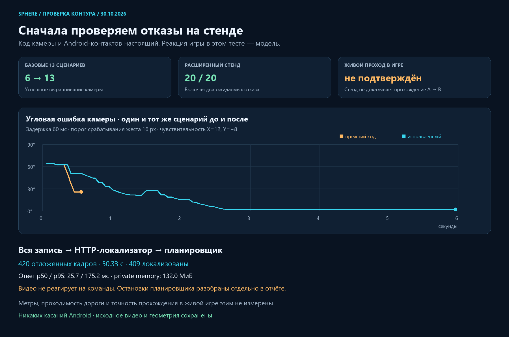

# Проверка пешего контура до следующего игрового теста

30.10.2026, Asia/Yekaterinburg. Продолжение `05582ee0`.
Исправления установлены в локальном вебе 3015 и обработчике 3342.
Новых касаний Android при этих проверках не было. Полное прохождение
Kakaska228 в живой игре после установки **не подтверждено**.

## Что найдено и исправлено

### Калибровка камеры принимала шум и порог жеста за чувствительность

В воспроизводимой модели Android-жеста прежний контроллер проваливал
7 из 13 сценариев. При пороге срабатывания 16 px первая видимая реакция
относится только к оставшейся части движения пальца. Деление на весь путь
занижало чувствительность. На следующей коррекции получался чрезмерный
поворот. При задержке видео маленькое изменение позы могло также дать
неправильный знак чувствительности.

Теперь первое видимое перемещение подтверждает срабатывание жеста,
следующее измеряет чувствительность уже удерживаемого пальца. Нужен
угловой сигнал не меньше 0,015 rad и второе установившееся наблюдение:
изменение до 0,010 rad, интервал от 40 ms. Шум сам по себе не обучает знак.

После измерения чувствительности движение следует ограниченному по скорости
закону обратной связи: коэффициент 1,8/s, шаг времени 50–180 ms, до 0,12 rad
за решение и до 6% короткой стороны экрана. Новая команда по-прежнему
требует свежую позу и native ACK; очередь старых движений не создаётся.
Частичный отклик очередного кадра не переобучает коэффициент на каждом шаге.
Скользящая проверка ожидаемого и наблюдаемого поворота обнаруживает отсутствие
реакции или изменение её знака. Это не воспроизведение записанных свайпов.

Лимит 120 коррекций раньше считался за весь запуск: на длинном стенде
получилась остановка на 47,01 s. Теперь он относится к отдельному
выравниванию. Общий счётчик остаётся в диагностике; ограничения 8 s на
выравнивание и 60 s на пеший запуск сохраняются.

### Один слабый кадр навсегда останавливал маршрут

В полном HTTP-прогоне на 45,633 s было 21 геометрическое соответствие,
хотя локализатор уже вернул `localized`. Управление требует минимум 24.
Следующий кадр дал 65, но `walk_pose_or_corridor_unqualified` оставался
терминальным состоянием.

Порог **не снижен**. Поза с 20–23 inliers теперь переводит стик в нейтраль
и требует три новые сильные позы в существующем окне восстановления.
Неверная матрица вращения, выход из коридора, скачок позиции, смена
источника и длительная потеря ориентиров по-прежнему останавливают тест.
Лимит трёх эпизодов восстановления за запуск также сохранён.

### Поздние задачи мешали остановке и повторному запуску

- Старый JPEG-кодировщик мог оставаться занятым после Stop. Теперь Stop
  закрывает его, новый запуск получает новый экземпляр. Поздний callback
  старого worker или canvas не публикуется в новую попытку.
- Нейтральное MOVE стика и UP камеры могли протухнуть в очереди после
  задержанного, но допустимого ACK. Проверка возраста очереди теперь
  относится к новому движению; команды остановки остаются разрешены.
  Native ACK timeout 500 ms не увеличен.
- Прогноз движения неотправленной коррекции откатывается вместе с ней.
  Поздний callback остановленной попытки не меняет новый контроллер.
- Превью после остановки берёт настоящий video, а не незаполненный canvas
  пути worker. При новом старте прежнее превью сбрасывается. Удалено
  устаревшее сообщение об отсутствии вертикальных свайпов.

## Что именно проверялось

`scripts/pilot/check_walk_camera_loop.cjs` загружает настоящие TypeScript
классы `WalkCameraDrag` и `TeachingContacts`. Виртуальные часы, камера игры,
touch slop и Android ACK моделируются; браузер и эмулятор не открываются.
Это замкнутый контур для модели реакции камеры, **не симулятор всей игры**.

Пройдены 20 сценариев:

- 17 фиксированных целей: оба знака чувствительности, обе оси,
  задержка видимого отклика 60–160 ms, порог жеста 8/16 px, шум позы,
  периодическая обработка 130 ms и разрыв кадров 350 ms.
- 50 s меняющегося направления: более 120 коррекций без прежней остановки.
  Угловая ошибка после первых 5 s: средняя 0,118 rad, максимум 0,313 rad.
  Это измеримая остаточная ошибка модели, не обещание идеальной плавности.
- Два отрицательных контроля: замершая камера и изменение знака реакции
  после калибровки. Оба завершились ожидаемым отказом и закрытием owner.

На первых 13 сценариях сравнения прежний код прошёл 6/13, исправленный —
13/13. Выравнивание с первоначальной калибровкой заняло 2,61–4,71 s.
Эти секунды не являются временем обработки каждого кадра локализатором.

`scripts/pilot/check_route_full_replay.py` отдельно подаёт всю сохранённую
запись на настоящий изолированный HTTP-сервис с binary JPEG и планировщиком.
Кадры, использованные как опорные, исключены. Используются реальные часы
получателя, одно выполняющееся наблюдение и пропуск запоздавших кадров.
Временный минимальный снимок очищается; исходные файлы сверяются по SHA-256.

**Ограничение этого прогона:** видео продолжает идти даже тогда, когда
планировщик требует нейтраль. Поэтому слишком далёкое перемещение персонажа
на записи во время reacquisition закономерно даёт `walk_relocalization_drift`.
Такой результат не означает, что контроллер на самом деле исполнил движение
или прошёл маршрут. В первом прогоне обнаружен слабый кадр, во втором при
совмещении с проверками — дополнительная потеря позы и этот отказ. Результаты
не заменяются только удачным запуском; сводки сохранены в evidence JSON.

Последний, третий прогон: 420 наблюдений до 50,332 s, 409 localized,
8 confirming, 3 unknown. Ответ p50 25,7 ms, p95 175,2 ms, максимум 309,3 ms;
8 ответов превысили 250 ms, и их движение не разрешается. План остановлен
на 44,781 s с `walk_relocalization_drift`; видео при нейтрали не остановилось.
Пропущен 61 запоздавший кадр, очередь не накапливалась. Это полезный
диагностический результат, **не успешный полный проход**.

Выборочный максимум private memory изолированного процесса — 132,0 MiB,
CPU — 37,75 core-seconds за 50,89 s. Здесь учтены декодирование видео,
JPEG и HTTP-локализатор с планировщиком. Не учтены память эмулятора,
браузера и реконструкции; замер не является нагрузочным тестом сотен окон.
Порог допуска 4,75 GiB относится к свободной памяти всей системы, а не
к расходу каждого окна.

## Проверки и установка

- Frontend: 155 tests, 15 suites, все прошли.
- Python: 146 passed, 1 skipped, 50 subtests passed. Пропущен прежний
  необязательный сценарий; пропуск не считается успешной проверкой.
- Next production build: exit 0, исходники до/после имеют одинаковый SHA-256.
  Существующие lint warnings вне этого изменения остались предупреждениями.
- Изолированный контейнер: 2 страницы, 31 asset, SHA обоих worker совпадает.
- Рабочий review-ui обновлён отдельно; остальные контейнеры сохранены.
- API перезапущен существующим watchdog; исходные карты и записи не изменены.
- APK не обновлялся: протокол X/Y и независимые контакты уже поддерживаются.
- IAB automation снова вернул ошибку создания kernel assets (os error 3).
  Визуальное принятие открытой страницы не заявляется. Проверены component
  lifecycle, HTTP-страницы, assets и соответствие production bundle.

Точная поставка, хеши и метрики последнего полного прогона находятся в
[walk-preflight-evidence.json](walk-preflight-evidence.json).

## Что дают готовые методы и где предел

[FFI-VTR, 2025](https://arxiv.org/abs/2507.12800) использует feature flow
и граф опорных ракурсов для visual teach and repeat. Это подтверждает
целесообразность отдельного лёгкого навигационного контура; Gaussian-рендер
не обязан выполняться при управлении. Код этой работы не подключался.

В [примере ViSP](https://github.com/lagadic/demo_pioneer/blob/master/src/visual_servo_pioneer.cpp)
управление строится как визуальная обратная связь со скоростной командой.
В нашей реализации применён ограниченный по скорости контроллер с отдельно
измеряемым откликом жеста, без зависимости от ViSP и без заявления об
эквивалентности роботизированному приводу.

[Offline Deep MPC, 2024](https://arxiv.org/abs/2402.04797) рассматривает
последовательность целевых изображений и сглаживание изменения скорости.
Однако обученный предсказатель физики робота нельзя считать готовым
контроллером Black Russia. Модель не скачивалась, платные запросы не делались.

Ни число облачных точек, ни красивый рендер не гарантируют совпадение
нового ракурса, проходимость дороги или отсутствие препятствий. Здесь всё ещё
сопровождается путь камеры, а положение персонажа относительно неё —
проверяемое допущение. Нет подтверждённой метрической карты, объезда NPC,
оценки суток/погоды и нагрузочного результата для сотен окон. На следующем
живом запуске нужны реальные ACK, движение центра и прогресс, а не только
видимая линия. Диагностика по стадиям и ограниченный архив уже включены.
