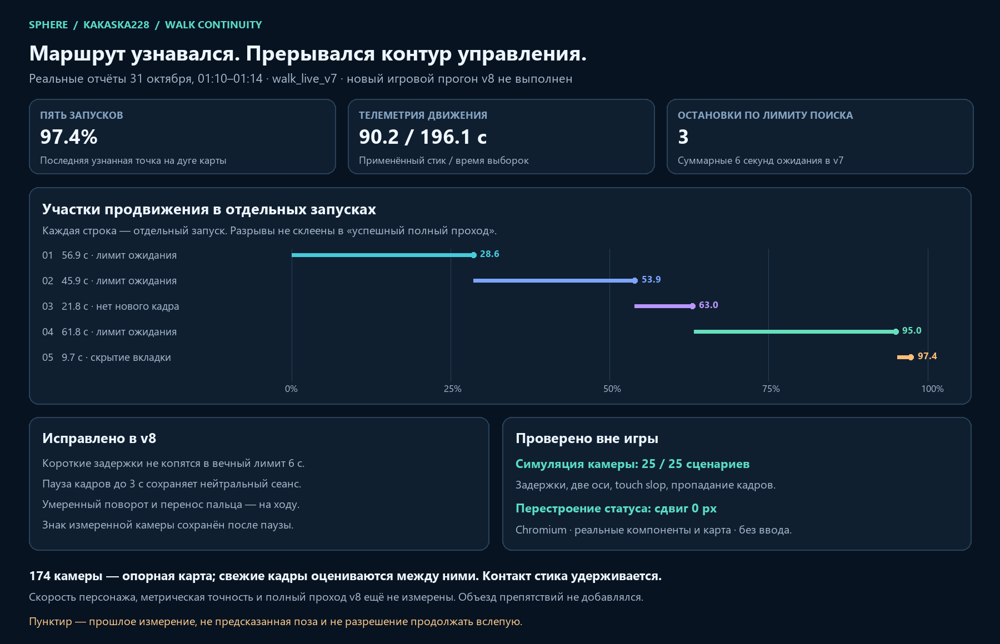

# Walk v8: continuous bends, short delivery recovery and stable layout

Verified locally on 2026-10-31. Replaces `walk_live_v7` on the review web service at `http://127.0.0.1:3015` and in the local route processor. This work sends no game/device input and does not rebuild or change the source video, scene geometry or prepared landmark map.

## What the latest actual game reports show

The 64-report rolling folder was snapshotted before edits. Five v7 attempts between 01:10 and 01:14 local time contain movement; a sixth contains a resource refusal before input opened.

| Local report time | Whole-run replies | Retained rows | Last estimated map progress | Applied motion seconds | Stop reason |
|---|---:|---:|---:|---:|---|
| 01:10:33 | 493 | 272 | 28.59% | 25.73 | `walk_recovery_time_budget` |
| 01:11:40 | 376 | 376 | 53.93% | 23.69 | `walk_recovery_time_budget` |
| 01:12:10 | 142 | 142 | 62.99% | 7.19 | `contact_video_stale` |
| 01:13:41 | 550 | 299 | 94.97% | 31.43 | `walk_recovery_time_budget` |
| 01:14:15 | 60 | 60 | 97.37% | 2.16 | `walk_visibility_pause` |
| 01:14:52 | 0 | 0 | — | 0 | `resource_guard` |

All six releases were `closed`. The video-stale episode records approximately **1006 ms** since the last presented frame. Other episodes contain JPEG peaks up to **613 ms** and source gaps around **872 ms**. These facts establish browser-observation interruptions; the old logs do not distinguish an upstream packet interruption from a presentation/scheduling interruption. They do not justify claiming that the network or emulator itself disconnected.

The reports contain mostly held-stick MOVE receipts. The 142-reply episode has **one** stick DOWN and 95 MOVE receipts. The user-visible stop/start motion is consistent with neutralization and camera feedback waits, not a new stick tap for every reference frame. Later-report native journals are rolling tails, so an absent DOWN in such a tail is not proof that no contact was opened.

Across these five attempts there were about **90.2 seconds** of applied-motion telemetry during **196.1 seconds** covered by the stored end times. This is a useful diagnostic ratio, not a measurement of walking speed or distance. The terminal 97.37% is estimated progress along the recovered camera trace; arrival and a complete single autonomous run remain unverified.

## Corrections implemented

### 1. No layout movement when localization status changes

Localization explanation, map-marker explanation and run status now have fixed-height containers. Counts reserve their width. Fresh-to-recent marker transitions use the same brief tracking label instead of swapping long headings. Real unknown states remain visible, and a past measurement is still labelled as past.

An isolated Chromium fixture runs the **actual** `NavigationRouteContext` and `RouteGeometryMap` components with the current 174-camera / 14,622-point geometry. It switches through fresh, recent, expired and unknown states. The maximum vertical change of both status regions and the map was **0 px** at viewports 1880 × 1250 and 760 × 1250. Source preview and comparison media are explicitly mocked with the original recording's first frame. This is real component/layout verification, not a live localization test or an authenticated user-tab screenshot.

### 2. Delivery pauses no longer consume a lifetime six-second localization allowance

Previously every short `route_observation_gap` and expired-localization answer contributed to one total recovery budget. Successful reacquisition did not replenish that budget. A run could therefore terminate after many recoverable short delays spread across otherwise confirmed movement. This matches three actual v7 stops.

Transport-only acquisition now retains its own finite continuous wait without charging the geometric-loss budget. Weak localized geometry and true `route_pose_not_verified` still charge that budget; three new localized confirmations remain mandatory before movement resumes. A stable two-second interval of applied movement and confirmed route progress replenishes the loss counters, preventing unrelated incidents over a long route from exhausting one lifetime allowance.

The current pose must still match map/epoch/sequence, corridor and continuity checks. Incompatible geometry, repeated unknown images, nonprogress and malformed input still stop. The global negotiated passage deadline remains finite.

### 3. Short presented-frame pauses retain a neutral input owner

Capture transport, neutral contact ownership and the browser's passage guard now permit up to **3 seconds** to recover a temporary presentation gap. The **250 ms fresh-RGB requirement for movement is unchanged**. Once fresh RGB is absent, translation is centred and camera input released; no old movement resumes merely because frames reappear.

Capture-presence renewal may continue during that bounded neutral wait. A queued nonneutral edge discovered after a late ACK now cancels into neutral before the 25 ms watchdog tick instead of immediately closing an otherwise healthy pedestrian owner. After a new fresh qualified localization reply, normal correction can continue without reopening the stick and retriggering a double-tap gesture.

External master recording retains its existing one-second encoded-stream watchdog. A real channel/identity/ACK failure, a presentation gap beyond three seconds or unconfirmed native closure remains terminal. This delivery does **not** automatically replace a failed peer or reopen an uncertain old input owner across a changed capture epoch.

### 4. Separate the pose-correction interval from source presentation

The previous movement deadline was always `capture + 250 ms`. A valid answer taking 120 ms to compute/deliver had only 130 ms left, often causing neutral motion immediately before the next correction arrived.

For this supervised **pedestrian** pilot, an admitted fresh pose now holds its correction until `min(capture + 350 ms, answer + 250 ms)`. The video watchdog independently still requires fresh presented RGB at 250 ms, and a newly received unknown/confirming result explicitly centres input. Answers already 250 ms old are rejected. No pose is extrapolated and no source-clock timestamp schedules actions. This is a bounded sample-and-hold, not authorization to continue through an unseen scene.

This change is not a vehicle controller. It does not establish tolerances at 100 km/h; a vehicle needs its own velocity model, latency bounds, steering/braking constraints and closed-loop tests.

### 5. Moderate bends and camera recentering happen while walking

Reference-view pursuit no longer invokes stationary alignment for every 0.40-radian yaw lag. The continuous pedestrian mode can keep translating during moderate reference-view correction, while large mismatches still enter stationary alignment. Entry yaw/pitch limits are 0.80/0.35 radians; recovery exits at 0.40/0.20. The frontend also requires measured camera gain before allowing simultaneous translation with a correcting camera.

Moving, qualified tracking no longer consumes the eight-second stationary-alignment timer or its move budget. Recentring the held camera finger at the edge of its allowed region no longer deliberately centres the stick. Uncalibrated sensitivity, wrong-sign/absent visual response, source staleness and a large initial camera mismatch still require neutral/stationary behavior.

The servo also previously reactivated a released finger with a positive probe even when the sensitivity sign was already known and the target required a negative displacement. Reactivation now uses the known gain sign and current error. It verifies a visible response without needlessly relearning an already measured gain. Opposite responses still require independent settling checks and eventually stop.

Reference orientation has a small **progress-based lookahead**: at most 0.2 recorded seconds, one map step and 0.25 radians. It is derived from the currently localized arc, not wall-clock playback of the recording. This anticipates a nearby recorded bend while limiting sudden camera target jumps. There is still no recorded-key replay or metre-scale ground-truth speed profile.

### 6. Fix a measured overconservative lightweight-start refusal

At 01:14:51 the refusal snapshot showed 13,023,956,992 bytes of available RAM and 14,640,263,168 bytes of commit headroom. Volume health was `Healthy`, free disk about 46.3 GiB. The only finding was the fixed **85%** commit threshold: usage was approximately 85.37%. It was not a shortage of twelve gigabytes of free RAM.

The bounded CPU live-localization profile now uses a 90% commit ceiling **and** requires absolute commit headroom at least as large as its 4.75 GiB reserve. RAM, disk, volume and measurement checks remain. Heavy feature preparation/reconstruction profiles keep their old limits. This is a small-task admission correction, not evidence that large host kernel pools or aggregate emulator memory use have been resolved.

### 7. Better evidence for the next actual presentation interruption

The recorder worker now reports bounded timestamps for actual H.264 arrival even outside recording, at most five messages per second. Packet-arrival evidence never grants input freshness. The connection exposes age-only source diagnostics; the walk trace records whether a presentation gap occurred with recent encoded arrivals, no confirmed recent arrivals or a hidden document. Epoch/monotonic conversion is bounded and malformed/future timestamps do not renew freshness.

These new reason codes address the evidence missing from previous v7 reports. We cannot retroactively classify the old one-second gap using them.

## Reference count, speed and retained limits

There are 174 recovered reference cameras across approximately 50.35 recorded seconds, about 3.46 reference views/s, and 1387 decoded source frames. The localizer processes newly captured query frames between those reference cameras; map-anchored sparse optical flow supplies updates between descriptor checks. It does not issue one new DOWN per reference image. The reference comparison is a throttled display, not the motor clock.

More map cameras may improve weak visual coverage but do not fix camera ACK stalls, presentation gaps, conservative movement permits or fixed alignment logic. Adding all 1387 near-duplicate frames would also increase matching/index cost. Current stick magnitude is still capped at **35%**. Removing unnecessary pauses improves continuity; matching the original recording's speed has not been established.

## Research applied and not claimed

The [Nav2 velocity smoother](https://docs.nav2.org/configuration/packages/configuring-velocity-smoother.html) separates command smoothing frequency from controller frequency. [Regulated Pure Pursuit](https://docs.nav2.org/configuration/packages/configuring-regulated-pp.html) uses bounded lookahead and speed regulation; its explicit rotate-to-heading behavior is distinct from tracking while moving. Those distinctions informed the local correction/held-contact and stationary-recovery changes here. We did not import a ROS stack, claim its collision avoidance or treat a robot velocity command as a calibrated Android stick.

The broader [visual teach-and-repeat comparison](VISUAL-TEACH-REPEAT-RESEARCH.md) remains applicable. LoTIS/FFI-VTR are research candidates, not installed replacements in v8. Dynamic obstacle avoidance remains out of scope for this delivery as requested.

## Verification and installed artifact

- **167 frontend tests**, 14 relevant suites, passed.
- **151 Python tests and 69 subtests** passed; one optional-video dependency skip.
- **25/25 closed-loop camera simulations** passed, including signed gains, two axes, 60/160 ms visual response, touch slop, short 350/650/850/1100/2200 ms frame gaps, a terminal 3100 ms gap, frozen/reversed camera response and a 50-second moving reference. These use production camera/contact classes against a simulated plant; they do not measure actual game latency or character movement.
- Browser layout checks passed at both viewport sizes with 0 px map/status displacement.
- Scoped lint has zero errors and six existing-pattern warnings; final production build/type checking passed. Node heap was capped at 1024 MiB with one static worker. The final build's source fingerprint matches the installed package.
- Candidate and installed-service checks verified two pages, 31 assets, the encoder worker and the **updated recorder worker**. Only the local review-UI container changed; other containers were preserved.
- Local processor reloaded via its existing watchdog. Original manifests, geometry and navigation assets retained their hashes.

Installed client: **`walk_live_v8`**. Refresh the browser page to load both the new bundle and worker. Old live-start clients are rejected with a version message before input opens. The artifact, test receipts and input evidence hashes are in [delivery-evidence.json](walk-continuous/delivery-evidence.json).

No complete new v8 game traversal, 99% repeat accuracy, vehicle-speed result or dynamic collision avoidance is claimed.
