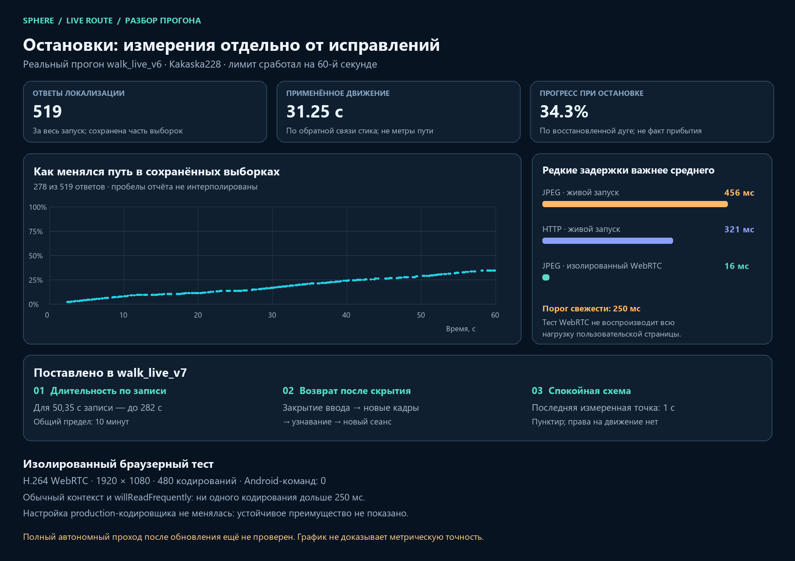

# Walk v7: duration, visibility recovery and live-marker state

This delivery addresses the user's 519-reply run, repeated hidden-tab stops and continuous unconfirmed-position warnings. The existing `Kakaska228` source video and navigation assets were preserved. No Android/game input was sent during the analysis, tests or deployment.

## Evidence from the actual v6 attempts

The rolling report folder was snapshotted before changes. The 00:16:29 local report `325b8edf14344f84802a20e2871e3011` stopped with `walk_time_limit`, **519 total observations**, 278 retained scalar rows, 31.2529 seconds of applied-stick motion feedback and approximately 34.3% estimated route progress. Release was `closed`; native input failure was null.

A second run at 00:20:57 stopped at the same 60-second limit with 529 observations, 34.2239 motion seconds and approximately 63.5% route progress. These were deliberate software time limits, not proof that the route had ended. Later attempts reached approximately 91.8% across restarts, but a completed single run is **not** established.

The 519-reply run's whole-run encoder aggregate includes **551 encodings**, including answers discarded before localization. JPEG encoding peaked at **455.9 ms**, worker round trip at 456.5 ms, HTTP at 320.9 ms and source-presentation gaps at 944.9 ms. Those exceed the 250 ms movement-permit budget. The run recorded 49 neutral waits. A single held contact can therefore produce stop/start motion even without a new touch-down every frame. Do not equate stick updates or camera events with repeated stick taps.



## Implemented changes

### Finite duration negotiated from the recorded route

Live walking now uses `min(600, max(120, ceil(recorded_span_seconds * 5 + 30)))`. The current approximately 50.35-second map yields **282 seconds**, rather than the old 60-second cut-off. This is conservative headroom for the existing 35% stick cap and pauses; it is not a prediction of completion time. The 10-minute cap still limits very long routes.

The API deadline, follower timeout, browser validation/deadline and observation quota use the same negotiated budget. A repeated start with the same intent does not extend the episode. Recorded-only control replay retains its separate 60-second test protocol. Observation and native-event storage remain bounded: 1200 recent browser observations, a 4096-event native tail, existing scalar-upload cap and existing rolling disk quotas. Total observations and effective duration are recorded separately; the controller's cumulative camera-move scalar is bounded at 18,000 for a long episode.

### Hidden tab becomes a resumable pause

When the document becomes hidden, the current native lease closes and the processor session retires. The panel retains a pending resume intent for the same job, clip, capture epoch and dimensions. On return it waits for confirmed closure and a fresh source, then opens a **new** session in recognized-route mode. The server must reacquire the current position before movement; previous input decisions are not reused.

The remaining active-time budget is preserved across that pause. Escape/manual stop, route/source changes and unmount cancel the intent. Unknown native closure blocks automatic reopening. Waiting for fresh source is limited to five seconds. This is not background driving: no old stick/camera command remains authorized while the browser is hidden.

### Separate input freshness from map-display continuity

The confirmed live marker still expires at **250 ms**. A correctly bound, recently measured pose can remain for **up to one second** as a faded dashed marker labelled as a past measurement. During that short display gap the panel says that confirmation is updating, rather than flashing the large failure message between otherwise good updates. The point is neither extrapolated nor used to authorize input.

The past marker must match the primary geometry hash and capture epoch. A different map or source cannot inherit it. Beyond the display grace period it disappears and an active unknown position remains visible as such. After a stopped run the panel no longer continuously warns merely because the old orientation was retained.

## Browser encoding experiments

The original 1920 × 1080 H.264 was remuxed into MP4 **without re-encoding**, using the source timestamp index. The production encoder and worker were exercised through isolated Chromium. Each context variant encoded 240 actual game frames. No emulator or user browser tab was controlled.

| Input and variant | p50 | p95 | p99 | Maximum | Over 250 ms |
|---|---:|---:|---:|---:|---:|
| MP4 playback, default canvas | 9.7 ms | 11.9 ms | 14.0 ms | 22.7 ms | 0 / 240 |
| MP4 playback, frequent-readback canvas | 9.9 ms | 12.8 ms | 14.5 ms | 17.0 ms | 0 / 240 |
| Local H.264 WebRTC, 1080p, default canvas | 10.1 ms | 14.2 ms | 15.8 ms | 16.0 ms | 0 / 240 |
| Local H.264 WebRTC, 1080p, frequent-readback canvas | 10.1 ms | 12.5 ms | 13.8 ms | 16.4 ms | 0 / 240 |

The initial default-adaptation WebRTC fixture negotiated 960 × 540; it is retained as a separate diagnostic, **not** counted as the Full HD comparison. The second fixture requested preserved resolution and reported 1920 × 1080, H.264 and zero decoded-frame drops. Both loopbacks re-encode through WebRTC; neither is the actual Android transport or the full loaded production page.

The large live 455.9 ms JPEG stall was **not reproduced**. Frequent readback did not show a consistent advantage across the experiments, so production encoder settings were not changed on that basis. These results narrow the investigation; they do not establish that live jitter has been fixed.

Reproduce after remuxing the original recording with its own exact timestamps:

```powershell
node scripts/pilot/check_recorded_encoder_browser.cjs .local-pilot/new-encoder-check C:/path/to/playwright/cli.js .local-pilot/source-remux.mp4 webrtc
```

The helper accepts only a new output folder and bounded local media inside `.local-pilot`. It exposes only its isolated loopback fixture, serves no filesystem browsing and writes no game input.

## Verification and delivery

- **133 frontend tests** in 12 relevant suites passed. After the final visibility-event race adjustment, the 32 walking-panel tests passed again against the built source.
- **147 Python tests and 69 subtests** passed; one optional-video dependency test skipped.
- Scoped ESLint completed with zero errors and four existing-pattern warnings: unused test parameter, explicit job-identity effect dependencies and a ref-based long-lived handler dependency. The repository uses legacy ESLint configuration; the check used `ESLINT_USE_FLAT_CONFIG=false`.
- Production build/type checking passed with one static worker and a 1024 MiB Node heap. Source fingerprint was unchanged throughout the build and matched the installed package.
- Candidate probe and installed-page verification checked two pages, 31 static assets, both video-worker hashes and v7 markers. Only the local review-UI container changed; other containers were preserved.
- The processor was reloaded through its existing watchdog. Video manifests, geometry and navigation route hashes were unchanged. No APK update or reconstruction rerun was required.

The installed panel reports **`walk_live_v7`** after a page refresh. Old live-start clients receive an explicit version/reload error before input opens. The installed image and processor reload are recorded in [delivery-evidence.json](walk-duration/delivery-evidence.json).

## Remaining work and limits

A complete v7 route, game-response smoothness and off-route tolerance have not yet been measured in a new live run. Current inference still uses the browser's frame delivery and JPEG pipeline, still refuses stale commands and still bounds neutral recovery. Dynamic collision avoidance, metric character position and guaranteed recovery from arbitrary displacement are not implemented.

The [teach-and-repeat research comparison](VISUAL-TEACH-REPEAT-RESEARCH.md) identifies LoTIS, FFI-VTR, QVPR, VT&R3 and other alternatives, including assumptions that prevent treating their demos as proof of our game workflow. The immediate delivery does not replace a proven pose with an unverified learned overlay or a blind camera sweep.
