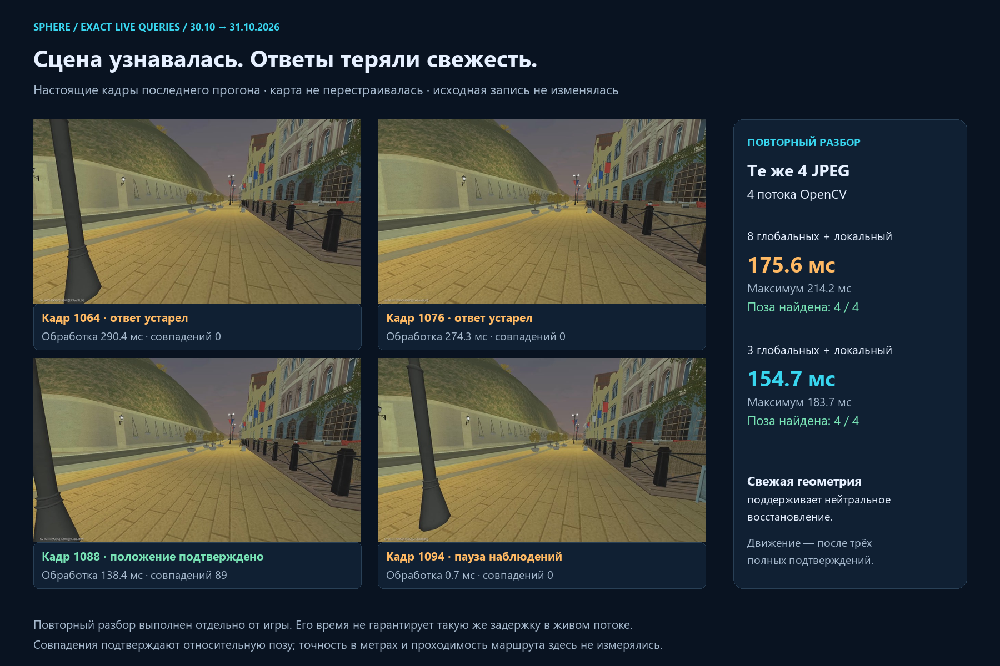

# Recovery timeout with fresh source frames

Date: 2026-10-31, Asia/Yekaterinburg. Investigated live run `5e6c6367196f4e4f9f2cdd67545c0952`, written on 2026-10-30 at 23:56:47. Baseline `3f0076db`; delivered client `walk_live_v6`.

## Actual evidence

This is the first investigated report from `walk_live_v5`, with the exact processor query-frame archive enabled. The original 299,471-byte scalar report and 1,415,765-byte ZIP were copied unchanged to `.local-pilot/walk-recovery-20261030-2358/` before analysis. The archive's geometry hash matches the current primary map.

The run lasted approximately 47.8 seconds and recorded 425 accepted browser observation samples. Stage totals count 440 HTTP replies and 446 JPEG preparations; some replies expired before entering sample history. There were 336 acknowledged stick commands, including neutral moves. Native input failure was null and release was `closed`.

At closure the newest source callback was sequence 1101, age 1.7 ms. The last processed answer was for sequence 1095, age 201.7 ms at its answer. Thus a fresh incoming video frame did **not** mean the corresponding localization had already completed. The stop was the follower's recovery timeout, not proof of a disconnected video stream or an obstacle.

The whole-run aggregates recorded 21 expired decisions, 46 neutral waits and 45 source callback gaps above 100 ms. Maximum source gap was 651.7 ms; maximum JPEG preparation was 600 ms; maximum HTTP round trip was 318.5 ms. These maxima are not one query and must not be added together. Existing data do not identify the cause inside the rare long worker/JPEG stalls.

The exact retained frames expose the final recovery sequence:

| Query sequence | Processor outcome | Processing time | Admitted inliers | Plan |
|---|---|---:|---:|---|
| 1064 | frame expired during localization | 290.4 ms | 0 | neutral recovery |
| 1076 | frame expired during localization | 274.3 ms | 0 | neutral recovery |
| 1085 | confirming geometry | 142.6 ms | 86 | neutral recovery |
| 1088 | localized geometry | 138.4 ms | 89 | neutral recovery |
| 1091 | localized geometry | 8.9 ms | 89 | neutral recovery |
| 1094 | observation gap | 0.7 ms | 0 | neutral recovery |
| 1095 | confirming geometry | 187.1 ms | 88 | stopped: recovery timeout |

Sequences 1085, 1091 and 1095 come from the scalar report; the other rows are present in the exact-frame archive. The source gap before 1094 reset localization confirmation again. The fixed two-second recovery episode then ended even though compatible geometry had recently been recovered. Zero admitted inliers on an expired answer mean that the result carried no usable pose; they do not establish that the scene had no matchable features.



## Reference count and visual smoothness

The primary map contains 174 cameras over approximately 50.35 seconds and 4096 selected localization landmarks. The saved-reference comparison is deliberately throttled to at most one update per second and selects real recorded timestamps. It will visibly step between images. It is not the live control source, the follower's next target or a 1 Hz steering loop.

In this run 425 browser samples over approximately 47.8 seconds are about 8.9 accepted observations/s. Optical-flow tracking solves current-image PnP between descriptor checks; the controller is not waiting for the next displayed reference image. Increasing saved camera count would not by itself fix this timeout, and could increase matching cost.

The pedestrian pilot also still bounds the stick to 35% and a run to 60 seconds. Its speed is therefore not expected to equal a full-stick original recording. Neither a completed repeat nor a tolerance of 1–3 metres is established here; map scale remains unknown.

## Implemented corrections

### Preserve a bounded local search after short delivery loss

After confirmation is lost, the tracker previously expanded every descriptor check from the ordinary three global candidates to eight, even when it retained a recent qualified local-reference hint. In the live episode this path sometimes exceeded the 250 ms image freshness budget and lost confirmation again.

The tracker now uses the ordinary global shortlist plus the recent local candidate while that retrieval hint is within its existing two-second lifetime. Cold/expired-hint recovery still uses the wider eight-candidate search. Current-image matching, exact subset matching, competing PnP, spatial support, pose discontinuity and corridor checks remain active. The hint neither supplies a pose nor authorizes movement. No source features or map bytes change.

`check_walk_recovery_frames.py` repeated matching on the last four exact archived JPEGs. Its hint was reference 33, taken from the preceding qualified archived frame, not from the query's known location. It varied native threads and candidate budgets without sending any game input. With four OpenCV threads:

| Offline run | Eight global candidates plus local hint | Three global candidates plus local hint |
|---|---:|---:|
| First comparison, mean | 172.2 ms | 144.4 ms |
| First comparison, maximum | 204.7 ms | 157.7 ms |
| Second comparison, mean | 175.6 ms | 154.7 ms |
| Second comparison, maximum | 214.2 ms | 183.7 ms |

All four queries found a pose in both variants. In the second comparison, three estimated positions were identical; the remaining centre differed by approximately 0.00138 map units. This is agreement between solvers, not independent metric ground truth. Offline measurements do not guarantee the same timings under live browser/emulator load. Four threads remain selected; one and two threads did not establish an advantage on these samples.

### Let fresh compatible geometry sustain neutral acquisition

The two-second timer now measures the absence of fresh compatible geometric evidence during recovery. A current confirming/localized pose can refresh that **neutral waiting** timer only if it has at least 24 inliers, valid rotation/position, acceptable corridor distance and continuity with the last qualified pose/progress.

Confirming evidence never resumes movement, never contributes to the three required localized confirmations and never resets the six-second aggregate recovery budget. Incompatible, malformed, weak or stale evidence cannot extend the idle timer. Blank scenes still time out; the total neutral budget still terminates repeated unsuccessful acquisition. The movement permit remains 250 ms.

Tests reproduce recovery lasting more than two wall-clock seconds while compatible current geometry continues to arrive, followed by three localized confirmations. They also verify termination with incompatible evidence and termination at the total budget despite ongoing confirming geometry. This is a control-state regression, not a replay of the sparse 2 fps image archive as though it were the original full live stream.

### Stop losing intermittent failures in scalar report reduction

The uploaded scalar summary retained only 213 of 425 observations after size reduction. The old every-other-row reduction removed the intervening failures in this particular stream, leaving only successful/confirming geometry in that subset. The exact processor archive preserved the missing expired/gap evidence.

The reducer now removes routine localized-following samples before loss, waiting and stop samples. If further reduction is required, it reduces the native tail and preserves state boundaries where possible before the final hard size cap. It does not mutate the full browser archive. The 480 KiB upload limit and bounded retention remain in place.

Added whole-run stage aggregates for encoder capture, worker round trip, JPEG and hashing **before** testing query freshness. A late encoded reply therefore contributes timing evidence even when it is discarded for control. This will separate encoder work from worker scheduling/transport delay on the next rare long stall.

## Verification and local delivery

- **134 frontend tests**, 13 suites.
- **160 Python tests**, 60 subtests; one optional-video dependency skip.
- Actual-image descriptor comparison: 24 cases per run, four exact JPEGs × three thread budgets × two search budgets; all pose solutions found. No Android input was sent.
- Production build, type checking and scoped image probe passed. Two pages, 31 assets and both worker hashes were checked before replacing only the review UI.
- Local processor reloaded through its existing watchdog; existing video, geometry and navigation files retained their verified hashes. No APK update, game command or scene rebuild was needed.

The panel displays `walk_live_v6` after a page refresh. Old live-start clients receive a direct version/reload message before opening input. A smoother complete live run after these corrections is still unverified.

[Machine-readable evidence](walk-recovery/delivery-evidence.json) records source hashes, original evidence hashes, test results, descriptor measurements and deployment receipts. The raw diagnostic originals remain in the local bounded workspace.

Reproduce the bounded image comparison and board from the repository root:

```powershell
.local-pilot/motor-worker-venv/Scripts/python.exe -m scripts.pilot.check_walk_recovery_frames --job .local-pilot/reconstruction-jobs/b861ac82fcd64425bc583b37f620ba2a --archive .local-pilot/walk-recovery-20261030-2358/5e6c6367196f4e4f9f2cdd67545c0952.zip --output .local-pilot/new-recovery-cost
.local-pilot/motor-worker-venv/Scripts/python.exe -m scripts.pilot.render_walk_recovery_evidence --archive .local-pilot/walk-recovery-20261030-2358/5e6c6367196f4e4f9f2cdd67545c0952.zip --cost .local-pilot/new-recovery-cost/report.json --output .local-pilot/new-recovery-board
```
