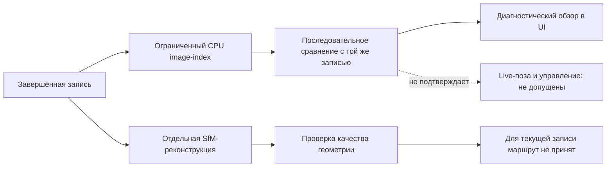
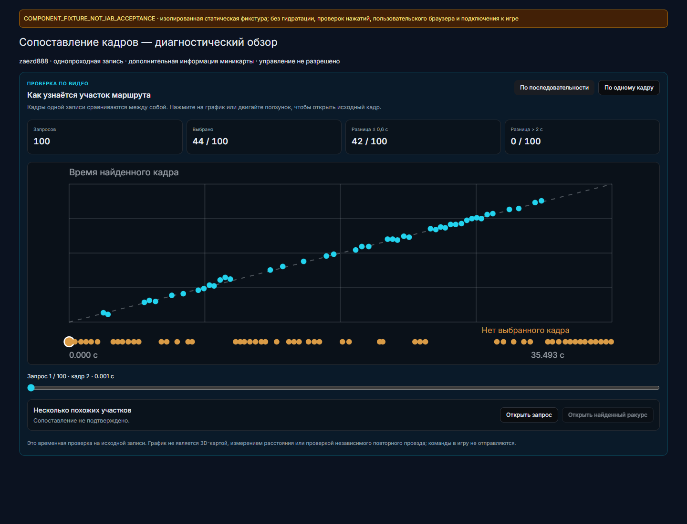
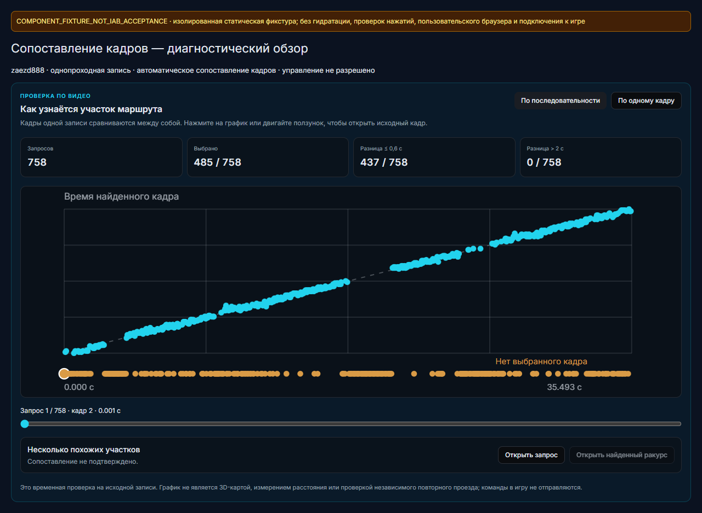

# Image-only replay `zaezd888`: эксперимент и локальная поставка

Проверен отдельный визуальный способ предлагать опорные кадры без принятой глобальной 3D-траектории. Результаты получены **на той же записи**, из которой выбраны опорные кадры. Близость временных меток используется как проверочный proxy, а не как независимая истина о месте или позе. Ни один опыт здесь не подтверждает позицию, расстояние, достижение цели или готовность автоматического управления.

Первоначальный вручную опубликованный source-bound результат `zaezd888` содержал 100 выборочных кадров, 169 опорных меток и дополнительный признак миникарты. Позже общий автоматический **world-only** построитель в отдельной проверке той же записи дал 143 опоры и 758 выборочных кадров; этот результат опубликован в задаче `zaezd888`, прежний fused-результат сохранён в истории. Результаты двух конфигураций не взаимозаменяемы; новая обработка не подтверждает качество на других записях или обработку `skuter1`. Артефакты предназначены только для offline-проверки: `position_confirmed`, `arrival_confirmed` и `execution_qualified` равны `false`. Сервер сверяет хеш и манифест с исходной записью и проверяет индексы и временные метки по `frames.jsonl`. [Новая публикация](image-route-evidence/generic-publication-v3.json), [её данные](image-route-evidence/published-generic-review.json), [историческая публикация](image-route-evidence/publication-fused.json), [её данные](image-route-evidence/published-review.json).

Сплошные стрелки показывают реализованные этапы обработки и просмотра, а не доказанную точность дороги или завершённость движения. Live-поза, безопасность и команды управления этим обзором не подтверждаются.

## Поиск и последовательность

В исходной пробе извлечены 169 опорных ракурсов и проверены 100 query из той же записи; все 901 исходный кадр декодированы. На proxy-критерии ±0,6 с одиночный поиск дал 70 попаданий из 100 и восемь случаев с высоким score и расхождением более 2 с; score не является калиброванной вероятностью. Ближайшие ±0,15 с исходного времени исключались из сопоставления. [Сводка](image-route-evidence/retrieval-summary.json), [покадровые измерения](image-route-evidence/query-metrics.json).

Строгий причинный последовательный фильтр выбрал лишь 5 из 100 кадров; все пять оказались внутри ±0,6 с по тому же proxy. Остальные — `unknown` или `ambiguous`, а не успешные распознавания. Другая конфигурация beam на тех же world-признаках выбрала 43/100, из них 35 внутри ±0,6 с; обратный порядок той же последовательности дал 42 выбора, из них два с ошибкой более 2 с. Обратный порядок — искусственный контроль, не повторный проезд. [Строгая последовательность](image-route-evidence/causal-strict-summary.json), [beam](image-route-evidence/beam-world-summary.json).

Добавление ограниченного признака миникарты для этого конкретного клипа изменило одиночный результат 70→83 попадания и 8→1 сильных расхождений по тому же времени. В опубликованном beam forward выбрано 44/100, из них 42 внутри ±0,6 с; reverse — 42/100, из них 39 внутри ±0,6 с и один с расхождением более 2 с. Остальные случаи остаются отказами от выбора. Данные миникарты необязательны, зависят от конкретного HUD и не являются независимым ground truth; успешность на другом интерфейсе, маршруте или повторном проезде не установлена. [Сравнение](image-route-evidence/minimap-fusion-summary.json), [production-beam replay](image-route-evidence/production-beam-summary.json).

## Относительная цель и проверка с заданным темпом

Двухкадровая оценка возвращает только относительное направление камеры без масштаба, ориентацию без переноса либо `unknown`; физическая калибровка и связь оси камеры с транспортом не подтверждены. Из четырёх намеренно неправильных raw-сопоставлений три дали `unknown`, но одно всё же вернуло `goal_direction` при временном расхождении 7,02 с. Это конкретный ложноположительный отрицательный контроль: успешное геометрическое решение само по себе не доказывает правильного места или направления движения. [Пары и результаты](image-route-evidence/relative-goals-report.json).

Отдельный open-loop replay подавал все 901 кадр в темпе исходных PTS через одну перезаписываемую ячейку без очереди. Обработаны 312 кадров, 589 заменены более свежими до обработки; первый и последний исходные индексы — 0 и 900. На обработанных кадрах p50/p95 возраста результата составили 132,5/187,0 мс, максимум 219 мс; 149 получили выбор reference, из них 138 находились внутри ±0,6 с по тому же proxy и ни один не имел расхождения более 2 с. Знаменатель — **все 312 обработанных**, не 901; пропущенные кадры не считаются успехом. Это измерение одного локального прогона без ответа среды и без физических действий, не гарантия скорости живого устройства. [Сводка](image-route-evidence/paced-replay-summary.json), [покадровый журнал](image-route-evidence/paced-replay-frames.jsonl), [режим](image-route-evidence/paced-replay-intent.json).

## Поставка и ограничения проверки интерфейса

Первоначально был установлен веб-образ `sha256:098f260ec33e45925413ff7e84a6e6cdd5de3946e33f804a85713b1d4171b420`; квитанция фиксирует healthy UI, два документа, 31 ресурс и совпадение хешей ресурсов и workers. Исходный набор сборки до и после имел одинаковый SHA; сборка заняла 79,484 с. Это проверка поставки, а не приёмка взаимодействия в пользовательском IAB. Более поздняя версия описана ниже. [Сборка](image-route-evidence/ui-build.json), [образ](image-route-evidence/ui-image.json), [установка](image-route-evidence/ui-install-receipt.json).

Первая проверка установки остановилась до замены UI из-за несовпадения порядка массива `Mounts`; исходный UI не был заменён. Отдельная проверка восстановила исходные полные хеши перестановкой порядка без удаления значений; второй probe с тем же образом завершился успешно. [Первая остановка](image-route-evidence/ui-probe-first-failure.json), [проверка порядка](image-route-evidence/ui-probe-order-proof.json), [второй probe](image-route-evidence/ui-probe-v2.json).

При первом обновлении API выполнен ограниченный перезапуск проверенной цепочки процессов под прежним watchdog. Перед ним файловые состояния заданий и подготовки были терминальными; **наличие live-сеанса в старом процессе осталось неизвестным**, поскольку старый интерфейс это не раскрывал. После обновления health сообщил `image_route_review_contract=source_bound_offline_v1` и `live_session_active=false`, запрос к артефакту без capability получил 403, а хеши 122 защищённых файлов и образ UI не изменились. Новый health-флаг проверяет только состояние на момент запроса. Более поздний перезапуск описан ниже. [Предварительная проверка](image-route-evidence/api-reload-precheck.json), [квитанция перезапуска](image-route-evidence/api-reload-v2.json).

Проверка пользовательского IAB не выполнена: доступ к браузеру был отключён настройками среды. Доступность установленного bundle и проверка артефакта на диске не подтверждают, что конкретная запись в OPFS выбрана пользователем или что весь интерфейс работает на его устройстве. Устаревший кадр или неоднозначность последовательности должны оставаться отказом от выбора, а не разрешением движения.

## Автоматическая подготовка: фактическая проверка

Первый запуск через настоящий hook и обычный CPU-подпроцесс завершился `KeyError: sha256`: манифест v2 содержит хеши отдельных access units, а не обязательный общий хеш файла видео. Успешного артефакта он не создал; после необязательного отказа был достигнут тестовый SfM sentinel. Этот результат сохранён, а не заменён последующей успешной попыткой. [Квитанция отказа](image-route-evidence/first-trial-trial-receipt.json), [результат worker](image-route-evidence/first-trial-worker-result.json), [лог builder](image-route-evidence/first-trial-builder-worker.log).

После исправления проверки access units второй изолированный запуск того же hook и обычного CPU-подпроцесса завершил подготовку за 94,719 с по worker-часам; общая квитанция с контрольными суммами — 95,141 с. SfM в этом испытании был **заглушён**, поэтому опыт проверяет hook и builder, а не полный новый SfM pipeline. Получены 143 опоры и 758 запросов: 485 выбранных, 273 `unknown`/`ambiguous`; 437 из всех 758 попали в ±0,6 с по same-video proxy, расхождений более 2 с среди выбранных — ноль. Кэш составил 16 554 936 байт, пик наблюдаемой совокупной working set — около 278 MiB, минимум свободной ОЗУ — около 9,35 GiB. Источник и связанный вручную fused-результат сохранили хеши; GPU и устройство не использовались. [Квитанция](image-route-evidence/r2-trial-trial-receipt.json), [результат](image-route-evidence/r2-trial-worker-result.json), [лог](image-route-evidence/r2-trial-trial-worker.log).

Пределы builder — до 240 опор и 1 024 запросов; на длинной записи до 600 с и при причинном ограничении промежутка наблюдений 0,5 с последовательность может часто отказываться от выбора. Из этого запуска нельзя обещать устойчивую обработку или локализацию всего маршрута длительностью 8–10 минут. Проверки на независимом повторном проходе пока нет.

На промежуточном состоянии прошли 25 проверок workspace и 34 frontend-теста; после исправления гонки `404 → ready` прошли 36 frontend-тестов в трёх наборах. Итоговый прогон в motor runtime с Python 3.12.12 и PyAV 17.1.0 дал 209 passed, 1 skipped и 48 subtests, Python lint v3 чистый. Для builder отдельно повторены 27 тестов в motor runtime с PyAV: 27 passed и одно предупреждение о неиспользуемой pytest-конфигурации. Эти пересекающиеся прогоны не складываются. Продуктовый код зафиксирован в `3b102ee9`; это не коммит настоящего отчёта. [Workspace](image-route-evidence/automatic-workspace-tests.txt), [frontend после исправления](image-route-evidence/final-frontend-v3-tests.txt), [motor runtime](image-route-evidence/final-motor-runtime-tests.txt), [builder PyAV](image-route-evidence/builder-pyav-tests-v2.log), [квитанция](image-route-evidence/builder-pyav-tests-v2.json), [lint](image-route-evidence/final-new-python-lint-v3.txt).

Ниже — изолированная статическая SSR-фикстура компонента с вручную опубликованными 100 результатами этой записи. Проверка нажатий и hydration не выполнялись; это не снимок пользовательского IAB. [Квитанция фикстуры](image-route-evidence/component-fixture-receipt.json).

Следующая фикстура показывает уже опубликованный общий world-only результат 143/758. Она создана до последнего исправления polling в интерфейсе и показывает тот этап исходников; это не подтверждение финальной версии приложения. Фикстура статическая, без hydration и проверки нажатий; это не приёмка пользовательского IAB. [Квитанция](image-route-evidence/component-fixture-v3-receipt.json).

Следующим был установлен веб-образ `sha256:07447e45d8b58e7329cb5aac33f3a299772750abc7386566046f9a1c021ae1cb`; его исходный набор с SHA `cd54bd006c06b5bb39ecc4994414446e5bf77a129cf6872c6979c814f39c236f` не изменился во время сборки 76,437 с. Отдельный probe и квитанция подтверждают ту поставку. API перезапущен в PID 50304: health сообщает `image_route_preparation_contract=bounded_cpu_before_sfm_v1`, live=false, защищённые файлы не изменились. [Сборка v2](image-route-evidence/ui-build-v2.json), [образ v2](image-route-evidence/ui-v2-image.json), [установка v2](image-route-evidence/ui-v2-install-receipt.json), [probe v2](image-route-evidence/ui-v2-probe.json), [API](image-route-evidence/api-reload-v3.json).

После исправления гонки установлен образ `sha256:05552b04a203620f66392a8052889769c57592cc83cd613dbeee38f5bc5a8f6d`; проверка контейнера показала running/healthy. Сборка заняла 77,609 с, хеш исходного набора `e60cc4d3df9bb9b683e1258be94699dcf0aaf341262efd032aadf308e6ec16f3` до и после одинаков. Probe и установка подтвердили 2 страницы, 31 ресурс и совпадение workers; пользовательская IAB-приёмка не выполнена. [Сборка v3](image-route-evidence/ui-build-v3.json), [образ v3](image-route-evidence/ui-v3-image.json), [probe v3](image-route-evidence/ui-v3-probe.json), [установка v3](image-route-evidence/ui-v3-install-receipt.json).

## Воспроизводимость

[Индекс](image-route-evidence/index.json) связывает побайтовые копии отчётов и снимков исходного кода с SHA-256 оригиналов. Видео, изображения исходных кадров, caches, веса и модели не включены; поэтому архив сам по себе не позволяет повторить расчёт. Исторические исследования геометрии и другие ограничения записаны в [журнале траектории](SCOOTER-TRAJECTORY-EXPERIMENTS.md).
