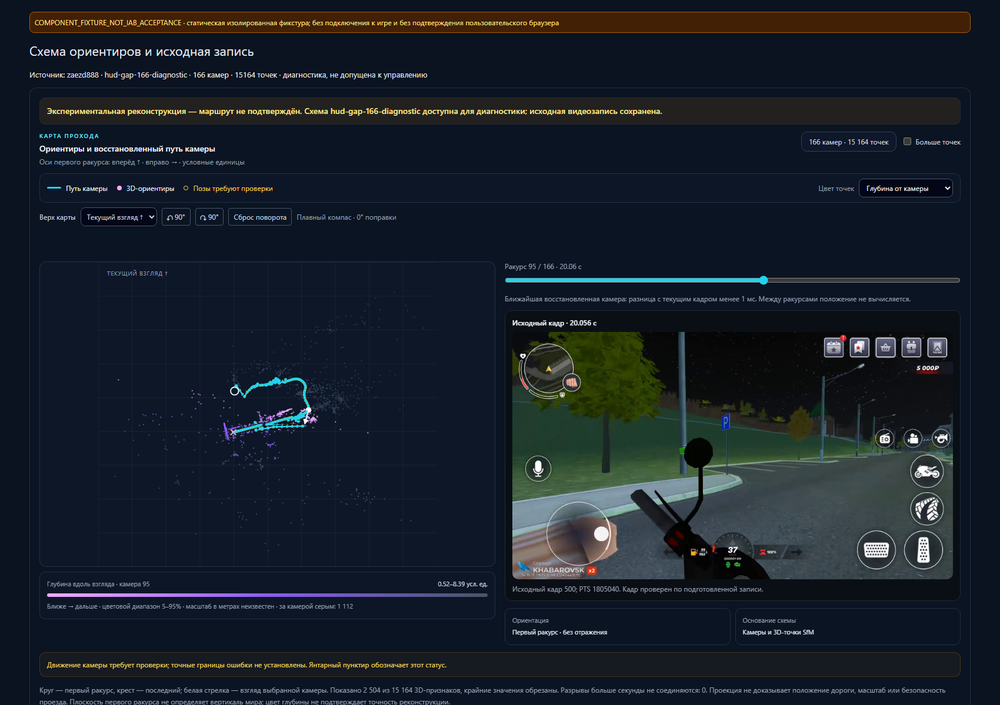

# Просмотр диагностической реконструкции: поставка 1 ноября 2026

Обновлённый локальный веб-интерфейс установлен и отвечает. В каталоге связанного задания опубликована рекомендованная **диагностическая** схема `hud-gap-166-diagnostic`: 166 камер и 15 164 точки. Она связана с исходным манифестом `zaezd888`; локальное переименование записи не меняет эту привязку. Запись `skuter1` к этой схеме не относится. Рекомендация помогает открыть схему для просмотра и не допускает её к управлению. Основная карта задания не заменена.

Интерфейс сначала выбирает подтверждённую готовую основную карту. Если её нет, он может выбрать только явно рекомендованную сервером альтернативу; без такой рекомендации оператор выбирает схему сам. Ручной выбор сохраняется при обновлении списка, а название, идентификатор и размеры схемы показаны на экране. Кнопка «Обновить результаты» перечитывает каталог и выбранную геометрию без сброса исходной записи. Привязка геометрии к SHA манифеста и временным меткам проверяется до отображения.

Независимая проверка выявила ошибку предыдущего варианта: после выбора пустого пункта старая карта могла оставаться видимой без диагностического предупреждения. В v2 снятие выбора очищает карту и источник, отменяет актуальность ожидающего ответа и не восстанавливает рекомендацию при следующем обновлении. Это покрыто интеграционным тестом, включая запоздавший ответ.

## Что подтверждено

- Установлен образ `sha256:cbd6374c9f1c5ffda6ba22bd6f52eae54e5ed4b5c5456a74b939201c9c033ef5`. Квитанция установки сообщает healthy UI, совпадение хешей 31 ресурса и двух worker-ресурсов, два проверенных документа и сохранность остальных контейнеров. Отдельная проверка подтвердила наличие нового bundle. Это проверка поставки, не полный функциональный проход в браузере. [Установка](route-review-evidence/install-receipt.json), [проверка](route-review-evidence/probe5.json), [образ](route-review-evidence/image.json).
- Перезапущенный локальный API сообщил `alternative_catalog_contract: source_bound_review_v1`; квитанция фиксирует PID 12316, 63 проверенных ресурса и отсутствие физических действий. Каталог отдаёт опубликованную рекомендацию, связанную с манифестом и геометрией. [API](route-review-evidence/runtime-reload.json), [публикация](route-review-evidence/publication.json).
- Сборка завершилась успешно за 51,406 с; хеш исходного набора до и после одинаков: `41a02003dc7f0d164cc2a14a64226fda4543fb1ca801f7a397fbfb72e1b3579a`. Сборочная квитанция отдельно не утверждает установку; установка подтверждена указанной выше квитанцией. [Сборка](route-review-evidence/build.json).
- Общий frontend-регресс: **69 тестов, 8 наборов**, 6,299 с; отдельный прогон `teaching-review` — 17 тестов, TypeScript прошёл. Эти 17 входят в 69 и не прибавляются к ним. [Сводка](route-review-evidence/frontend-regression.json), [лог](route-review-evidence/frontend-regression.log), [отдельная проверка](route-review-evidence/frontend-checks-v2.json), [лог](route-review-evidence/frontend-checks-v2.log).
- В выводе инструмента зафиксирован результат backend-прогона: **38 тестов и 9 subtests**, 5,53 с. Отдельный сырой лог не сохранялся; команда, происхождение результата и хеши файлов, снятые при оформлении, приведены в [квитанции наблюдения](route-review-evidence/backend-observed.json).

## Границы результата

166-камерная схема остаётся неподтверждённой: улучшение отдельного проблемного интервала не устранило проблемы всей траектории. Проверенная 172-камерная альтернатива показала худший результат и не принята. Наличие карты, большое число точек и предложение схемы в каталоге не доказывают точность положения, масштаб, проходимость или готовность автоматического проезда. Подробности предыдущих экспериментов сохранены в [историческом отчёте](SCOOTER-HUD-FUSION.md).

Снимок ниже — **COMPONENT_FIXTURE_NOT_IAB_ACCEPTANCE**: изолированный SSR настоящего `RouteGeometryMap` с опубликованной геометрией и исходным кадром 500 на 20,056 с. Эффект рисования canvas воспроизведён в фикстуре; использованы CSS предыдущей изолированной проверки, а не подтверждённые CSS текущей установки. Интерактивность, каталог `TeachingReview` и пользовательский IAB этим снимком не проверялись. [Квитанция фикстуры](route-review-evidence/component-fixture.json).

Пожелания по будущему накоплению опыта и обучению приложения рассматриваются как отдельное направление; эта поставка не реализует автоматическое обучение или подтверждённую автономную навигацию. Индекс копий и хешей: [index.json](route-review-evidence/index.json). Исходные видео, локальные базы и полные машинные JSON тестов в пакет не включены.
