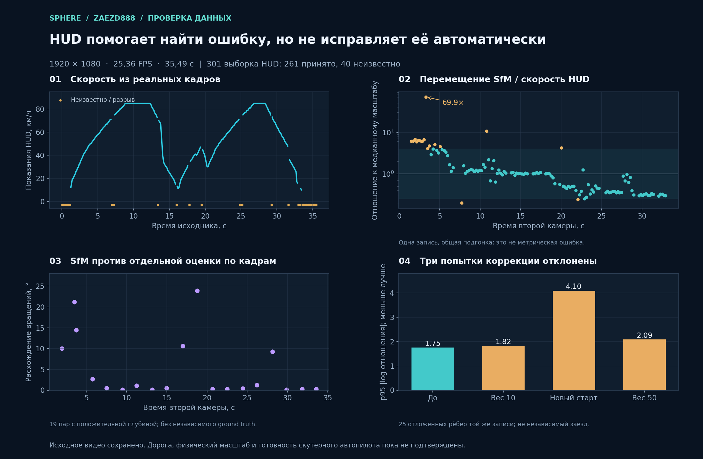
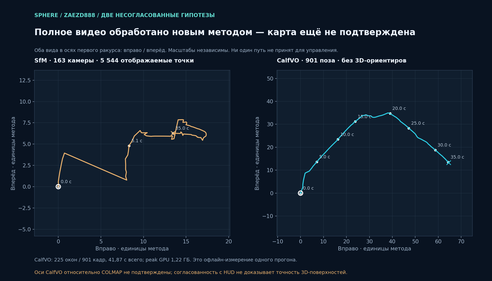
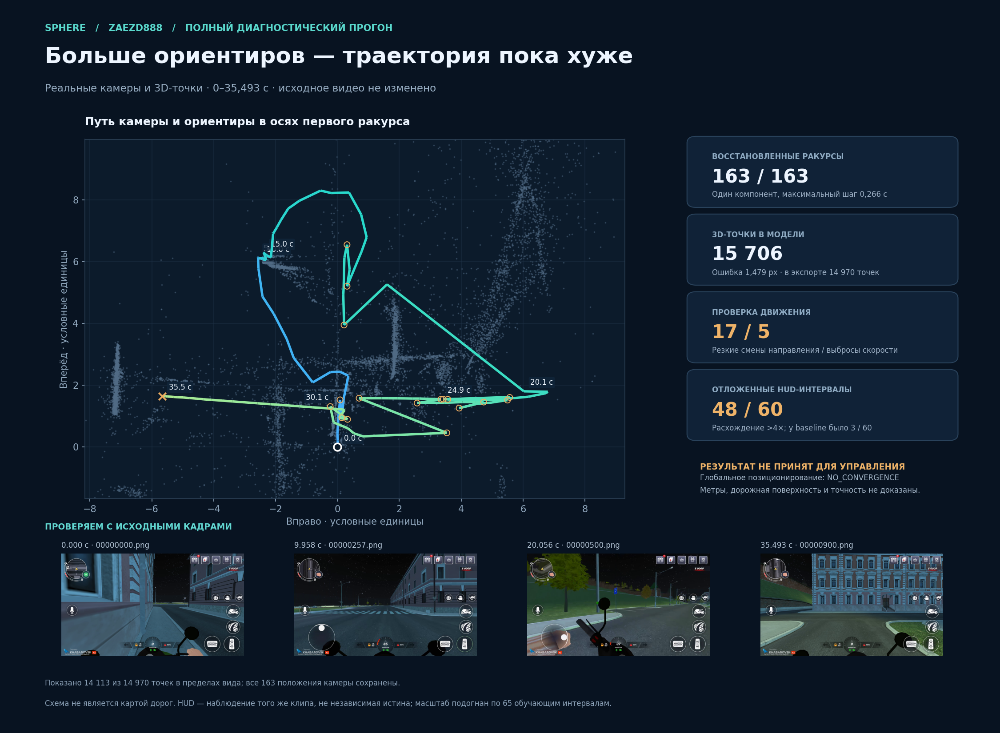
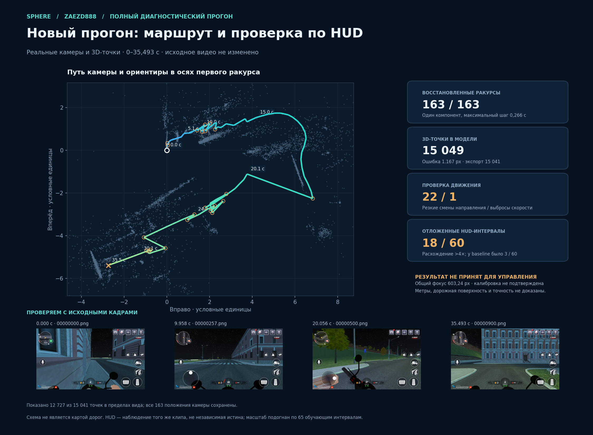
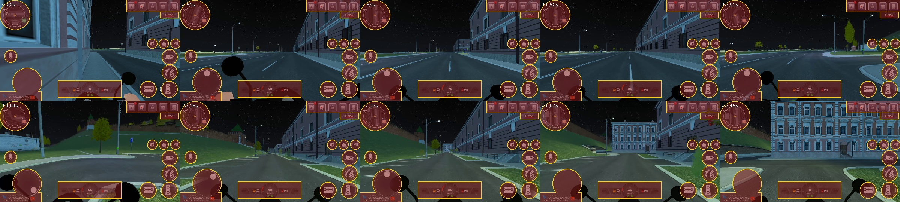
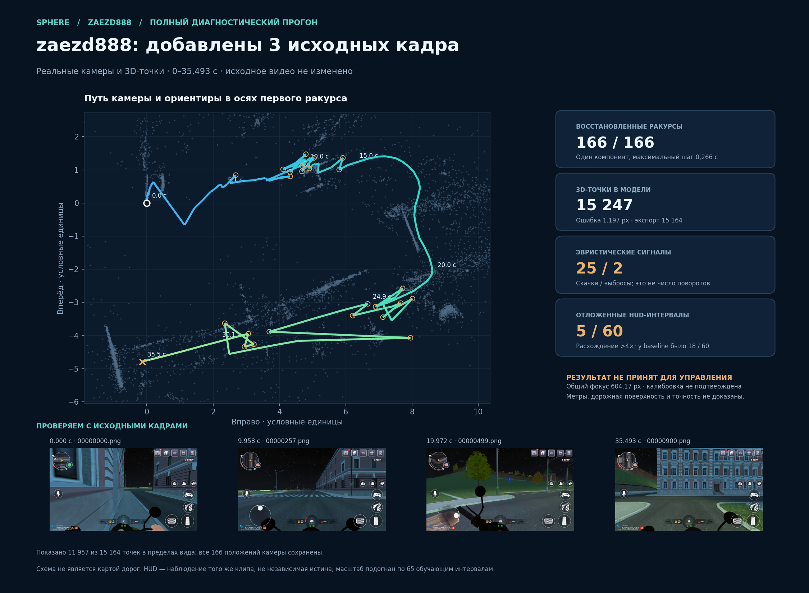
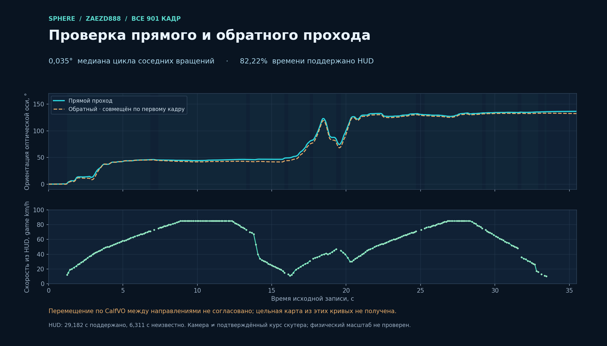

# Заезд `zaezd888`: HUD и диагностическая реконструкция скутера

Дата: 2026-11-01. Веб установлен на `http://127.0.0.1:3015`, API перезапущен с `route_camera_pipeline=vehicle_geometry_v3_hud`. Это исследование записи **`zaezd888`**, не `skuter1`. Повторно прочитаны 13 локальных manifest: записи с точным названием `skuter1` среди них нет ([квитанция](scooter-hud-evidence/capture-source-inventory.json), [хеши прочитанных manifest](scooter-hud-evidence/skuter1-manifest-scan.json)); browser IAB сейчас недоступен, поэтому OPFS и другие источники этим поиском не проверены. Автономный маршрут не готов.

## Исходник и ограничения

Запись `zaezd888`, job `c667f86cc9de4a378fb12e5269981a6e`: 901 кадр, 1920×1080, H.264, от 0 до 35,493 с; средняя частота по 900 интервалам ≈ 25,357 кадров/с. Временные интервалы следует брать из timestamps, а не предполагать постоянную частоту. SHA-256 manifest: `67e22e330837646e4f0d3b0ab95895371f79136c54bd8c1b0014478aa8c3d417`; SHA-256 видео: `0feaeae732c30d2f25ff1359f276f78f53ed029538243ac1b42ae1537192df1e`. Эксперименты не меняли исходник и не выполняли действий на устройстве.

## Одна запись с HUD — основной сценарий

Для следующих скутерных записей основной сценарий — **один неизменный master с HUD**. Для геометрии маски применяется к отдельному входу извлечения признаков; HUD читается из исходного кадра отдельно. Запись без HUD и другая запись с HUD не требуются как обязательная пара. Второй добровольный проход полезен для независимой проверки, освещения и дополнительных ракурсов; его нельзя требовать воспроизвести с теми же координатами, скоростью и таймингами или склеивать по равным номерам кадров.

| Наблюдение | Что действительно доступно сейчас |
| --- | --- |
| Отображаемая скорость | Ограниченный source-bound OCR текущего двухзначного HUD; неизвестные интервалы сохранены. 100+ пока не поддержано, см. ограничения выше |
| Газ и тормоз | По одной скорости однозначно не восстановить: мешают инерция, уклон, столкновения и другие причины. При управлении из эмулятора web input log не даёт эти касания |
| Стик | Его положение может быть видно в HUD, но надёжное распознавание его направления/усилия в этом пакете ещё не реализовано |
| Миникарта | Экспериментальные соответствия с разрывами; не абсолютные координаты и не подтверждённая траектория |
| Будущее управление | Требуется обратная связь по текущим положению, курсу и скорости. Записанный профиль движения — ориентир, а не слепой повтор клавиш |

## HUD OCR

Пресет для этого расположения использует область `rgb[931:969, 920:1000]`. Sidecar с шагом 3 кадра содержит 301 выбранный кадр: 261 принято, 40 неизвестно; остальные кадры не классифицировались. Единица — отображаемые игрой `game_hud_kmh`, а не независимо проверенный физический масштаб. Свидетельства: `.local-pilot/scooter-hud-20261101/ocr-receipted-step3.csv.receipt.json`, `job-sidecar-receipt.json` и `reconstruction-jobs/c667f86cc9de4a378fb12e5269981a6e/telemetry/`.

Отдельная ручная проверка 31 кадра (`independent-validation.csv`) показывает 26 совпадений и 5 неизвестных, не обнаруживая ошибочно принятых среди этих 31; это ограниченная выборка, не гарантия на всём клипе. Таблица `heldout-validation.csv`, несмотря на историческое имя, содержит **60 калибровочных** кадров: 51 совпадение и 9 неизвестных. На них выбирался фильтр, поэтому это не независимая проверка. Высокая OCR confidence сама по себе не доказывает корректность показания. Неизвестные интервалы не интерполируются в графике. Основной сценарий — одна HUD-запись; вторая запись может быть дополнительной проверкой и не предполагает покадрового совпадения. По одной скорости нельзя надёжно различить газ, тормоз и движение накатом; показания ≥100 в текущем OCR остаются `unknown`.

Фильтр намеренно принимает только две ASCII-цифры с confidence ≥50 и отдельно отбрасывает неоднозначное `14` (наблюдалось смешение с `74`). Однозначные числа, `0` и скорости ≥100 сейчас остаются неизвестными; это ограничение распознавания, а не отсутствие движения или остановка. Пресет привязан к текущей раскладке HUD и 1920×1080. Он ещё не универсален для другого масштаба интерфейса.

Статус sidecar в момент изолированного рендера: 301 элемент, 260 числовых samples и 41 null, при исходных счётчиках 261/40; дополнительный null с `gap_before=true` отражает разрыв. Поэтому график показывает 260 точек при счётчике 261: счётчики относятся к исходным показаниям OCR, а график консервативно разрывает соединение через временной пробел.

## Автоматический путь обработки

Новая запись с выбранным пресетом Black Russia сохраняет `hudProfile=black_russia_scooter_v1`. При обычном запуске обработки реконструкция владеет отдельным CPU-процессом OCR. Он ограничен 90 секундами, шагом 3 кадра и одним потоком Tesseract; GPU-модель не загружается. Отмена и ошибка реконструкции освобождают дочерний процесс. Сбой необязательного HUD не должен прерывать независимую реконструкцию. Повторное чтение статуса не запускает OCR повторно. Веб продолжает опрос, если реконструкция уже завершилась, но OCR ещё работает.

Существующий `zaezd888` обработан отдельно на неизменном исходнике: проверенный sidecar связан с тем же job и manifest. Исходный manifest не переписан ради добавления нового поля. Пеший профиль, generic vehicle и запись с объявленным скрытым HUD не получают этот OCR автоматически. CSV, receipt и временные метки проверяются перед выдачей графика; кэш ограничен 32 сводками и не используется для управления.

## Миникарта

Покадровая регистрация Sim(2) в HUD-пикселях приняла 773 из 900 переходов, 127 оставлены разрывами. Накопленный масштаб дрейфует; это не метрическая траектория. ECC Euclidean проверял переходы другим методом: первая проверка дала 96 кандидатов из 127, после маски ярких/цветных элементов и согласования двух пространственных разбиений осталось 15 кандидатов. Из 51 контрольной пары тот же строгий фильтр принял 20, поэтому чувствительность низкая. У 15 кандидатов медиана ошибки цикла 0,635 px, расхождения разбиений 0,267 px. Общие изображения, возможный статичный HUD, отсутствие ground truth и модели zoom не позволяют считать эти кандидаты гарантированными связями. Результаты: `.local-pilot/scooter-minimap-20261101/{report.json,ecc-trial.json,ecc-partition-trial.json}`. Разрывы глобально не сшиты.

## Совместные bundle-эксперименты

Три варианта использовали 163 камеры, 2 400 точек, 29 332 наблюдения и масштаб, подогнанный по обучающим рёбрам этой же записи. Предположение о связи скорости HUD со скоростью камеры и фиксированные image-derived rotations/intrinsics не доказывают физическую метрическую шкалу. Все три отчёта содержат `accepted: false`; их результаты не заменяют исходную геометрию.

| Вариант | Основное наблюдение | Решение |
| --- | --- | --- |
| v1, вес 10 | Средняя ошибка изображения 1,072→1,139 px; p95 абсолютного log ratio скорости на 25 отложенных рёбрах 1,751→1,825; выброс около 3,318 с остаётся | Отклонён |
| v2, speed initialization и forward assumption | Средняя ошибка 1,072→15,719 px; 643 наблюдения за камерой; held-out p95 1,751→4,100 | Отклонён |
| v3, вес 50 | Средняя ошибка 1,072→1,460 px; held-out p95 1,751→2,090; остаются временные выбросы | Отклонён |

Первоначальные наблюдения и результаты: `.local-pilot/scooter-fusion-20261101/speed-bundle-v{1,2,3}/report.json`. Наличие невысокой ошибки проекции не устраняет проблемы траектории. Никакие из вариантов не являются подтверждённой коррекцией маршрута.

## Отдельная проверка вращений

В 21 заранее выбранной паре сравнили относительные вращения SfM с новой оценкой LK → essential matrix → recoverPose на тех же исходных кадрах. Две пары имеют нулевую поддержку cheirality и считаются неудачами. На остальных 19 медиана расхождения 0,48°, шесть пар расходятся более чем на 5°, пять — более чем на 10°. В интервале 3,318–3,535 с SfM даёт 20,57°, а новая оценка — 0,67°; полное расхождение вращений 21,22°. Эти описательные пороги не являются критерием допуска.

Привязка проверена: все 163 камеры совпали с source index, timestamps, access-unit SHA и PNG SHA в сохранённой подготовке; все 41 декодированный кадр этой выборки попиксельно совпали с соответствующими PNG. Это исключает ошибку индексации в данном сравнении, но не делает оценку LK независимой истиной: запись и калибровка общие, вырождение essential matrix всё ещё возможно. Нельзя безусловно сохранить все вращения SfM и исправлять только центры камер. Свидетельства: `.local-pilot/scooter-yaw-20261101/{report.json,binding.json,README.md}`.

## Проверка фокуса, инициализации и числа кадров

Входной граф глобальной реконструкции — `world-filtered-v2`: SIFT, до 8192 кандидатов и максимум 1024 после маски, LightGlue и повторная фильтрация HUD. Это не отдельная база `dense-tracks`, где GFTT/LK отслеживает 901 реальный кадр. На изображениях 1920×1080 проверены фиксированные f=604,43 / 960 / 1280, то есть гипотезы горизонтального FOV 115,61° / 90° / 73,74°. Все варианты связали 163/163 камеры, но все отказали проверке движения.

Для f=960 согласованность с HUD лучше: на одинаковых 125 интервалах после подгонки по первым 65 и оценки следующих 60 медиана |log ratio| меняется с 1,192 до 0,427; число отклонений более ×4 — с 10 до 3. Это проверка масштаба на части той же записи, не независимая калибровка или доказательство правильных поворотов. Гипотеза f=1280 дала 0,920 и 20/60 выбросов. Свидетельство: [intrinsics-comparison.json](scooter-hud-evidence/intrinsics-comparison.json).

Два настоящих инкрементальных SfM с разными начальными парами и без длинных связей дали компоненты 71 и 70 камер без пересечения: 3,318–18,771 с и 20,271–35,242 с. Между ними 1,5 секунды; исходное начало и конец не покрыты. Совместить их через Sim3 и выдать общий путь нельзя. Это сравнение начальных пар, а не принудительный хронологический проход COLMAP.

Короткие интервалы действительно сохраняют больше соответствий. Например, около 3,318 с на интервалах 34/67/133/217 мс остаётся 161/58/19/15 устойчивых GFTT/LK-точек. Разделение слабых промежутков в экспериментальном [route_overlap_sampling.py](../../../scripts/pilot/route_overlap_sampling.py) добавило 52 настоящих кадра: 163→215. Суммарная длительность промежутков, не прошедших этот же тест перекрытия, уменьшилась с 5,890 до 0,366 с. Последние шесть слабых промежутков уже состоят из соседних исходных кадров. Увеличение числа поддержанных интервалов 135/162→208/214 не является измерением точности поз: интервалы и знаменатель изменились, а критерий общий для отбора и оценки.

**Полный пересчёт по 215 кадрам ухудшил результат.** Получены 8397 точек, reprojection 1,282 px, но на тех же 125 HUD-интервалах P90/P10 масштаба ухудшился 8,53→111,68, а отложенный score 0,427→2,029, выбросы ×4 — 3/60→43/60. Поэтому экспериментальный отборщик не подключён к основной обработке, новый результат не заменяет карту. Дополнительные ракурсы одновременно меняют временной граф сопоставлений; это не чистый эксперимент «меняется только число камер».

## Готовый альтернативный инструмент: CalfVO

Подготовлен и реально запущен [CalfVO](https://github.com/VladimirYugay/CalfVO), commit `64497981704a89dc1683dcbe7966fe809cfd1b49`, DINOv2 checkpoint ревизии `173e9d02503f69fb74296a8a4e26392a22e90901`, SHA-256 `ca3531dbbdeec1e1ff3f5300ab236d3d529b413eb7fe89769a174def07f37ecd`. Это отдельная офлайн-диагностика, не новый контроллер.

Стандартный `torch.load(mmap=True)` в этой Windows-среде увеличил private/commit примерно на 2,08 ГБ при росте working set около 1 МБ; две первые попытки остановлены защитой. Экспериментальный загрузчик читает проверенный ZIP_STORED checkpoint по одному тензору, максимум 16 MiB; полная дополнительная CPU-копия весов не создаётся. Строго совпали 686 тензоров, маленький fixture проверен побитно для dense, non-contiguous/shared view, integer и empty. FP16 применяется к encoder/transformer, pose head остаётся FP32; численная эквивалентность FP32 не проверена.

На RX 9070 обработаны **все 901 кадр и 900 соседних интервалов**, 225 перекрывающихся окон по 8 кадров, batch 1. Upstream окно пропускало последний кадр, поэтому явно добавлено окно 893–900; объединение — upstream `recover_trajectory`. Полный процесс занял 41,87 с, GPU peak allocated 1,224 ГБ/reserved 1,265 ГБ, минимальный свободный commit 4,995 ГиБ при сохранённом пороге 4,5 ГиБ. Это результат одного офлайн-прогона, а не обещание real-time FPS или производительности сотен окон. Хеши видео и checkpoint до/после совпали; 41 кадр дополнительно сверён с PNG.

CalfVO дал 3 отклонения более ×4 против 17 у исходной SfM на тех же 125 HUD-рёбрах, но масштаб подогнан по тем же данным. Между методами конечное относительное вращение расходится на 137,22°. Гладкость и меньший speed score не доказывают правильную карту.

Проверка реальными SIFT/LG-наблюдениями также **не допускает CalfVO как готовую геометрию**. При фиксированных нормализованных позах, f=960 и исключении 43 изображений из построения точек медианная ошибка на общих 1682 отложенных 2D-ключах — 14,42 px; f=604 — 13,82 px; контроль SfM960 — 1,96 px. Ассоциации 3D-треков различаются, SfM-позы используют все кадры, оси CalfVO относительно COLMAP не подтверждены. Поэтому это не независимое доказательство точности контрольной модели, но и основания принять новую позовую модель нет. Основные результаты: `.local-pilot/scooter-calfvo-full-20261101/` и `.local-pilot/scooter-calfvo-triangulation-20261101-normalized/`.

## Контрольная запись, маски и наблюдаемость

Контроль `fuflo228` — альтернативная модель **123/123 камер и 22 014 точек**, а не её 54-кадровая primary. Эксперимент использовал исходные 1920×1080 кадры, приблизительный интервал 0,25 с с исключёнными 150 индексами для другой проверки, маску нижних 22%, RootSIFT/LightGlue до 4096 признаков и incremental SfM с оптимизацией общего SIMPLE_PINHOLE. Ошибка репроекции 0,969 px и один компонент не дают автоматический допуск: собственный аудит также зафиксировал пять разворотов и один скоростной выброс. В контрольном manifest указан `stick` и объявлен скрытый HUD; на изображениях видны части транспорта и footer. В целевой записи указан `vehicle_buttons` и HUD видим. Сцены, освещение, интервалы, маски, квоты и методы отличаются, поэтому единственная причина различий не установлена.

На десяти выбранных исходных кадрах каждой записи одинаковый SIFT после vehicle-маски дал медиану 3036 доступных признаков в контроле и 2132 в ночной записи; маска исключает 70,22% пикселей. Экспериментальная более точная маска целевого HUD исключила 51,96% и сохранила медиану 3441 кандидата вместо 2132. Ещё более локальная маска окружностей и небольших прямоугольников исключила 24,02%, но **не закрыла некоторые видимые зеркала**: разделить тёмные части транспорта, дорогу и тени в ограниченных ROI не удалось. Она оставлена с `foreground_coverage=unknown` и не применена для matching. 2–3 фактические координаты SIFT-точек на каждом из десяти кадров визуально проверены по скриншотам; это не проверка глубины, статичности или соответствий. Цветовые маски и количество точек сами по себе не подтверждают корректность геометрии.

Отдельный SegFormer B0 ADE20K при исследовательском пороге 0,9 почти не выделил ночное звёздное небо: на десяти кадрах выявленные точки SIFT изменились с 35 641 до 35 633, в верхней четверти выбранные точки остались 8912 до и после. Предложенная маска **не принята**; это не ground-truth разметка, а результат одного порога и модели. Источники и контрольные суммы: [краткое свидетельство масок, контроля и неба](scooter-hud-evidence/mask-control-sky-summary.json).

## Память LightGlue и незавершённые графы

Восьмипарный тест FP32 и upstream autocast использовал общий CPU-кеш признаков и переносил на GPU только текущую пару. Медианный Jaccard соответствий 0,959; максимум выделенной PyTorch GPU-памяти 596 642 304 против 502 959 616 байт. Это не полный граф и не доказательство уменьшения системного commit или правильности SfM; проверки cheirality чувствительны к предположенному фокусному расстоянию.

Две последующие попытки 163 кадров и 796 пар были остановлены по ограничению ресурсов **до завершения геометрической проверки**. В первой сохранены 312 сырых пар и ноль verified; внешний watchdog измерил свободный commit 4,481 ГиБ при пороге 4,5 ГиБ. Во второй сохранены 60 сырых пар и ноль verified; внутренний guard указал RAM или commit ниже 4,5 ГиБ без сохранения точного показателя, внешний периодический монитор мог пропустить провал. Эти частичные базы не допускаются к mapping. Последующий раздельный запуск завершился: CPU stage1 сохранил 163 точных float32 набора с совпадением прежних feature-хешей, отдельный FP32 stage2 обработал все 796 пар; `stage2` сам по себе ещё не содержал verified geometry. На отдельной копии проверены все 796 пар, 783 непустые. Incremental mapping не уложился во внешний лимит 120 с: последняя запись журнала — 49 кадров, сохранённой модели нет. Это не готовая геометрия. Квитанции: [stage1](scooter-hud-evidence/stage1-feature-summary.json), [stage2](scooter-hud-evidence/stage2-complete.json), [verification](scooter-hud-evidence/graph-verification.json), [timeout](scooter-hud-evidence/incremental-timeout.json). Предыдущие ограничения сохранены в [свидетельстве о памяти](scooter-hud-evidence/lightglue-memory-summary.json).

Отдельно исследован кэш WSL. Однократный `drop_caches=1` завершился таймаутом клиента через 20 с; повторного вызова не было. Последующее чтение показало уменьшение файлового кэша, идентичности всех контейнеров сохранились. Параллельные изменения нагрузки не позволяют приписать весь прирост свободной памяти этой операции. Настройки, файлы и процессы пользователя не удалялись ([квитанция](scooter-hud-evidence/wsl-cache-reclaim.json), [механизм Microsoft](https://devblogs.microsoft.com/commandline/memory-reclaim-in-the-windows-subsystem-for-linux-2/)).

## Полный граф: глобальные диагностические модели

На копии 783-парного verified графа global mapper при фиксированном f=960 построил **163 камеры / 15 706 точек**, reprojection 1,479 px. Оптимизатор глобального позиционирования завершился `NO_CONVERGENCE`; temporal audit отметил 17 разворотов и 5 скоростных выбросов. На тех же 125 исходных HUD-рёбрах отношение p90/p10 составило 203,36; при подгонке масштаба на первых 65 рёбрах 48 из следующих 60 отклонились более чем в четыре раза. Это не ground truth и held-out здесь относится только к подгонке масштаба. Число эвристических разворотов не равно числу реальных крупных поворотов: пользователь описывает в `zaezd888` около четырёх больших поворотов; это сообщение не является покадровой разметкой. [Отчёт](scooter-hud-evidence/global-f960-report.json), [сравнение](scooter-hud-evidence/global-f960-comparison.json), [привязка рисунка](scooter-hud-evidence/global-f960-figure-receipt.json).

В отдельном контроле на **том же графе** общий SIMPLE_PINHOLE начинался с f=604,43 и уточнялся: получено **163 камеры / 15 049 точек**, f≈603,24 px, reprojection 1,167 px; positioning завершился `CONVERGENCE`, но temporal audit по-прежнему провален: 22 разворота и один скоростной выброс. На тех же 125 HUD-рёбрах p90/p10 12,51, а отклонений более ×4 на следующих 60 рёбрах — 18. Это существенно лучше f960 на этом графе, но не подтверждает физическую калибровку или точный путь. [Отчёт](scooter-hud-evidence/global-f603-report.json), [сравнение](scooter-hud-evidence/global-f603-comparison.json), [привязка рисунка](scooter-hud-evidence/global-f603-figure-receipt.json).

Результат доступен локальному job `c667f86cc9de4a378fb12e5269981a6e` как **`hud-focal-603-diagnostic`**, `DIAGNOSTIC_ONLY`, `execution_qualified=false`; в выдаче 15 041 из 15 049 рассчитанных точек. Квитанция фиксирует неизменность primary/source/control и отсутствие замены navigation ([receipt](scooter-hud-evidence/global-f603-publish-receipt.json)). Существующий web selector может выдавать альтернативу, но IAB заблокирован: взаимодействие пользователя с этой альтернативой в реальном UI не принято и не проверено.

## Уточнения масок и геометрии

Шестипиксельное расширение только заданных эллипсов и небольших прямоугольников HUD повысило исключённую область с 24,02% до 26,37% на десяти кадрах. Красным отмечена исходная локальная маска, жёлтым — добавленная полоса; зеркала и тело по-прежнему `unknown`, поэтому маска не допущена к matching. [Измерения](scooter-hud-evidence/mask-pad-report.json), [привязка рисунка](scooter-hud-evidence/mask-pad-figure-receipt.json).

Эвристика верхнесвязанной тёмной области ограничивалась верхними 70% кадра, но визуально захватила фасады и местами дорогу; она **отклонена**. Из 21 ранее отмеченной и разрешённой исходной маской точки одна попала в исключение; это маленькая визуальная выборка, не семантическая разметка. Маска не применялась к полному графу ([результат](scooter-hud-evidence/dark-sky-report.json), [контроль точек](scooter-hud-evidence/dark-sky-landmark-check.json)).

Проверка алгебры CalfVO подтвердила вычисление относительных camera-to-world преобразований и pinhole-проекции для синтетической CV-камеры, но не измеряет оси игровой камеры ([fixture](scooter-hud-evidence/calfvo-convention-fixture.json)). Для новой f960 глобальной модели 9,17% восстановленных треков имеют максимальный острый угол между лучами меньше 2°; это вычислено по уже восстановленным, не прошедшим temporal audit камерам и не является независимым измерением параллакса или доказательством природы конкретных точек ([аудит](scooter-hud-evidence/parallax-audit.json)).

## Конкретный скачок на повороте

У последней модели f≈603 единственный крупный скоростной выброс — камеры исходных кадров 496→500, **19,839–20,056 с**. Перемещение 3,428 условных единицы против 0,342 и 0,302 у соседних пар. Двухвидовая essential-оценка по тем же соответствиям и тому же предполагаемому фокусу расходится с глобальным вращением на 12,77°; у двух контролей — 0,50° и 0,62°. Это конкретный конфликт оценки, а не доказательство ошибки пользователя или независимая истина. Подтверждённые совпадения могут содержать неверные ассоциации; small reprojection error на подогнанных точках не снимает проблему ([форензика](scooter-hud-evidence/jump-forensics.json), [сравнение](scooter-hud-evidence/jump-flow-comparison.json)).

Все четыре промежуточные соседние пары проверены по реально декодированным кадрам. На первых трёх осталось 150/430, 221/460 и 180/477 LK/FB-треков, на 499→500 — 35/460 при интервале 84 мс, ниже исследовательского порога 40. Поэтому вращение последней пары не принималось. Прямая пара 496→500 сохранила только 8/430 треков; прослеженная через промежуточные кадры цепочка — 19/430. Destination HUD-маска не убрала дополнительные треки после FB-фильтра на этих двух слабых переходах. Это не доказывает безвредность исходной маски или истинность отсеянных совпадений. Промежуточные кадры помогают наблюдаемости, но простого складывания четырёх подтверждённых вращений здесь ещё нет ([измерения и binding](scooter-hud-evidence/jump-adjacent.json)).

Эвристические «22 смены направления» не означают 22 настоящих поворота: часть относится к мелким скачкам вычисленных центров. Три-четыре описанных пользователем больших поворота служат проверкой общей формы, но не основанием вручную перерисовывать путь.

## Целевое добавление исходных кадров: 163 → 166

В отдельном контрольном запуске добавлены реальные кадры 497, 498 и 499 между 496 и 500. Их PTS, access-unit SHA и PNG SHA связаны с исходным видео; кадры 496 и 500 попиксельно совпали с прежней подготовкой. Сохранены все 796 прежних raw-пар и match blobs всех 796 прежних verified записей; добавлены только 27 связей с новыми ракурсами. Это сохранение соответствий, а не обещание неизменности матриц калибровки/поз при новом global solve.

Получены 166/166 камер, 15 247 реконструированных точек (15 164 в экспорте), reprojection 1,197 px, общий f≈604,17 px. Нормализованный к медиане обычного шага скачок 496→500 уменьшился **22,51→1,27**, конфликт двух оценок вращения — **12,77°→0,276°**. На тех же 125 HUD-рёбрах p90/p10 улучшился 12,51→7,25 и сильных отклонений на последних 60 стало 18→5, но медиана абсолютной log-ошибки ухудшилась **0,451→0,603**. На одних и тех же 163 исходных ракурсах temporal audit изменился 22/1→25/2 сигналов разворота/скоростного выброса. Поэтому **общий маршрут по-прежнему не принят**, модель не опубликована. Участок выбирали после просмотра этой же записи; это причинная диагностика, не независимая проверка.

Экспериментальный `plan_pose_gaps` теперь формирует такой план автоматически по speed-outlier и строгой привязке image→source index→PTS: на полном исходном наборе он выбрал те же 497–499. Общие пределы — до 3 кадров на интервал, 24 добавления и 240 выбранных кадров; никаких новых поз не интерполируется. Соседний кадр или исчерпанный бюджет остаются `unresolved`. **Это планировщик отбора, не production retry-loop и не допуск управления.** Его 14 unit-тестов пройдены отдельно и не складываются с предыдущим backend-набором, где часть тестов пересекается.

Квитанции: [локальное сравнение](scooter-hud-evidence/targeted-gap-local-comparison.json), [HUD](scooter-hud-evidence/targeted-gap-comparison.json), [сохранение графа](scooter-hud-evidence/targeted-gap-graph-preservation.json), [время и входы](scooter-hud-evidence/targeted-gap-receipt.json), [автоматический план на реальных индексах](scooter-hud-evidence/auto-gap-plan.json), [14 тестов](scooter-hud-evidence/overlap-final-tests.json).

## Настоящий обратный проход по всем 901 кадру

После прямого CalfVO выполнен **отдельный полный проход 900→0**, а не только SfM с другой начальной парой: 225 окон, 901 кадр, 900 рёбер, оригинальные timestamps и source index. Создан только один read-only memmap с входом после штатного crop/resize размером 135 625 728 байт; full-HD RGB всех кадров в RAM не накапливались. Общий процесс занял 40,53 с, GPU cap 3 GiB и host reserve 4,5 GiB сохранены, исходное видео и checkpoint не изменились.

На соседних кадрах цикл вращения `forward(i→i+1) × reverse(i+1→i)` имеет медиану 0,0345°, p90 0,109°, максимум 1,393°. Но это **не согласованная траектория перемещения**: после масштабирования reverse по первым 450 рёбрам (s=1,318) медиана относительной ошибки замыкания переноса на других 450 равна 0,682; после привязки только по frame0 конечное расхождение 79,88 условных единицы при длине forward 91,67, то есть 87,1%. Даже ориентация на конце расходится на 5,03° из-за накопления ошибок.

Обратный просмотр действительно даёт полезную проверку и отдельно поддерживает локальную оценку ориентации. Он не создаёт независимых измерений глубины или расстояния: обе модели видят одно видео, используют один learned checkpoint, и обе могут систематически ошибаться. Holdout здесь относится **только** к подгонке одного масштаба, не к обучению модели или участию кадров в inference. Пути не усредняются и не публикуются как исправленная карта. [Сравнение](scooter-hud-evidence/calfvo-reverse-comparison.json), [покрытие и binding](scooter-hud-evidence/calfvo-reverse-result.json), [ограничители процесса](scooter-hud-evidence/calfvo-reverse-process.json).

## Разделение направления и скорости: условная проверка

Близкие локальные вращения F/B проверены отдельно от недостоверных глобальных центров. Оптический heading в предполагаемой горизонтальной xz-плоскости первого ракурса расходится между направлениями на медиану 2,14°, p90 4,86°; на конце — 136,39° и 132,27° относительно первого ракурса. Это не измеренный курс транспорта: совпадение optical forward с движением вперёд и направление гравитации остаются предположениями.

Только соседние принятые HUD-показания с интервалом ≤0,2 с поддерживают 29,182 с из 35,493 с; 6,311 с неизвестны. Интегрирование предполагает линейное изменение скорости только между такими соседями. Получены 10 независимых участков с собственным началом координат: **после разрыва положение неизвестно, куски не сшивались**. Суммарная поддержанная интегральная величина 462,75 game-HUD-distance units не объявляется физическими метрами. Это ещё не навигационная карта, но полезная проверка, какие части оценки можно отделить от сбойного SfM-переноса.

[Условия и покрытие](scooter-hud-evidence/hud-heading-report.json), [интервалы](scooter-hud-evidence/hud-heading-intervals.json), [несшитые участки](scooter-hud-evidence/hud-heading-segments.json), [source-bound направления](scooter-hud-evidence/hud-headings.csv). Никакое сглаживание рисунка не переводит этот результат в `execution_qualified`.

## UI и проверки

Карточка скорости привязана к SHA текущего manifest; несовпадение скрывает данные. Принятые показания показываются в SVG с разрывами при `null` и интервалах более 0,2 с; максимум 601 sample. Снимок `.local-pilot/scooter-hud-20261101/hud-card.png` получен headless Chromium с отдельным профилем: серверный рендер фактических `HudSpeedCard` и `hudChart` на `read_status` настоящего sidecar, с упрощёнными стилями fixture. Это визуальная проверка компонента, а не end-to-end проверка работающего приложения. Локальная квитанция: `.local-pilot/scooter-hud-20261101/ui-evidence.json`.

ESLint изменённых frontend-файлов recovery: 0 ошибок, 4 предупреждения по квитанции [проверок recovery](scooter-hud-evidence/recovery-tests.json). Исторический номер строки предупреждения не используется как доказательство текущего состояния.

Текущее состояние после recovery: установленный `sphere-review-20261002-review-ui-1` запущен и healthy; `docker inspect` и [квитанция установки](scooter-hud-evidence/final-install.json) указывают image `sha256:aad66cdda43aa025afcd10f5d7a4c5a216b64cb2ebcf814be6599a47e51afb5d`. Сборка v4 заняла 45,859 с с неизменным fingerprint исходников ([квитанция](scooter-hud-evidence/final-build.json)). Backend-подборка: **229 passed, 1 skipped, 15 subtests passed** ([лог](scooter-hud-evidence/final-backend-tests.log)). Комбинированный frontend-прогон: **65 passed в 8 suites за 7,472 с** ([лог](scooter-hud-evidence/frontend-combined-tests.log), [сводка](scooter-hud-evidence/frontend-combined-tests-summary.json)).  Recovery reload подтвердил контракт `confirmed_absence_v1`, 61 существующий asset не изменился ([квитанция](scooter-hud-evidence/final-api-reload.json)). Эти проверки не заменяют end-to-end тест в IAB.

Коммиты: HUD `3ee985733c2cd5fb4b1818d1a43571b0de32d678`, recovery `5e30e952d5917ef146cf7a585f96609d5e0412e9`. Браузерный доступ IAB остаётся заблокирован; новая запись `skuter1` не получена. **`autonomous_route_ready=false`**: точная сцена и автономное движение не подтверждены. Сводная версионируемая квитанция: [scooter-hud-delivery.json](scooter-hud-delivery.json).

## Проверенные готовые подходы

У [QVPR Teach and Repeat](https://github.com/QVPR/teach-repeat) лёгкое сопоставление изображений корректирует одометрический маршрут непрерывно, но системе нужна одометрия. [BearNav](https://chronorobotics.fel.cvut.cz/open-science/stroll-bearnav) сохраняет скорости и визуальные признаки, затем корректирует курс по изображению; готовая глобальная 3D-сетка для этого не требуется. Для нашей записи это аргумент проверять локальные визуальные ошибки и профиль движения отдельно от качества Gaussian-рендера, а не считать красивое облако достаточным контроллером. Это вывод для проекта, не результат испытания этих пакетов в игре.

[DROID-SLAM](https://github.com/princeton-vl/DROID-SLAM) и [MASt3R-SLAM](https://github.com/rmurai0610/MASt3R-SLAM) требуют собственной CUDA-среды/расширений; подтверждённого запуска этих пакетов на текущей RX 9070 здесь нет. [COLMAP pose priors](https://colmap.github.io/faq.html#reconstruction-with-pose-priors-gps) описывает позиции с привязкой, а не прямую подстановку одного скалярного показания скорости как GPS. Локальная миникарта с неизвестным zoom и разрывами также не превращается от этого в абсолютные координаты.

## Вывод

HUD даёт наблюдения скорости внутри игры с явно обозначенными неизвестными интервалами. Следующая причинная проверка — независимая проверка соответствий и геометрии в сложных участках с сохранением фасадов, дороги и переднего плана, прежде чем выбирать или включать маску. Ни масштаб мира, ни точная геометрия дороги, ни непрерывная траектория и тем более допуск автопилота этими результатами не подтверждены. Фактическое выполнение движения и вход на устройство в ходе этого исследования не производились.

Код выполненных диагностических экспериментов сохранён отдельно: [архив исходников](experiments/scooter/README.md). Он не подключён к production и не содержит исходных видео, баз соответствий или весов моделей.
