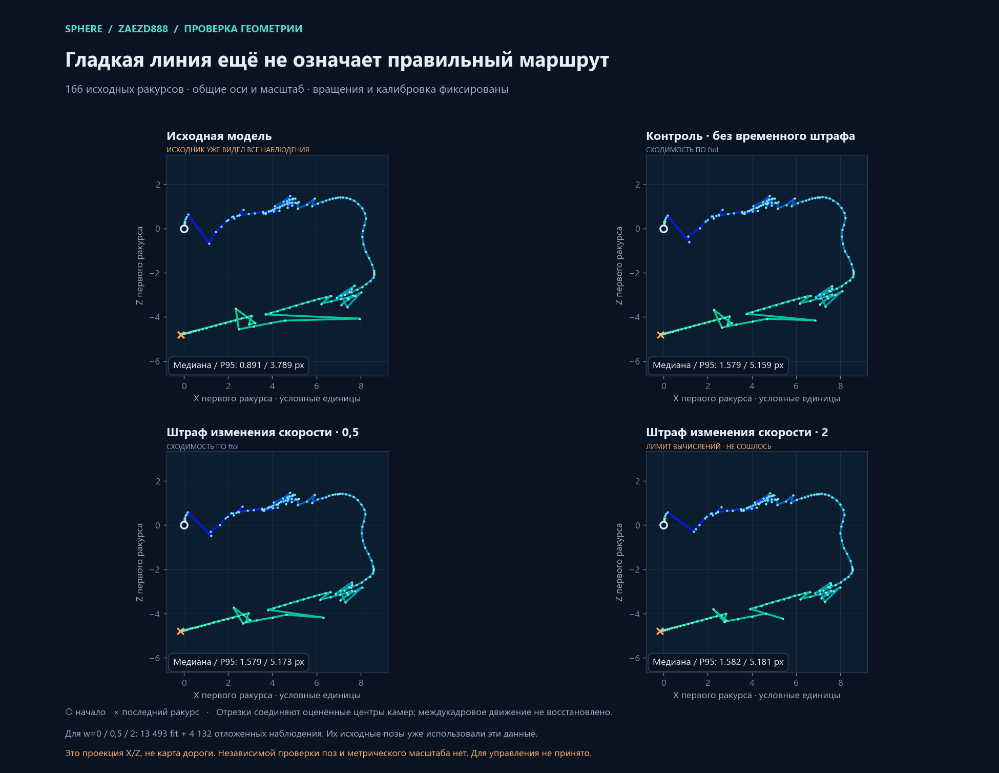

# Эксперименты с траекторией `zaezd888` после модели из 166 ракурсов

**Достоверная траектория пока не получена.** Все результаты ниже относятся к одной записи; дополнительные кадры и точки не являются независимым доказательством правильности поз. Опубликованная схема `hud-gap-166-diagnostic` предназначена для просмотра, но не принята для управления. У SIFT-модели зарегистрированы 166 камер и 15 247 исходных 3D-точек; экспорт содержит 15 164 точки. У отдельной DISK-модели те же 166 камер и 4 475 3D-точек. Это разные результаты с разными входными признаками и разрешениями, а не разные подсчёты одной модели.

Историческая база и ранние результаты, включая недостаточную согласованность прямого и обратного переноса CalfVO, описаны в [SCOOTER-HUD-FUSION.md](SCOOTER-HUD-FUSION.md). Поставка диагностического просмотра описана [отдельно](ROUTE-REVIEW-DELIVERY.md). Ни один из описанных здесь опытов не устанавливает масштаб в метрах, расположение дороги или связь оптической оси камеры с направлением скутера.

## Больше исходных кадров: 166 → 172

Планировщик по двум скоростным флагам добавил шесть **реальных** кадров: 690–692 и 695, 697, 699. Полная модель зарегистрировала 172/172 камеры и 17 397 точек; global positioning завершился `NO_CONVERGENCE`. На общих 163 исходных ракурсах эвристические флаги разворота/скоростного выброса изменились с 25/2 до 24/6: прежние два локальных выброса исчезли, но шесть возникли позже, на 30,517–31,631 с. Это флаги модели, а не число реальных поворотов.

На одних и тех же 125 HUD-интервалах отношение p90/p10 ухудшилось с 7,25 до 14,96; медианная абсолютная логарифмическая ошибка последней части — с 0,603 до 0,761; отклонений более чем в четыре раза стало 13 вместо 5 из 60. Масштаб подгонялся только по первым 65 интервалам и проверялся на последних 60, однако обе части взяты из той же записи, HUD и связь камеры с транспортом не подтверждены как метрическая истина. 172-камерная модель не принята. [Описание](scooter-trajectory-evidence/172-readme.md), [сопоставление](scooter-trajectory-evidence/172-comparison.json), [общие ракурсы](scooter-trajectory-evidence/172-common163.json).

## Совместная оптимизация центров и точек

На фиксированном подмножестве 2 000 точек использованы 13 493 обучающих и 4 132 отложенных 2D-наблюдения. Центры 166 камер и точки оптимизировались совместно, но **вращения и внутренние параметры оставались фиксированными**. Сравнивались варианты без временного штрафа и со штрафом на изменение скорости весов 0,5 и 2; направление вперёд и HUD в целевую функцию не вводились. Исходная модель ранее видела все наблюдения, поэтому честный контроль для вариантов — `w=0` на том же разделении, а не исходная модель.

| Вариант | Отложенная 2D-ошибка, медиана / p95, px | Флаги общих 163 ракурсов: разворот / скорость | Состояние |
|---|---:|---:|---|
| `w=0` | 1,579 / 5,159 | 24 / 2 | остановка по `ftol` |
| `w=0,5` | 1,579 / 5,173 | 24 / 2 | остановка по `ftol` |
| `w=2` | 1,582 / 5,181 | 21 / 0 | лимит вычислений, сходимость не достигнута |

Изменения ошибок малы и статистическая значимость не оценивалась. При `w=2` путь выглядит глаже, но отложенная репроекция относительно `w=0` ухудшилась, а оптимизация не сошлась. Предварительное правило отклонять ухудшившие held-out варианты не позволяет принять ни один штраф. Исходные позы были построены с использованием наблюдений, позднее названных held-out; независимой записи или истинных поз здесь нет. [Метод и ограничения](scooter-trajectory-evidence/joint-ba-readme.md), [числа и хеши](scooter-trajectory-evidence/joint-ba-review.json).

На рисунке соединены оценённые центры в осях первой камеры; белый круг и оранжевый крест обозначают первый и последний ракурс. Исходная панель не является независимым контролем: исходная модель уже использовала все наблюдения. Рисунок не устанавливает движение между кадрами.

## Непрерывная модель и фрагменты

Spline-опыты использовали то же разделение наблюдений и фиксированные вращения/внутренние параметры. При шаге узлов 0,5 с отложенная медиана/p95 составила 2,656/39,009 px, при 1,0 с — 3,357/45,310 px против 1,579/5,159 px для `w=0`. Оба варианта остановились на пределе 500 вычислений без сходимости; визуальная гладкость не компенсирует ухудшение и не подтверждает истинный путь. [Результаты](scooter-trajectory-evidence/spline-comparison.json).

Инкрементальная реконструкция дала три перекрывающиеся компоненты на 16, 65 и 105 камер, а не одну полную карту. У двух перекрывающихся компонент оценённые фокусные расстояния приблизительно 381 и 596 px; физическая калибровка не подтверждена. Проверка совмещения оценила вращение по первым десяти общим камерам и проверила последующие десять: медианное расхождение ориентаций выросло с 0,61° до 11,85°, p95 отложенных — 33,09°. Медианная перекрёстная репроекция составляла 205 px на подгонке и 318 px на отложенных камерах. Это внутренний тест совмещения на той же записи, но он не поддерживает объединение компонент. [Компоненты](scooter-trajectory-evidence/incremental-report.json), [исправленная проверка ориентаций](scooter-trajectory-evidence/orientation-check.json).

## Другие признаки и наблюдаемость

DISK + LightGlue на анализируемом разрешении 640×360 зарегистрировал все 166 камер, но дал 4 475 точек, 39 эвристических разворотных и 10 скоростных флагов; маршрут отклонён. Поскольку метод признаков **и** разрешение отличаются от SIFT, это не однофакторный A/B-тест. На том же HUD-разделении медианная ошибка последней части — 0,702 и пять отклонений более чем в четыре раза из 60. [Квитанция DISK](scooter-trajectory-evidence/disk-summary.json).

Полная регистрация камер не означает достаточную наблюдаемость. В DISK-модели восемь кадров имели менее шести сохранённых наблюдений 3D-треков длиной не менее трёх ракурсов; в кадрах 54 и 550 осталось по одному такому наблюдению, хотя до построения глобальных треков было соответственно 747 и 723 различных keypoint с проверенными парными совпадениями. У SIFT на этих кадрах — 514 и 128 наблюдений по тому же определению. Потери находятся между парными совпадениями и сохранённой глобальной поддержкой, но их единственная причина не установлена; pairwise inlier сам по себе не гарантирует согласованного 3D-трека или параллакса. [Наблюдаемость](scooter-trajectory-evidence/observability-summary.json), [разбор потерь](scooter-trajectory-evidence/attrition.json).

Независимая от поз SfM проба линий и точек схода на 12 исходных кадрах не подтвердила фокус. Предполагались pinhole, квадратные пиксели и главный пункт в центре; ортогональность семейств не доказана, некоторые точки схода плохо обусловлены и находятся далеко за изображением. Условные оценки одной пары направлений нельзя считать измерением фокуса или доказательством изменения FOV. [VP-отчёт](scooter-trajectory-evidence/vp-report.json).

## Гибридный GP: ориентации CalfVO и классические треки

В первом опыте 166 вращений взяты из полного прохода CalfVO по 901 кадру; его переносы не использовались. Global positioning получил 15 001 существующий SIFT-трек с тремя или более наблюдениями и случайную инициализацию центров и точек. Native solver сошёлся, но на тех же наблюдениях p95 ошибки вырос с 3,71 до 16,17 px; 391 наблюдение оказалось за камерой. Последующая BA с фиксированными вращениями не сошлась за 30 итераций и изменила состав наблюдений, поэтому её нельзя выдавать за улучшение по неизменной выборке. [Оценка](scooter-trajectory-evidence/calf-R-gp-summary.json), [квитанция ресурсов](scooter-trajectory-evidence/calf-R-gp-receipt.json).

Чтобы проверить зависимость от ранее отфильтрованных SfM-треков, выполнен отдельный официальный этап COLMAP: rotation averaging и построение свежих треков без GP, BA и retriangulation. Получены 23 349 контейнеров треков и 140 270 наблюдений; это **ещё не 3D-точки**. Затем в эти контейнеры внесены вращения CalfVO и выполнен новый GP с сохранённой калибровкой. Он также сошёлся, однако на 61 310 общих 2D-наблюдениях p95 вырос с 3,45 до 27,93 px. У всех новых наблюдений p95 — 45,34 px, два наблюдения за камерой. Ни один вариант не принят и не опубликован. Малое расхождение соседних вращений не обеспечивает согласованности полного маршрута. [Полный итог этапов](scooter-trajectory-evidence/fresh-track-outcome.json).

## Фиксированная калибровка при инкрементальном восстановлении

Отдельный опыт запретил изменение общего фокуса 604,1715 px, главного пункта и остальных внутренних параметров при регистрации и local/global BA. Получены две компоненты: 16 камер на 0–3,318 с и 150 камер на 3,535–35,493 с. Общих камер между ними нет; принудительного слияния не выполнялось. Большая компонента имеет среднюю ошибку 1,006 px, но 30 разворотных и 14 скоростных флагов на 147 общих ракурсах. В журнале также 86 сообщений о неудаче линейного решателя/разложения матрицы. Это не готовый маршрут; её 115 HUD-интервалов нельзя сравнивать напрямую с прежним разделением 125. [Отчёт](scooter-trajectory-evidence/fixed-calibration-assessment.json), [параметры](scooter-trajectory-evidence/fixed-calibration-options.txt).

## Что можно взять из готовых систем повторения маршрута

Исследования поддерживают выделение отдельного слоя локальных подцелей: VT&R3 использует локальные подкарты и не требует точной глобальной реконструкции для длинного повторения. Это архитектурная возможность, а не результат испытания Sphere. [Документация VT&R3](https://utiasasrl.github.io/).

В GuideNav (HRI 2026) демонстрация хранится как упорядоченные изображения, CosPlace выбирает место, а reloc3r оценивает относительную позу к подцели. По README весь стек, включая offline replay, требует ROS2 и Ubuntu; CUDA указан как зависимость. В проверенном исходнике `c94abf7ffcc1ab5eda54fec648117d6f2b41f431` накопление пяти кадров служит ожиданием: собранный context не передаётся в inference. Перенос reloc3r нормализуется до единичного вектора, а значит не является измеренной дистанцией или скоростью. Автоматическое завершение по последнему индексу и игнорирование score нельзя перенести в Sphere как доказательство достижения цели. Полезная гипотеза — отдельный temporal selector и локальная относительная цель с проверкой неоднозначности; готовое управление стиком этим не получено. GuideNav здесь не запускался, веса не загружались. [Официальный код](https://github.com/guidedogrobot-navigation/GuideNav), [разбор конкретных функций](scooter-trajectory-evidence/guidenav-gap-memo.md).

FFI-VTR (2025) описывает движение по графу опорных изображений и минимизацию feature flow без точной плотной карты. Его репозиторий опирается на VINS-Fusion и старый ROS; заменить им наш Windows/Android pipeline одной установкой нельзя. QUT teach-repeat — пример лёгкого визуального корректора, но использует одометрию; у игрового видео её эквивалент не подтверждён. Оба проекта полезны для проверки отдельных алгоритмов, а не как уже работающий для Sphere автопилот. [FFI-VTR](https://arxiv.org/abs/2507.12800), [его зависимости](https://github.com/wangjks/FFI-VTR), [QUT](https://open.qcr.ai/code/teach_repeat/).

## Полный временной фильтр и локальное соединение

Для проверки 807 существующих связей признаки LightGlue сопоставлены с LK-потоком по всем 901 реальным исходным кадрам. Проверялись переходы вперёд и назад на каждом шаге с пределом 1,5 px, оба конца с пределом 3 px и полный цикл с пределом 1,5 px. Это согласованность алгоритмов на одной записи, не независимая истина: повторяющиеся фасады могут обмануть оба метода.

Первый процесс достиг ограничения 240,532 с, сохранив 787 завершённых связей. Остальные 20 были **неизвестными**, а не пустыми или успешно проверенными. Отдельное разрешённое возобновление только недостающих связей заняло 28,796 с; вместе этапы заняли 269,328 с, то есть весь результат не укладывался в один лимит 240 с. В завершённом графе 651 связь непустая и 156 измеренно пустые; неизвестных связей не осталось. Граф разделился на компоненты 94 и 71 камеры и изолированный кадр 500. Две компоненты исследованы отдельно; это не восстановление полного маршрута. Хеши исходных данных в квитанциях не изменились. [Итог](scooter-trajectory-evidence/temporal-flow-report.json), [частичная квитанция](scooter-trajectory-evidence/temporal-flow-partial-manifest.json), [первый процесс](scooter-trajectory-evidence/temporal-flow-receipt.json), [возобновление](scooter-trajectory-evidence/temporal-flow-resume-receipt.json), [границы компонент](scooter-trajectory-evidence/temporal-flow-handoff.json), [оценка](scooter-trajectory-evidence/temporal-flow-mapping-assessment.json).

В локальной попытке добавить опорные ракурсы использованы реальные кадры 501, 502 и 503. Они уже участвовали как промежуточные изображения потока; теперь для них впервые извлечены SIFT-признаки и оценивались позы. Из 24 новых пар временной фильтр сохранил 12 с 654 соответствиями. Все прежние 807 записей связей и строки признаков 166 старых кадров сохранены побайтово, включая 156 пустых результатов. Изолированный кадр 500 присоединился к поздней компоненте, но ранняя и поздняя компоненты размером 94 и 75 камер **не соединились** и имеют независимые системы координат. [План](scooter-trajectory-evidence/temporal-frontier-plan.json), [итог попытки](scooter-trajectory-evidence/temporal-bridge-outcome.json).

Обе глобальные оптимизации остановились с `NO_CONVERGENCE`. У ранней компоненты один эвристический флаг разворота и четыре скоростных, у поздней — ноль и один соответственно. HUD доступен лишь частично: 72 интервала с разделением 65/7 и 52 интервала с разделением 0/52; это не полный сопоставимый тест 125 интервалов, а для второй компоненты масштаб по обучающей части не определён. Сохранены 816 и 9 731 повторных наблюдений трека из одного изображения; это не точные дубликаты одного и того же 2D-признака. Ни одна компонента не получила автоматический допуск, а низкая ошибка на использованных наблюдениях не доказывает позы или сшивку дороги.

## DISK: сравнение разрешений

Проведено сравнение одной пары DISK + LightGlue: те же 166 исходных кадров, маска, 811 пар, закреплённые веса и лимит 1 024 признака на кадр. Анализируемое разрешение изменено с 640×360 до 1 024×576; GPU-лимит также отличался, поэтому время и память относятся к конкретным запускам. Исходные файлы не изменены.

| Показатель | 640×360 | 1 024×576 |
|---|---:|---:|
| 2D keypoint-наблюдения | 133 999 | 168 802 |
| 3D-точки модели | 4 475 | 6 612 |
| Поддержка камеры: минимум / медиана | 1 / 111 | 14 / 198 |
| Кадры с поддержкой <6 / <15 | 8 / 15 | 0 / 1 |
| Эвристические разворотные / скоростные флаги | 39 / 10 | 39 / 17 |
| HUD: медианная абсолютная log-ошибка / отклонений >4× | 0,702 / 5 из 60 | 1,067 / 14 из 60 |
| GPU-фаза: время / пик резервирования | 63,6 с / 2,31 GiB | 80,3 с / 5,71 GiB |

Поддержка здесь — in-sample наблюдения взаимно связанных треков с положительной глубиной и ошибкой ≤4 px, а не независимая проверка поз или «надёжные 3D-точки». На тех же 125 HUD-интервалах масштаб подогнан по первым 65 и проверен на последних 60; HUD остаётся зависимым от той же записи и не является подтверждённой метрической истиной. При большей поддержке скоростных флагов стало больше, а HUD-согласованность ухудшилась. Оба маршрута отклонены; новая модель не опубликована. [Компактное сравнение](scooter-trajectory-evidence/disk-resolution-comparison.json), [CPU-квитанция](scooter-trajectory-evidence/disk-v4-cpu-receipt.json), [веса и хеши](scooter-trajectory-evidence/disk-v4-weights-receipt.json). Квитанция GPU-фазы отдельно фиксирует её завершение до CPU-проверки; итог сравнения включает и последующую CPU-проверку.

## Автоматическая диагностика поддержки камеры

В отчёты обычной и learned-реконструкции добавлена диагностика фактических наблюдений каждой зарегистрированной камеры. Учитываются только взаимно связанные наблюдения точек с треками минимум в трёх **разных** зарегистрированных ракурсах; точка учитывается не более одного раза в кадре. Для поддержки дополнительно требуются положительная глубина, наблюдение внутри кадра и конечная ошибка репроекции не более 4 px. Сводка содержит min/median/p10, число кадров ниже 6 и 15 наблюдений и до 12 самых слабых кадров. Это диагностические числа, не новые пороги допуска и не изменение ранжирования моделей. Неполная или противоречивая структура возвращает `invalid`, а не фиктивную здоровую сводку.

Разница с прежним исследовательским счётчиком важна: на SIFT-кадре 26 тот насчитал 1 301 **элемент трека**, включая 152 повтора точки в том же кадре. Оставались 1 149 различных точек, из которых одна не имела трёх разных ракурсов; новый raw-счётчик даёт 1 148. Число прошедших репроекцию ≤4 px — отдельная, более строгая величина. [Сверка на тех же файлах модели](scooter-trajectory-evidence/productdiagnostics-comparison.json).

Для защищённого `quality.json` полный массив сокращён до сводки и 12 кадров; тест охватывает 240 ракурсов и существующий предел 64 КиБ. Оценка повторно используется только до изменения модели; recovery, дополнение и temporal repair вызывают новую оценку. Во время обхода проверяются отмена и свежие native-счётчики памяти и свободного места; состояние тома обновляется полным сбором не реже чем через три секунды между вызовами. Профили и пределы не ослаблены. В локальном smoke фактический production callback обработал SIFT166 за 3,09 с с одним полным сбором и 1 022 чтениями памяти; время зависит от хоста и не является нормативом. [Квитанция](scooter-trajectory-evidence/productdiagnostics-receipt-v4.json), [smoke](scooter-trajectory-evidence/production-check-smoke.json).

Общий backend-прогон: 9 наборов, 120 passed, 1 skipped и 9 subtests, 6,43 с; пропущена проверка недоступного создания symlink, сырой лог отдельно не сохранён. [Квитанция наблюдения](scooter-trajectory-evidence/root-combined-tests-observed.json). Код отправлен в коммите `62015c49`; импорт новым процессом установленного worker-интерпретатора проверен. Новый worker читает эти исходники при следующем запуске; это не подтверждение пользовательской приёмки или нового допуска маршрута.

## Ограниченная проверка ночного неба

На шести кадрах той же SIFT166-реконструкции вручную размечены консервативные внутренние участки предполагаемого неба, а не всё небо. Из 1 943 уже **оставленных в базе после маски** keypoint в этих участках четыре имели взаимно связанные наблюдения в итоговой 3D-модели. Это не 4 из всех звёзд и не результат по исходным немаскированным детекциям. Исходный SIFT имел верхнюю цель 8 192 детекции, затем до 4 096 признаков после маски; это не DISK-профиль с лимитом 1 024. Результат относится к выбранным частичным полигонам и одной записи, не доказывает отсутствие влияния неба в остальных областях. [Аудит](scooter-trajectory-evidence/sky-report.json), [происхождение признаков](scooter-trajectory-evidence/sky-provenance.json).

## Воспроизводимость и границы архива

[Индекс](scooter-trajectory-evidence/index.json) содержит SHA-256 копий и локальных исходников; для сокращённой сводки наблюдаемости указан преобразованный источник. Архивированы небольшие квитанции и основные использованные runner-скрипты. Их пути и зависимости привязаны к экспериментальному локальному окружению: pycolmap/COLMAP, OpenCV, SciPy, PyTorch/LightGlue, подготовленные кадры, базы, маски и контрольные веса не включены. Копии кода не являются самодостаточным пакетом воспроизведения; отсутствующие DB, видео и модели намеренно не включены. Для фактического повтора нужны исходные данные, соответствующие версиям и хешам квитанций, проверка ресурсов и отдельное разрешённое выполнение.
