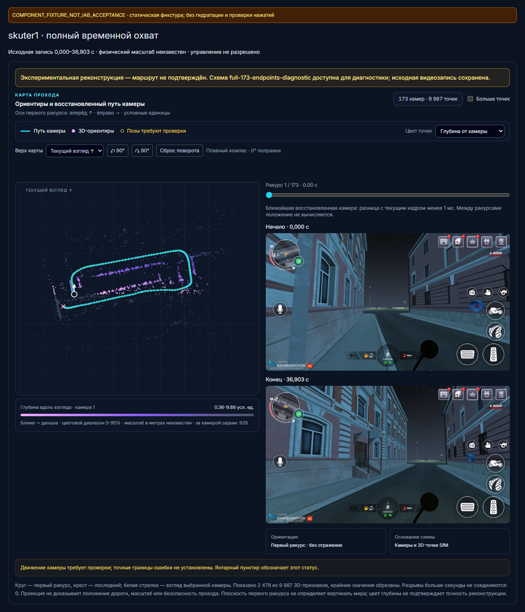
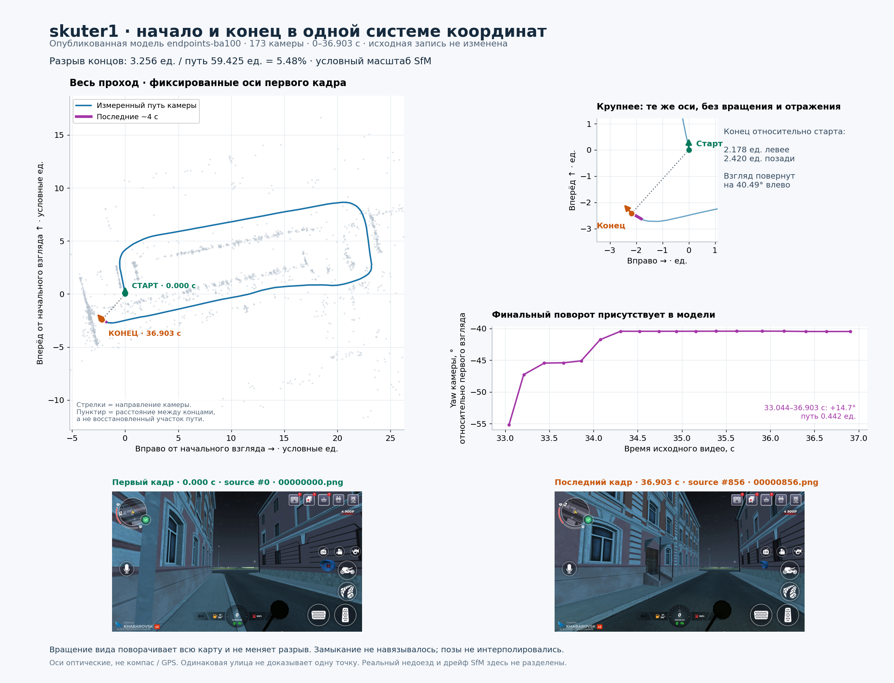
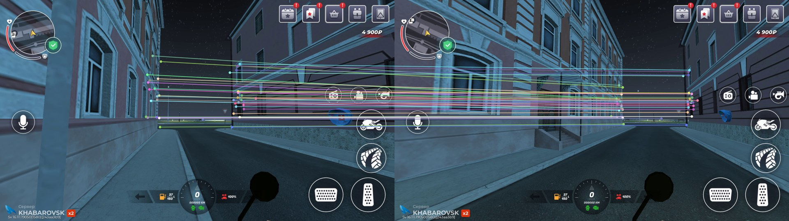

# `skuter1`: часы журнала и повторная обработка

**Полный временной охват пока не подтверждает точность формы и замыкание маршрута:** проверка LightGlue выявила существенное расхождение между относительной геометрией существующей схемы и частью сопоставлений начала и конца. Ни принудительное замыкание, ни калибровка по оценке 5 м не выполнены.

Отчёт фиксирует исправление импорта исходной записи `skuter1` и экспериментальную повторную обработку. Это не свидетельство готовности маршрута к автономному управлению; оценка геометрии здесь добавляется только после завершения задачи.

## Исходный отказ

Задание `6a77040681d142ec97d51831a22785fb` отклонило исходный журнал с `browser_teach_input_order`. В записи 857 кадров и три события: первый idle heartbeat был на 5,4 мс до `started_at_ms`, его receipt — на 0,9 мс до, а `closed` — на 11,2 мс после. События идут по возрастанию, закрытие подтверждено; действия внешнего управления не записывались (`external_unobserved`). Валидатор раньше начинал проверку порядка с времени создания записи worker. Страница и worker используют `performance.timeOrigin + performance.now()`; worker задаёт начало после асинхронной подготовки OPFS. Данные показывают расхождение границы, но не позволяют отдельно измерить задержку сообщений и смещение часов контекстов. См. [диагностику и SHA исходных файлов](skuter1-input-clock-evidence/diagnosis.json).

Импортёр ограниченно допускает только устаревшие v2 `external_unobserved` idle/release события в пределах 100 мс до начала. Проверки упорядоченности, соответствия receipt, native uptime, касаний и освобождения остаются. Для нового маркера часов события сохраняют фактическое время получения worker как `at_ms` и исходное время страницы как `source_at_ms`; прежний preroll для них не действует. Исходный журнал и видео не переписываются. [Снимок импортёра](skuter1-input-clock-evidence/sources/browser_teach.py), [тесты](skuter1-input-clock-evidence/sources/test_motor_browser_teach.py), [worker](skuter1-input-clock-evidence/sources/teaching-recorder.worker.js).

Тестовый запуск импортёра: 53 passed, 19 subtests, 3,77 с; тесты используют настоящий кодек. [Лог](skuter1-input-clock-evidence/importer-tests.txt). Отдельная проверка worker: 47 тестов и TypeScript без ошибки; этот ранний [receipt](skuter1-input-clock-evidence/recorder-clock-fix.json) описывает состояние до установки, а не её результат.

API был перезагружен только после проверки заданий и live-состояния: PID 50304 → 6696, новый `browser_teach_input_clock_contract=idle_preroll100_worker_receipt_v1`, отсутствие capability даёт 403. Защищённые файлы и запущенный UI не изменились при перезагрузке. [Квитанция](skuter1-input-clock-evidence/api-reload.json).

## Повторная обработка

Первоначальный отказ сохранён; повтор инициирован для того же исходника и задания, без изменения `START`, control и входных файлов. Индекс изображений — диагностический, совпадение по времени в той же записи не является независимой проверкой положения. Исходное видео содержит около 23,196 кадров/с при заявленной цели 30, около 8,36 Мбит/с; синтетические кадры не добавлялись. Построенный image-review содержит 149 опорных кадров и 708 запросов; для 421 выбран опорный кадр, из них 379 находятся в пределах 0,6 с по proxy времени и один отличается более чем на 2 с. Остальные оставлены без выбранной ссылки. Эта проверка выполнена на том же видео и не измеряет точность положения. [Review](skuter1-input-clock-evidence/image-review.json), [receipt](skuter1-input-clock-evidence/image-review-receipt.json).

Повтор занял 449,531 с и остановился с `resource_guard` во время fallback; подготовка навигации не завершена, исходные файлы и прежние START/control/log сохранили SHA. [Квитанция повтора](skuter1-input-clock-evidence/retry-result.json). Первая промежуточная модель имеет 144 из 173 выбранных камер, но не охватывает первые 5,678 с и не допущена как маршрут; это не окончательная успешная геометрия. [Промежуточное качество](skuter1-input-clock-evidence/partial-first-model-quality.json). После остановки PyAV реально декодировал все 857 кадров 1920×1080 за 2,828 с; отдельная проверка каждого AU подтвердила хэши и NAL. [Декодирование](skuter1-input-clock-evidence/source-decode.json), [проверка AU](skuter1-input-clock-evidence/source-validation.json).

## Поставка worker в веб

Кандидат образа содержит только слой с обновлённым публичным worker; новый Next build не выполнялся и весь текущий frontend не пересобирался. Первый probe завершился ошибкой инструмента, повторный подтвердил отдачу проверенных страниц и assets. Установка завершилась `ui_application_config_changed`, откат прежнего образа подтверждён; на основании этой попытки нельзя утверждать, что новый worker установлен. [Первый probe](skuter1-input-clock-evidence/frontend-probe-first-failed.json), [повторный probe](skuter1-input-clock-evidence/frontend-probe-v2.json), [попытка установки](skuter1-input-clock-evidence/frontend-install-first-failed.json). Реального пользовательского IAB-теста не было.

Повторная попытка установки также остановлена проверкой конфигурации и откатилась; среди отличий контейнера обнаружен `Env`, поэтому отличия нельзя считать только метаданными. [Вторая попытка](skuter1-input-clock-evidence/install-receipt-v2.json), [сопоставление полей](skuter1-input-clock-evidence/container-config-delta-v2.json).

Последующее сравнение установило, что 12 уникальных ключей и значения `Env` совпадают, изменился только порядок. Третья попытка после нормализации подтвердила установку образа `sha256:61bdd78299702ee2b812a53ebc9556cd7eac44cec0e03093efacd891da436cf2`, healthy UI и неизменность остальных проверенных assets; API и исходник также не изменились. Это слой с одним public asset поверх прежнего сборочного образа, без нового Next build и без IAB-приёмки. [Подтверждение порядка окружения](skuter1-input-clock-evidence/environment-order-proof-v2.json), [финальная квитанция установки](skuter1-input-clock-evidence/install-receipt-v3.json).

## Последующее восстановление компонентов

После остановленного повтора выполнен отдельный эксперимент по объединению и локальной оптимизации: опубликован для просмотра только диагностический вариант `components-169-diagnostic` (169 реальных камер, 9987 точек), 0,441–36,404 с. Точные первый и последний кадры не восстановлены. Медианная ошибка перепроекции уменьшилась с 1,68 до 0,79 px на тех же наблюдениях, но оптимизация достигла предела итераций без полной сходимости и заметно изменила траекторию. Отношение расстояния концов к длине составляло 0,162 / 0,109 / 0,065 для исходной / объединённой / оптимизированной модели; это безразмерные оценки модели, не доказательство указанной пользователем близости концов около 5 м. Исходник, основной результат и состояние задачи сохранены; вариант не квалифицирован для управления. [Результат оптимизации](skuter1-input-clock-evidence/component-ba-result.json), [сравнение](skuter1-input-clock-evidence/component-ba-pose-compare.json), [квитанция публикации](skuter1-input-clock-evidence/component-publication-receipt.json).

В последующем исследовании fixed-K оптимизация 169 камер достигла сходимости. Для четырёх отсутствовавших кадров 0, 6, 850 и 856 использованы реальные соответствия LK с проверкой прямого и обратного хода и PnP; 70% идентификаторов точек служили для оценки позы, остальные 30% — для проверки до присоединения наблюдений. Для кадра 0 на 160 отложенных точках медиана/p95 составили 0,243/0,771 px, для кадра 856 на 132 — 0,419/1,122 px. Эти данные получены на той же записи и не являются независимой истинной траекторией. Исследовательская модель имеет 173 камеры и 9987 точек, охватывает точные крайние кадры 0–36,903 с; 74404 наблюдения, медиана/p95 ошибки 0,771/2,564 px. Старые позы, точки и наблюдения 169 камер не менялись; новые наблюдения имеют отдельное пространство идентификаторов. Этот ручной bounded-эксперимент не доказывает автоматическую готовность для других видео и не допускает управление. [Проверка удержанных точек](skuter1-input-clock-evidence/endpoint-probe.json), [происхождение кадров](skuter1-input-clock-evidence/endpoint-provenance.json), [присоединение](skuter1-input-clock-evidence/endpoint-attachment.json), [оценка 100 итераций](skuter1-input-clock-evidence/ba100-assessment.json).

В каталоге выбран новый предпочтительный для просмотра вариант `full-173-endpoints-diagnostic`; предыдущий 169-камерный вариант сохранён. Это источник-ориентированная публикация для диагностики с `executionQualified: false`, а не замена основной модели или подтверждение маршрута. [Квитанция публикации](skuter1-input-clock-evidence/full173-publication-receipt.json).

Изображение — статическая SSR-фикстура с исходными крайними кадрами и опубликованной геометрией, без гидратации и проверки кликов; это не снимок пользовательского IAB и не приёмка интерфейса. [Квитанция фикстуры](skuter1-input-clock-evidence/full173-fixture-receipt.json).

Отдельный изолированный offline trial общих helper-функций на сохранённых компонентах этого же `skuter1` дал 169 камер после merge и 173/173 после восстановления четырёх кадров, 10552 точки и охват 0–36,903 с. Для 80602 наблюдений средняя ошибка 1,277 px, p95 3,142 px; нарушений взаимности, дублей и неположительной глубины не обнаружено. Повторного SfM, BA, публикации и команд устройству в этом trial не было; источник и защищённые файлы не изменились. Это проверка на одном исходнике, не независимая проверка маршрута и не гарантия для последующих записей. [Квитанция trial](skuter1-input-clock-evidence/automatic-trial-outcome.json).

## Общий конвейер и незакрытый вопрос петли

В исходный pipeline подключены ограниченное объединение компонентов и проверяемое восстановление крайних кадров; receipt первого запуска включает оба helper и модули image-index. Зафиксированный [регрессионный запуск](skuter1-input-clock-evidence/final-regression.txt): 266 passed, 1 skipped, 53 subtests. Предыдущий вызов тестов завершился ошибкой из-за пропущенного пути к pycolmap и некорректной mock-fixture; после исправления окружения и fixture выполнен указанный итоговый прогон. Изолированный trial выше использовал точно те версии helper, чьи SHA сохранены в его исходном receipt; он не является полным новым SfM-запуском или доказательством качества на другом материале. Исходные снимки конвейера и тестов находятся в [индексе](skuter1-input-clock-evidence/index.json).

Пользователь указал, что начало и конец близки примерно на 5 м. Это полезная подсказка, но масштаб видео не подтверждён. Проверки сопоставлений начала и конца пока не установили надёжную связь: например, для кадров 0→856 RootSIFT дал 32 ratio-соответствия и 14 fundamental inliers, но ни одного надёжного сопоставления с 3D-точками; прямой LK не сохранил отслеженных точек. Дополнительные SIFT-проверки координат и ориентаций также не дали пригодных пар для PnP. Это ограничение конкретных проверенных методов, не доказательство отсутствия петли. Позиции не стягивались принудительно, оценка 5 м не использовалась как калибровка. [RootSIFT](skuter1-input-clock-evidence/skuter1-loop-evidence-20261101-report.json), [LK](skuter1-input-clock-evidence/skuter1-loop-evidence-20261101-direct-lk.json), [проверка tracked SIFT](skuter1-input-clock-evidence/skuter1-loop-landmark-sift-20261101-report.json), [ориентации](skuter1-input-clock-evidence/skuter1-loop-landmark-oriented-20261101-report.json).

Дополнительный LightGlue обнаружил более сильные 2D-соответствия: 64 совпадения и 38 essential inliers для 0→856. Однако при разделении 48/16 по совпадениям существующая геометрия на удержанных точках имеет медианный Sampson residual 20,31 px, а fitted essential — 3,39 px; расхождение рассчитанных относительных вращений составляет 21,04°. Для 0→844 оно 3,89°, но и здесь остатки существующей модели на удержанных точках высоки. Fitted essential также содержит выбросы, калибровка не подтверждена и эти результаты не являются истинной позой. Значит полный временной охват 173 кадрами не доказывает точность формы или замыкание петли; надёжной коррекции и метрического расстояния всё ещё нет. Оставшаяся CPU-проверка остановлена по тайм-ауту, не считается успехом. [LightGlue](skuter1-input-clock-evidence/skuter1-lightglue-loop-20261101-worker-result.json), [0→856](skuter1-input-clock-evidence/skuter1-lightglue-cheirality-20261101-relative-pose-audit.json), [0→844](skuter1-input-clock-evidence/skuter1-lightglue-rest-20261101-relative-pose-audit-0-844.json), [тайм-аут](skuter1-input-clock-evidence/skuter1-lightglue-rest-20261101-receipt.json).

Исходный код поставлен коммитом `f52c3028`. Новые helper и их тесты прошли Ruff; для изменённых старых файлов сравнение не выявило роста числа замечаний по правилам, что не является утверждением о чистоте всего проекта. Mypy на Python 3.13 завершился сбоем сериализации; полная проверка типов не подтверждена. [Lint delta](skuter1-input-clock-evidence/lint-delta.json).

На этой схеме изображены оценки опубликованной модели, а не измерения GPS: разрыв 3,256 единицы и путь 59,425 единицы имеют неизвестный масштаб. Пунктир показывает расстояние концов, не добавленный участок маршрута. Вращение карты не меняет этого разрыва. [Метрики схемы](skuter1-input-clock-evidence/fixed-endpoints-metrics.json).

Линии показывают найденные 2D-сопоставления; часть может быть ошибочной, а независимого подтверждения позы нет.

Финальная проверка доставки подтвердила healthy API, отсутствие live-сессии, предпочтительную диагностическую схему `full-173-endpoints-diagnostic` и совпадение HTTP-байтов worker с исходным SHA `4a327116…e3975769`; защищённые файлы не изменились. [Квитанция](skuter1-input-clock-evidence/final-delivery-verification.json).

Дополнительная проверка координат подтвердила преобразование полупиксельных координат между 1920×1080 и 960×540; критическая ошибка масштаба координат не обнаружена, но физическая калибровка не подтверждена. [Аудит](skuter1-input-clock-evidence/coordinate-audit.json). Сопоставление миникарты прошло контроль на близких кадрах, но пары начала и конца не прошли удержанную проверку; это не подтверждает и не опровергает замыкание. [Квитанция](skuter1-input-clock-evidence/minimap-closure-report.json).
